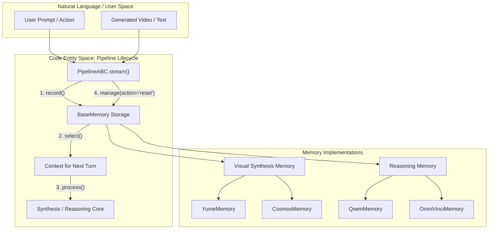
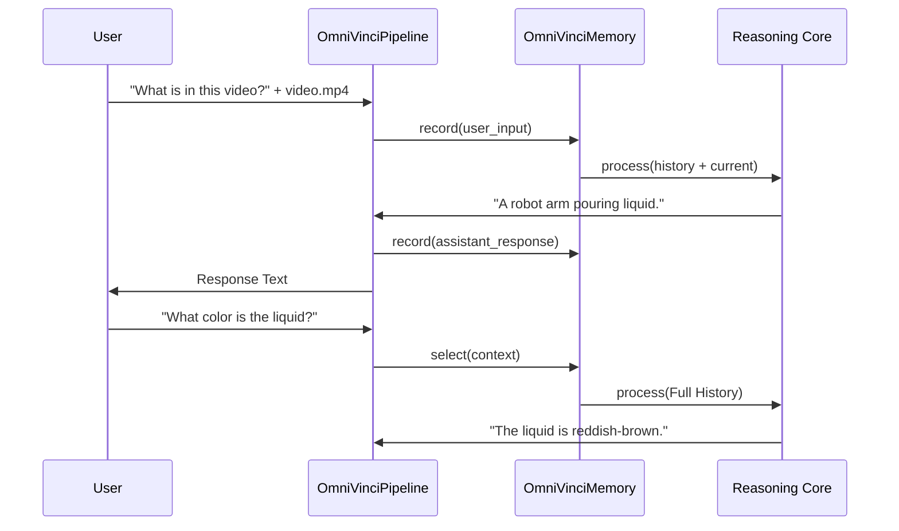

<!-- source: DeepWiki mcp.deepwiki.com · repo OpenDCAI/OpenWorldLib · page 2.3 Memory Module: Stateful Multi-Turn Interaction · fetched 2026-11-02 -->

# Memory Module: Stateful Multi-Turn Interaction

<details>
<summary>Relevant source files</summary>

The following files were used as context for generating this wiki page:

- [examples/pipeline_infer_mapping.py](examples/pipeline_infer_mapping.py)
- [examples/pipeline_load_mapping.py](examples/pipeline_load_mapping.py)
- [scripts/test_inference/test_mm_reasoning.sh](scripts/test_inference/test_mm_reasoning.sh)
- [src/openworldlib/base_models/diffusion_model/video/wan_2p1/utils/fm_solvers_unipc.py](src/openworldlib/base_models/diffusion_model/video/wan_2p1/utils/fm_solvers_unipc.py)
- [src/openworldlib/memories/reasoning/qwen/qwen_memory.py](src/openworldlib/memories/reasoning/qwen/qwen_memory.py)
- [src/openworldlib/memories/visual_synthesis/yume/yume_1p5_memory.py](src/openworldlib/memories/visual_synthesis/yume/yume_1p5_memory.py)
- [src/openworldlib/memories/visual_synthesis/yume/yume_memory.py](src/openworldlib/memories/visual_synthesis/yume/yume_memory.py)
- [src/openworldlib/operators/omnivinci_operator.py](src/openworldlib/operators/omnivinci_operator.py)
- [src/openworldlib/operators/qwen2p5_omni_operator.py](src/openworldlib/operators/qwen2p5_omni_operator.py)
- [src/openworldlib/operators/yume_1p5_operator.py](src/openworldlib/operators/yume_1p5_operator.py)
- [src/openworldlib/operators/yume_operator.py](src/openworldlib/operators/yume_operator.py)
- [src/openworldlib/pipelines/omnivinci/pipeline_omnivinci.py](src/openworldlib/pipelines/omnivinci/pipeline_omnivinci.py)
- [src/openworldlib/pipelines/qwen/pipeline_qwen2p5_omni.py](src/openworldlib/pipelines/qwen/pipeline_qwen2p5_omni.py)
- [src/openworldlib/pipelines/yume/pipeline_yume.py](src/openworldlib/pipelines/yume/pipeline_yume.py)
- [src/openworldlib/pipelines/yume/pipeline_yume_1p5.py](src/openworldlib/pipelines/yume/pipeline_yume_1p5.py)
- [src/openworldlib/synthesis/visual_generation/cosmos/cosmos_predict2p5_synthesis.py](src/openworldlib/synthesis/visual_generation/cosmos/cosmos_predict2p5_synthesis.py)
- [src/openworldlib/synthesis/visual_generation/yume/yume/__init__.py](src/openworldlib/synthesis/visual_generation/yume/yume/__init__.py)
- [src/openworldlib/synthesis/visual_generation/yume/yume/image2video.py](src/openworldlib/synthesis/visual_generation/yume/yume/image2video.py)
- [src/openworldlib/synthesis/visual_generation/yume/yume_1p5/__init__.py](src/openworldlib/synthesis/visual_generation/yume/yume_1p5/__init__.py)
- [src/openworldlib/synthesis/visual_generation/yume/yume_1p5/modules/model.py](src/openworldlib/synthesis/visual_generation/yume/yume_1p5/modules/model.py)
- [src/openworldlib/synthesis/visual_generation/yume/yume_1p5/textimage2video.py](src/openworldlib/synthesis/visual_generation/yume/yume_1p5/textimage2video.py)
- [src/openworldlib/synthesis/visual_generation/yume/yume_1p5/utils/utils.py](src/openworldlib/synthesis/visual_generation/yume/yume_1p5/utils/utils.py)
- [src/openworldlib/synthesis/visual_generation/yume/yume_1p5_synthesis.py](src/openworldlib/synthesis/visual_generation/yume/yume_1p5_synthesis.py)
- [src/openworldlib/synthesis/visual_generation/yume/yume_synthesis.py](src/openworldlib/synthesis/visual_generation/yume/yume_synthesis.py)
- [test/test_cosmos_predict2p5.py](test/test_cosmos_predict2p5.py)
- [test/test_depth_anything_v1.py](test/test_depth_anything_v1.py)
- [test/test_lingbot_world.py](test/test_lingbot_world.py)
- [test/test_yume.py](test/test_yume.py)
- [test/test_yume_1p5.py](test/test_yume_1p5.py)
- [test_stream/test_cosmos_predict2p5_stream.py](test_stream/test_cosmos_predict2p5_stream.py)
- [test_stream/test_lingbot_world_stream.py](test_stream/test_lingbot_world_stream.py)
- [test_stream/test_omnivinci_stream.py](test_stream/test_omnivinci_stream.py)
- [test_stream/test_qwen2p5_omni_stream.py](test_stream/test_qwen2p5_omni_stream.py)
- [test_stream/test_yume_1p5_stream.py](test_stream/test_yume_1p5_stream.py)
- [test_stream/test_yume_stream.py](test_stream/test_yume_stream.py)

</details>


The Memory module in OpenWorldLib provides the architectural foundation for stateful, multi-turn interactions across both visual synthesis and multimodal reasoning tasks. While standard pipelines often operate on a single-turn "input-to-output" basis, the `BaseMemory` abstraction allows pipelines to maintain temporal continuity, conversation history, and world-state consistency during streaming or interactive sessions.

## BaseMemory Lifecycle

Every memory implementation follows a standardized lifecycle defined by five core methods. This lifecycle ensures that the `PipelineABC.stream()` method can interact with different memory backends (e.g., video buffers vs. text KV-caches) through a unified interface.

### Lifecycle Methods
1.  **`record`**: Stores new data (frames, tokens, or interactions) into the memory storage.
2.  **`select`**: Retrieves specific elements from memory to serve as context for the next generation turn (e.g., the last frame of a generated video).
3.  **`compress`**: Optimizes memory usage by pruning or summarizing old states to stay within model context windows.
4.  **`process`**: Formats stored data into the specific tensor or dictionary format required by the `Synthesis` or `Reasoning` components.
5.  **`manage`**: Handles administrative tasks such as `reset` (clearing history) or `save`/`load` operations.

### Memory Data Flow in Code Entity Space

The following diagram illustrates how memory entities bridge the gap between user interactions and the generative core.

**Diagram: Memory Interaction and State Management**

**Sources:** `[src/openworldlib/pipelines/pipeline_utils.py:1-50]()`, `[test_stream/test_cosmos_predict2p5_stream.py:37-101]()`.

---

## Visual Synthesis Memory

Visual synthesis memory is primarily concerned with **temporal continuity**. For navigation models like LingBot or Yume, the memory must store the generated video segments so that the final frame of Turn $N$ can serve as the initial conditioning frame for Turn $N+1$.

### Concrete Implementations

| Implementation | Model Support | Key Features |
| :--- | :--- | :--- |
| `CosmosMemory` | Cosmos-Predict2.5 | Manages `all_frames` buffer; `select()` extracts the last PIL image for `img2world` conditioning [test_stream/test_cosmos_predict2p5_stream.py:88-113](). |
| `YumeMemory` | Yume, Yume 1.5 | Stores latent history and frame buffers to maintain camera trajectory consistency [src/openworldlib/synthesis/visual_generation/yume/yume_1p5_synthesis.py:129-160](). |
| `LingBotMemory` | LingBot-World | Supports DDP-aware frame concatenation for distributed streaming [test_stream/test_lingbot_world_stream.py:156-168](). |
| `WanMemory` | Wan 2.1 / 2.2 | Handles tensor-to-PIL conversion for frame persistence [examples/pipeline_infer_mapping.py:68-77](). |

### The `stream()` Workflow
In visual pipelines, the `stream()` method uses the memory module to loop through interactions.
1.  The user provides an interaction (e.g., "forward").
2.  The pipeline generates a video chunk.
3.  `memory.record(video_chunk)` appends the chunk to `all_frames`.
4.  `memory.select()` identifies the last frame.
5.  The next call to the synthesis engine uses this frame as the new `image_path` or `images` input.

**Sources:** `[test_stream/test_cosmos_predict2p5_stream.py:79-113]()`, `[test_stream/test_lingbot_world_stream.py:138-154]()`.

---

## Reasoning Memory

Reasoning memory focuses on **conversational state** and **multimodal context**. Unlike visual memory which stores pixel data, reasoning memory typically stores a sequence of messages (text, image references, and video pointers) to be fed into an MLLM (Multimodal Large Language Model).

### Qwen and OmniVinci Memory
For models like `Qwen2.5-Omni` and `OmniVinci`, the memory module maintains a list of turns.

*   **Storage Structure**: Usually a `List[Dict]` containing roles (`user`, `assistant`) and content.
*   **Manage Action**: The `manage(action="reset")` call is critical here to clear the conversation history without re-instantiating the model [test_stream/test_omnivinci_stream.py:49-53]().
*   **Context Injection**: In `OmniVinciMemory`, the `process()` method ensures that if a video was generated in a previous turn, it is correctly referenced as a visual input for the current reasoning turn [test_stream/test_omnivinci_stream.py:126-138]().

**Diagram: Reasoning Memory Context Flow**

**Sources:** `[test_stream/test_omnivinci_stream.py:18-53]()`, `[examples/pipeline_infer_mapping.py:81-93]()`.

---

## Implementation Details: Yume 1.5 Synthesis & Memory

The `Yume1p5Synthesis` class demonstrates a complex use of memory where "history latents" are used to ensure smooth transitions between video segments.

### Latent Continuity
In `predict_per_interaction`, the synthesis engine checks the `interaction_idx`. If it is greater than 0, it retrieves `history_latents` from the previous turn's memory to initialize the diffusion process [src/openworldlib/synthesis/visual_generation/yume/yume_1p5_synthesis.py:159-162](). This prevents the "flicker" effect common in naive video concatenation.

```python
# Snippet from Yume 1.5 Synthesis Logic
if interaction_idx == 0:
    # First turn: encode initial image to latents
    visual_latents = self.model.vae.encode(...)
    history_latents = visual_latents[:, :-current_latent_num]
else:
    # Subsequent turns: calculate frame offset from history
    history_current_frame_num = (history_latents.shape[1]-1)*4+1+32
```
**Sources:** `[src/openworldlib/synthesis/visual_generation/yume/yume_1p5_synthesis.py:129-160]()`.

## Summary of Key Classes

| Class | File Path | Role |
| :--- | :--- | :--- |
| `CosmosPredict2p5Synthesis` | `[src/openworldlib/synthesis/visual_generation/cosmos/cosmos_predict2p5_synthesis.py:33]()` | Generates video chunks using Flow Matching. |
| `Yume1p5Synthesis` | `[src/openworldlib/synthesis/visual_generation/yume/yume_1p5_synthesis.py:22]()` | Manages per-interaction video prediction with latent history. |
| `Qwen2p5OmniPipeline` | `[src/openworldlib/pipelines/qwen/pipeline_qwen2p5_omni.py:1]()` | Orchestrates multi-turn multimodal reasoning. |
| `FlowUniPCMultistepScheduler` | `[src/openworldlib/base_models/diffusion_model/video/wan_2p1/utils/fm_solvers_unipc.py:22]()` | Handles the noise schedule for flow-based synthesis. |

**Sources:** `[src/openworldlib/synthesis/visual_generation/cosmos/cosmos_predict2p5_synthesis.py:33-50]()`, `[src/openworldlib/synthesis/visual_generation/yume/yume_1p5_synthesis.py:22-45]()`.

---

