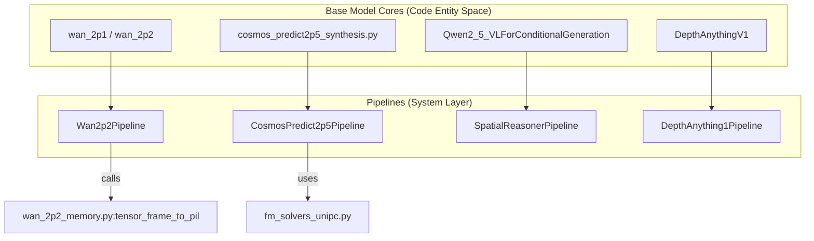
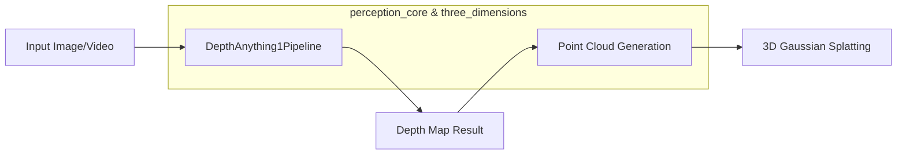

<!-- source: DeepWiki mcp.deepwiki.com · repo OpenDCAI/OpenWorldLib · page 2.4 Base Models: Diffusion, LLM/MLLM, and Perception Cores · fetched 2026-11-02 -->

# Base Models: Diffusion, LLM/MLLM, and Perception Cores

<details>
<summary>Relevant source files</summary>

The following files were used as context for generating this wiki page:

- [README.md](README.md)
- [README_zh.md](README_zh.md)
- [docs/awesome_world_model.md](docs/awesome_world_model.md)
- [docs/planning.md](docs/planning.md)
- [examples/pipeline_infer_mapping.py](examples/pipeline_infer_mapping.py)
- [examples/pipeline_load_mapping.py](examples/pipeline_load_mapping.py)
- [src/openworldlib/base_models/diffusion_model/video/wan_2p1/utils/fm_solvers_unipc.py](src/openworldlib/base_models/diffusion_model/video/wan_2p1/utils/fm_solvers_unipc.py)
- [src/openworldlib/pipelines/pipeline_utils.py](src/openworldlib/pipelines/pipeline_utils.py)
- [src/openworldlib/synthesis/visual_generation/cosmos/cosmos_predict2p5_synthesis.py](src/openworldlib/synthesis/visual_generation/cosmos/cosmos_predict2p5_synthesis.py)
- [test/test_cosmos_predict2p5.py](test/test_cosmos_predict2p5.py)
- [test/test_depth_anything_v1.py](test/test_depth_anything_v1.py)
- [test/test_lingbot_world.py](test/test_lingbot_world.py)
- [test_stream/test_cosmos_predict2p5_stream.py](test_stream/test_cosmos_predict2p5_stream.py)
- [test_stream/test_lingbot_world_stream.py](test_stream/test_lingbot_world_stream.py)

</details>


The `base_models` layer constitutes the foundational computational engine of OpenWorldLib. It provides the low-level model implementations for visual synthesis, multimodal reasoning, spatial perception, and 3D reconstruction. These cores are designed to be modular and are loaded by higher-level `Synthesis` and `Reasoning` classes to perform complex world-modeling tasks [README_zh.md:169-173]().

## Architecture Overview

The `base_models` directory is organized into four primary domains:
1.  **`diffusion_model`**: Video and image generation backends (e.g., Wan, HunyuanVideo, Cosmos).
2.  **`llm_mllm_core`**: Large Language Models and Multimodal Large Language Models for reasoning.
3.  **`perception_core`**: Modules for detection, segmentation, and general visual perception.
4.  **`three_dimensions`**: Cores for depth estimation, point cloud processing, and 3D scene representation.

### Base Model to Pipeline Mapping
The following diagram illustrates how specific code entities in the `base_models` layer are utilized by the `PipelineABC` implementations.

**Diagram: Model Core to Pipeline Association**

Sources: [examples/pipeline_load_mapping.py:20-92](), [examples/pipeline_infer_mapping.py:68-75](), [test/test_depth_anything_v1.py:5-7]()

---

## Diffusion Model Cores

The diffusion cores support state-of-the-art video generation architectures. They are primarily used for "Navigation Video Generation" and "Interactive Video" tasks [README.md:120-121]().

### Video Diffusion
*   **Wan (2.1/2.2)**: High-quality video synthesis. The pipeline `Wan2p2Pipeline` utilizes these cores for text-to-video and image-to-video tasks [examples/pipeline_load_mapping.py:63-68]().
*   **Cosmos (Predict 2.5)**: Implements flow-matching based video generation. It utilizes `fm_solvers_unipc.py` for efficient sampling [src/openworldlib/base_models/diffusion_model/video/wan_2p1/utils/fm_solvers_unipc.py:1-25]().
*   **Hunyuan Video**: Powers the `HunyuanGameCraftPipeline` and `HunyuanWorldPlay` for interactive world simulation [examples/pipeline_load_mapping.py:29-34]().

### Image Diffusion
*   **DiffSynth**: Integrated for high-fidelity image generation and initial frame synthesis for video pipelines.

---

## LLM & MLLM Cores

The `llm_mllm_core` provides the cognitive engine for the framework. These models handle text processing, visual understanding, and action token generation.

| Core Entity | Primary Pipeline | Role |
| :--- | :--- | :--- |
| `Qwen2.5-Omni` | `Qwen2p5OmniPipeline` | Multi-turn multimodal reasoning [examples/pipeline_load_mapping.py:54-60]() |
| `Qwen2-VL` | `SpatialReasonerPipeline` | Spatial perception and coordinate grounding [docs/awesome_world_model.md:92-93]() |
| `OmniVinci` | `OmniVinciPipeline` | General-purpose world understanding [README.md:124-125]() |

---

## Perception & 3D Cores

Perception cores provide the "eyes" of the world model, transforming raw pixels into structured representations like depth maps or object masks.

### Depth & 3D Representation
*   **DepthAnything (V1/V2)**: Monocular depth estimation core. The `DepthAnything1Pipeline` loads these weights to generate depth maps which are often fed into 3D reconstruction stages [test/test_depth_anything_v1.py:12-23]().
*   **3D Gaussian Splatting (3DGS)**: Used in the `three_dimensions` core for point cloud rendering. This is supported by the `diff-gaussian-rasterization` CUDA submodule [README_zh.md:190-191]().

**Diagram: Perception Data Flow**

Sources: [test/test_depth_anything_v1.py:25-30](), [README_zh.md:183-185]()

---

## Loading and Initialization

Base models are typically loaded through the `from_pretrained` method of their respective pipelines. The `pipeline_load_mapping.py` file serves as the registry for these initializations.

### Component-Based Loading (Example: Cosmos)
Some complex base models require multiple sub-components (Text Encoders, VAEs) to be loaded simultaneously:
```python
# from examples/pipeline_load_mapping.py:81-92
required_components = {
    "text_encoder_model_path": _resolve_path(model_path, "text_encoder_model_path"),
    "vae_model_path": _resolve_path(model_path, "vae_model_path"),
}
pipeline = CosmosPredict2p5Pipeline.from_pretrained(
    model_path=_resolve_path(model_path, "pretrained_model_path"),
    required_components=required_components,
    mode=mode,
    device=device
)
```

### Key Functions
*   **`_resolve_path`**: Parses model paths from strings or dictionaries to handle multi-checkpoint models [examples/pipeline_load_mapping.py:4-17]().
*   **`init_distributed_group`**: Used for base models that require multi-GPU inference, such as `LingBot` [test/test_lingbot_world.py:7-23]().

Sources: [examples/pipeline_load_mapping.py:4-17](), [examples/pipeline_load_mapping.py:81-92](), [test/test_lingbot_world.py:7-23]()

---

