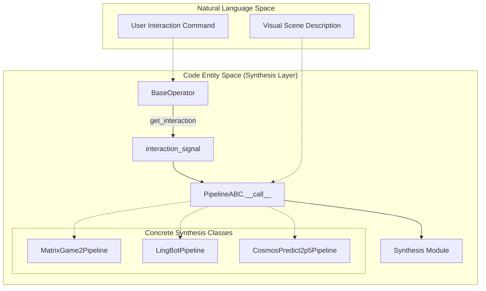
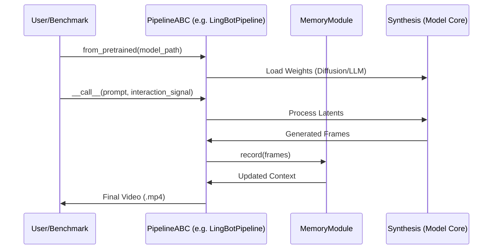

<!-- source: DeepWiki mcp.deepwiki.com · repo OpenDCAI/OpenWorldLib · page 3 Synthesis Pipelines: Visual & Audio Generation · fetched 2026-11-02 -->

# Synthesis Pipelines: Visual & Audio Generation

Relevant source files

The following files were used as context for generating this wiki page:

- [README.md](README.md)
- [README_zh.md](README_zh.md)
- [docs/awesome_world_model.md](docs/awesome_world_model.md)
- [docs/planning.md](docs/planning.md)
- [examples/pipeline_infer_mapping.py](examples/pipeline_infer_mapping.py)
- [examples/pipeline_load_mapping.py](examples/pipeline_load_mapping.py)
- [src/openworldlib/base_models/diffusion_model/video/wan_2p1/utils/fm_solvers_unipc.py](src/openworldlib/base_models/diffusion_model/video/wan_2p1/utils/fm_solvers_unipc.py)
- [src/openworldlib/pipelines/pipeline_utils.py](src/openworldlib/pipelines/pipeline_utils.py)
- [src/openworldlib/synthesis/visual_generation/cosmos/cosmos_predict2p5_synthesis.py](src/openworldlib/synthesis/visual_generation/cosmos/cosmos_predict2p5_synthesis.py)
- [test/test_cosmos_predict2p5.py](test/test_cosmos_predict2p5.py)
- [test/test_depth_anything_v1.py](test/test_depth_anything_v1.py)
- [test/test_lingbot_world.py](test/test_lingbot_world.py)
- [test_stream/test_cosmos_predict2p5_stream.py](test_stream/test_cosmos_predict2p5_stream.py)
- [test_stream/test_lingbot_world_stream.py](test_stream/test_lingbot_world_stream.py)

This page provides a high-level overview of the generative synthesis pipelines within OpenWorldLib. These pipelines are categorized by their primary output modality: **Navigation Video**, **Interactive/Text-to-Video**, and **Audio**. 

The synthesis layer is responsible for the core generative process, often utilizing diffusion models or flow-matching architectures to predict future states of a world based on current perceptions and interaction signals.

## Modality Overview

OpenWorldLib organizes synthesis capabilities into three main tracks. Each track uses a specialized `Synthesis` class and is wrapped in a `PipelineABC` [src/openworldlib/pipelines/pipeline_utils.py:5-25]() to provide a unified interface for inference.

| Modality | Key Pipelines | Core Task |
| :--- | :--- | :--- |
| **Navigation Video** | `MatrixGame2`, `LingBot`, `HunyuanGameCraft` | Generates video driven by camera/ego-motion signals (e.g., "forward", "camera_l"). |
| **Interactive Video** | `CosmosPredict2p5`, `Wan2p2`, `Sora2` | General video synthesis from text or images, supporting long-term consistency. |
| **Audio Generation** | `MMAudio`, `ThinkSound` | Generates synchronized audio for video sequences or from text descriptions. |

**Sources:** [README.md:118-126](), [src/openworldlib/pipelines/pipeline_utils.py:5-25]()

## System Architecture: Synthesis & Code Entities

The following diagram bridges the high-level synthesis concepts to the specific code entities used in the generation lifecycle.

### Visual Synthesis Component Mapping

**Sources:** [examples/pipeline_load_mapping.py:20-102](), [src/openworldlib/pipelines/pipeline_utils.py:20-24]()

---

## 3.1 Navigation Video Generation
Navigation video pipelines are designed for "World Simulators" where the output is conditioned on specific interaction signals. These signals simulate a user or agent moving through a 3D environment.

*   **Key Models:** `MatrixGame2`, `HunyuanGameCraft`, `LingBot-World`, `Astra`, and `Yume`.
*   **Interaction Schema:** Uses a unified set of commands such as `forward`, `backward`, `camera_l`, and `camera_r` [test/test_lingbot_world.py:40-40]().
*   **Frame Logic:** Pipelines often calculate the number of output frames based on the length of the interaction sequence (e.g., `len(interaction_signal) * 12`) [examples/pipeline_infer_mapping.py:8-14]().

For details on signal processing and streaming navigation, see **[Navigation Video Generation](#3.1)**.

**Sources:** [examples/pipeline_infer_mapping.py:7-54](), [test/test_lingbot_world.py:40-47]()

---

## 3.2 Interactive & Text-to-Video Generation
These pipelines focus on high-fidelity video synthesis from text prompts or initial image frames (I2V). They support advanced sampling techniques like Flow Matching and Classifier-Free Guidance (CFG).

*   **Key Models:** `CosmosPredict2p5` (utilizing flow matching) [test/test_cosmos_predict2p5.py:26-33](), `Wan2p2`, and API-based integrations like `Sora2` and `Veo3`.
*   **Capabilities:** Supports `img2world` and `video2world` modes. `CosmosPredict2p5` specifically uses a `FlowUniPCMultistepScheduler` for efficient sampling [src/openworldlib/base_models/diffusion_model/video/wan_2p1/utils/fm_solvers_unipc.py]().
*   **Streaming:** Implements the `.stream()` method to maintain temporal continuity across multiple turns by using the last generated frame as the next starting point [test_stream/test_cosmos_predict2p5_stream.py:79-88]().

For details on schedulers and conditioning masks, see **[Interactive & Text-to-Video Generation](#3.2)**.

**Sources:** [test/test_cosmos_predict2p5.py:55-61](), [test_stream/test_cosmos_predict2p5_stream.py:79-88](), [examples/pipeline_load_mapping.py:81-92]()

---

## 3.3 Audio Generation: MMAudio & ThinkSound
Audio synthesis provides the "soundtrack" to the generated visual world, ensuring multimodal alignment.

*   **MMAudio:** A pipeline for text-to-audio and video-to-audio synthesis using `BigVGANv2` vocoders and `CLIP` for alignment.
*   **ThinkSound:** An advanced video-to-audio system that utilizes a Chain-of-Thought (CoT) approach to analyze video content before generating synchronized sound using `Synchformer`.

For details on sampling rates and video-audio compositing, see **[Audio Generation: MMAudio & ThinkSound](#3.3)**.

**Sources:** [README.md:187-188](), [docs/awesome_world_model.md:78-80]()

---

## Pipeline Execution Flow

The following diagram illustrates the standard data flow from loading a synthesis pipeline to producing a video/audio result.

### Synthesis Pipeline Lifecycle

**Sources:** [src/openworldlib/pipelines/pipeline_utils.py:13-24](), [test_stream/test_cosmos_predict2p5_stream.py:79-101](), [examples/pipeline_infer_mapping.py:7-20]()

---

