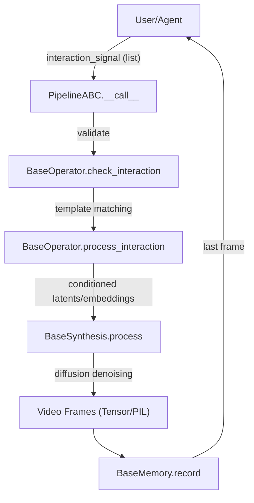
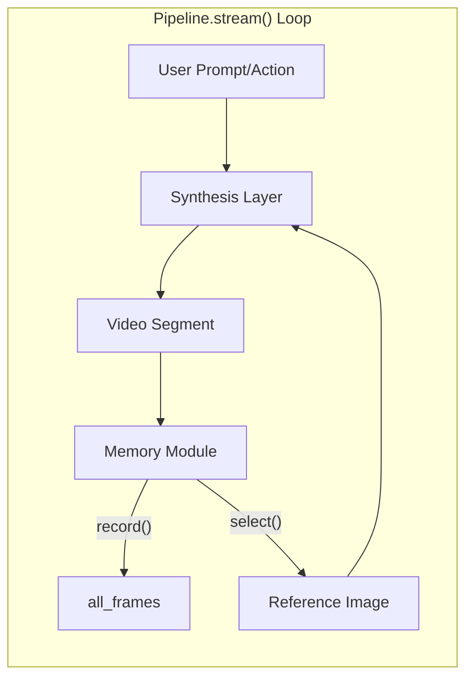

<!-- source: DeepWiki mcp.deepwiki.com · repo OpenDCAI/OpenWorldLib · page 3.1 Navigation Video Generation · fetched 2026-11-02 -->

# Navigation Video Generation

Relevant source files

The following files were used as context for generating this wiki page:

- [data/benchmarks/generation/__init__.py](data/benchmarks/generation/__init__.py)
- [data/benchmarks/tasks_map.py](data/benchmarks/tasks_map.py)
- [examples/pipeline_infer_mapping.py](examples/pipeline_infer_mapping.py)
- [examples/pipeline_load_mapping.py](examples/pipeline_load_mapping.py)
- [scripts/test_inference/test_nav_video_gen.sh](scripts/test_inference/test_nav_video_gen.sh)
- [src/openworldlib/base_models/diffusion_model/video/wan_2p1/utils/fm_solvers_unipc.py](src/openworldlib/base_models/diffusion_model/video/wan_2p1/utils/fm_solvers_unipc.py)
- [src/openworldlib/memories/visual_synthesis/yume/yume_1p5_memory.py](src/openworldlib/memories/visual_synthesis/yume/yume_1p5_memory.py)
- [src/openworldlib/memories/visual_synthesis/yume/yume_memory.py](src/openworldlib/memories/visual_synthesis/yume/yume_memory.py)
- [src/openworldlib/operators/hunyuan_world_voager_operator.py](src/openworldlib/operators/hunyuan_world_voager_operator.py)
- [src/openworldlib/operators/yume_1p5_operator.py](src/openworldlib/operators/yume_1p5_operator.py)
- [src/openworldlib/operators/yume_operator.py](src/openworldlib/operators/yume_operator.py)
- [src/openworldlib/pipelines/hunyuan_world/pipeline_hunyuan_world_voyager.py](src/openworldlib/pipelines/hunyuan_world/pipeline_hunyuan_world_voyager.py)
- [src/openworldlib/pipelines/yume/pipeline_yume.py](src/openworldlib/pipelines/yume/pipeline_yume.py)
- [src/openworldlib/pipelines/yume/pipeline_yume_1p5.py](src/openworldlib/pipelines/yume/pipeline_yume_1p5.py)
- [src/openworldlib/representations/point_clouds_generation/hunyuan_world/hunyuan_world_voyager_representation.py](src/openworldlib/representations/point_clouds_generation/hunyuan_world/hunyuan_world_voyager_representation.py)
- [src/openworldlib/synthesis/visual_generation/cosmos/cosmos_predict2p5_synthesis.py](src/openworldlib/synthesis/visual_generation/cosmos/cosmos_predict2p5_synthesis.py)
- [src/openworldlib/synthesis/visual_generation/hunyuan_world/hunyuan_world_voyager_synthesis.py](src/openworldlib/synthesis/visual_generation/hunyuan_world/hunyuan_world_voyager_synthesis.py)
- [src/openworldlib/synthesis/visual_generation/yume/yume/__init__.py](src/openworldlib/synthesis/visual_generation/yume/yume/__init__.py)
- [src/openworldlib/synthesis/visual_generation/yume/yume/image2video.py](src/openworldlib/synthesis/visual_generation/yume/yume/image2video.py)
- [src/openworldlib/synthesis/visual_generation/yume/yume_1p5/__init__.py](src/openworldlib/synthesis/visual_generation/yume/yume_1p5/__init__.py)
- [src/openworldlib/synthesis/visual_generation/yume/yume_1p5/modules/model.py](src/openworldlib/synthesis/visual_generation/yume/yume_1p5/modules/model.py)
- [src/openworldlib/synthesis/visual_generation/yume/yume_1p5/textimage2video.py](src/openworldlib/synthesis/visual_generation/yume/yume_1p5/textimage2video.py)
- [src/openworldlib/synthesis/visual_generation/yume/yume_1p5/utils/utils.py](src/openworldlib/synthesis/visual_generation/yume/yume_1p5/utils/utils.py)
- [src/openworldlib/synthesis/visual_generation/yume/yume_1p5_synthesis.py](src/openworldlib/synthesis/visual_generation/yume/yume_1p5_synthesis.py)
- [src/openworldlib/synthesis/visual_generation/yume/yume_synthesis.py](src/openworldlib/synthesis/visual_generation/yume/yume_synthesis.py)
- [test/test_astra.py](test/test_astra.py)
- [test/test_cosmos_predict2p5.py](test/test_cosmos_predict2p5.py)
- [test/test_depth_anything_v1.py](test/test_depth_anything_v1.py)
- [test/test_hunyuan_gamecraft.py](test/test_hunyuan_gamecraft.py)
- [test/test_hunyuan_world_voyager.py](test/test_hunyuan_world_voyager.py)
- [test/test_lingbot_world.py](test/test_lingbot_world.py)
- [test/test_recammaster.py](test/test_recammaster.py)
- [test/test_wan_2p2.py](test/test_wan_2p2.py)
- [test/test_yume.py](test/test_yume.py)
- [test/test_yume_1p5.py](test/test_yume_1p5.py)
- [test_stream/test_cosmos_predict2p5_stream.py](test_stream/test_cosmos_predict2p5_stream.py)
- [test_stream/test_hunyuan_game_craft_stream.py](test_stream/test_hunyuan_game_craft_stream.py)
- [test_stream/test_lingbot_world_stream.py](test_stream/test_lingbot_world_stream.py)
- [test_stream/test_matrix_game_2_stream.py](test_stream/test_matrix_game_2_stream.py)
- [test_stream/test_wan2p2_stream.py](test_stream/test_wan2p2_stream.py)
- [test_stream/test_yume_1p5_stream.py](test_stream/test_yume_1p5_stream.py)
- [test_stream/test_yume_stream.py](test_stream/test_yume_stream.py)

Navigation Video Generation pipelines in OpenWorldLib are designed to generate temporally consistent video sequences driven by camera interaction signals. These models act as "World Simulators," where a user or agent can provide a starting image and a sequence of movement commands (e.g., "forward", "camera_l") to synthesize the resulting visual perspective.

## Supported Pipelines and Models

The framework integrates several state-of-the-art navigation and interactive video models. Each is encapsulated in a dedicated `Pipeline` class that manages the synthesis, operator, and memory layers.

| Model Name | Pipeline Class | Key Characteristics |
| :--- | :--- | :--- |
| **MatrixGame2** | `MatrixGame2Pipeline` | Universal navigation with multi-turn support. |
| **HunyuanGameCraft** | `HunyuanGameCraftPipeline` | High-fidelity game-like environment synthesis. |
| **HunyuanWorld-Voyager** | `HunyuanWorldVoyagerPipeline` | Integrated 3D representation for navigation. |
| **LingBot-World** | `LingBotPipeline` | Large-scale world model for embodied AI. |
| **Astra** | `AstraPipeline` | Trajectory-controllable video generation. |
| **Yume / Yume-1.5** | `YumePipeline` / `Yume1p5Pipeline` | Fast, interactive world generation. |
| **Wan2.2** | `Wan2p2Pipeline` | Advanced flow-matching based video synthesis. |

**Sources:** [examples/pipeline_load_mapping.py:20-68](), [examples/pipeline_infer_mapping.py:136-142](), [scripts/test_inference/test_nav_video_gen.sh:7-14]()

## Interaction Signal Schema

Navigation pipelines utilize a unified `interaction_signal` to drive the camera movement. This signal can be a single string or a list of commands.

### Unified 3D Interaction Schema
The following signals are standard across most navigation pipelines:
- `forward` / `backward`: Linear movement along the Z-axis.
- `left` / `right`: Lateral movement along the X-axis.
- `camera_l` / `camera_r`: Panning the camera (Yaw).
- `camera_up` / `camera_down`: Tilting the camera (Pitch).
- `forward_left` / `s_curve`: Complex trajectories (supported by specific models like Astra).

### Implementation Logic: Frame Count Calculation
The number of frames generated is often a function of the number of interaction steps provided.
- **MatrixGame2**: Generates 12 frames per interaction step [examples/pipeline_infer_mapping.py:8-8]().
- **HunyuanGameCraft**: Generates 12 frames per interaction step [examples/pipeline_infer_mapping.py:24-24]().
- **LingBot-World**: Generates 36 frames per interaction plus 1 initial frame [examples/pipeline_infer_mapping.py:43-43]().

**Sources:** [examples/pipeline_infer_mapping.py:7-54](), [test/test_hunyuan_world_voyager.py:21-23](), [test/test_astra.py:20-23]()

## Technical Architecture: Interaction Flow

The following diagram illustrates how interaction signals flow from the user through the `Operator` and `Synthesis` layers to produce video frames.

### Data Flow: User Interaction to Video

**Sources:** [examples/pipeline_infer_mapping.py:7-48](), [test_stream/test_wan2p2_stream.py:61-67](), [test_stream/test_hunyuan_game_craft_stream.py:180-192]()

## Streaming Mode for Long Sequences

For long-duration navigation, pipelines implement a `stream()` method. This allows for multi-turn interaction where the last frame of the previous generation segment becomes the starting condition for the next.

### Streaming Lifecycle
1. **Reset Memory**: Initialize the memory module to clear previous states [test_stream/test_wan2p2_stream.py:23-23]().
2. **First Turn**: Generate video from an initial image or text prompt [test_stream/test_wan2p2_stream.py:56-64]().
3. **Memory Selection**: The `MemoryModule.select()` method retrieves the final frame of the segment [test_stream/test_wan2p2_stream.py:67-67]().
4. **Subsequent Turns**: Pass the selected frame back into `stream()` as the new reference image [test_stream/test_hunyuan_game_craft_stream.py:178-180]().
5. **Final Export**: Use `imageio.mimsave` or `export_to_video` to concatenate all segments stored in `memory_module.all_frames` [test_stream/test_wan2p2_stream.py:81-93]().

### Pipeline Streaming Components

**Sources:** [test_stream/test_wan2p2_stream.py:53-81](), [test_stream/test_hunyuan_game_craft_stream.py:156-203]()

## Detailed Model Implementation Notes

### HunyuanWorld-Voyager
This pipeline integrates a representation model (e.g., `moge-vitl`) to generate depth or point cloud data alongside the video, enhancing spatial consistency [test/test_hunyuan_world_voyager.py:8-18](). It supports a `save_representation_video` flag to visualize the underlying 3D structure [test/test_hunyuan_world_voyager.py:17-17]().

### Astra
Astra uses a MoE (Mixture of Experts) architecture and requires a base model (like `Wan2.1-T2V-1.3B`) as a component [test/test_astra.py:16-33](). It is specifically optimized for complex trajectories like `s_curve` [test/test_astra.py:22-22]().

### Wan2.2
Wan2.2 utilizes flow-matching solvers (`FlowUniPCMultistepScheduler`) for high-efficiency generation. In streaming mode, it relies on `wan_2p2_memory` to handle tensor-to-PIL conversions for intermediate frame selection [examples/pipeline_infer_mapping.py:68-77]().

**Sources:** [test/test_hunyuan_world_voyager.py:4-24](), [test/test_astra.py:5-42](), [examples/pipeline_infer_mapping.py:57-78]()

---

