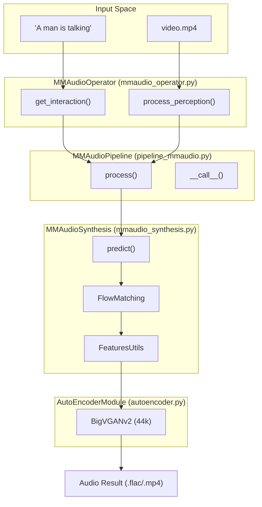
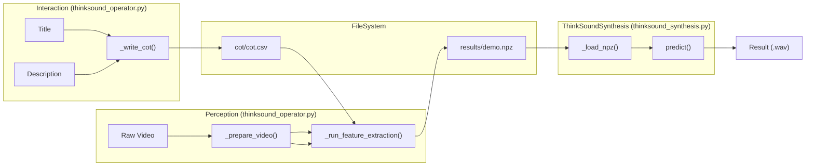

<!-- source: DeepWiki mcp.deepwiki.com · repo OpenDCAI/OpenWorldLib · page 3.3 Audio Generation: MMAudio & ThinkSound · fetched 2026-11-02 -->

# Audio Generation: MMAudio & ThinkSound

Relevant source files

The following files were used as context for generating this wiki page:

- [src/openworldlib/operators/thinksound_operator.py](src/openworldlib/operators/thinksound_operator.py)
- [src/openworldlib/pipelines/mmaudio/pipeline_mmaudio.py](src/openworldlib/pipelines/mmaudio/pipeline_mmaudio.py)
- [src/openworldlib/pipelines/thinksound/pipeline_thinksound.py](src/openworldlib/pipelines/thinksound/pipeline_thinksound.py)
- [src/openworldlib/synthesis/audio_generation/mmaudio/mmaudio/ext/autoencoder/autoencoder.py](src/openworldlib/synthesis/audio_generation/mmaudio/mmaudio/ext/autoencoder/autoencoder.py)
- [src/openworldlib/synthesis/audio_generation/mmaudio/mmaudio/ext/bigvgan_v2/bigvgan.py](src/openworldlib/synthesis/audio_generation/mmaudio/mmaudio/ext/bigvgan_v2/bigvgan.py)
- [src/openworldlib/synthesis/audio_generation/mmaudio/mmaudio/model/utils/features_utils.py](src/openworldlib/synthesis/audio_generation/mmaudio/mmaudio/model/utils/features_utils.py)
- [src/openworldlib/synthesis/audio_generation/mmaudio/mmaudio_synthesis.py](src/openworldlib/synthesis/audio_generation/mmaudio/mmaudio_synthesis.py)
- [src/openworldlib/synthesis/audio_generation/thinksound/ThinkSound/data_utils/v2a_utils/feature_utils_224.py](src/openworldlib/synthesis/audio_generation/thinksound/ThinkSound/data_utils/v2a_utils/feature_utils_224.py)
- [src/openworldlib/synthesis/audio_generation/thinksound/thinksound_synthesis.py](src/openworldlib/synthesis/audio_generation/thinksound/thinksound_synthesis.py)
- [test/test_mmaudio.py](test/test_mmaudio.py)
- [test/test_thinksound.py](test/test_thinksound.py)

The Audio Generation module in `OpenWorldLib` provides high-fidelity synthesis of audio from text descriptions or video sequences. It primarily integrates two advanced pipelines: **MMAudio** (Multi-Modal Audio) and **ThinkSound**. These pipelines leverage flow-matching and diffusion-based architectures to synchronize generated soundscapes with visual content or textual prompts.

## MMAudio Pipeline

The `MMAudioPipeline` is designed for both text-to-audio (T2A) and video-to-audio (V2A) synthesis. It utilizes a `FlowMatching` backbone combined with a `BigVGANv2` vocoder and `CLIP` for multimodal feature alignment `[src/openworldlib/pipelines/mmaudio/pipeline_mmaudio.py:10-14]()`.

### Implementation Details
The pipeline separates data preprocessing from model inference through the `MMAudioOperator` and `MMAudioSynthesis` classes `[src/openworldlib/pipelines/mmaudio/pipeline_mmaudio.py:72-76]()`.

*   **Multimodal Conditioning**: Uses `CLIP` for text/image features and `Synchformer` for temporal video synchronization `[src/openworldlib/synthesis/audio_generation/mmaudio/mmaudio/model/utils/features_utils.py:50-67]()`.
*   **Vocoding**: Supports multiple sampling rates, notably a 44.1kHz high-fidelity mode using `BigVGANv2` `[src/openworldlib/synthesis/audio_generation/mmaudio/mmaudio/ext/autoencoder/autoencoder.py:30-46]()`.
*   **Classifier-Free Guidance (CFG)**: Employs `cfg_strength` to balance prompt adherence and audio quality `[src/openworldlib/pipelines/mmaudio/pipeline_mmaudio.py:132-135]()`.

### MMAudio Data Flow

The following diagram illustrates how natural language and video inputs are transformed into audio waveforms through the code entities.

**Sources:** `[src/openworldlib/pipelines/mmaudio/pipeline_mmaudio.py:83-186]()`, `[src/openworldlib/synthesis/audio_generation/mmaudio/mmaudio_synthesis.py:130-186]()`, `[test/test_mmaudio.py:43-71]()`.

---

## ThinkSound Pipeline

The `ThinkSoundPipeline` focuses on synchronized video-to-audio generation using a Chain-of-Thought (CoT) approach. It processes video content and textual descriptions (title/description) to generate matching audio `[src/openworldlib/pipelines/thinksound/pipeline_thinksound.py:11-16]()`.

### Key Components
*   **Chain-of-Thought (CoT)**: The `ThinkSoundOperator` generates intermediate `cot.csv` files containing captions and CoT descriptions to guide the synthesis `[src/openworldlib/operators/thinksound_operator.py:85-92]()`.
*   **Feature Extraction**: Uses an external script `extract_latents.py` to produce `demo.npz` files containing MetaCLIP and T5 embeddings `[src/openworldlib/operators/thinksound_operator.py:95-117]()`.
*   **Sampling**: Implements discrete Euler sampling for the diffusion process `[src/openworldlib/synthesis/audio_generation/thinksound/thinksound_synthesis.py:21]()`.

### Directory Structure
ThinkSound relies on specific directories for its workflow:
*   `video_dir`: Stores formatted MP4 files.
*   `cot_dir`: Contains the `cot.csv` generated from interactions.
*   `results_dir`: Stores extracted features (`.npz`) and final audio.

**Sources:** `[src/openworldlib/operators/thinksound_operator.py:23-60]()`, `[test/test_thinksound.py:31-44]()`.

---

## Technical Configuration & Comparison

| Feature | MMAudio | ThinkSound |
| :--- | :--- | :--- |
| **Backbone** | Flow-Matching | Diffusion (Rectified Flow) |
| **Text Encoder** | CLIP (DFN5B-ViT-H-14) | T5-v1_1-xl & MetaCLIP |
| **Video Encoder** | Synchformer | Synchformer |
| **Sampling Rate** | 16kHz / 44.1kHz | Config-dependent (default 44.1kHz) |
| **Output Format** | FLAC / MP4 (Composite) | WAV |
| **Preprocessing** | In-memory Operator | File-based CoT (NPZ) |

### ThinkSound Execution Flow

**Sources:** `[src/openworldlib/operators/thinksound_operator.py:62-142]()`, `[src/openworldlib/pipelines/thinksound/pipeline_thinksound.py:154-184]()`, `[src/openworldlib/synthesis/audio_generation/thinksound/thinksound_synthesis.py:25-77]()`.

---

## Video Compositing
Both pipelines support merging generated audio back into the source video. MMAudio uses the `make_video` utility, which takes `video_info` (extracted during perception) and the generated waveform to produce a synchronized MP4 `[test/test_mmaudio.py:19-22]()`.

### Path Resolution
The `MMAudioSynthesis` class includes a robust `_maybe_resolve_hf_cache_snapshot_dir` utility to handle HuggingFace's local snapshot directory structure, ensuring that `CLIP` and `BigVGANv2` weights are correctly loaded regardless of whether they are provided as repo IDs or local paths `[src/openworldlib/synthesis/audio_generation/mmaudio/mmaudio_synthesis.py:23-79]()`.

**Sources:** `[src/openworldlib/synthesis/audio_generation/mmaudio/mmaudio_synthesis.py:82-127]()`, `[src/openworldlib/synthesis/audio_generation/thinksound/ThinkSound/data_utils/v2a_utils/feature_utils_224.py:29-69]()`.

---

