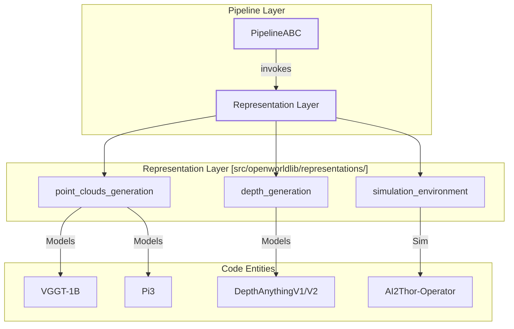
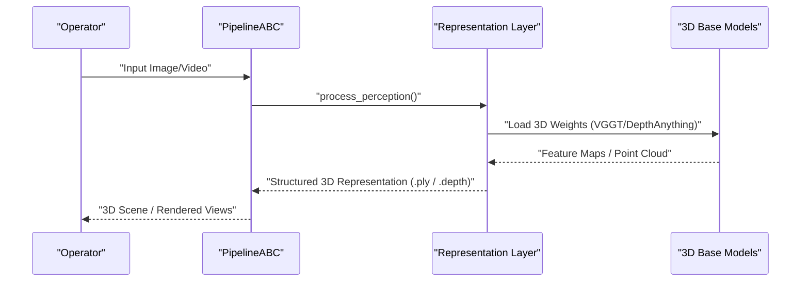

<!-- source: DeepWiki mcp.deepwiki.com · repo OpenDCAI/OpenWorldLib · page 4 Representation Pipelines: 3D Scene Generation · fetched 2026-11-02 -->

# Representation Pipelines: 3D Scene Generation

Relevant source files

The following files were used as context for generating this wiki page:

- [README.md](README.md)
- [README_zh.md](README_zh.md)
- [data/benchmarks/README.md](data/benchmarks/README.md)
- [docs/awesome_world_model.md](docs/awesome_world_model.md)
- [docs/planning.md](docs/planning.md)
- [src/openworldlib/pipelines/pipeline_utils.py](src/openworldlib/pipelines/pipeline_utils.py)

This page provides a high-level overview of the 3D scene generation and representation capabilities within OpenWorldLib. These pipelines focus on the **Representation** layer of the world model architecture, enabling the transformation of 2D visual data (images/videos) into structured 3D environments and depth-aware spatial representations [README.md:183-185]().

## Overview of 3D Representation
In OpenWorldLib, 3D scene generation is treated as a core pillar of world modeling, bridging the gap between pixel-level synthesis and spatial understanding [README.md:81-83](). The framework supports feed-forward 3D reconstruction, monocular depth estimation, and integration with physical simulation environments.

The following diagram illustrates the relationship between the representation layer and the core `PipelineABC` structure.

### 3D Representation System Architecture

**Sources:** [src/openworldlib/pipelines/pipeline_utils.py:5-25](), [README.md:183-185](), [README_zh.md:169-189]()

---

## Point Cloud Reconstruction
OpenWorldLib integrates several state-of-the-art feed-forward 3D reconstruction models. These systems typically follow a two-stage workflow:
1.  **Neural Reconstruction:** Generating a sparse or dense point cloud (exported as `.ply`) from one or more input images.
2.  **3D Gaussian Splatting (3DGS):** Using the point cloud as a geometric prior to initialize and render high-fidelity 3D scenes using CUDA-accelerated rasterization [README.md:123-124]().

Key models supported include **VGGT**, **Pi3**, **FlashWorld**, and **HunyuanMirror**. These models are critical for tasks requiring "Spatial Intelligence," where the model must understand the 3D structure of the world it is predicting [docs/awesome_world_model.md:18-23]().

For a deep dive into the point cloud workflows, camera convention probing, and specific model architectures, see **[Point Cloud Reconstruction: VGGT, CUT3R, Pi3, LoGeR, FlashWorld, HunyuanMirror](#4.1)**.

---

## Depth Estimation
Depth estimation serves as a fundamental perception task within the representation layer. The primary implementation is the `DepthAnythingPipeline`, which leverages the **DepthAnything** family of models to produce high-resolution monocular depth maps.

These depth maps are frequently used as intermediate representations to:
*   Provide spatial cues for video generation pipelines.
*   Initialize point clouds for 3D reconstruction.
*   Assist in spatial reasoning tasks by providing relative distance metrics [data/benchmarks/README.md:59-61]().

For details on the implementation of depth generation and its integration with the `three_dimensions` base models, see **[Depth Estimation: DepthAnything](#4.2)**.

---

## Simulation Environments
Beyond static reconstruction, OpenWorldLib supports interactive 3D representation through the integration of the **AI2-THOR** simulator. This allows the framework to function as an embodied agent within a physics-enabled environment [README.md:74-75]().

The simulation integration includes:
*   **`pipeline_thor`**: A specialized pipeline for interacting with the simulator.
*   **`ai2thor_operator`**: An operator that maps unified interaction signals (forward, backward, rotate) to simulator actions.
*   **Embodied Evaluation**: Benchmarking models on navigation and object manipulation tasks within the simulated 3D space [data/benchmarks/README.md:67-73]().

For details on how to set up and use the AI2-THOR integration for embodied AI research, see **[Simulation Environment: AI2Thor](#4.3)**.

---

## 3D Representation Component Mapping

The following table summarizes the primary 3D representation components and their corresponding code locations.

| Component | Code Category | Representative Models | File Path Reference |
| :--- | :--- | :--- | :--- |
| **Point Cloud Generation** | Representation | VGGT, Pi3, FlashWorld | `src/openworldlib/representations/point_clouds_generation` |
| **Depth Generation** | Representation | DepthAnything | `src/openworldlib/representations/depth_generation` |
| **3D Base Models** | Base Model Core | 3DGS, Point Cloud Kernels | `src/openworldlib/base_models/three_dimensions` |
| **Simulation** | Representation | AI2-THOR | `src/openworldlib/representations/simulation_environment` |

### Interaction and Representation Flow

**Sources:** [src/openworldlib/pipelines/pipeline_utils.py:17-21](), [README_zh.md:169-189](), [docs/planning.md:38-39]()

---

