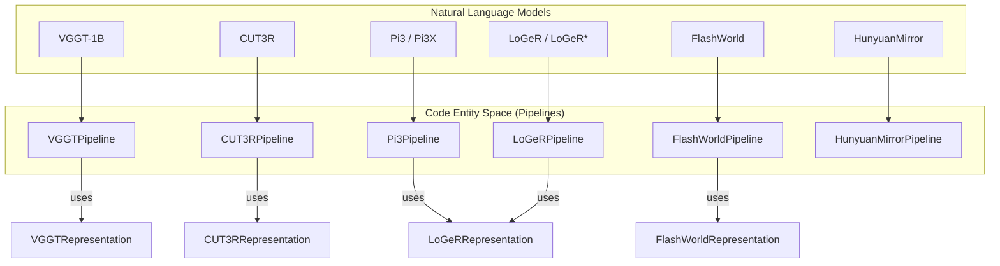
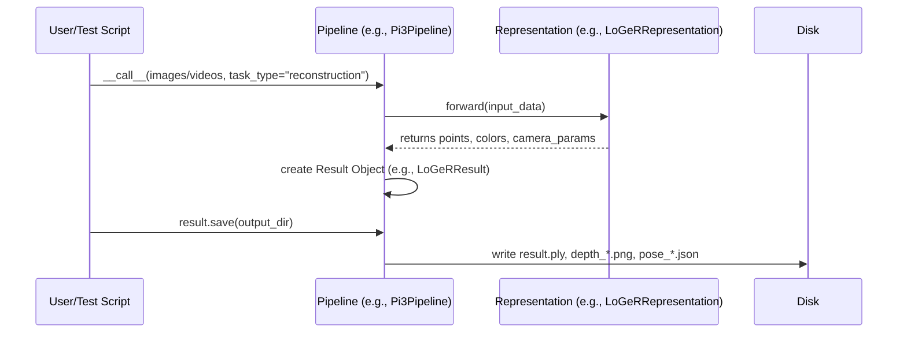

<!-- source: DeepWiki mcp.deepwiki.com · repo OpenDCAI/OpenWorldLib · page 4.1 Point Cloud Reconstruction: VGGT, CUT3R, Pi3, LoGeR, FlashWorld, HunyuanMirror · fetched 2026-11-02 -->

# Point Cloud Reconstruction: VGGT, CUT3R, Pi3, LoGeR, FlashWorld, HunyuanMirror

Relevant source files

The following files were used as context for generating this wiki page:

- [docs/installation.md](docs/installation.md)
- [pyproject.toml](pyproject.toml)
- [requirements.txt](requirements.txt)
- [scripts/setup/cut3r_install.sh](scripts/setup/cut3r_install.sh)
- [scripts/setup/default_3D_install.sh](scripts/setup/default_3D_install.sh)
- [scripts/setup/default_audio_install.sh](scripts/setup/default_audio_install.sh)
- [scripts/setup/hunyuan_mirror_install.sh](scripts/setup/hunyuan_mirror_install.sh)
- [scripts/setup/loger_install.sh](scripts/setup/loger_install.sh)
- [src/openworldlib/operators/cut3r_operator.py](src/openworldlib/operators/cut3r_operator.py)
- [src/openworldlib/operators/flash_world_operator.py](src/openworldlib/operators/flash_world_operator.py)
- [src/openworldlib/operators/hunyuan_worldplay_operator.py](src/openworldlib/operators/hunyuan_worldplay_operator.py)
- [src/openworldlib/operators/matrix_game_2_operator.py](src/openworldlib/operators/matrix_game_2_operator.py)
- [src/openworldlib/operators/pi3_operator.py](src/openworldlib/operators/pi3_operator.py)
- [src/openworldlib/operators/vggt_operator.py](src/openworldlib/operators/vggt_operator.py)
- [src/openworldlib/pipelines/cut3r/pipeline_cut3r.py](src/openworldlib/pipelines/cut3r/pipeline_cut3r.py)
- [src/openworldlib/pipelines/flash_world/pipeline_flash_world.py](src/openworldlib/pipelines/flash_world/pipeline_flash_world.py)
- [src/openworldlib/pipelines/hunyuan_world/pipeline_hunyuan_mirror.py](src/openworldlib/pipelines/hunyuan_world/pipeline_hunyuan_mirror.py)
- [src/openworldlib/pipelines/hunyuan_world/pipeline_hunyuan_worldplay.py](src/openworldlib/pipelines/hunyuan_world/pipeline_hunyuan_worldplay.py)
- [src/openworldlib/pipelines/matrix_game/pipeline_matrix_game_2.py](src/openworldlib/pipelines/matrix_game/pipeline_matrix_game_2.py)
- [src/openworldlib/pipelines/pi3/__init__.py](src/openworldlib/pipelines/pi3/__init__.py)
- [src/openworldlib/pipelines/pi3/pipeline_loger.py](src/openworldlib/pipelines/pi3/pipeline_loger.py)
- [src/openworldlib/pipelines/pi3/pipeline_pi3.py](src/openworldlib/pipelines/pi3/pipeline_pi3.py)
- [src/openworldlib/pipelines/vggt/pipeline_vggt.py](src/openworldlib/pipelines/vggt/pipeline_vggt.py)
- [src/openworldlib/representations/point_clouds_generation/cut3r/cut3r_representation.py](src/openworldlib/representations/point_clouds_generation/cut3r/cut3r_representation.py)
- [src/openworldlib/representations/point_clouds_generation/flash_world/flash_world_representation.py](src/openworldlib/representations/point_clouds_generation/flash_world/flash_world_representation.py)
- [src/openworldlib/representations/point_clouds_generation/pi3/loger/__init__.py](src/openworldlib/representations/point_clouds_generation/pi3/loger/__init__.py)
- [src/openworldlib/representations/point_clouds_generation/pi3/loger/layers/attention.py](src/openworldlib/representations/point_clouds_generation/pi3/loger/layers/attention.py)
- [src/openworldlib/representations/point_clouds_generation/pi3/loger/layers/block.py](src/openworldlib/representations/point_clouds_generation/pi3/loger/layers/block.py)
- [src/openworldlib/representations/point_clouds_generation/pi3/loger/layers/camera_head.py](src/openworldlib/representations/point_clouds_generation/pi3/loger/layers/camera_head.py)
- [src/openworldlib/representations/point_clouds_generation/pi3/loger/pi3.py](src/openworldlib/representations/point_clouds_generation/pi3/loger/pi3.py)
- [src/openworldlib/representations/point_clouds_generation/pi3/loger/ttt.py](src/openworldlib/representations/point_clouds_generation/pi3/loger/ttt.py)
- [src/openworldlib/representations/point_clouds_generation/pi3/loger/utils/basic.py](src/openworldlib/representations/point_clouds_generation/pi3/loger/utils/basic.py)
- [src/openworldlib/representations/point_clouds_generation/pi3/loger/utils/geometry.py](src/openworldlib/representations/point_clouds_generation/pi3/loger/utils/geometry.py)
- [src/openworldlib/representations/point_clouds_generation/pi3/loger/utils/rotation.py](src/openworldlib/representations/point_clouds_generation/pi3/loger/utils/rotation.py)
- [src/openworldlib/representations/point_clouds_generation/pi3/loger_representation.py](src/openworldlib/representations/point_clouds_generation/pi3/loger_representation.py)
- [src/openworldlib/representations/point_clouds_generation/vggt/vggt_representation.py](src/openworldlib/representations/point_clouds_generation/vggt/vggt_representation.py)
- [test/test_cut3r.py](test/test_cut3r.py)
- [test/test_flash_world.py](test/test_flash_world.py)
- [test/test_hunyuan_mirror.py](test/test_hunyuan_mirror.py)
- [test/test_hunyuan_worldplay.py](test/test_hunyuan_worldplay.py)
- [test/test_infinite_vggt.py](test/test_infinite_vggt.py)
- [test/test_loger.py](test/test_loger.py)
- [test/test_matrix_game_2.py](test/test_matrix_game_2.py)
- [test/test_pi3.py](test/test_pi3.py)
- [test/test_vggt.py](test/test_vggt.py)
- [test_stream/test_loger_stream.py](test_stream/test_loger_stream.py)
- [test_stream/test_pi3_stream.py](test_stream/test_pi3_stream.py)
- [test_stream/test_vggt_stream.py](test_stream/test_vggt_stream.py)

This page provides a technical deep dive into the 3D scene representation pipelines within OpenWorldLib that utilize a two-stage point cloud reconstruction and rendering workflow. These pipelines share a common architectural pattern: Stage 1 performs neural reconstruction from images/videos to a 3D point cloud (often saved as `.ply`), and Stage 2 performs 3D Gaussian Splatting (3DGS) or point-based rendering to generate interactive novel views.

## Overview of the Two-Stage Workflow

The reconstruction pipelines for VGGT, CUT3R, Pi3, LoGeR, FlashWorld, and HunyuanMirror follow a unified execution lifecycle. This lifecycle abstracts the complexity of different neural backends (Transformers, DPT, etc.) into a consistent 3D representation layer.

| Stage | Component | Responsibility |
| :--- | :--- | :--- |
| **Stage 1** | **Representation Layer** | Neural inference to generate 3D point positions, colors, and features. Outputs `.ply` or `.npy` data. |
| **Stage 2** | **Synthesis/Rendering** | 3D Gaussian Splatting or deterministic point rendering based on camera interaction signals. |

### System Mapping: Natural Language to Code Entities

The following diagram bridges the high-level model names with their specific implementation classes in the codebase.

**Model to Pipeline Entity Mapping**

**Sources:** `[src/openworldlib/pipelines/vggt/pipeline_vggt.py:26-43]()`, `[src/openworldlib/pipelines/pi3/pipeline_pi3.py:8-18]()`, `[src/openworldlib/pipelines/cut3r/pipeline_cut3r.py:30-47]()`, `[src/openworldlib/pipelines/flash_world/pipeline_flash_world.py:29-47]()`.

---

## Stage 1: Neural Reconstruction

Each model utilizes a specific representation class to transform 2D inputs into 3D point clouds. This stage is typically invoked via the `process()` or `__call__` method of the pipeline with `task_type="reconstruction"` or similar.

### Implementation Details by Model
*   **VGGT (Visual Geometry Group Transformer):** Uses a transformer-based architecture (`VGGT-1B`) to predict 3D point coordinates and features from a single or multiple reference images `[test/test_vggt.py:8-28]()`.
*   **CUT3R:** Implements a multi-scale reconstruction approach. Supported configurations include `cut3r_224_linear_4` and `cut3r_512_dpt_4_64`, which utilize DPT (Dense Prediction Transformer) backends `[test/test_cut3r.py:10-33]()`.
*   **Pi3 / LoGeR:** Both utilize the `LoGeRRepresentation`. Pi3 handles video inputs by sampling frames at a specified `interval` (e.g., 10) to reconstruct the global scene `[test/test_pi3.py:20-23]()`.
*   **HunyuanMirror:** Specifically optimized for mirror-like or high-fidelity surface reconstruction, producing point maps, depth, and normals `[test/test_hunyuan_mirror.py:25-37]()`.

### Data Flow in Stage 1

**Sources:** `[src/openworldlib/pipelines/pi3/pipeline_loger.py:84-174]()`, `[test/test_pi3.py:18-24]()`.

---

## Stage 2: 3DGS Rendering & Interaction

Once the point cloud is generated, the pipelines support interactive rendering. This stage consumes the **Unified 3D Interaction Schema** to move the virtual camera within the reconstructed scene.

### Camera Convention Probing & Deterministic Fallback
The system attempts to use high-performance 3D Gaussian Splatting if the `diff-gaussian-rasterization` submodule is installed `[src/openworldlib/pipelines/vggt/pipeline_vggt.py:33]()`. If CUDA extensions are missing, the pipelines fall back to a deterministic CPU/NumPy-based point renderer.

**Deterministic Renderer Logic (`render_point_cloud`):**
1.  **Coordinate Transform:** Projects 3D points to camera space using `w2c = np.linalg.inv(c2w)` `[src/openworldlib/pipelines/pi3/pipeline_loger.py:43-47]()`.
2.  **Z-Buffering:** Sorts points by depth (`z`) to handle occlusions `[src/openworldlib/pipelines/pi3/pipeline_loger.py:62-63]()`.
3.  **Splatting:** Iterates through a splat radius (e.g., `splat_radius=3`) to fill pixels on a `canvas` and `z_buf` `[src/openworldlib/pipelines/pi3/pipeline_loger.py:68-81]()`.

### Unified Interaction Handling
The `Operator` layer (e.g., `VGGTOperator`, `Pi3Operator`) translates string commands like `"forward"`, `"camera_l"`, or `"camera_zoom_in"` into camera matrix deltas `[test_stream/test_vggt_stream.py:21-28]()`.

**Camera Delta Application (`_apply_camera_delta`):**
The function modifies the `c2w` (Camera-to-World) matrix based on a 5-element delta vector `[dx, dy, dz, theta_x, theta_z]` `[src/openworldlib/pipelines/pi3/pipeline_loger.py:13-31]()`.

| Interaction | Transformation |
| :--- | :--- |
| `forward` / `backward` | Translation along Z-axis (`dz`) |
| `left` / `right` | Translation along X-axis (`dx`) |
| `camera_l` / `camera_r` | Rotation around Z-axis (`theta_z`) |
| `camera_up` / `camera_down` | Rotation around X-axis (`theta_x`) |

---

## Installation & Requirements

These pipelines require specific 3D dependencies beyond the base `openworldlib` installation.

*   **Extra Group:** `3d_ply_default` (includes `plyfile`) `[pyproject.toml:26-32]()`.
*   **CUDA Submodules:** For Stage 2 acceleration, `diff-gaussian-rasterization` must be compiled.
*   **Specific Scripts:**
    *   VGGT/Pi3: `bash scripts/setup/default_3D_install.sh` `[docs/installation.md:92-100]()`.
    *   CUT3R: `bash scripts/setup/cut3r_install.sh` (installs `roma`, `trimesh`, `simple_knn`) `[scripts/setup/cut3r_install.sh:1-16]()`.
    *   LoGeR: `bash scripts/setup/loger_install.sh` `[docs/installation.md:113]()`.

### Key Pipeline Classes and Files

| Pipeline | Main Class | Operator | Representation |
| :--- | :--- | :--- | :--- |
| **VGGT** | `VGGTPipeline` | `VGGTOperator` | `VGGTRepresentation` |
| **CUT3R** | `CUT3RPipeline` | `CUT3ROperator` | `CUT3RRepresentation` |
| **Pi3** | `Pi3Pipeline` | `Pi3Operator` | `LoGeRRepresentation` |
| **FlashWorld** | `FlashWorldPipeline` | `FlashWorldOperator` | `FlashWorldRepresentation` |

**Sources:** `[src/openworldlib/pipelines/vggt/pipeline_vggt.py:4]()`, `[src/openworldlib/pipelines/pi3/pipeline_pi3.py:8]()`, `[src/openworldlib/pipelines/cut3r/pipeline_cut3r.py:6]()`, `[src/openworldlib/pipelines/flash_world/pipeline_flash_world.py:4]()`.

---

