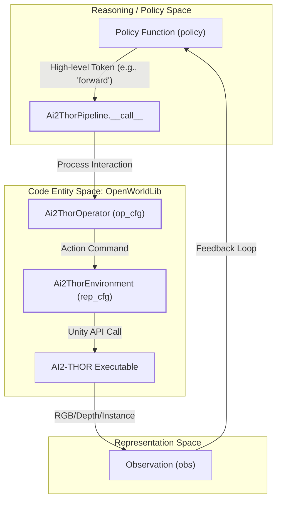
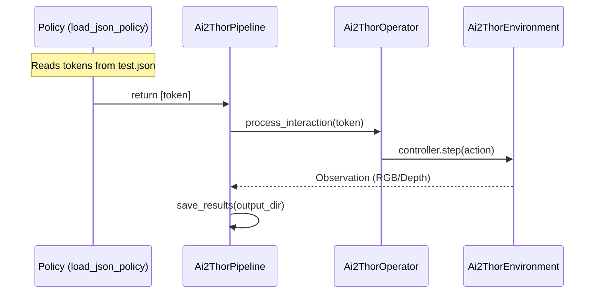

<!-- source: DeepWiki mcp.deepwiki.com · repo OpenDCAI/OpenWorldLib · page 4.3 Simulation Environment: AI2Thor · fetched 2026-11-02 -->

# Simulation Environment: AI2Thor

<details>
<summary>Relevant source files</summary>

The following files were used as context for generating this wiki page:

- [scripts/setup/ai2thor_install.sh](scripts/setup/ai2thor_install.sh)
- [scripts/setup/default_install.sh](scripts/setup/default_install.sh)
- [scripts/setup/lower_trans_install.sh](scripts/setup/lower_trans_install.sh)
- [scripts/test_inference/test_simulator_env.sh](scripts/test_inference/test_simulator_env.sh)
- [test/test_ai2thor.py](test/test_ai2thor.py)
- [tools/installing/readme.md](tools/installing/readme.md)

</details>


The AI2Thor simulation environment integration in OpenWorldLib provides a high-fidelity physical and visual platform for evaluating embodied reasoning and navigation agents. Unlike generative synthesis pipelines, this environment uses a deterministic physics engine (Unity) to provide ground-truth feedback for agent interactions. The integration is structured around a three-tier architecture: the `Ai2ThorPipeline` (lifecycle management), the `Ai2ThorOperator` (interaction mapping), and the `Ai2ThorEnvironment` (representation layer).

## 1. Environment Setup and Installation

The AI2Thor environment requires a specific Unity build and a set of Python dependencies. The installation is automated via a dedicated setup script that downloads the Linux-64 binary and installs required libraries including `objathor` and `msgpack`.

*   **Binary Target**: `submodules/ai2thor/` [scripts/setup/ai2thor_install.sh:10-12]()
*   **Key Dependencies**: `Flask`, `Werkzeug`, `objathor`, `python-xlib`, and `msgpack` [scripts/setup/ai2thor_install.sh:15-19]()

The installation script performs the following steps:
1.  Installs Python dependencies via `pip`.
2.  Downloads the AI2-THOR Unity build from S3.
3.  Extracts the build to the local submodule directory for use by the pipeline.

**Sources:**
- [scripts/setup/ai2thor_install.sh:1-31]()
- [scripts/setup/default_install.sh:1-17]()

---

## 2. System Architecture

The AI2Thor integration bridges the gap between high-level navigation tokens and the low-level Unity engine commands. The following diagram illustrates the data flow from a policy (AI or Human) through the operator and into the simulation environment.

### 2.1 Component Interaction Flow
"This diagram maps the logical flow of an embodied reasoning step to specific code entities."



**Sources:**
- [test/test_ai2thor.py:50-61]()
- [test/test_ai2thor.py:10-23]()

---

## 3. Pipeline Implementation: Ai2ThorPipeline

The `Ai2ThorPipeline` manages the simulation lifecycle, including initialization, stepping, and result persistence. It is instantiated using `from_pretrained` which accepts two distinct configurations: `rep_cfg` for the simulator's physical parameters and `op_cfg` for the interaction constraints.

### 3.1 Configuration Parameters
The pipeline differentiates between the representation (simulation) and the operator (interaction) layers:

| Category | Key Parameters | Description |
| :--- | :--- | :--- |
| **Representation (`rep_cfg`)** | `scene`, `gridSize`, `rotateStepDegrees`, `visibilityDistance` | Defines the physical layout and movement resolution in the Unity engine. [test/test_ai2thor.py:29-40]() |
| **Operator (`op_cfg`)** | `look_deg`, `camera_yaw_deg`, `human_window_size` | Defines the mapping of interaction signals to simulator actions. [test/test_ai2thor.py:42-48]() |

### 3.2 Execution Lifecycle
The `__call__` method of the pipeline executes the simulation loop:
1.  **Action Retrieval**: Fetches a token from the `policy` function (or human input). [test/test_ai2thor.py:15-21]()
2.  **Simulation Step**: Updates the agent state based on `max_steps` and `max_timesteps`. [test/test_ai2thor.py:54-55]()
3.  **Data Capture**: Optionally records RGB frames, depth maps, and instance segmentation masks. [test/test_ai2thor.py:56-59]()

**Sources:**
- [test/test_ai2thor.py:6-69]()

---

## 4. Navigation Benchmark & Evaluation

The simulator is primarily used for evaluating embodied agents using a standardized JSON format. This format allows for deterministic replay and validation of agent performance.

### 4.1 Test Data Format (`test.json`)
For benchmarking, a `test.json` file provides the sequence of ground-truth or target actions. A `load_json_policy` helper is used to feed these tokens into the pipeline for validation.

```json
{
  "tokens": ["forward", "rotate_right", "forward", "interact"],
  "metadata": {
    "scene": "FloorPlan1",
    "initial_pose": {"x": 0.0, "y": 0.0, "z": 0.0}
  }
}
```
[test/test_ai2thor.py:10-26]()

### 4.2 Code-to-Entity Mapping
The following diagram demonstrates how the `test.json` data is consumed by the pipeline entities.



**Sources:**
- [test/test_ai2thor.py:10-26]()
- [test/test_ai2thor.py:63-68]()

---

## 5. Key Functions and Classes

### `Ai2ThorPipeline.from_pretrained(rep_cfg, op_cfg)`
Initializes the simulator and operator. The `executable_path` must point to the binary installed by `install_ai2thor.sh`.
[test/test_ai2thor.py:30-50]()

### `policy(obs)`
A callback function that receives the current observation (RGB/Depth) and returns a list of action tokens. In testing scenarios, this is often a non-reactive policy that simply replays a pre-defined sequence.
[test/test_ai2thor.py:15-21]()

### `pipe.save_results(...)`
Persists the simulation trajectory, including recorded frames and action logs, to the specified `output_dir`. This is essential for downstream "Navigation Fidelity" and "Success Rate" metrics in the benchmarking framework.
[test/test_ai2thor.py:63-68]()

**Sources:**
- [test/test_ai2thor.py:6-69]()
- [scripts/setup/ai2thor_install.sh:30]()

---

