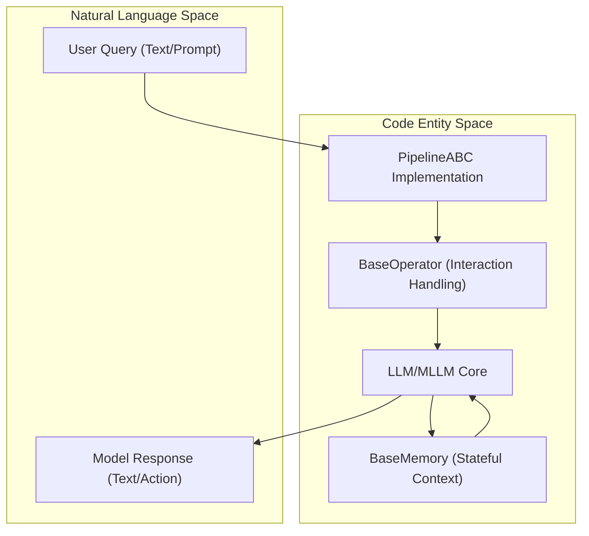
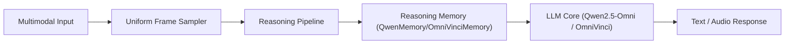

<!-- source: DeepWiki mcp.deepwiki.com · repo OpenDCAI/OpenWorldLib · page 5 Reasoning Pipelines: Multimodal & Spatial · fetched 2026-11-02 -->

# Reasoning Pipelines: Multimodal & Spatial

Relevant source files

The following files were used as context for generating this wiki page:

- [README.md](README.md)
- [README_zh.md](README_zh.md)
- [docs/awesome_world_model.md](docs/awesome_world_model.md)
- [docs/planning.md](docs/planning.md)
- [scripts/setup/omnivinci_install.sh](scripts/setup/omnivinci_install.sh)
- [src/openworldlib/pipelines/pipeline_utils.py](src/openworldlib/pipelines/pipeline_utils.py)
- [test/test_omnivinci.py](test/test_omnivinci.py)
- [test/test_qwen2p5_omni.py](test/test_qwen2p5_omni.py)

Reasoning pipelines in OpenWorldLib are designed to move beyond simple visual generation by enabling models to understand, interact with, and reason about the physical and semantic properties of the world. These pipelines leverage Large Multimodal Models (LMMs) to perform tasks ranging from precise spatial coordinate estimation to complex multi-turn conversations involving text, images, video, and audio.

All reasoning pipelines inherit from the base `PipelineABC` [src/openworldlib/pipelines/pipeline_utils.py:5-25](), ensuring a consistent interface for loading models via `from_pretrained()` and executing inference via `__call__()` or `stream()`.

### Architecture Overview

The reasoning architecture bridges "Natural Language Space" (user queries and model responses) with "Code Entity Space" (the underlying model components and memory management).

**Reasoning System Components**

Sources: [src/openworldlib/pipelines/pipeline_utils.py:5-25](), [README.md:169-182]()

---

### Spatial Reasoning: SpatialReasoner & SpatialLadder

Spatial reasoning pipelines are specialized for "Spatial Intelligence," focusing on the model's ability to perceive 3D relationships, coordinates, and object placements from 2D visual inputs. These pipelines typically utilize high-resolution perception cores and specific prompting techniques to align visual features with spatial coordinates.

*   **SpatialReasonerPipeline**: Focuses on explicit spatial reasoning through coordinate alignment.
*   **SpatialLadderPipeline**: Implements a hierarchical approach to spatial understanding, often built on `Qwen2_5_VLForConditionalGeneration` cores.

These pipelines implement a structured interaction lifecycle:
1.  **get_interaction**: Captures spatial queries and visual data.
2.  **process_interaction**: Normalizes inputs and samples video frames uniformly.
3.  **inference**: Executes the MLLM forward pass to generate spatial coordinates or descriptions.
4.  **delete_last_interaction**: Clears the short-term buffer to prepare for new spatial queries.

For a deep dive into perception processing and the interaction tier, see **[Spatial Reasoning: SpatialReasoner & SpatialLadder](#5.1)**.

Sources: [README.md:124-125](), [docs/awesome_world_model.md:85-92]()

---

### General Multimodal Reasoning: OmniVinci & Qwen2.5-Omni

General reasoning pipelines are designed for broad multimodal understanding across multiple formats, including text, image, video, and audio. Unlike specialized spatial models, these pipelines prioritize multi-turn conversational depth and cross-modal synthesis.

#### Supported Pipelines

| Pipeline Class | Base Model | Key Features |
| :--- | :--- | :--- |
| `OmniVinciPipeline` | `nvidia/omnivinci` | High-fidelity video/audio reasoning, uses `OmniVinciMemory`. |
| `Qwen2p5OmniPipeline` | `Qwen/Qwen2.5-Omni-7B` | Native audio-in-video support, streaming multi-turn interaction. |

#### Component Interaction

The following diagram illustrates how `Qwen2p5OmniPipeline` [test/test_qwen2p5_omni.py:1]() and `OmniVinciPipeline` [test/test_omnivinci.py:1]() manage complex inputs.

#### Key Characteristics
*   **Memory Management**: Uses stateful memory modules (`QwenMemory`, `OmniVinciMemory`) to maintain context across long conversations [README.md:174-176]().
*   **Environment**: Requires specific dependencies for audio and scaling, managed via `omnivinci_install.sh` [scripts/setup/omnivinci_install.sh:1-21]().
*   **Streaming**: Supports the `stream()` method for real-time token and audio generation [src/openworldlib/pipelines/pipeline_utils.py:23-24]().

For details on memory compression and streaming mode, see **[General Multimodal Reasoning: OmniVinci & Qwen2.5-Omni](#5.2)**.

Sources: [test/test_qwen2p5_omni.py:46-59](), [test/test_omnivinci.py:51-63](), [scripts/setup/omnivinci_install.sh:1-21]()

---

