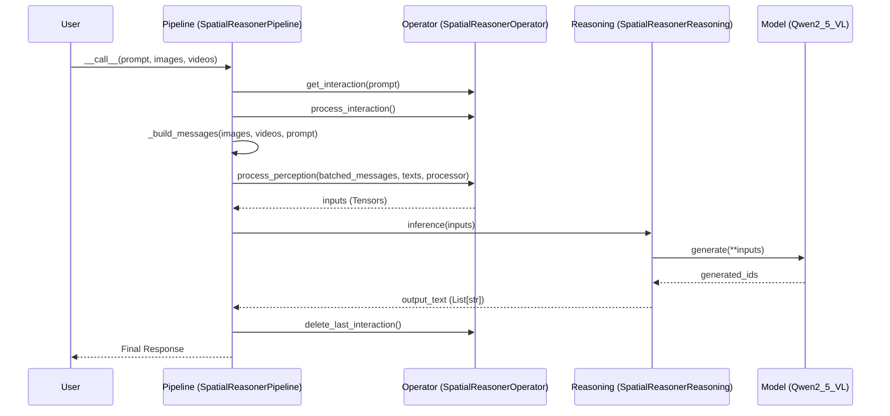
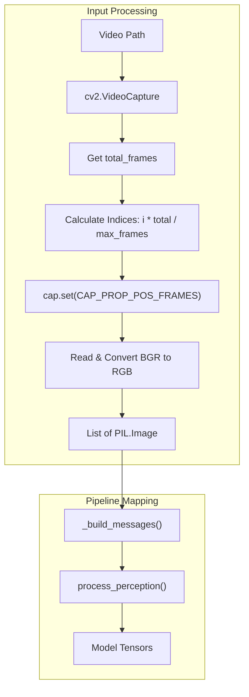

<!-- source: DeepWiki mcp.deepwiki.com · repo OpenDCAI/OpenWorldLib · page 5.1 Spatial Reasoning: SpatialReasoner & SpatialLadder · fetched 2026-11-02 -->

# Spatial Reasoning: SpatialReasoner & SpatialLadder

Relevant source files

The following files were used as context for generating this wiki page:

- [src/openworldlib/pipelines/spatial_ladder/pipeline_spatial_ladder.py](src/openworldlib/pipelines/spatial_ladder/pipeline_spatial_ladder.py)
- [src/openworldlib/pipelines/spatial_reasoner/pipeline_spatial_reasoner.py](src/openworldlib/pipelines/spatial_reasoner/pipeline_spatial_reasoner.py)
- [src/openworldlib/reasoning/spatial_reasoning/spatial_ladder/spatial_ladder_reasoning.py](src/openworldlib/reasoning/spatial_reasoning/spatial_ladder/spatial_ladder_reasoning.py)
- [src/openworldlib/reasoning/spatial_reasoning/spatial_reasoner/spatial_reasoner_reasoning.py](src/openworldlib/reasoning/spatial_reasoning/spatial_reasoner/spatial_reasoner_reasoning.py)
- [test/test_spatial_ladder.py](test/test_spatial_ladder.py)
- [test/test_spatial_reasoner.py](test/test_spatial_reasoner.py)

This page provides a deep dive into the **SpatialReasoner** and **SpatialLadder** pipelines. These systems are designed for advanced multimodal spatial reasoning, leveraging the `Qwen2_5_VLForConditionalGeneration` architecture to process and reason over images and video sequences.

## Overview

The spatial reasoning pipelines in `OpenWorldLib` provide a unified interface for complex visual-textual tasks. Both `SpatialReasonerPipeline` and `SpatialLadderPipeline` follow a three-tier architecture:
1.  **Pipeline Tier**: Orchestrates the lifecycle and manages user-facing inputs.
2.  **Reasoning Tier**: Handles the core MLLM (Multimodal Large Language Model) loading and inference.
3.  **Operator Tier**: Manages interaction state and perception preprocessing.

### Core Components

| Component | SpatialReasoner Implementation | SpatialLadder Implementation |
| :--- | :--- | :--- |
| **Pipeline** | `SpatialReasonerPipeline` [src/openworldlib/pipelines/spatial_reasoner/pipeline_spatial_reasoner.py:10-13]() | `SpatialLadderPipeline` [src/openworldlib/pipelines/spatial_ladder/pipeline_spatial_ladder.py:10-13]() |
| **Reasoning** | `SpatialReasonerReasoning` [src/openworldlib/reasoning/spatial_reasoning/spatial_reasoner/spatial_reasoner_reasoning.py:9-12]() | `SpatialLadderReasoning` [src/openworldlib/reasoning/spatial_reasoning/spatial_ladder/spatial_ladder_reasoning.py:9-12]() |
| **Operator** | `SpatialReasonerOperator` [src/openworldlib/pipelines/spatial_reasoner/pipeline_spatial_reasoner.py:42-42]() | `SpatialLadderOperator` [src/openworldlib/pipelines/spatial_ladder/pipeline_spatial_ladder.py:43-43]() |
| **Base Model** | `Qwen2_5_VLForConditionalGeneration` [src/openworldlib/reasoning/spatial_reasoning/spatial_reasoner/spatial_reasoner_reasoning.py:43-43]() | `Qwen2_5_VLForConditionalGeneration` [src/openworldlib/reasoning/spatial_reasoning/spatial_ladder/spatial_ladder_reasoning.py:43-43]() |

**Sources:** [src/openworldlib/pipelines/spatial_reasoner/pipeline_spatial_reasoner.py](), [src/openworldlib/pipelines/spatial_ladder/pipeline_spatial_ladder.py](), [src/openworldlib/reasoning/spatial_reasoning/spatial_reasoner/spatial_reasoner_reasoning.py](), [src/openworldlib/reasoning/spatial_reasoning/spatial_ladder/spatial_ladder_reasoning.py]()

---

## Interaction Lifecycle & Data Flow

The pipelines implement a strict interaction lifecycle to ensure state consistency during inference. This flow bridges the "Natural Language Space" (prompts) to the "Code Entity Space" (tensor inputs for the model).

### Interaction Sequence Diagram

The following diagram illustrates the call sequence during a single inference pass (`__call__`).

**Pipeline Execution Flow**

**Sources:** [src/openworldlib/pipelines/spatial_reasoner/pipeline_spatial_reasoner.py:70-110](), [src/openworldlib/pipelines/spatial_ladder/pipeline_spatial_ladder.py:79-112]()

---

## Perception Processing & Sampling

A critical aspect of spatial reasoning is the transformation of raw media into model-ready tensors.

### Uniform Video Sampling
For video inputs, the framework typically employs uniform sampling to reduce computational overhead while maintaining temporal context. As demonstrated in the test suites, a common pattern is sampling a fixed number of frames (e.g., `max_frames=8`) from the total duration of the video file.

**Video Sampling Logic**

**Sources:** [test/test_spatial_reasoner.py:14-27](), [test/test_spatial_ladder.py:14-27](), [src/openworldlib/pipelines/spatial_reasoner/pipeline_spatial_reasoner.py:45-68]()

---

## Implementation Details

### Reasoning Tier: Inference Logic
The `inference` method in both `SpatialReasonerReasoning` and `SpatialLadderReasoning` handles the transition from preprocessed inputs to decoded text. It utilizes `torch.no_grad()` for efficiency and trims the input tokens from the generated sequence to return only the model's response.

*   **Model Loading**: Uses `Qwen2_5_VLForConditionalGeneration.from_pretrained` with support for `weight_dtype` (defaulting to `torch.bfloat16`) and `attn_implementation` [src/openworldlib/reasoning/spatial_reasoning/spatial_reasoner/spatial_reasoner_reasoning.py:43-51]().
*   **Token Trimming**: The pipeline calculates the length of `in_ids` to slice the `generated_ids`, ensuring the prompt is not included in the final string [src/openworldlib/reasoning/spatial_reasoning/spatial_ladder/spatial_ladder_reasoning.py:79-81]().

### Pipeline Tier: Message Building
The `_build_messages` function standardizes inputs into a format compatible with the `AutoProcessor` chat templates. It handles:
*   **Image Wrapping**: Converts single `str` or `PIL.Image` into a list [src/openworldlib/pipelines/spatial_reasoner/pipeline_spatial_reasoner.py:56-57]().
*   **Video Wrapping**: Detects if a list of `PIL.Image` represents a single video sequence and nests it appropriately [src/openworldlib/pipelines/spatial_reasoner/pipeline_spatial_reasoner.py:62-63]().
*   **Content Assembly**: Constructs a list of dictionaries with types `image`, `video`, and `text` [src/openworldlib/pipelines/spatial_reasoner/pipeline_spatial_reasoner.py:65-68]().

### Technical Specification Table

| Feature | Specification |
| :--- | :--- |
| **Model Architecture** | Qwen2.5-VL (Vision-Language) |
| **Precision** | `torch.bfloat16` (Default) |
| **Max Tokens** | 2048 (Default) |
| **Supported Inputs** | PIL Image, Video Frames (List[PIL]), Text Prompt |
| **Device Support** | CUDA, CPU |

**Sources:** [src/openworldlib/reasoning/spatial_reasoning/spatial_reasoner/spatial_reasoner_reasoning.py:62-84](), [src/openworldlib/pipelines/spatial_reasoner/pipeline_spatial_reasoner.py:70-75](), [test/test_spatial_reasoner.py:32-36]()

---

## Usage Example

The following logic illustrates how the `SpatialReasonerPipeline` is initialized and invoked for both image and video tasks.

1.  **Initialization**: `pipe = SpatialReasonerPipeline.from_pretrained(model_path="ccvl/SpatialReasoner")` [test/test_spatial_reasoner.py:32-36]().
2.  **Image Inference**: Passing a single PIL image and a prompt returns a description list [test/test_spatial_reasoner.py:39-43]().
3.  **Video Inference**: Passing a list of sampled frames allows the model to summarize temporal content [test/test_spatial_reasoner.py:57-61]().

**Sources:** [test/test_spatial_reasoner.py:30-63](), [test/test_spatial_ladder.py:30-63]()

---

