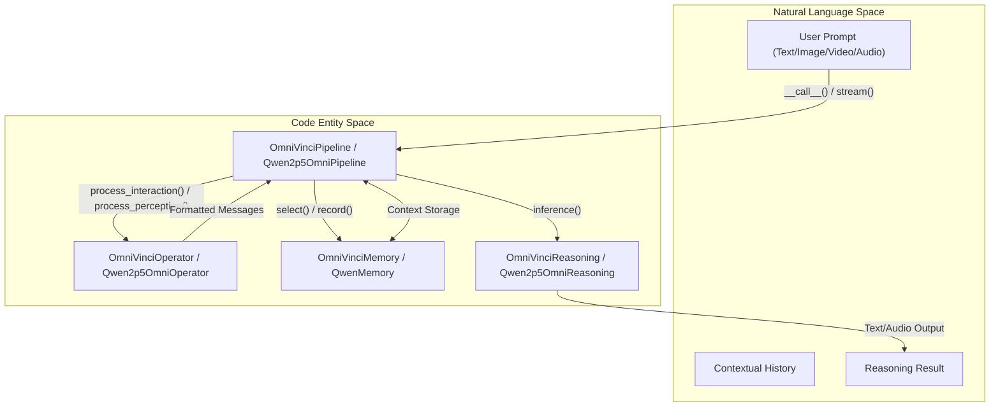
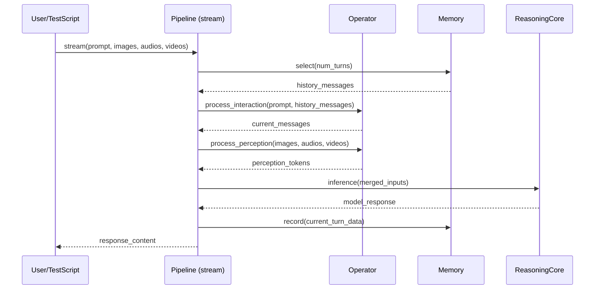

<!-- source: DeepWiki mcp.deepwiki.com · repo OpenDCAI/OpenWorldLib · page 5.2 General Multimodal Reasoning: OmniVinci & Qwen2.5-Omni · fetched 2026-11-02 -->

# General Multimodal Reasoning: OmniVinci & Qwen2.5-Omni

Relevant source files

The following files were used as context for generating this wiki page:

- [scripts/setup/omnivinci_install.sh](scripts/setup/omnivinci_install.sh)
- [scripts/test_inference/test_mm_reasoning.sh](scripts/test_inference/test_mm_reasoning.sh)
- [src/openworldlib/memories/reasoning/qwen/qwen_memory.py](src/openworldlib/memories/reasoning/qwen/qwen_memory.py)
- [src/openworldlib/operators/omnivinci_operator.py](src/openworldlib/operators/omnivinci_operator.py)
- [src/openworldlib/operators/qwen2p5_omni_operator.py](src/openworldlib/operators/qwen2p5_omni_operator.py)
- [src/openworldlib/pipelines/omnivinci/pipeline_omnivinci.py](src/openworldlib/pipelines/omnivinci/pipeline_omnivinci.py)
- [src/openworldlib/pipelines/qwen/pipeline_qwen2p5_omni.py](src/openworldlib/pipelines/qwen/pipeline_qwen2p5_omni.py)
- [test/test_omnivinci.py](test/test_omnivinci.py)
- [test/test_qwen2p5_omni.py](test/test_qwen2p5_omni.py)
- [test_stream/test_omnivinci_stream.py](test_stream/test_omnivinci_stream.py)
- [test_stream/test_qwen2p5_omni_stream.py](test_stream/test_qwen2p5_omni_stream.py)

This section covers the high-level multimodal reasoning pipelines integrated into OpenWorldLib: **OmniVinci** and **Qwen2.5-Omni**. These pipelines are designed for general-purpose reasoning across text, image, video, and audio modalities. They leverage specialized memory modules to support stateful, multi-turn conversations and streaming interactions.

## Pipeline Architecture

The general reasoning pipelines follow the standard OpenWorldLib architectural pattern, decoupling data preprocessing (Operator), state management (Memory), and model inference (Reasoning).

### OmniVinci Pipeline
`OmniVinciPipeline` is designed for comprehensive multimodal understanding. It utilizes the `OmniVinciOperator` to handle diverse inputs and `OmniVinciMemory` to maintain context across turns [src/openworldlib/pipelines/omnivinci/pipeline_omnivinci.py:20-55]().

### Qwen2.5-Omni Pipeline
`Qwen2p5OmniPipeline` integrates Alibaba's Qwen2.5-Omni model. It features a similar structure but uses the `Qwen2p5OmniOperator` and `QwenMemory` [src/openworldlib/pipelines/qwen/pipeline_qwen2p5_omni.py:20-49](). Notably, it supports generating audio responses in addition to text [test/test_qwen2p5_omni.py:52-64]().

### System Component Mapping
The following diagram illustrates the relationship between the natural language reasoning task and the specific code entities involved in the execution flow.

**Multimodal Reasoning Entity Map**

Sources: [src/openworldlib/pipelines/omnivinci/pipeline_omnivinci.py:144-200](), [src/openworldlib/pipelines/qwen/pipeline_qwen2p5_omni.py:134-189](), [src/openworldlib/memories/reasoning/qwen/qwen_memory.py:24-85]()

---

## Memory & Stateful Interaction

Both pipelines implement a `stream()` method to support multi-turn dialogues. This is facilitated by the reasoning memory modules which store conversation history, including multimodal tokens.

### Memory Lifecycle
1.  **Record**: Stores the current turn's messages and the model's response into `self.storage` [src/openworldlib/memories/reasoning/qwen/qwen_memory.py:24-41]().
2.  **Select**: Retrieves a specified number of recent turns to inject into the next prompt context [src/openworldlib/memories/reasoning/qwen/qwen_memory.py:47-84]().
3.  **Manage**: Handles lifecycle actions such as `reset` (clearing history) [src/openworldlib/memories/reasoning/qwen/qwen_memory.py:86-98]().

### Streaming Data Flow
The `stream()` method manages the interaction between the operator, the memory module, and the reasoning core.

**Reasoning Streaming Workflow**

Sources: [test_stream/test_omnivinci_stream.py:126-133](), [test_stream/test_qwen2p5_omni_stream.py:129-157](), [src/openworldlib/memories/reasoning/qwen/qwen_memory.py:47-68]()

---

## Implementation Details

### Operator Processing
Operators are responsible for modality-specific loading and formatting:
*   **Images**: Converted to RGB mode [src/openworldlib/operators/omnivinci_operator.py:94-107]().
*   **Audio**: Handled as tuples of `(data, sample_rate)` or raw numpy arrays [src/openworldlib/operators/qwen2p5_omni_operator.py:106-123]().
*   **Video**: Sampled into a list of PIL Images (frames). Default sampling often targets 33 frames for consistency [test/test_qwen2p5_omni.py:24-35]().

### Environment Setup
A dedicated script, `omnivinci_install.sh`, is provided to set up the complex dependencies required for these multimodal models, including vision and audio processing libraries.

| Category | Packages |
| :--- | :--- |
| **Core** | `torch==2.5.1`, `bitsandbytes`, `einops-exts` |
| **Vision/Video** | `opencv-python-headless`, `pytorchvideo` |
| **Audio** | `openai-whisper`, `kaldiio`, `openworldlib[audio_default]` |
| **Utilities** | `s2wrapper` (Scaling on Scales), `beartype` |

Sources: [scripts/setup/omnivinci_install.sh:1-21](), [src/openworldlib/operators/omnivinci_operator.py:28-55]()

### Execution Examples
The framework provides standardized test scripts for both single-turn and interactive streaming modes.

*   **Single-Turn**: `test/test_omnivinci.py` and `test/test_qwen2p5_omni.py`.
*   **Interactive Stream**: `test_stream/test_omnivinci_stream.py` and `test_stream/test_qwen2p5_omni_stream.py`.

These can be launched via the unified reasoning test utility:
`bash scripts/test_inference/test_mm_reasoning.sh [qwen2.5-omni|omnivinci]` [scripts/test_inference/test_mm_reasoning.sh:23-38]().

Sources: [test/test_qwen2p5_omni.py:46-73](), [test_stream/test_omnivinci_stream.py:38-53](), [scripts/test_inference/test_mm_reasoning.sh:1-38]()

---

