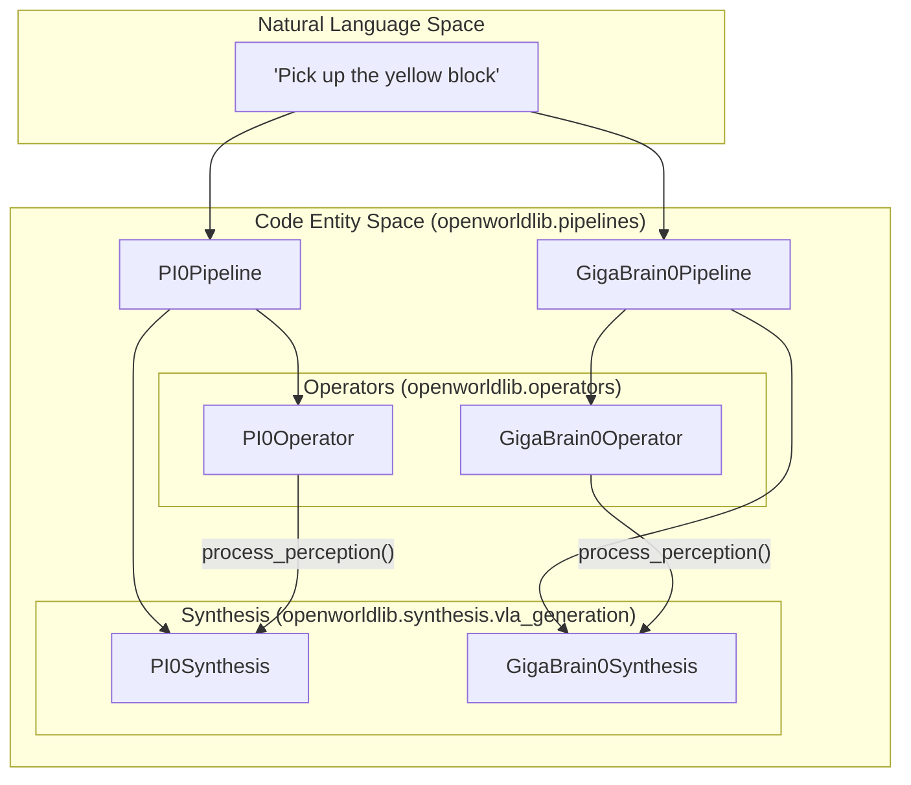
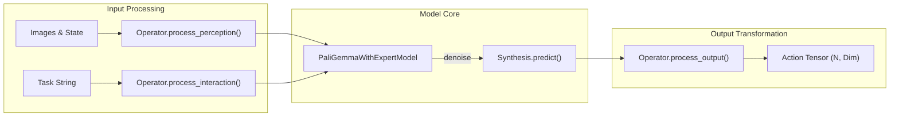

<!-- source: DeepWiki mcp.deepwiki.com · repo OpenDCAI/OpenWorldLib · page 6 Vision-Language-Action (VLA) Pipelines · fetched 2026-11-02 -->

# Vision-Language-Action (VLA) Pipelines

<details>
<summary>Relevant source files</summary>

The following files were used as context for generating this wiki page:

- [README.md](README.md)
- [README_zh.md](README_zh.md)
- [docs/awesome_world_model.md](docs/awesome_world_model.md)
- [docs/planning.md](docs/planning.md)
- [src/openworldlib/operators/giga_brain_0_operator.py](src/openworldlib/operators/giga_brain_0_operator.py)
- [src/openworldlib/pipelines/giga_brain_0/pipeline_giga_brain_0.py](src/openworldlib/pipelines/giga_brain_0/pipeline_giga_brain_0.py)
- [src/openworldlib/pipelines/pi0/pipeline_pi0.py](src/openworldlib/pipelines/pi0/pipeline_pi0.py)
- [src/openworldlib/pipelines/pipeline_utils.py](src/openworldlib/pipelines/pipeline_utils.py)
- [src/openworldlib/synthesis/vla_generation/giga_brain_0/giga_brain_0/modeling_giga_brain_0.py](src/openworldlib/synthesis/vla_generation/giga_brain_0/giga_brain_0/modeling_giga_brain_0.py)
- [src/openworldlib/synthesis/vla_generation/giga_brain_0/giga_brain_0/paligemma2_with_expert.py](src/openworldlib/synthesis/vla_generation/giga_brain_0/giga_brain_0/paligemma2_with_expert.py)
- [src/openworldlib/synthesis/vla_generation/pi0/pi0/modeling_pi0.py](src/openworldlib/synthesis/vla_generation/pi0/pi0/modeling_pi0.py)
- [src/openworldlib/synthesis/vla_generation/pi0/pi0_synthesis.py](src/openworldlib/synthesis/vla_generation/pi0/pi0_synthesis.py)
- [test/test_giga_brain_0.py](test/test_giga_brain_0.py)
- [test/test_pi0.py](test/test_pi0.py)
- [test/test_pi05.py](test/test_pi05.py)

</details>


Vision-Language-Action (VLA) pipelines in OpenWorldLib are designed for **robot action prediction**. These systems ingest multimodal observations—typically multiple camera views (high-level and wrist-mounted) and robot proprioception—alongside natural language instructions to predict a sequence of future actions (e.g., joint velocities or end-effector poses).

The VLA architecture follows the standard OpenWorldLib design pattern, composed of a `Pipeline` class that coordinates an `Operator` for data normalization/tokenization and a `Synthesis` module for model inference [src/openworldlib/pipelines/pi0/pipeline_pi0.py:10-21]().

## VLA System Overview

OpenWorldLib supports two primary categories of VLA systems: diffusion-based models (PI0, GigaBrain0) and specialized synthesis systems (Spirit, LingBot-VA, Libero).

### Diffusion-Based VLA (PI0 & GigaBrain0)
These pipelines utilize a diffusion denoising loop to generate action trajectories. They are built upon a dual-stream attention mechanism (PaliGemma-based) that processes visual and language tokens alongside noisy action tokens.

*   **PI0 (Physical Intelligence 0):** Supports diverse robot embodiments including Aloha, Libero, and Droid [test/test_pi0.py:20-64](). It features a `PI0.5` mode which utilizes discrete state inputs and quantile-based normalization [src/openworldlib/pipelines/pi0/pipeline_pi0.py:13-15]().
*   **GigaBrain0:** An evolution of the PI0 architecture featuring "knowledge insulation" and support for multi-embodiment training via embodiment-specific linear layers [src/openworldlib/synthesis/vla_generation/giga_brain_0/giga_brain_0/modeling_giga_brain_0.py:13-76]().

For deep technical details on these models, including denoising loops and dual-stream attention, see **[PI0 & GigaBrain0: Diffusion-Based Robot Action Prediction](#6.1)**.

### Specialized VLA Systems
OpenWorldLib also integrates VLA systems focused on specific benchmarks or synthesis styles:
*   **Spirit V1.5:** A general-purpose VLA pipeline.
*   **LingBot-VA:** Combines `lingbot_va_synthesis` with a specialized `lingbot_va_operator`.
*   **Libero:** A pipeline dedicated to the LIBERO benchmark, utilizing BDDL task formats and specialized normalization statistics.

For details on environment setup and benchmark evaluation for these systems, see **[Spirit V1.5, LingBot-VA & Libero: Additional VLA Systems](#6.2)**.

---

## Architectural Mapping

The following diagrams illustrate the relationship between high-level VLA concepts and the specific code entities implementing them.

### Pipeline to Code Entity Mapping
This diagram shows how the abstract VLA pipeline is realized through specific classes in the `pi0` and `giga_brain_0` modules.


**Sources:** [src/openworldlib/pipelines/pi0/pipeline_pi0.py:10-21](), [src/openworldlib/pipelines/giga_brain_0/pipeline_giga_brain_0.py:32-52]()

### Action Prediction Workflow
This diagram maps the data flow from raw inputs through the internal code functions to the final predicted robot action.


**Sources:** [src/openworldlib/pipelines/pi0/pipeline_pi0.py:139-173](), [src/openworldlib/synthesis/vla_generation/giga_brain_0/giga_brain_0/modeling_giga_brain_0.py:78-112]()

---

## Pipeline Components

| Component | Role | Key Files |
| :--- | :--- | :--- |
| **Pipeline** | High-level API for `from_pretrained` and `__call__`. | `pipeline_pi0.py`, `pipeline_giga_brain_0.py` |
| **Operator** | Handles image resizing (224x224), normalization via `state_norm_stats`, and tokenization. | `pi0_operator.py`, `giga_brain_0_operator.py` |
| **Synthesis** | Wraps the neural network (VLM + Diffusion Head) and manages the sampling loop. | `pi0_synthesis.py`, `giga_brain_0_synthesis.py` |
| **Model Core** | Implementation of `PaliGemmaWithExpertModel` and `GigaBrain0Policy`. | `modeling_pi0.py`, `modeling_giga_brain_0.py` |

**Sources:** [src/openworldlib/pipelines/pi0/pipeline_pi0.py:10-45](), [src/openworldlib/pipelines/giga_brain_0/pipeline_giga_brain_0.py:32-70](), [src/openworldlib/synthesis/vla_generation/giga_brain_0/giga_brain_0/modeling_giga_brain_0.py:13-34]()

## Usage Example
A VLA pipeline is typically instantiated using `from_pretrained`, which requires normalization statistics for the specific robot embodiment.

```python
# Example instantiation for PI0 on Aloha robot
pipe = PI0Pipeline.from_pretrained(
    model_path='lerobot/pi0_base',
    state_norm_stats=norm_stats['state'],
    action_norm_stats=norm_stats['action'],
    robot_type='aloha'
)
# Inference
actions = pipe(images=img_dict, prompt="perform task", state=robot_state_tensor)
```
**Sources:** [test/test_pi0.py:105-119](), [src/openworldlib/pipelines/pi0/pipeline_pi0.py:32-46]()

---

