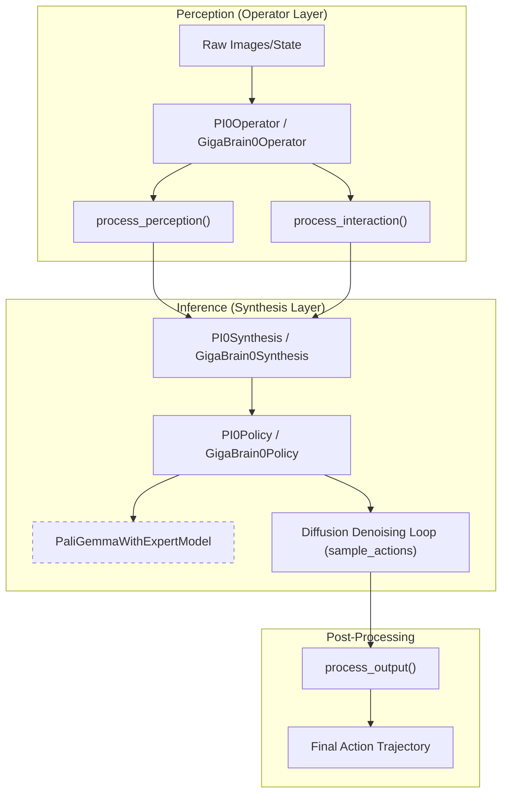
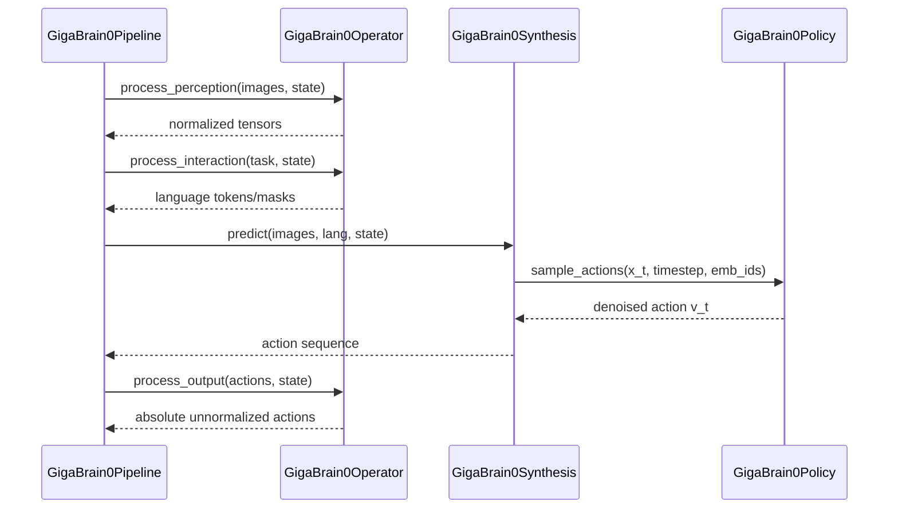

<!-- source: DeepWiki mcp.deepwiki.com · repo OpenDCAI/OpenWorldLib · page 6.1 PI0 & GigaBrain0: Diffusion-Based Robot Action Prediction · fetched 2026-11-02 -->

# PI0 & GigaBrain0: Diffusion-Based Robot Action Prediction

Relevant source files

The following files were used as context for generating this wiki page:

- [src/openworldlib/operators/giga_brain_0_operator.py](src/openworldlib/operators/giga_brain_0_operator.py)
- [src/openworldlib/pipelines/giga_brain_0/pipeline_giga_brain_0.py](src/openworldlib/pipelines/giga_brain_0/pipeline_giga_brain_0.py)
- [src/openworldlib/pipelines/pi0/pipeline_pi0.py](src/openworldlib/pipelines/pi0/pipeline_pi0.py)
- [src/openworldlib/synthesis/vla_generation/giga_brain_0/giga_brain_0/modeling_giga_brain_0.py](src/openworldlib/synthesis/vla_generation/giga_brain_0/giga_brain_0/modeling_giga_brain_0.py)
- [src/openworldlib/synthesis/vla_generation/giga_brain_0/giga_brain_0/paligemma2_with_expert.py](src/openworldlib/synthesis/vla_generation/giga_brain_0/giga_brain_0/paligemma2_with_expert.py)
- [src/openworldlib/synthesis/vla_generation/pi0/pi0/modeling_pi0.py](src/openworldlib/synthesis/vla_generation/pi0/pi0/modeling_pi0.py)
- [src/openworldlib/synthesis/vla_generation/pi0/pi0_synthesis.py](src/openworldlib/synthesis/vla_generation/pi0/pi0_synthesis.py)
- [test/test_giga_brain_0.py](test/test_giga_brain_0.py)
- [test/test_pi0.py](test/test_pi0.py)
- [test/test_pi05.py](test/test_pi05.py)

This page provides a technical deep dive into the **PI0** and **GigaBrain0** Vision-Language-Action (VLA) pipelines. These models utilize a diffusion-based denoising process to predict robot action trajectories from multimodal observations (images, robot state, and natural language instructions).

The implementation is split into two primary families:
1.  **PI0 / PI0.5**: Based on the PaliGemma architecture with expert attention blocks for robot control.
2.  **GigaBrain0**: An evolution using PaliGemma 2, supporting multiple robot embodiments and advanced "knowledge insulation" for improved inference stability.

## System Architecture: Dual-Stream Attention

The core of these VLA models is a dual-stream architecture. A base Vision-Language Model (VLM) processes static observations (images and text) to generate a Key-Value (KV) cache. A secondary "Expert" stream then uses this cache to denoise action trajectories.

### Data Flow & Code Entity Mapping

The following diagram bridges the natural language concepts of the VLA loop to the specific classes and functions in `OpenWorldLib`.

**VLA Prediction Data Flow**

Sources: [src/openworldlib/pipelines/pi0/pipeline_pi0.py:10-21](), [src/openworldlib/synthesis/vla_generation/pi0/pi0/modeling_pi0.py:147-170](), [src/openworldlib/operators/giga_brain_0_operator.py:11-12]()

## PI0 & PI0.5 Implementation

The `PI0Pipeline` serves as a unified wrapper for both the original PI0 and the updated PI0.5.

### Key Features
*   **Dual-Stream VLM**: Uses `PaliGemmaWithExpertModel` to separate general vision-language reasoning from robot-specific action prediction [src/openworldlib/synthesis/vla_generation/pi0/pi0/modeling_pi0.py:194-196]().
*   **Diffusion Denoising**: Actions are generated by denoising a Gaussian noise sequence over a fixed number of steps (default 10) [src/openworldlib/synthesis/vla_generation/pi0/pi0/modeling_pi0.py:179-180]().
*   **PI0.5 Mode**: Enabled via `discrete_state_input=True`. This mode uses quantile-based normalization and specialized time MLPs for the denoising process [src/openworldlib/pipelines/pi0/pipeline_pi0.py:13-15](), [src/openworldlib/synthesis/vla_generation/pi0/pi0/modeling_pi0.py:199-202]().

### Normalization & Robot Support
The pipeline requires normalization statistics (`state_norm_stats`, `action_norm_stats`) which can be either mean/std or quantile-based (q01/q99) [src/openworldlib/pipelines/pi0/pipeline_pi0.py:54-55](). It supports major robot embodiments including **Aloha**, **Libero**, and **Droid** [test/test_pi0.py:20-64]().

Sources: [src/openworldlib/pipelines/pi0/pipeline_pi0.py:32-46](), [src/openworldlib/synthesis/vla_generation/pi0/pi0_synthesis.py:7-15]()

## GigaBrain0: Multi-Embodiment VLA

`GigaBrain0Pipeline` extends the PI0 concept with a larger backbone (PaliGemma 2) and explicit support for `embodiment_id` to handle heterogeneous robot fleets.

### Technical Implementation
*   **PaliGemma2 Backbone**: Utilizes `PaliGemma2WithExpertModel` for enhanced representation learning [src/openworldlib/synthesis/vla_generation/giga_brain_0/giga_brain_0/modeling_giga_brain_0.py:50-54]().
*   **Knowledge Insulation**: A specialized forward pass where the prefix (vision/language) KV cache is detached before being passed to the action suffix, preventing gradient leakage or interference between the general VLM and the action head [src/openworldlib/synthesis/vla_generation/giga_brain_0/giga_brain_0/modeling_giga_brain_0.py:142-160]().
*   **Embodiment-Specific Layers**: Uses `EmbodimentSpecificLinear` projections to map generic VLM features to specific robot action spaces [src/openworldlib/synthesis/vla_generation/giga_brain_0/giga_brain_0/modeling_giga_brain_0.py:63-64]().

### Inference Lifecycle
The pipeline follows a strict sequence: `process()` (input prep) → `predict()` (denoising) → `process_output()` (unnormalization).

**GigaBrain0 Pipeline Logic**

Sources: [src/openworldlib/pipelines/giga_brain_0/pipeline_giga_brain_0.py:147-175](), [src/openworldlib/synthesis/vla_generation/giga_brain_0/giga_brain_0/modeling_giga_brain_0.py:78-112]()

## Key Classes & Functions

| Entity | Role | File Reference |
| :--- | :--- | :--- |
| `PI0Pipeline` | High-level API for PI0/PI0.5 inference. | [src/openworldlib/pipelines/pi0/pipeline_pi0.py:10]() |
| `GigaBrain0Pipeline` | High-level API for GigaBrain0 inference. | [src/openworldlib/pipelines/giga_brain_0/pipeline_giga_brain_0.py:32]() |
| `PaliGemmaWithExpertModel` | Dual-stream attention core for PI0. | [src/openworldlib/synthesis/vla_generation/pi0/pi0/paligemma_with_expert.py]() |
| `PaliGemma2WithExpertModel` | Dual-stream attention core for GigaBrain0. | [src/openworldlib/synthesis/vla_generation/giga_brain_0/giga_brain_0/paligemma2_with_expert.py]() |
| `Normalize` / `Unnormalize` | Handles mean/std or quantile scaling. | [src/openworldlib/operators/giga_brain_0_operator.py:14-102]() |
| `AbsoluteActions` | Converts model deltas back to absolute positions. | [src/openworldlib/operators/giga_brain_0_operator.py:125-146]() |

## Execution & Compilation

To optimize performance, both pipelines support `torch.compile` on the denoising loop:
*   `PI0Pipeline.compile()` wraps `PI0Policy.sample_actions` [src/openworldlib/synthesis/vla_generation/pi0/pi0_synthesis.py:47-50]().
*   Quantization is available via `quantize()` which applies `float8` dynamic activation/weight quantization to the PaliGemma blocks [src/openworldlib/synthesis/vla_generation/pi0/pi0_synthesis.py:52-62]().

### Example Test Usage
Testing scripts provide boilerplate for loading specific robot configurations:
*   **PI0**: `python test/test_pi0.py --dataset aloha` [test/test_pi0.py:4-22]()
*   **GigaBrain0**: `python test/test_giga_brain_0.py` [test/test_giga_brain_0.py:62-84]()

Sources: [src/openworldlib/pipelines/pi0/pipeline_pi0.py:95-97](), [src/openworldlib/pipelines/giga_brain_0/pipeline_giga_brain_0.py:143-145]()

---

