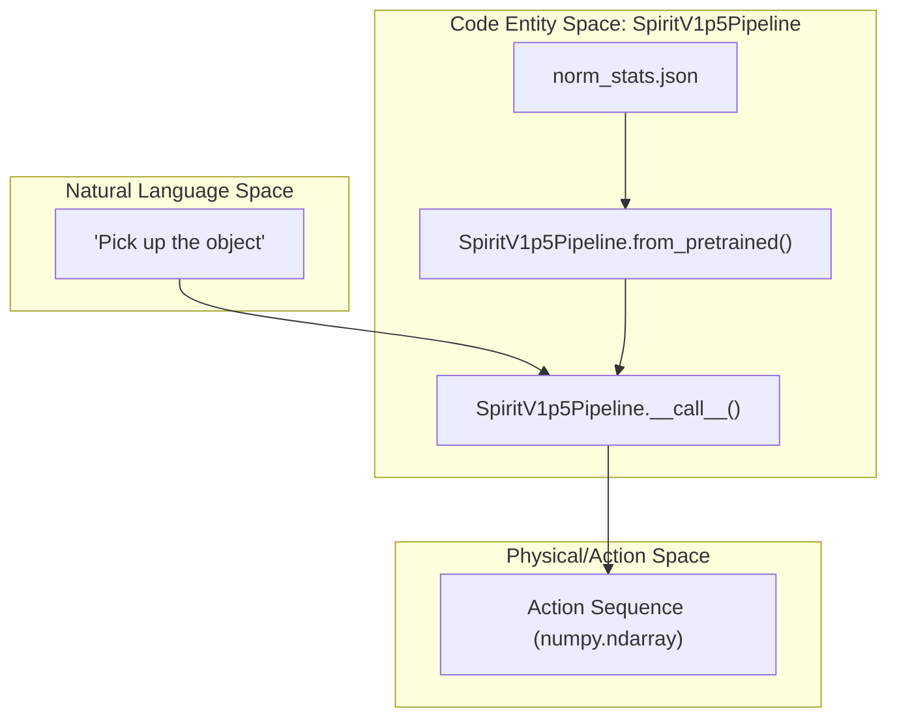
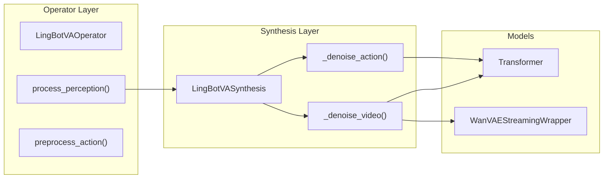

<!-- source: DeepWiki mcp.deepwiki.com · repo OpenDCAI/OpenWorldLib · page 6.2 Spirit V1.5, LingBot-VA & Libero: Additional VLA Systems · fetched 2026-11-02 -->

# Spirit V1.5, LingBot-VA & Libero: Additional VLA Systems

<details>
<summary>Relevant source files</summary>

The following files were used as context for generating this wiki page:

- [data/test_case/test_vla_case1/libero/LIVING_ROOM_SCENE5_put_the_white_mug_on_the_left_plate_and_put_the_yellow_and_white_mug_on_the_right_plate.bddl](data/test_case/test_vla_case1/libero/LIVING_ROOM_SCENE5_put_the_white_mug_on_the_left_plate_and_put_the_yellow_and_white_mug_on_the_right_plate.bddl)
- [scripts/setup/libero_install.sh](scripts/setup/libero_install.sh)
- [scripts/setup/lingbot_va.sh](scripts/setup/lingbot_va.sh)
- [scripts/test_inference/test_vla.sh](scripts/test_inference/test_vla.sh)
- [src/openworldlib/operators/libero_operator.py](src/openworldlib/operators/libero_operator.py)
- [src/openworldlib/operators/lingbot_va_operator.py](src/openworldlib/operators/lingbot_va_operator.py)
- [src/openworldlib/operators/pi0_operator.py](src/openworldlib/operators/pi0_operator.py)
- [src/openworldlib/pipelines/libero/pipeline_libero.py](src/openworldlib/pipelines/libero/pipeline_libero.py)
- [src/openworldlib/pipelines/lingbot_va/pipeline_lingbot_va.py](src/openworldlib/pipelines/lingbot_va/pipeline_lingbot_va.py)
- [src/openworldlib/synthesis/visual_generation/libero/libero_synthesis.py](src/openworldlib/synthesis/visual_generation/libero/libero_synthesis.py)
- [src/openworldlib/synthesis/vla_generation/lingbot_va/lingbot_va_synthesis.py](src/openworldlib/synthesis/vla_generation/lingbot_va/lingbot_va_synthesis.py)
- [test/test_lingbot_va.py](test/test_lingbot_va.py)
- [test/test_spirit_v1p5.py](test/test_spirit_v1p5.py)
- [test/test_spirit_v1p5_libero.py](test/test_spirit_v1p5_libero.py)

</details>


This page documents the integration of specialized Vision-Language-Action (VLA) pipelines within OpenWorldLib. While PI0 and GigaBrain0 focus on diffusion-based policies, the systems described here cover autoregressive video-action generation (LingBot-VA), general-purpose VLA reasoning (Spirit V1.5), and simulation-based execution and visualization (Libero).

## Spirit V1.5: General VLA Pipeline

`SpiritV1p5Pipeline` is designed for high-level robot action prediction across multiple embodiments. It supports multi-view camera inputs and utilizes normalization statistics to map predicted actions into the physical robot's control space.

### Workflow and Implementation
The pipeline follows a standard inference flow where it accepts observation images, the current robot state, and a natural language task description. It outputs a sequence of actions that can be executed directly or visualized in a simulator.

*   **Initialization**: Loaded via `from_pretrained()` using a model path and a `norm_stats_path` containing mean/std or quantile statistics for action denormalization [test/test_spirit_v1p5.py:14-19]().
*   **Data Processing**: It accepts a dictionary of images (e.g., `cam_high`, `cam_left_wrist`) and raw state vectors [test/test_spirit_v1p5.py:24-30]().
*   **Inference**: The `__call__` method returns a sequence of action steps [test/test_spirit_v1p5.py:32-38]().

### Spirit V1.5 Code Entity Mapping
The following diagram illustrates how the Spirit pipeline bridges natural language instructions and physical action space.

**Diagram: Spirit V1.5 Action Generation Flow**

**Sources:** [test/test_spirit_v1p5.py:6-41]()

---

## LingBot-VA: Autoregressive Video-Action Synthesis

`LingBotVAPipeline` implements a world-model approach where future video frames and robot actions are generated co-dependently. It is based on the Wan architecture and uses a transformer-based diffusion process for both modalities.

### Architecture and Data Flow
The system is split into three main components:
1.  **LingBotVAOperator**: Handles image resizing, normalization, and action channel remapping [src/openworldlib/operators/lingbot_va_operator.py:39-42]().
2.  **LingBotVASynthesis**: Manages the transformer, VAE, and flow-match schedulers [src/openworldlib/synthesis/vla_generation/lingbot_va/lingbot_va_synthesis.py:28-54]().
3.  **LingBotVAPipeline**: Orchestrates the autoregressive loop across multiple "chunks" of time [src/openworldlib/pipelines/lingbot_va/pipeline_lingbot_va.py:24-38]().

### Key Functions
*   **`process_perception`**: Normalizes multi-view images to `[-1, 1]` and resizes them according to the `env_type` (e.g., `robotwin_tshape`) [src/openworldlib/operators/lingbot_va_operator.py:91-128]().
*   **`predict`**: Executes the main loop. It alternates between `_denoise_video` and `_denoise_action` for each chunk [src/openworldlib/synthesis/vla_generation/lingbot_va/lingbot_va_synthesis.py:107-182]().
*   **`postprocess_action`**: Denormalizes actions using quantiles (`q01`, `q99`) stored in the configuration [src/openworldlib/operators/lingbot_va_operator.py:160-177]().

**Diagram: LingBot-VA Internal Pipeline**

**Sources:** [src/openworldlib/pipelines/lingbot_va/pipeline_lingbot_va.py:115-180](), [src/openworldlib/synthesis/vla_generation/lingbot_va/lingbot_va_synthesis.py:143-182](), [src/openworldlib/operators/lingbot_va_operator.py:39-180]()

---

## Libero: Simulation and Visualization

The `LiberoPipeline` serves as an evaluation and visualization bridge. It takes actions predicted by a VLA model (like Spirit or PI0) and executes them within the LIBERO simulation environment.

### BDDL Task Format
LIBERO tasks are defined using the PDDL-derived **BDDL (Behavior-Driven Description Language)**. These files specify regions, objects, initial states, and goals [data/test_case/test_vla_case1/libero/LIVING_ROOM_SCENE5_put_the_white_mug_on_the_left_plate_and_put_the_yellow_and_white_mug_on_the_right_plate.bddl:1-92]().

### Implementation Details
*   **`LiberoOperator`**: Primarily used for unnormalizing action sequences before they enter the simulator [src/openworldlib/pipelines/libero/pipeline_libero.py:13-15]().
*   **`LiberoSynthesis`**: Wraps the `robosuite` environment. Its `predict` method steps the simulation, checks for task success, and records video frames [src/openworldlib/pipelines/libero/pipeline_libero.py:110-134]().
*   **`LiberoPipeline.from_pretrained`**: Initializes the environment using a `.bddl` file path and a benchmark name (e.g., `libero_10`) [src/openworldlib/pipelines/libero/pipeline_libero.py:35-49]().

### Evaluation Workflow
The typical VLA benchmark evaluation involves running a VLA pipeline to get actions, then passing those actions to the Libero pipeline for validation.

```python
# Example: Connecting Spirit to Libero
actions = spirit_pipeline(images=images, task=task)
libero_pipeline = LiberoPipeline.from_pretrained(bddl_file=bddl_path)
result = libero_pipeline(actions=actions, video_path="eval.mp4")
print(f"Success: {result['success']}")
```
**Sources:** [test/test_spirit_v1p5_libero.py:18-73](), [src/openworldlib/pipelines/libero/pipeline_libero.py:8-28]()

---

## Installation & Environment

Different VLA systems require specific dependencies, managed via setup scripts:

| System | Setup Script | Key Dependencies |
| :--- | :--- | :--- |
| **LingBot-VA** | `scripts/setup/lingbot_va.sh` | `diffusers==0.36.0`, `flash-attn`, `einops` [scripts/setup/lingbot_va.sh:10-13]() |
| **Libero** | `scripts/setup/libero_install.sh` | `robosuite==1.5.0`, `bddl==1.0.1`, `robomimic` [scripts/setup/libero_install.sh:10-11]() |

### VLA Benchmark Execution
The `scripts/test_inference/test_vla.sh` script provides a unified interface for running tests across all supported VLA systems, including `lingbot-va`, `spirit-v1p5`, and the `spirit-v1p5-libero` combined visualization test [scripts/test_inference/test_vla.sh:28-32]().

**Sources:** [scripts/setup/lingbot_va.sh:1-15](), [scripts/setup/libero_install.sh:1-14](), [scripts/test_inference/test_vla.sh:1-153]()

---

