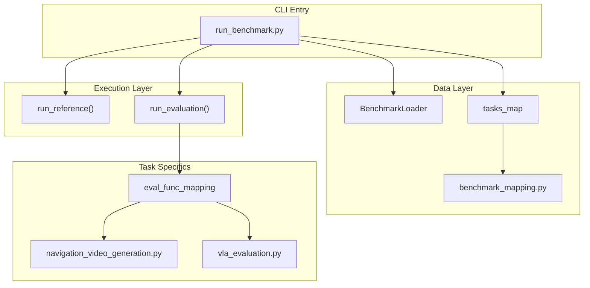
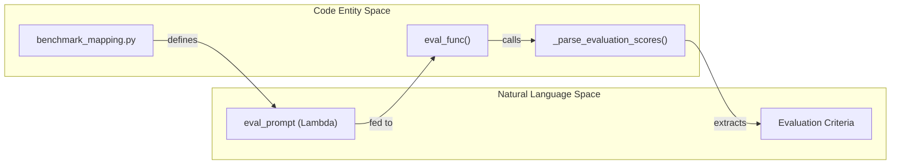

<!-- source: DeepWiki mcp.deepwiki.com · repo OpenDCAI/OpenWorldLib · page 7 Benchmarking & Evaluation Framework · fetched 2026-11-02 -->

# Benchmarking & Evaluation Framework

Relevant source files

The following files were used as context for generating this wiki page:

- [data/benchmarks/benchmark_loader.py](data/benchmarks/benchmark_loader.py)
- [data/benchmarks/generation/navigation_video_generation/benchmark_mapping.py](data/benchmarks/generation/navigation_video_generation/benchmark_mapping.py)
- [data/benchmarks/generation/text2video_generation/benchmark_mapping.py](data/benchmarks/generation/text2video_generation/benchmark_mapping.py)
- [examples/evaluation_tasks/base_evaluation.py](examples/evaluation_tasks/base_evaluation.py)
- [examples/evaluation_tasks/navigation_video_generation.py](examples/evaluation_tasks/navigation_video_generation.py)
- [examples/run_benchmark.py](examples/run_benchmark.py)
- [scripts/test_benchmark/navigation_video_eval.sh](scripts/test_benchmark/navigation_video_eval.sh)

The Benchmarking & Evaluation Framework in OpenWorldLib provides a unified system for measuring the performance of world models across diverse tasks including navigation video generation, multimodal reasoning, 3D reconstruction, and Vision-Language-Action (VLA) robotics. It decouples data loading, model inference, and metric calculation to allow for scalable and reproducible evaluation.

The framework supports a two-stage execution flow:
1.  **Reference Generation**: Running the target model to produce outputs (e.g., videos, actions, or text).
2.  **Evaluation Scoring**: Using Multimodal LLMs (MLLMs) or deterministic scripts to score the generated outputs against ground truth or qualitative criteria.

### System Overview

The evaluation system is centered around `run_benchmark.py`, which acts as the primary entry point for all benchmarking tasks [examples/run_benchmark.py:1-30](). It utilizes a mapping-based architecture to resolve task types to specific data loaders and evaluation functions.

**Core Components:**
*   **`BenchmarkLoader`**: Handles local and HuggingFace-based data retrieval [data/benchmarks/benchmark_loader.py:14-19]().
*   **`tasks_map`**: A registry that associates task types with their metadata and data paths [examples/run_benchmark.py:16]().
*   **`eval_func_mapping`**: Maps task categories to specific scoring logic (e.g., MLLM-based video quality assessment) [examples/run_benchmark.py:20]().

### High-Level Workflow

The following diagram illustrates the relationship between the benchmark runner and the underlying code entities.

**Benchmark Execution Architecture**

**Sources:** [examples/run_benchmark.py:16-26](), [data/benchmarks/benchmark_loader.py:27-35](), [examples/evaluation_tasks/eval_func_mapping.py:1-10]()

---

### Benchmark Data Infrastructure

The data infrastructure is designed to be "plug-and-play." Each benchmark directory contains a `metadata.jsonl` file and a `benchmark_mapping.py` that defines how the data should be interpreted by the `BenchmarkLoader`.

*   **Metadata Management**: The `BenchmarkLoader` parses `.jsonl` or `.json` files and automatically expands relative media paths (images/videos) into absolute paths for the pipeline [data/benchmarks/benchmark_loader.py:113-165]().
*   **Remote Integration**: It supports `snapshot_download` from HuggingFace, allowing users to run benchmarks by simply providing a repo ID [data/benchmarks/benchmark_loader.py:200-210]().

For details on directory structures and metadata formats, see [Benchmark Data Infrastructure (#7.1)](#).

**Sources:** [data/benchmarks/benchmark_loader.py:147-186](), [data/benchmarks/generation/navigation_video_generation/benchmark_mapping.py:31-41]()

---

### Benchmark Execution & MLLM Evaluation

The execution logic supports both end-to-end runs and "evaluation-only" runs using existing result files. This is particularly useful for expensive video generation tasks.

*   **Reference Generation**: The `run_reference` function iterates through samples and uses the pipeline's inference mapping to generate results [examples/run_benchmark.py:164-180]().
*   **MLLM-Based Scoring**: For qualitative tasks like "Navigation Video Generation," the framework uses models like `Qwen2.5-Omni` to score outputs across dimensions such as `navigation_fidelity`, `temporal_consistency`, and `visual_quality` [examples/evaluation_tasks/navigation_video_generation.py:83-90]().
*   **Resumable Evaluation**: Results are persisted in a `results.json` file, allowing the system to skip already generated samples if a run is interrupted [examples/run_benchmark.py:119-135]().

**Evaluation Logic Flow**

**Sources:** [examples/evaluation_tasks/navigation_video_generation.py:58-134](), [data/benchmarks/generation/navigation_video_generation/benchmark_mapping.py:1-29](), [examples/run_benchmark.py:58-61]()

For details on CLI arguments and specific evaluation functions, see [Benchmark Execution & MLLM Evaluation (#7.2)](#).

### Summary Table: Task Types & Metrics

| Task Type | Core Metric | Evaluation Method |
| :--- | :--- | :--- |
| `navigation_video_gen` | Fidelity, Consistency | MLLM Scoring (1-10) |
| `text2video_generation` | Alignment, Quality | MLLM Scoring (1-10) |
| `vla` | Success Rate | Deterministic Script |
| `spatial_reasoning` | Accuracy | Exact Match / LLM |

**Sources:** [data/benchmarks/generation/navigation_video_generation/benchmark_mapping.py:22-28](), [data/benchmarks/generation/text2video_generation/benchmark_mapping.py:30-36](), [examples/run_benchmark.py:31-42]()

---

