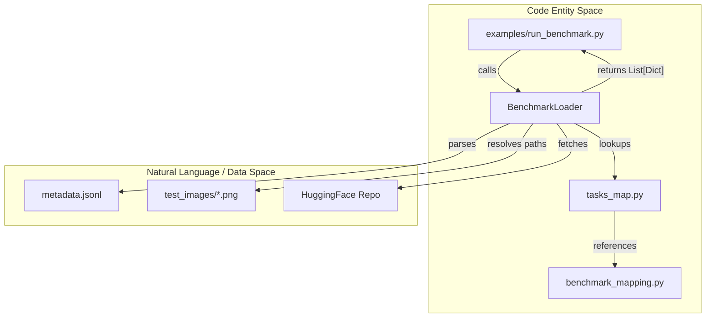
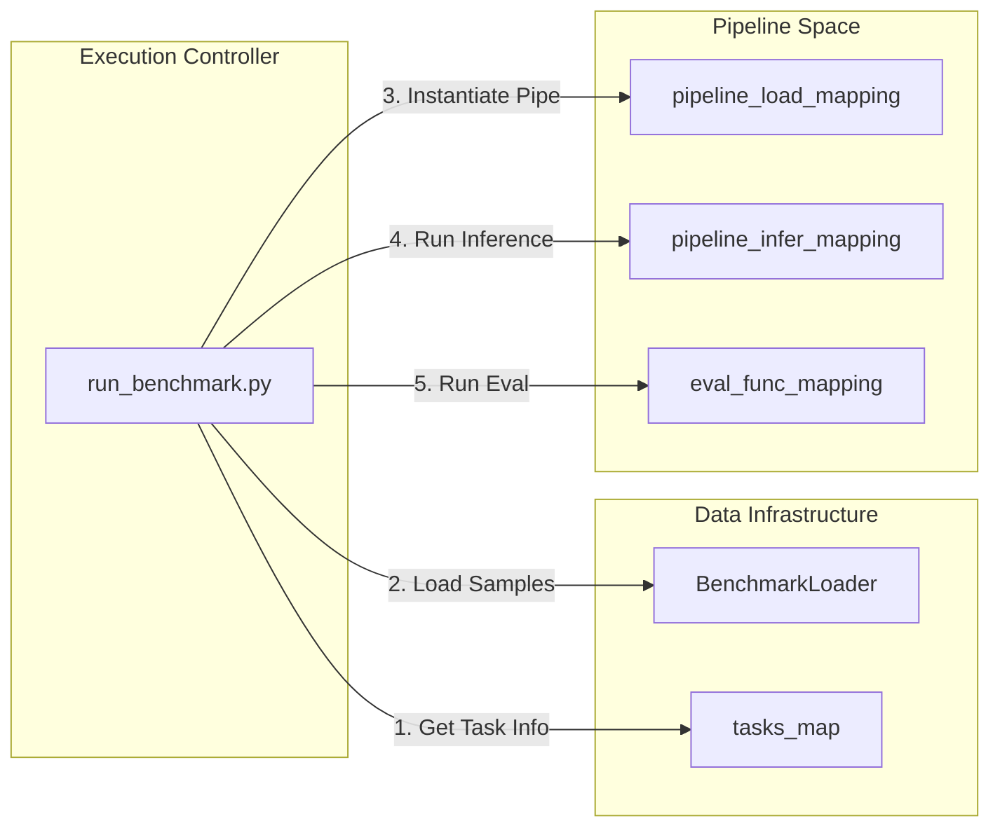

<!-- source: DeepWiki mcp.deepwiki.com · repo OpenDCAI/OpenWorldLib · page 7.1 Benchmark Data Infrastructure · fetched 2026-11-02 -->

# Benchmark Data Infrastructure

<details>
<summary>Relevant source files</summary>

The following files were used as context for generating this wiki page:

- [data/benchmarks/benchmark_loader.py](data/benchmarks/benchmark_loader.py)
- [data/benchmarks/generation/__init__.py](data/benchmarks/generation/__init__.py)
- [data/benchmarks/generation/image2video_editing/benchmark_mapping.py](data/benchmarks/generation/image2video_editing/benchmark_mapping.py)
- [data/benchmarks/generation/navigation_video_generation/benchmark_mapping.py](data/benchmarks/generation/navigation_video_generation/benchmark_mapping.py)
- [data/benchmarks/generation/scene_3d_generation/benchmark_mapping.py](data/benchmarks/generation/scene_3d_generation/benchmark_mapping.py)
- [data/benchmarks/generation/text2video_generation/benchmark_mapping.py](data/benchmarks/generation/text2video_generation/benchmark_mapping.py)
- [data/benchmarks/reasoning/__init__.py](data/benchmarks/reasoning/__init__.py)
- [data/benchmarks/reasoning/academic_qa/benchmark_mapping.py](data/benchmarks/reasoning/academic_qa/benchmark_mapping.py)
- [data/benchmarks/reasoning/simulation_env_reasoning/benchmark_mapping.py](data/benchmarks/reasoning/simulation_env_reasoning/benchmark_mapping.py)
- [data/benchmarks/reasoning/sptial_reasoning/benchmark_mapping.py](data/benchmarks/reasoning/sptial_reasoning/benchmark_mapping.py)
- [data/benchmarks/reasoning/three_dimension_reasoning/benchmark_mapping.py](data/benchmarks/reasoning/three_dimension_reasoning/benchmark_mapping.py)
- [data/benchmarks/tasks_map.py](data/benchmarks/tasks_map.py)
- [examples/evaluation_tasks/base_evaluation.py](examples/evaluation_tasks/base_evaluation.py)
- [examples/evaluation_tasks/navigation_video_generation.py](examples/evaluation_tasks/navigation_video_generation.py)
- [examples/run_benchmark.py](examples/run_benchmark.py)
- [scripts/test_benchmark/navigation_video_eval.sh](scripts/test_benchmark/navigation_video_eval.sh)
- [test/test_wan_2p2.py](test/test_wan_2p2.py)
- [test_stream/test_wan2p2_stream.py](test_stream/test_wan2p2_stream.py)

</details>


The Benchmark Data Infrastructure in OpenWorldLib provides a unified, extensible framework for loading and organizing datasets across diverse world model tasks, including navigation video generation, multimodal reasoning, VLA (Vision-Language-Action), and 3D scene synthesis. It abstracts the complexities of data sourcing (local vs. HuggingFace) and metadata parsing, ensuring that pipelines receive standardized input dictionaries.

## Core Components

The infrastructure is centered around the `BenchmarkLoader` class and a hierarchical mapping system that defines task-specific data requirements.

### BenchmarkLoader
The `BenchmarkLoader` [data/benchmarks/benchmark_loader.py:14-25]() is the primary engine for data ingestion. It handles:
*   **Path Resolution**: Automatically detects if a `data_path` is a local directory or a HuggingFace repository ID [data/benchmarks/benchmark_loader.py:94-111]().
*   **HuggingFace Integration**: Uses `snapshot_download` to fetch datasets if not found locally [data/benchmarks/benchmark_loader.py:107-111]().
*   **Metadata Parsing**: Supports both `.json` and `.jsonl` formats [data/benchmarks/benchmark_loader.py:120-145]().
*   **Media Path Expansion**: Identifies string values with supported media extensions (e.g., `.mp4`, `.png`, `.webp`) and converts them into absolute filesystem paths based on the `perception_data_path` [data/benchmarks/benchmark_loader.py:166-184]().

### Task and Benchmark Mappings
The infrastructure uses a nested mapping strategy to register benchmarks:
1.  **`tasks_map`**: The top-level registry in [data/benchmarks/tasks_map.py:5-9]() that categorizes benchmarks into broad types like `navigation_video_gen` or `vla_eval`.
2.  **`benchmark_mapping.py`**: Located within specific task directories (e.g., `data/benchmarks/generation/navigation_video_generation/`), these files define the `info` dictionary for each benchmark [data/benchmarks/generation/navigation_video_generation/benchmark_mapping.py:31-41]().

**Data Flow: From Configuration to Pipeline Input**

The following diagram illustrates how the `BenchmarkLoader` transforms raw metadata into structured test cases for the `run_benchmark.py` execution script.

**Benchmark Data Assembly Flow**

Sources: [examples/run_benchmark.py:16-17](), [data/benchmarks/benchmark_loader.py:27-35](), [data/benchmarks/tasks_map.py:5-9]()

---

## Directory Structure and Metadata

The benchmark data is organized by capability pillars. Each benchmark directory typically contains a metadata file and a folder for perceptual data (images/videos).

### Directory Layout
```text
data/benchmarks/
├── generation/
│   ├── navigation_video_generation/
│   │   ├── benchmark_mapping.py
│   │   └── sf_nav_vidgen_test/
│   │       ├── metadata.jsonl
│   │       └── test_images/
│   └── imagetext2video_generation/
├── reasoning/
│   └── spatial_reasoning/
└── vla/
    └── vla_libero_benchmarks/
```
Sources: [data/benchmarks/generation/__init__.py:1-3](), [data/benchmarks/tasks_map.py:5-9]()

### Metadata Format (`metadata.jsonl`)
The `metadata.jsonl` file contains one JSON object per line. Each object must include the keys defined in the `input_keys` section of the corresponding `benchmark_mapping.py` [data/benchmarks/benchmark_loader.py:169-175]().

**Example Entry for Navigation:**
```json
{"id": "sample_001", "ref_image": "start_frame.png", "interaction_signal": "forward,left", "scene_description": "A sunny forest path"}
```
Sources: [data/benchmarks/generation/navigation_video_generation/benchmark_mapping.py:31-37](), [data/benchmarks/benchmark_loader.py:122-136]()

### Supported Media Extensions
The loader automatically identifies the following extensions for path resolution:
*   **Images**: `.png`, `.jpg`, `.jpeg`, `.bmp`, `.tiff`, `.tif`, `.webp` [data/benchmarks/benchmark_loader.py:21]()
*   **Videos**: `.mp4`, `.avi`, `.mov`, `.mkv`, `.webm`, `.gif` [data/benchmarks/benchmark_loader.py:22]()

---

## Implementation Details

### Benchmark Mapping Pattern
Each task type implements a `benchmark_mapping.py` that provides a schema for the `BenchmarkLoader`.

| Key | Description |
| :--- | :--- |
| `input_keys` | Keys in metadata required for model inference. |
| `output_keys` | Keys representing the expected model output (e.g., `generated_video`). |
| `perception_data_path` | Subdirectory containing media files. |
| `metadata_path` | Path to the `.jsonl` or `.json` file. |
| `eval_prompt` | A lambda or function that generates the MLLM evaluation prompt. |

Sources: [data/benchmarks/generation/navigation_video_generation/benchmark_mapping.py:31-37](), [data/benchmarks/generation/text2video_generation/benchmark_mapping.py:39-44]()

### Evaluation Prompt Integration
The `eval_prompt` in the mapping file is a critical bridge between the raw data and the evaluation MLLM. It takes a `sample` dictionary and returns a formatted string instructing the evaluator (e.g., Qwen2.5-Omni) on how to score dimensions like Navigation Fidelity or Temporal Consistency [data/benchmarks/generation/navigation_video_generation/benchmark_mapping.py:1-29]().

**System Logic for Pipeline Execution**
The following diagram shows how `run_benchmark.py` coordinates the loader and the inference logic.

**Inference and Data Integration**

Sources: [examples/run_benchmark.py:16-20](), [examples/run_benchmark.py:164-180]()

### Key Functions
*   **`load_benchmark(...)`**: Orchestrates the resolution of the data path, loading of metadata, and assembly of test cases [data/benchmarks/benchmark_loader.py:27-35]().
*   **`_assemble_test_cases(...)`**: Iterates through metadata entries and prepends the absolute base path to any string recognized as a media file [data/benchmarks/benchmark_loader.py:153-186]().
*   **`download_from_hf(...)`**: Wrapper around `huggingface_hub` to manage dataset downloads and local caching [data/benchmarks/benchmark_loader.py:200-210]().

Sources: [data/benchmarks/benchmark_loader.py:14-210]()

---

