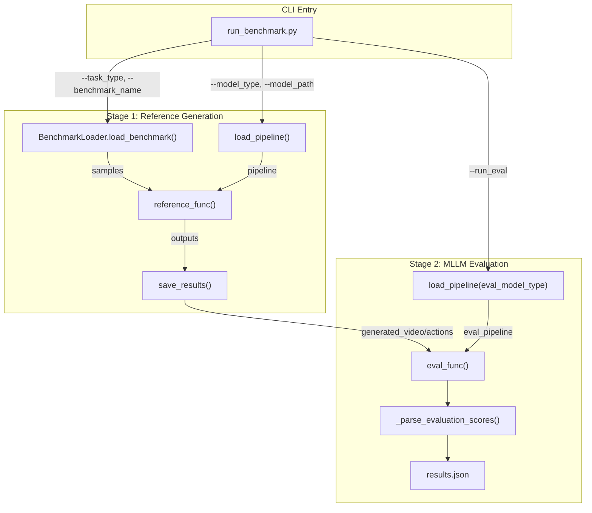
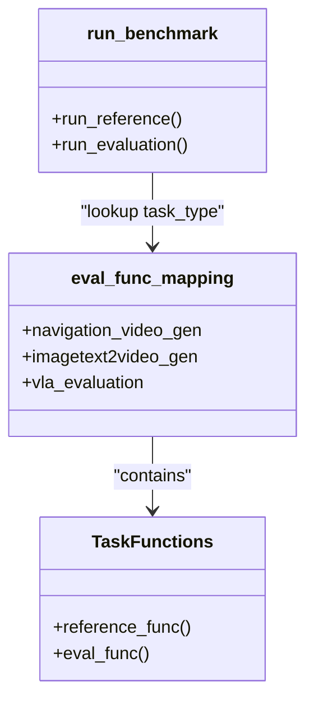

<!-- source: DeepWiki mcp.deepwiki.com · repo OpenDCAI/OpenWorldLib · page 7.2 Benchmark Execution & MLLM Evaluation · fetched 2026-11-02 -->

# Benchmark Execution & MLLM Evaluation

<details>
<summary>Relevant source files</summary>

The following files were used as context for generating this wiki page:

- [data/benchmarks/benchmark_loader.py](data/benchmarks/benchmark_loader.py)
- [data/benchmarks/generation/navigation_video_generation/benchmark_mapping.py](data/benchmarks/generation/navigation_video_generation/benchmark_mapping.py)
- [data/benchmarks/generation/text2video_generation/benchmark_mapping.py](data/benchmarks/generation/text2video_generation/benchmark_mapping.py)
- [data/benchmarks/generation/text2video_generation/videoverse/info.py](data/benchmarks/generation/text2video_generation/videoverse/info.py)
- [data/benchmarks/generation/text2video_generation/worldscore/info.py](data/benchmarks/generation/text2video_generation/worldscore/info.py)
- [data/benchmarks/vla/__init__.py](data/benchmarks/vla/__init__.py)
- [data/benchmarks/vla/vla_libero_test/benchmark_mapping.py](data/benchmarks/vla/vla_libero_test/benchmark_mapping.py)
- [examples/evaluation_tasks/base_evaluation.py](examples/evaluation_tasks/base_evaluation.py)
- [examples/evaluation_tasks/eval_func_mapping.py](examples/evaluation_tasks/eval_func_mapping.py)
- [examples/evaluation_tasks/imagetext2video_generation.py](examples/evaluation_tasks/imagetext2video_generation.py)
- [examples/evaluation_tasks/navigation_video_generation.py](examples/evaluation_tasks/navigation_video_generation.py)
- [examples/evaluation_tasks/vla_evaluation.py](examples/evaluation_tasks/vla_evaluation.py)
- [examples/run_benchmark.py](examples/run_benchmark.py)
- [scripts/setup/flash_world_install.sh](scripts/setup/flash_world_install.sh)
- [scripts/test_benchmark/imagetext2video_eval.sh](scripts/test_benchmark/imagetext2video_eval.sh)
- [scripts/test_benchmark/navigation_video_eval.sh](scripts/test_benchmark/navigation_video_eval.sh)
- [scripts/test_benchmark/vla_evaluation.sh](scripts/test_benchmark/vla_evaluation.sh)
- [scripts/test_inference/test_3d_scene_gen.sh](scripts/test_inference/test_3d_scene_gen.sh)
- [scripts/test_inference/test_audio_gen.sh](scripts/test_inference/test_audio_gen.sh)
- [scripts/test_inference/test_inter_video_gen.sh](scripts/test_inference/test_inter_video_gen.sh)

</details>


The OpenWorldLib benchmarking framework provides a standardized, two-stage workflow for executing world model tasks and evaluating their outputs using Multimodal Large Language Models (MLLMs). It supports diverse task categories including navigation video generation, text-to-video synthesis, and Vision-Language-Action (VLA) evaluation.

## 1. Execution Architecture

The benchmarking system is centered around `run_benchmark.py`, which orchestrates the loading of datasets, model pipelines, and evaluation logic. The process is divided into two primary stages: **Reference Generation** and **Evaluation Scoring**.

### Benchmark Execution Flow
The following diagram illustrates the data flow from CLI invocation through the two-stage execution process.

Title: Benchmark Execution Pipeline

Sources: [examples/run_benchmark.py:30-64](), [examples/run_benchmark.py:164-210](), [examples/run_benchmark.py:213-259]()

## 2. CLI Configuration & Parameters

The `run_benchmark.py` script uses a comprehensive set of arguments to control the lifecycle of a benchmark run.

| Argument | Type | Description |
| :--- | :--- | :--- |
| `--task_type` | `str` | The category of the task (e.g., `navigation_video_gen`, `vla_evaluation`). |
| `--benchmark_name` | `str` | Specific benchmark ID registered in `benchmark_mapping.py`. |
| `--model_type` | `str` | The model architecture to test (e.g., `matrix-game2`, `wan2p2`). |
| `--model_path` | `str/JSON` | Path or HF ID. Supports JSON strings for multi-weight models. |
| `--run_eval` | `flag` | If set, executes the MLLM-based evaluation stage. |
| `--results_dir` | `str` | Path to existing results. If provided, skips Stage 1 and resumes from Evaluation. |
| `--eval_model_type`| `str` | The MLLM used for scoring (default: `qwen2p5omni`). |

Sources: [examples/run_benchmark.py:30-64](), [examples/run_benchmark.py:67-85]()

## 3. The Two-Stage Flow

### Stage 1: Reference Generation (`run_reference`)
In this stage, the system iterates through the test cases provided by `BenchmarkLoader`. For each sample, it invokes a `reference_func` mapped to the `task_type` in `eval_func_mapping.py`.
- **Navigation Tasks**: The `reference_func` in `navigation_video_generation.py` takes an initial image and a sequence of `interaction_signal` inputs to generate a video [examples/evaluation_tasks/navigation_video_generation.py:9-54]().
- **VLA Tasks**: Generates a sequence of robot actions based on visual observations and language instructions.

### Stage 2: MLLM Evaluation (`run_evaluation`)
If `--run_eval` is enabled, the system loads an evaluation MLLM (typically `Qwen2.5-Omni`). It uses task-specific prompts defined in the benchmark's `benchmark_mapping.py` to ask the MLLM to score the generated output across multiple dimensions.

Sources: [examples/run_benchmark.py:164-259](), [examples/evaluation_tasks/eval_func_mapping.py:15-28]()

## 4. MLLM-Based Scoring Metrics

Evaluation is performed by passing the generated media (video/image) and the original prompt/interaction signals to an MLLM. The MLLM is instructed to provide scores (1-10) and comments in a strict format.

### Navigation Fidelity Metrics
For navigation video generation, the `eval_func` in `navigation_video_generation.py` parses the following dimensions:
- **Navigation Fidelity**: Accuracy of executing interaction signals (e.g., turning left on "left").
- **Visual Quality**: Clarity and absence of artifacts.
- **Temporal Consistency**: Coherence across consecutive frames.
- **Scene Consistency**: Adherence to the reference image's style and layout.
- **Motion Smoothness**: Naturalness of camera movement.

### VLA Task Success Rate
For VLA (Vision-Language-Action) tasks, evaluation typically focuses on the **Task Success Rate**, determining if the predicted actions lead to the completion of the robotic manipulation goal [examples/evaluation_tasks/eval_func_mapping.py:24-27]().

Sources: [examples/evaluation_tasks/navigation_video_generation.py:137-186](), [data/benchmarks/generation/navigation_video_generation/benchmark_mapping.py:1-29]()

## 5. Implementation Details

### Mapping Logic
The system uses `eval_func_mapping` to decouple the runner logic from task-specific implementations.

Title: Evaluation Function Mapping

Sources: [examples/evaluation_tasks/eval_func_mapping.py:15-28](), [examples/run_benchmark.py:23-26]()

### Result Persistence & Resumability
Results are saved in a structured JSON format within the `--output_dir`.
- **Persistence**: Every sample result is appended to a `results.json` file, including paths to generated videos and raw MLLM responses [examples/run_benchmark.py:119-160]().
- **Resumable Evaluation**: By providing `--results_dir`, the script skips the expensive generation stage and directly performs evaluation on previously generated assets [examples/run_benchmark.py:302-310]().

### Example Execution Command
To run a full navigation benchmark with evaluation:
```bash
python -m examples.run_benchmark \
    --task_type navigation_video_gen \
    --benchmark_name sf_nav_vidgen_test \
    --data_path ./data/benchmarks/generation/navigation_video_generation/sf_nav_vidgen_test \
    --model_type hunyuan-game-craft \
    --model_path '{"pretrained_model_path": "tencent/Hunyuan-GameCraft-1.0"}' \
    --run_eval
```
Sources: [scripts/test_benchmark/navigation_video_eval.sh:2-14]()

---

