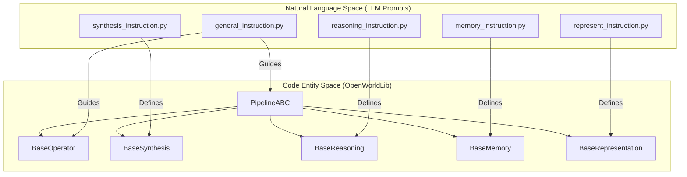
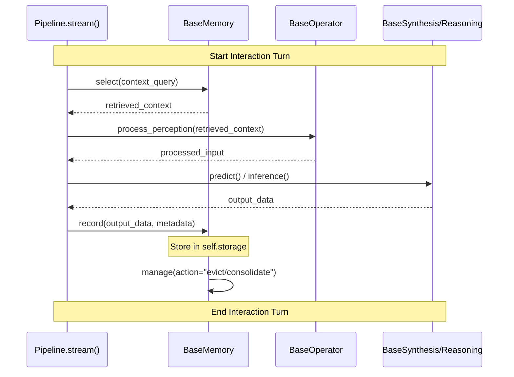

<!-- source: DeepWiki mcp.deepwiki.com · repo OpenDCAI/OpenWorldLib · page 8.1 Vibe Coding: LLM-Assisted Framework Construction · fetched 2026-11-02 -->

# Vibe Coding: LLM-Assisted Framework Construction

<details>
<summary>Relevant source files</summary>

The following files were used as context for generating this wiki page:

- [tools/readme.md](tools/readme.md)
- [tools/vibe_code/prompts/general_instruction.py](tools/vibe_code/prompts/general_instruction.py)
- [tools/vibe_code/prompts/memory_instruction.py](tools/vibe_code/prompts/memory_instruction.py)
- [tools/vibe_code/prompts/reasoning_instruction.py](tools/vibe_code/prompts/reasoning_instruction.py)
- [tools/vibe_code/prompts/represent_instruction.py](tools/vibe_code/prompts/represent_instruction.py)
- [tools/vibe_code/prompts/synthesis_instruction.py](tools/vibe_code/prompts/synthesis_instruction.py)
- [tools/vibe_code/readme.md](tools/vibe_code/readme.md)

</details>


Vibe Coding is the core methodology used to construct and extend the OpenWorldLib framework. It leverages Large Language Models (LLMs) as architect-level assistants to transform raw model implementations into modular, standardized components that conform to the OpenWorldLib `Pipeline`, `Operator`, `Synthesis`, `Reasoning`, `Representation`, and `Memory` abstractions. This approach ensures that diverse world models—ranging from video generators to 3D reconstruction systems—share a unified interface for inference, streaming, and evaluation [tools/readme.md:1-3]().

## The Vibe Coding Workflow

The process utilizes a set of structured prompt templates located in `tools/vibe_code/prompts/`. These templates provide the LLM with the "vibe" (the architectural pattern and coding style) of the library, enabling it to generate conformant code from external repositories or paper implementations.

### Architectural Mapping: Natural Language to Code

The following diagram illustrates how the Vibe Coding instructions bridge the gap between high-level task descriptions and the concrete class structures required by the framework.

**Title: Vibe Coding Entity Mapping**

Sources: [tools/vibe_code/prompts/general_instruction.py:40-115](), [tools/vibe_code/prompts/synthesis_instruction.py:1-22](), [tools/vibe_code/prompts/reasoning_instruction.py:1-22](), [tools/vibe_code/prompts/memory_instruction.py:1-11](), [tools/vibe_code/prompts/represent_instruction.py:1-23]()

## Core Prompt Templates

### 1. General Instruction (`general_instruction.py`)
This is the foundational prompt that defines the high-level relationship between the `Pipeline`, `Operator`, and `Memory` modules. It enforces the following lifecycle:
*   **Pipeline File**: Must implement `from_pretrained()`, `process()`, `__call__()`, and `stream()` [tools/vibe_code/prompts/general_instruction.py:45-69]().
*   **Operator File**: Must inherit from `BaseOperator` and handle `textual_instruction`, `visual_instruction`, and `action_instruction` [tools/vibe_code/prompts/general_instruction.py:79-115]().

### 2. Synthesis Instruction (`synthesis_instruction.py`)
Used for generative world models (Video, Audio). It requires the implementation of a `BaseSynthesis` class with a `predict()` method that accepts processed results from the `Operator` [tools/vibe_code/prompts/synthesis_instruction.py:7-21]().

### 3. Reasoning Instruction (`reasoning_instruction.py`)
Targeted at MLLMs and spatial reasoning models. It defines a `BaseReasoning` class where the `inference()` method is the primary execution point for multimodal understanding [tools/vibe_code/prompts/reasoning_instruction.py:7-21]().

### 4. Representation Instruction (`represent_instruction.py`)
Focuses on 3D scene understanding. The generated `BaseRepresentation` class must implement `get_representation()`, which outputs point clouds, depth maps, or camera poses [tools/vibe_code/prompts/represent_instruction.py:7-23]().

### 5. Memory Instruction (`memory_instruction.py`)
Crucial for the `stream()` interface. It defines a stateful `BaseMemory` class that manages interaction history across multiple turns [tools/vibe_code/prompts/memory_instruction.py:1-11]().

## Implementation: The Memory Lifecycle

The `Memory` module is the state management backbone for multi-turn interactions. It is primarily invoked within the `Pipeline.stream()` function [tools/vibe_code/prompts/memory_instruction.py:4]().

**Title: Memory Data Flow in Pipeline.stream()**

Sources: [tools/vibe_code/prompts/memory_instruction.py:18-97](), [tools/vibe_code/prompts/general_instruction.py:64-68]()

### Memory Class Specification
The `BaseMemory` template requires five key methods to handle the lifecycle of interaction data:

| Method | Purpose | Implementation Detail |
| :--- | :--- | :--- |
| `record()` | Ingestion | Ingests raw data (PIL.Image, text, etc.) after each turn [tools/vibe_code/prompts/memory_instruction.py:46-56](). |
| `select()` | Retrieval | Retrieves context (e.g., the last generated frame) for the next turn [tools/vibe_code/prompts/memory_instruction.py:58-67](). |
| `compress()` | Refinement | Distills key information (summarization or feature extraction) [tools/vibe_code/prompts/memory_instruction.py:69-77](). |
| `process()` | Adaptation | Converts refined data into model-ready formats like `kv_cache` or `latents` [tools/vibe_code/prompts/memory_instruction.py:79-87](). |
| `manage()` | Lifecycle | Handles `reset`, `eviction`, and STM-to-LTM transfer [tools/vibe_code/prompts/memory_instruction.py:89-97](). |

## Example: MatrixGame2 Implementation
The Vibe Coding prompts guide the LLM to produce concrete implementations like `MatrixGame2Memory`, which stores generated video frames and retrieves the `last_frame` to maintain temporal continuity during navigation [tools/vibe_code/prompts/memory_instruction.py:118-159]().

### Data Structure Template
All memory implementations must adhere to a standardized storage format within `self.storage`:
```python
{
    'content': <data>,      # PIL.Image, str, tensor, etc.
    'type': <type>,         # 'image', 'video', 'text', 'audio', 'action', 'other'
    'timestamp': <int>,     # Sequential index
    'metadata': <dict>      # Interaction signals or model config
}
```
Sources: [tools/vibe_code/prompts/memory_instruction.py:28-37](), [tools/vibe_code/prompts/general_instruction.py:139-150]()

---

