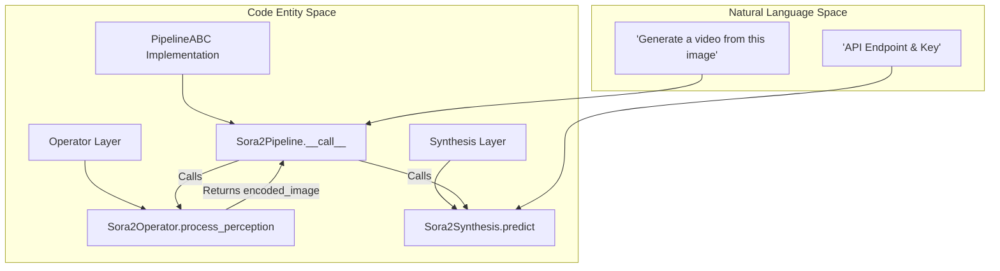
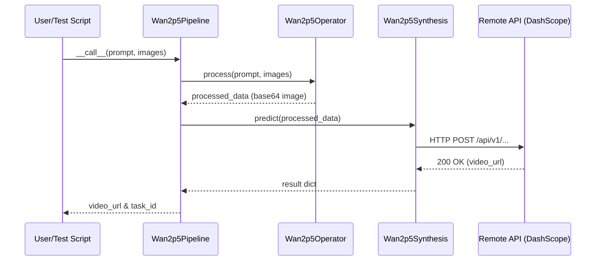

<!-- source: DeepWiki mcp.deepwiki.com · repo OpenDCAI/OpenWorldLib · page 8.2 API Clients & External Model Integration · fetched 2026-11-02 -->

# API Clients & External Model Integration

<details>
<summary>Relevant source files</summary>

The following files were used as context for generating this wiki page:

- [scripts/setup/default_audio_generation_install.sh](scripts/setup/default_audio_generation_install.sh)
- [src/openworldlib/operators/sora2_operator.py](src/openworldlib/operators/sora2_operator.py)
- [src/openworldlib/operators/veo3_operator.py](src/openworldlib/operators/veo3_operator.py)
- [src/openworldlib/operators/wan_2p5_operator.py](src/openworldlib/operators/wan_2p5_operator.py)
- [src/openworldlib/pipelines/sora/pipeline_sora2.py](src/openworldlib/pipelines/sora/pipeline_sora2.py)
- [src/openworldlib/pipelines/veo/pipeline_veo3.py](src/openworldlib/pipelines/veo/pipeline_veo3.py)
- [src/openworldlib/pipelines/wan/pipeline_wan_2p5.py](src/openworldlib/pipelines/wan/pipeline_wan_2p5.py)
- [src/openworldlib/synthesis/visual_generation/veo/veo3_synthesis.py](src/openworldlib/synthesis/visual_generation/veo/veo3_synthesis.py)
- [test/test_sora2.py](test/test_sora2.py)
- [test/test_veo3.py](test/test_veo3.py)
- [test/test_wan_2p5.py](test/test_wan_2p5.py)
- [tools/api/clients/__init__.py](tools/api/clients/__init__.py)
- [tools/api/configs/requirement_av_api.md](tools/api/configs/requirement_av_api.md)
- [tools/api/configs/settings.yaml](tools/api/configs/settings.yaml)

</details>


This page documents the tools and API layer used by OpenWorldLib to interface with cloud-based generative world models. Unlike local inference pipelines that load weights into GPU memory, API-based pipelines leverage remote endpoints for synthesis. The framework currently supports **Sora2** (OpenAI), **Veo3** (OpenAI-compatible third-party), and **Wan2.5** (Alibaba DashScope).

## Architecture Overview

The API integration follows the standard OpenWorldLib design pattern: a `Pipeline` coordinates an `Operator` for data preprocessing and a `Synthesis` class for remote model invocation.

### Data Flow: Local to Cloud
1.  **Input**: The user provides a text prompt and optional reference images to the `Pipeline`.
2.  **Operator**: The `Operator` (e.g., `Sora2Operator`) encodes images into base64 or bytes and formats the interaction signal [src/openworldlib/operators/sora2_operator.py:78-104]().
3.  **Synthesis**: The `Synthesis` class (e.g., `Wan2p5Synthesis`) sends a request to the configured `endpoint` using the provided `api_key` [src/openworldlib/synthesis/visual_generation/wan/wan_2p5_synthesis.py]().
4.  **Polling/Retrieval**: For asynchronous APIs like Sora2, the pipeline enters a polling loop to check task status [src/openworldlib/pipelines/sora/pipeline_sora2.py:154-212]().

### Natural Language to Code Entity Mapping (API Context)
The following diagram illustrates how high-level API concepts map to specific classes and methods within the codebase.

**API Pipeline Composition**

**Sources:** [src/openworldlib/pipelines/sora/pipeline_sora2.py:106-152](), [src/openworldlib/operators/sora2_operator.py:78-104]()

---

## Supported API Clients

### Sora2 (OpenAI)
The `Sora2Pipeline` supports both Text-to-Video (T2V) and Image-to-Video (I2V). It includes a robust polling mechanism to track generation progress.

*   **Operator**: `Sora2Operator` handles `RGB` conversion and converts PIL images to bytes for the OpenAI multipart upload [src/openworldlib/operators/sora2_operator.py:35-58]().
*   **Pipeline Lifecycle**: The `__call__` method automatically detects the task type based on the presence of images [src/openworldlib/pipelines/sora/pipeline_sora2.py:118-132](). If `wait=True`, it invokes `_poll_video_status` which prints a progress bar to `stdout` [src/openworldlib/pipelines/sora/pipeline_sora2.py:144-152]().
*   **Endpoint**: Default is `https://api.openai.com/v1` [tools/api/configs/requirement_av_api.md:5-6]().

### Veo3 (Third-party OpenAI-compatible)
`Veo3Pipeline` is designed for endpoints that use the OpenAI Chat Completions format to trigger video generation.

*   **Operator**: `Veo3Operator` builds a `user_content` list containing a JSON-stringified instruction (with metadata like `aspect_ratio` and `resolution`) and base64-encoded images [src/openworldlib/operators/veo3_operator.py:75-133]().
*   **Synthesis**: Uses `OpenAI` client internally to call the `veo3.1` model via the `chat.completions` endpoint [src/openworldlib/synthesis/visual_generation/veo/veo3_synthesis.py:86-91]().

### Wan2.5 (Alibaba DashScope)
`Wan2p5Pipeline` interfaces with Alibaba's DashScope API. It supports T2V and I2V (often referred to as I2AV in this context).

*   **Operator**: `Wan2p5Operator` encodes images into a `data:image/png;base64,...` string [src/openworldlib/operators/wan_2p5_operator.py:35-55]().
*   **Response Handling**: The pipeline checks for `HTTPStatus.OK` and extracts `video_url` and `task_id` from the response object [src/openworldlib/pipelines/wan/pipeline_wan_2p5.py:198-210]().
*   **Endpoints**: Supports Beijing (`dashscope.aliyuncs.com`) and Singapore (`dashscope-intl.aliyuncs.com`) regions [tools/api/configs/requirement_av_api.md:1-4]().

---

## Configuration & Integration

### settings.yaml & API Initialization
API-based pipelines are typically initialized using the `api_init` class method, which bypasses local weight loading [src/openworldlib/pipelines/sora/pipeline_sora2.py:32-76]().

| Pipeline | Default Endpoint | Key Parameter | Source |
| :--- | :--- | :--- | :--- |
| `Sora2Pipeline` | `https://api.openai.com/v1` | `api_key` | [src/openworldlib/pipelines/sora/pipeline_sora2.py:17]() |
| `Veo3Pipeline` | (User defined) | `api_key` | [src/openworldlib/pipelines/veo/pipeline_veo3.py:22]() |
| `Wan2p5Pipeline` | `https://dashscope.aliyuncs.com/api/v1` | `api_key` | [src/openworldlib/pipelines/wan/pipeline_wan_2p5.py:20]() |

### API vs. Local Pipelines
API pipelines differ from local pipelines in three primary ways:
1.  **Hardware**: They do not require high VRAM as the `Synthesis` layer only performs HTTP requests.
2.  **Processing**: The `Operator` must perform heavy serialization (Base64/JSON) to transmit data over the wire [src/openworldlib/operators/veo3_operator.py:12-34]().
3.  **State**: API calls are often asynchronous, requiring a polling state machine within the `Pipeline` [src/openworldlib/pipelines/sora/pipeline_sora2.py:171-212]().

**API System Entity Interaction**

**Sources:** [src/openworldlib/pipelines/wan/pipeline_wan_2p5.py:123-218](), [test/test_wan_2p5.py:24-32]()

---

## Usage Examples

### Running Sora2
Users must provide their own API key. The pipeline handles the transition from Image+Text to I2V automatically.
```python
pipeline = Sora2Pipeline.api_init(endpoint="...", api_key="...")
result = pipeline(prompt="European village", images=image, wait=True)
# The result['response'] contains the final video object after polling
```
**Sources:** [test/test_sora2.py:25-35]()

### Downloading Results
For APIs that return a URL (like Wan2.5), a utility function is typically used to stream the content to a local file.
```python
def save_video(url, save_path):
    response = requests.get(url, stream=True)
    with open(save_path, "wb") as f:
        for chunk in response.iter_content():
            f.write(chunk)
```
**Sources:** [test/test_wan_2p5.py:9-16]()

**Sources:**
*   [src/openworldlib/pipelines/sora/pipeline_sora2.py]()
*   [src/openworldlib/pipelines/veo/pipeline_veo3.py]()
*   [src/openworldlib/pipelines/wan/pipeline_wan_2p5.py]()
*   [src/openworldlib/operators/sora2_operator.py]()
*   [src/openworldlib/operators/veo3_operator.py]()
*   [src/openworldlib/operators/wan_2p5_operator.py]()
*   [src/openworldlib/synthesis/visual_generation/veo/veo3_synthesis.py]()
*   [tools/api/configs/requirement_av_api.md]()
*   [test/test_sora2.py]()
*   [test/test_wan_2p5.py]()

---

