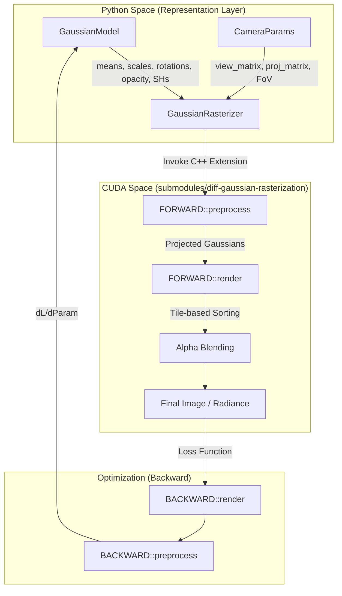
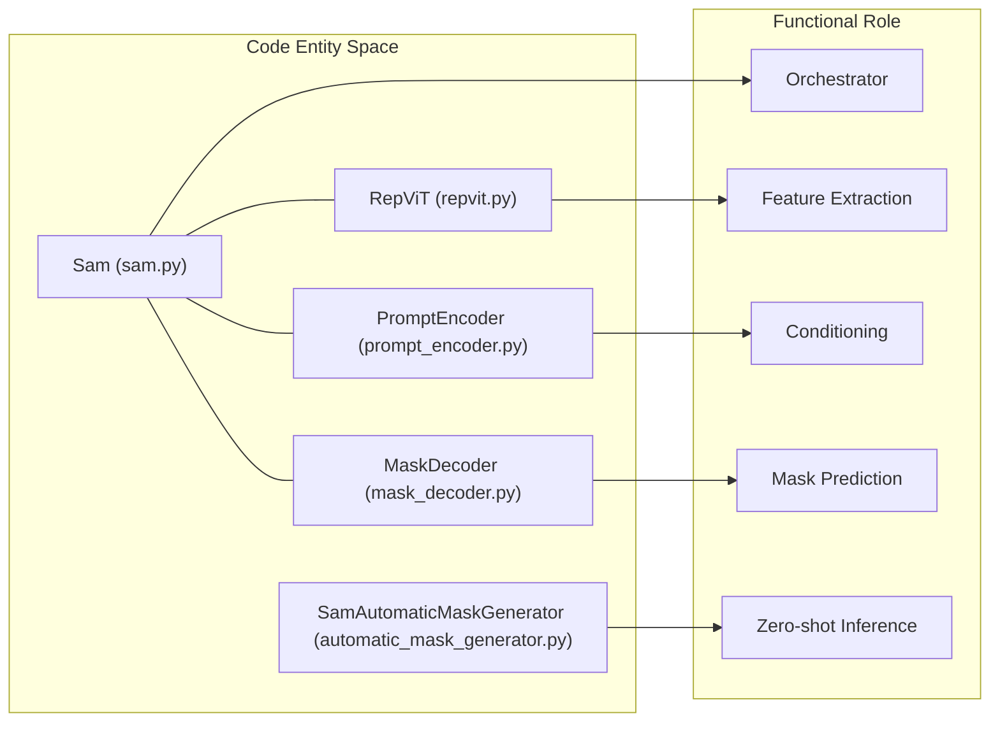

<!-- source: DeepWiki mcp.deepwiki.com · repo OpenDCAI/OpenWorldLib · page 8.3 CUDA Submodules: Gaussian Rasterization & SAM · fetched 2026-11-02 -->

# CUDA Submodules: Gaussian Rasterization & SAM

Relevant source files

The following files were used as context for generating this wiki page:

- [submodules/diff-gaussian-rasterization/.gitignore](submodules/diff-gaussian-rasterization/.gitignore)
- [submodules/diff-gaussian-rasterization/.gitmodules](submodules/diff-gaussian-rasterization/.gitmodules)
- [submodules/diff-gaussian-rasterization/CMakeLists.txt](submodules/diff-gaussian-rasterization/CMakeLists.txt)
- [submodules/diff-gaussian-rasterization/LICENSE.md](submodules/diff-gaussian-rasterization/LICENSE.md)
- [submodules/diff-gaussian-rasterization/README.md](submodules/diff-gaussian-rasterization/README.md)
- [submodules/diff-gaussian-rasterization/cuda_rasterizer/auxiliary.h](submodules/diff-gaussian-rasterization/cuda_rasterizer/auxiliary.h)
- [submodules/diff-gaussian-rasterization/cuda_rasterizer/backward.cu](submodules/diff-gaussian-rasterization/cuda_rasterizer/backward.cu)
- [submodules/diff-gaussian-rasterization/cuda_rasterizer/backward.h](submodules/diff-gaussian-rasterization/cuda_rasterizer/backward.h)
- [submodules/diff-gaussian-rasterization/cuda_rasterizer/config.h](submodules/diff-gaussian-rasterization/cuda_rasterizer/config.h)
- [submodules/diff-gaussian-rasterization/cuda_rasterizer/forward.cu](submodules/diff-gaussian-rasterization/cuda_rasterizer/forward.cu)
- [submodules/diff-gaussian-rasterization/cuda_rasterizer/forward.h](submodules/diff-gaussian-rasterization/cuda_rasterizer/forward.h)
- [submodules/sam_repvit/LICENSE](submodules/sam_repvit/LICENSE)
- [submodules/sam_repvit/linter.sh](submodules/sam_repvit/linter.sh)
- [submodules/sam_repvit/repvit_sam/__init__.py](submodules/sam_repvit/repvit_sam/__init__.py)
- [submodules/sam_repvit/repvit_sam/automatic_mask_generator.py](submodules/sam_repvit/repvit_sam/automatic_mask_generator.py)
- [submodules/sam_repvit/repvit_sam/build_sam.py](submodules/sam_repvit/repvit_sam/build_sam.py)
- [submodules/sam_repvit/repvit_sam/modeling/__init__.py](submodules/sam_repvit/repvit_sam/modeling/__init__.py)
- [submodules/sam_repvit/repvit_sam/modeling/common.py](submodules/sam_repvit/repvit_sam/modeling/common.py)
- [submodules/sam_repvit/repvit_sam/modeling/image_encoder.py](submodules/sam_repvit/repvit_sam/modeling/image_encoder.py)
- [submodules/sam_repvit/repvit_sam/modeling/mask_decoder.py](submodules/sam_repvit/repvit_sam/modeling/mask_decoder.py)
- [submodules/sam_repvit/repvit_sam/modeling/prompt_encoder.py](submodules/sam_repvit/repvit_sam/modeling/prompt_encoder.py)
- [submodules/sam_repvit/repvit_sam/modeling/repvit.py](submodules/sam_repvit/repvit_sam/modeling/repvit.py)

This page documents the specialized CUDA-accelerated submodules integrated into OpenWorldLib. These submodules provide high-performance backends for 3D rendering and efficient image segmentation, which are critical for the framework's representation and synthesis capabilities.

## Overview of Submodules

OpenWorldLib utilizes three primary submodules located in the `submodules/` directory:

1.  **`diff-gaussian-rasterization`**: The core differentiable rendering engine for 3D Gaussian Splatting (3DGS).
2.  **`depth-diff-gaussian-rasterization-wonderworld`**: A specialized fork of the 3DGS rasterizer that incorporates depth-aware rendering.
3.  **`sam_repvit`**: An implementation of Segment Anything Model (SAM) using the RepViT backbone for high-speed mobile-friendly segmentation.

---

## 1. Differentiable Gaussian Rasterization

The `diff-gaussian-rasterization` submodule provides the CUDA implementation for rendering 3D Gaussians into 2D images. This is the primary backend for pipelines like **VGGT**, **CUT3R**, and **HunyuanMirror**.

### Implementation Details
The rasterizer is split into a forward pass (rendering) and a backward pass (gradient computation for optimization).

*   **Forward Pass**: Projects 3D Gaussians onto a 2D image plane based on camera parameters and performs alpha-blending.
*   **Backward Pass**: Computes gradients with respect to Gaussian parameters (means, scales, rotations, opacity, and SH colors).

### Data Flow: Python to CUDA
The interaction between the Python representation layer and the CUDA backend follows this flow:

Title: 3DGS Rasterization Data Flow

**Sources:** `submodules/diff-gaussian-rasterization/cuda_rasterizer/forward.h:21-39` (), `submodules/diff-gaussian-rasterization/cuda_rasterizer/backward.h:23-62` ().

### Key CUDA Functions
*   **`FORWARD::preprocess`**: Handles the transformation of 3D means to 2D, calculates 2D covariance (conics), and determines the radius of each Gaussian on screen.
*   **`FORWARD::render`**: A tile-based renderer that sorts Gaussians per tile and accumulates color using the front-to-back blending equation.
*   **`BACKWARD::preprocess`**: Calculates gradients for 3D properties using the chain rule from 2D screen-space gradients.

---

## 2. RepViT-SAM (Segmentation)

The `sam_repvit` submodule implements a high-performance version of the Segment Anything Model. It replaces the standard ViT backbone with **RepViT**, a hardware-efficient architecture optimized for mobile and edge devices.

### Architectural Components
The model is composed of three main entities:
1.  **Image Encoder**: A `RepViT` or `TinyViT` backbone that produces image embeddings.
2.  **Prompt Encoder**: Encodes points, boxes, or masks into sparse and dense embeddings.
3.  **Mask Decoder**: A transformer-based decoder that maps embeddings to final segmentation masks.

Title: RepViT-SAM Entity Mapping

**Sources:** `submodules/sam_repvit/repvit_sam/modeling/sam.py` (), `submodules/sam_repvit/repvit_sam/modeling/repvit.py:144-187` (), `submodules/sam_repvit/repvit_sam/modeling/prompt_encoder.py:16-61` (), `submodules/sam_repvit/repvit_sam/modeling/mask_decoder.py:16-70` ().

### Build and Registry
The submodule provides a registry for loading different SAM variants.
*   **Registry**: `sam_model_registry` allows selecting between `vit_h`, `vit_l`, `vit_b`, `vit_t`, and `repvit`.
*   **RepViT Setup**: The `build_sam_repvit` function initializes the `Sam` class with a `repvit` image encoder from the `timm` library.

**Sources:** `submodules/sam_repvit/repvit_sam/build_sam.py:48-82` (), `submodules/sam_repvit/repvit_sam/build_sam.py:134-141` ().

---

## 3. Build and Integration Process

These submodules are integrated as C++/CUDA extensions via `torch.utils.cpp_extension`.

### Compilation Workflow
1.  **Environment**: Requires `nvcc` (CUDA Toolkit) and a compatible C++ compiler (GCC/Clang).
2.  **Setup**: Each submodule contains a `setup.py` (or uses the main framework's install scripts).
3.  **Invocation**:
    *   `diff-gaussian-rasterization` is invoked via `from diff_gaussian_rasterization import GaussianRasterizationSettings, GaussianRasterizer`.
    *   `sam_repvit` is invoked via the `SamPredictor` or `SamAutomaticMaskGenerator` classes.

### Summary Table: Submodule Comparison

| Submodule | Core Technology | Primary Use Case | Key Files |
| :--- | :--- | :--- | :--- |
| **diff-gaussian-rasterization** | CUDA C++ / GLM | 3DGS Rendering (VGGT, CUT3R) | `forward.cu`, `backward.cu` |
| **sam_repvit** | PyTorch / RepViT | Efficient Segmentation | `repvit.py`, `mask_decoder.py` |
| **wonderworld-rasterization** | CUDA C++ (Depth) | Depth-aware 3DGS | Fork of `diff-gaussian-rasterization` |

**Sources:** `submodules/sam_repvit/repvit_sam/predictor.py` (), `submodules/sam_repvit/repvit_sam/automatic_mask_generator.py:35-134` ().

---

