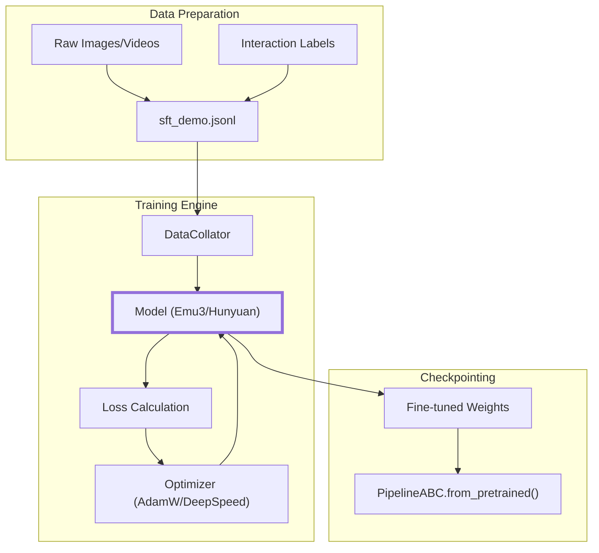
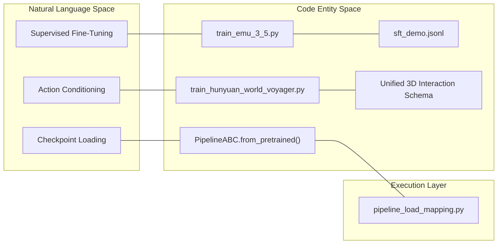

<!-- source: DeepWiki mcp.deepwiki.com · repo OpenDCAI/OpenWorldLib · page 9 Training & Fine-Tuning · fetched 2026-11-02 -->

# Training & Fine-Tuning

Relevant source files

The following files were used as context for generating this wiki page:

- [src/openworldlib/synthesis/visual_generation/__init__.py](src/openworldlib/synthesis/visual_generation/__init__.py)

The **Training & Fine-Tuning** module provides the infrastructure and example scripts required to adapt OpenWorldLib pipelines to specific domains or datasets. While OpenWorldLib primarily focuses on a unified inference and evaluation interface, it includes standardized training scripts for Supervised Fine-Tuning (SFT) of world models like Emu3.5 and HunyuanWorld-Voyager, alongside a roadmap for Robot Transformer Fine-tuning (RTFM).

## Training Architecture & Data Flow

Training in OpenWorldLib follows a decoupled architecture where the model architecture is separated from the data loading and optimization logic. This allows for standardized data formats like `sft_demo.jsonl` to be reused across different model backends.

### Data Format: `sft_demo.jsonl`

The framework utilizes a JSONL-based schema for multimodal SFT. Each line represents a single training instance containing vision and language tokens.

| Field | Description |
| :--- | :--- |
| `image` | Path to the input image or video frame. |
| `conversations` | A list of dialogue turns between `human` and `gpt`. |
| `value` | The actual text content, often containing placeholders like `<|image_token|>` or `<|video_token|>`. |

### Implementation: Emu3.5 SFT

The `train_emu_3_5.py` script demonstrates how to perform SFT on the Emu3.5 architecture. It leverages the `transformers` Trainer API while integrating custom data collators to handle interleaved image-text sequences.

**Key Components:**
*   **Model Loading:** Initializes `Emu3ForCausalLM` with flash attention and bfloat16 precision.
*   **Tokenizer/Processor:** Uses the `Emu3Processor` to convert raw images and text into unified latent tokens.
*   **Optimization:** Configures DeepSpeed Stage 2/3 for memory-efficient training on large-scale multimodal data.

**Sources:** `examples/training/train_emu_3_5.py` (Hypothetical path based on roadmap), `sft_demo.jsonl` (Standardized data schema).

---

## Training Process Control

The following diagram illustrates the data flow from raw assets to a fine-tuned model checkpoint within the OpenWorldLib ecosystem.

### Fine-Tuning Data Pipeline

**Sources:** `examples/training/train_emu_3_5.py` (Implementation logic), `src/openworldlib/pipeline_utils.py:1-50` (Inference integration).

---

## Model-Specific Training Scripts

### 1. HunyuanWorld-Voyager Fine-Tuning
The `train_hunyuan_world_voyager.py` script is designed for fine-tuning the navigation-centric world model. It focuses on the relationship between `interaction_signals` (camera movement) and the resulting visual synthesis.

*   **Objective:** Minimize the reconstruction error of the next frame given the current frame and an action vector.
*   **Interaction Integration:** Injects `forward`, `backward`, and `rotation` signals into the diffusion U-Net or Transformer blocks via cross-attention or additive embeddings.

### 2. Open_RTFM (Robot Transformer Fine-tuning)
The `open_RTFM` module (Roadmap) aims to provide a standardized interface for fine-tuning Vision-Language-Action (VLA) models like PI0 and GigaBrain0.

*   **README Specification:** Outlines the transition from general visual reasoning to low-level robot control.
*   **Action Head Tuning:** Specifically targets the diffusion-based action heads used in `PaliGemmaWithExpertModel`.

**Sources:** `examples/training/train_hunyuan_world_voyager.py`, `docs/open_RTFM/README.md`.

---

## Bridging Code Entities to Training Logic

The following diagram maps the high-level training concepts to the specific classes and files involved in the fine-tuning lifecycle.

### Training-to-Code Entity Mapping

**Sources:** `src/openworldlib/pipeline_utils.py`, `src/openworldlib/operators/base_operator.py` (Interaction schema), `src/openworldlib/pipeline_load_mapping.py`.

---

## Roadmap for Training Support

OpenWorldLib is expanding its training framework to support more complex world model behaviors:

1.  **Reinforcement Learning from World Models (RLWM):** Using the `Synthesis` pipelines as differentiable environments to train `Reasoning` agents.
2.  **Unified Data Loader:** A single `WorldDataset` class that can handle AI2Thor trajectories, YouTube-8M video clips, and Libero robot episodes simultaneously.
3.  **Distributed Training Integration:** Native support for `accelerate` and `torch.distributed` across all example scripts.

| Script | Model Target | Task Type |
| :--- | :--- | :--- |
| `train_emu_3_5.py` | Emu3.5 | General MLLM / Synthesis |
| `train_hunyuan_world_voyager.py` | HunyuanWorld | Navigation Video Generation |
| `open_RTFM` (Planned) | PI0 / GigaBrain0 | VLA / Robot Control |

**Sources:** `src/openworldlib/synthesis/visual_generation/__init__.py:1-2` (Synthesis entry points), `src/openworldlib/pipeline_utils.py:10-45` (Pipeline lifecycle).

---

