# Page: OpenWorldLib Overview

# OpenWorldLib Overview

<details>
<summary>Relevant source files</summary>

The following files were used as context for generating this wiki page:

- [.gitignore](.gitignore)
- [LICENSE](LICENSE)
- [README.md](README.md)
- [README_zh.md](README_zh.md)
- [data/benchmarks/README.md](data/benchmarks/README.md)
- [docs/awesome_world_model.md](docs/awesome_world_model.md)
- [docs/planning.md](docs/planning.md)
- [src/openworldlib/pipelines/pipeline_utils.py](src/openworldlib/pipelines/pipeline_utils.py)

</details>


OpenWorldLib is an open-source, unified framework designed to standardize the development and evaluation of **World Models**. It defines a world model as a perception-centric framework equipped with interaction and long-term memory capabilities, capable of understanding and predicting the complex physical world [README.md:81-83]().

The library integrates diverse research outcomes—ranging from navigation video generation to 3D scene reconstruction and Vision-Language-Action (VLA) models—into a consistent architectural pattern.

## Mission and Core Pillars

The mission of OpenWorldLib is to establish a standardized world model framework that makes the invocation of existing research more structured and reproducible [README.md:111-113](). The framework is built upon four functional pillars that represent the necessary capabilities of a world model [data/benchmarks/README.md:6-12]():

1.  **Synthesis**: The generative layer responsible for producing spatio-temporally consistent visual (video/3D) or auditory content.
2.  **Reasoning**: The cognitive layer for causal inference, future prediction, and counterfactual reasoning.
3.  **Representation**: The perception layer that parses temporal structures, states, and physical properties.
4.  **Memory**: The stateful layer that enables long-term interaction and temporal continuity across generation turns.

### Architectural Mapping: Natural Language to Code Entities

The following diagram bridges the high-level conceptual pillars to the concrete package structure found in the `src/openworldlib` directory.

**System Architecture Overview**
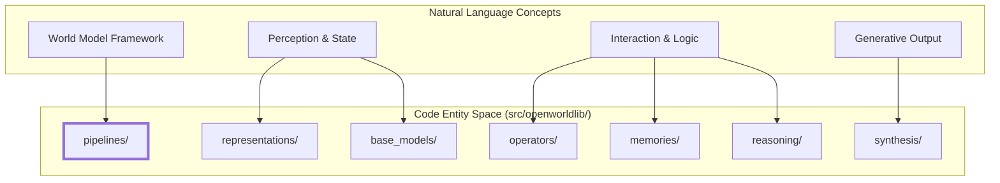
Sources: [README_zh.md:158-190](), [data/benchmarks/README.md:6-12]()

## Supported Task Categories

OpenWorldLib categorizes world model research into several distinct sub-tasks, providing specialized pipelines for each [README.md:118-126]():

| Task Category | Sub-tasks | Representative Pipelines |
| :--- | :--- | :--- |
| **Video Generation** | Navigation, Long Video, Egocentric | `MatrixGame2`, `HunyuanWorldPlay`, `Wan2p2`, `CosmosPredict2p5` |
| **3D Scene Generation** | Point Cloud, Gaussian Splatting | `VGGT`, `FlashWorld`, `Pi3`, `HunyuanMirror` |
| **Reasoning** | VQA, Spatial Reasoning | `SpatialReasoner`, `OmniVinci`, `Qwen2p5Omni` |
| **VLA** | Robot Action Prediction | `PI0`, `GigaBrain0`, `SpiritV1p5` |
| **Simulation** | Embodied Environments | `AI2Thor` |

For a complete catalogue of models and their associated papers, see **[Supported Models & Task Taxonomy](#1.2)**.

## Core Abstractions

At the heart of the library is the `PipelineABC` class, which defines the standard lifecycle for any world model task [src/openworldlib/pipelines/pipeline_utils.py:5-25]().

**Pipeline Interaction Flow**
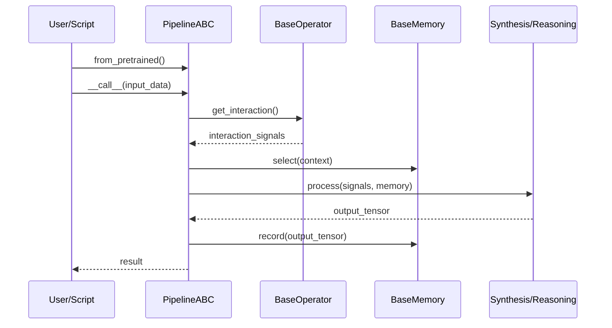
Sources: [src/openworldlib/pipelines/pipeline_utils.py:5-25](), [README_zh.md:158-190]()

## Getting Started & Hardware Requirements

OpenWorldLib provides a unified installation workflow via `scripts/setup/default_install.sh` [README.md:138-140](). Due to the heavy nature of world models, the framework is primarily tested on high-end hardware:
*   **GPU Memory**: Recommended **80GB** or **141GB** VRAM for full-scale inference [README_zh.md:152]().
*   **Python**: Version 3.10 [README.md:132]().

For detailed environment setup and per-method requirements, see **[Getting Started: Installation & Environment Setup](#1.1)**.

## Child Pages
*   **[Getting Started: Installation & Environment Setup](#1.1)**: Detailed guide on dependency groups, CUDA submodules, and setup scripts.
*   **[Supported Models & Task Taxonomy](#1.2)**: A comprehensive list of integrated models, their task types, and implementation classes.

---

# Page: Getting Started: Installation & Environment Setup

# Getting Started: Installation & Environment Setup

<details>
<summary>Relevant source files</summary>

The following files were used as context for generating this wiki page:

- [docs/installation.md](docs/installation.md)
- [pyproject.toml](pyproject.toml)
- [scripts/setup/ai2thor_install.sh](scripts/setup/ai2thor_install.sh)
- [scripts/setup/default_install.sh](scripts/setup/default_install.sh)
- [scripts/setup/flash_world_install.sh](scripts/setup/flash_world_install.sh)
- [scripts/setup/hunyuan_mirror_install.sh](scripts/setup/hunyuan_mirror_install.sh)
- [scripts/setup/libero_install.sh](scripts/setup/libero_install.sh)
- [scripts/setup/lingbot_va.sh](scripts/setup/lingbot_va.sh)
- [scripts/setup/loger_install.sh](scripts/setup/loger_install.sh)
- [scripts/setup/lower_trans_install.sh](scripts/setup/lower_trans_install.sh)
- [scripts/test_inference/test_3d_scene_gen.sh](scripts/test_inference/test_3d_scene_gen.sh)
- [scripts/test_inference/test_audio_gen.sh](scripts/test_inference/test_audio_gen.sh)
- [scripts/test_inference/test_inter_video_gen.sh](scripts/test_inference/test_inter_video_gen.sh)
- [scripts/test_inference/test_vla.sh](scripts/test_inference/test_vla.sh)
- [src/openworldlib/operators/hunyuan_worldplay_operator.py](src/openworldlib/operators/hunyuan_worldplay_operator.py)
- [src/openworldlib/pipelines/hunyuan_world/pipeline_hunyuan_mirror.py](src/openworldlib/pipelines/hunyuan_world/pipeline_hunyuan_mirror.py)
- [src/openworldlib/pipelines/hunyuan_world/pipeline_hunyuan_worldplay.py](src/openworldlib/pipelines/hunyuan_world/pipeline_hunyuan_worldplay.py)
- [src/openworldlib/pipelines/pi3/pipeline_loger.py](src/openworldlib/pipelines/pi3/pipeline_loger.py)
- [test/test_hunyuan_mirror.py](test/test_hunyuan_mirror.py)
- [test/test_hunyuan_worldplay.py](test/test_hunyuan_worldplay.py)
- [test_stream/test_loger_stream.py](test_stream/test_loger_stream.py)
- [tools/installing/readme.md](tools/installing/readme.md)

</details>


This page provides a comprehensive guide to setting up the OpenWorldLib environment. Due to the diverse nature of world models—spanning video synthesis, 3D reconstruction, and robot action prediction—the framework uses a modular installation strategy. Users can install a base environment and then layer task-specific dependencies using specialized scripts or `pyproject.toml` optional groups.

## System Requirements

The framework is optimized for Linux-based environments with NVIDIA GPUs.

| Component | Requirement | Note |
| :--- | :--- | :--- |
| **Python** | 3.10 | Standard across most pipelines [docs/installation.md:22-231]() |
| **CUDA** | 12.1 | Required for most local inference and CUDA submodules [docs/installation.md:23-232]() |
| **PyTorch** | 2.5.1 / 2.6.0 | Version varies by task (e.g., LoGeR requires 2.6.0) [docs/installation.md:112]() |
| **GPU** | NVIDIA (24GB+ VRAM) | Required for large-scale video models like Hunyuan or Wan |

Sources: [docs/installation.md:1-235](), [scripts/setup/loger_install.sh:7]()

## Installation Workflow

OpenWorldLib provides two primary ways to manage dependencies:
1.  **Unified Installation**: Using `pip install -e ".[group]"` for standardized dependency sets.
2.  **Task-Specific Scripts**: Bash scripts located in `scripts/setup/` that handle complex environment setups, including specific PyTorch versions and external build isolations.

### Dependency Group Mapping

The `pyproject.toml` file defines several optional dependency groups to minimize environment bloat.

| Group Name | Purpose | Key Packages |
| :--- | :--- | :--- |
| `transformers_high` | Default for most modern video/reasoning models | `transformers>=4.49.0`, `diffusers==0.36.0` |
| `transformers_low` | Compatibility for older model checkpoints | `transformers<=4.45.1`, `diffusers==0.31.0` |
| `3d_ply_default` | 3D Scene Generation and Point Clouds | `plyfile`, `transformers_high` set |
| `audio_default` | Audio Reasoning and Synthesis | `qwen_omni_utils`, `soundfile` |
| `audio_generation_default` | MMAudio and ThinkSound specific | `k_diffusion`, `descript-audio-codec` |

Sources: [pyproject.toml:11-56]()

### Core Installation Diagram

The following diagram illustrates how the installation scripts bridge the gap between high-level task categories and specific code entities/dependencies.

**Installation Entity Mapping**
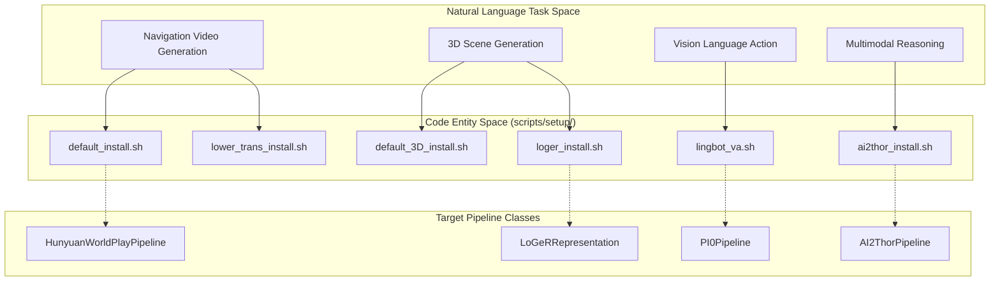
Sources: [docs/installation.md:18-191](), [scripts/setup/default_install.sh:1-17](), [scripts/setup/ai2thor_install.sh:1-31](), [src/openworldlib/pipelines/hunyuan_world/pipeline_hunyuan_worldplay.py:8-9]()

---

## Task-Specific Setup Guides

### 1. Navigation & Interactive Video
Most navigation models (MatrixGame2, Hunyuan-GameCraft, Yume) use the `default_install.sh` script, which installs `transformers_high` and `flash-attn`.

```bash
# Standard installation
bash scripts/setup/default_install.sh

# Special case: HunyuanWorld-Voyager (requires older transformers)
bash scripts/setup/lower_trans_install.sh
```
Sources: [docs/installation.md:25-40](), [scripts/setup/default_install.sh:1-17]()

### 2. 3D Scene Generation
3D pipelines often require `plyfile` for point cloud manipulation and specialized rendering backends.

```bash
# General 3D (VGGT, Pi3)
bash scripts/setup/default_3D_install.sh

# LoGeR (Requires PyTorch 2.6.0)
bash scripts/setup/loger_install.sh
```
Sources: [docs/installation.md:92-113](), [scripts/setup/loger_install.sh:7-26]()

### 3. Vision-Language-Action (VLA)
VLA pipelines like $\pi_0$ and GigaBrain-0 use the default environment, but robot-specific simulators like LIBERO or AI2-THOR require additional steps.

```bash
# Base VLA
bash scripts/setup/default_install.sh

# Robot Simulators
bash scripts/setup/libero_install.sh
bash scripts/setup/ai2thor_install.sh
```
Sources: [docs/installation.md:130-152](), [scripts/setup/ai2thor_install.sh:14-27]()

### 4. Audio Generation
Audio pipelines (MMAudio, ThinkSound) require specific codecs and diffusion schedulers defined in the `audio_generation_default` group.

```bash
# Install audio generation dependencies
pip install -e ".[audio_generation_default]"
bash scripts/setup/default_audio_install.sh
```
Sources: [pyproject.toml:43-56](), [docs/installation.md:176]()

---

## Implementation Details: Installation Scripts

### `default_install.sh` Workflow
The `default_install.sh` script serves as the primary entry point for the framework. It ensures that `torch`, `CLIP`, and `flash-attn` are installed correctly to avoid build isolation issues.

1.  **Base Environment**: Installs `torch==2.5.1`. [scripts/setup/default_install.sh:7]()
2.  **Requirements**: Triggers `pip install -e ".[transformers_high]"` to resolve the majority of pipeline dependencies. [scripts/setup/default_install.sh:11]()
3.  **Flash Attention**: Installs `flash-attn==2.5.9.post1` with `--no-build-isolation` to ensure it links against the local torch/CUDA installation. [scripts/setup/default_install.sh:14]()

### Environment Setup for Simulation (AI2-THOR)
The `ai2thor_install.sh` script handles the downloading of external Unity binaries and Python controllers.

**AI2-THOR Setup Data Flow**
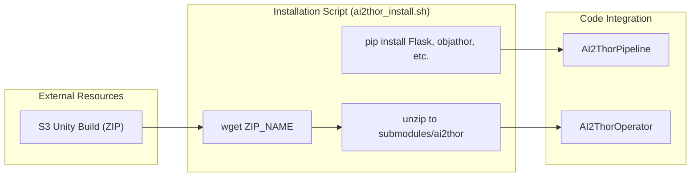
Sources: [scripts/setup/ai2thor_install.sh:11-30](), [src/openworldlib/pipelines/pi3/pipeline_loger.py:9-10]()

## Verifying the Installation

After installation, you can verify the environment using the provided test scripts.

```bash
# Verify VLA installation (e.g., PI0)
bash scripts/test_inference/test_vla.sh pi0

# Verify 3D Scene Generation (e.g., Hunyuan Mirror)
python test/test_hunyuan_mirror.py
```
Sources: [scripts/test_inference/test_vla.sh:60-65](), [test/test_hunyuan_mirror.py:18-29]()

---

# Page: Supported Models & Task Taxonomy

# Supported Models & Task Taxonomy

<details>
<summary>Relevant source files</summary>

The following files were used as context for generating this wiki page:

- [README.md](README.md)
- [README_zh.md](README_zh.md)
- [data/benchmarks/README.md](data/benchmarks/README.md)
- [docs/awesome_world_model.md](docs/awesome_world_model.md)
- [docs/planning.md](docs/planning.md)
- [examples/pipeline_infer_mapping.py](examples/pipeline_infer_mapping.py)
- [examples/pipeline_load_mapping.py](examples/pipeline_load_mapping.py)
- [src/openworldlib/base_models/diffusion_model/video/wan_2p1/utils/fm_solvers_unipc.py](src/openworldlib/base_models/diffusion_model/video/wan_2p1/utils/fm_solvers_unipc.py)
- [src/openworldlib/pipelines/pipeline_utils.py](src/openworldlib/pipelines/pipeline_utils.py)
- [src/openworldlib/synthesis/visual_generation/cosmos/cosmos_predict2p5_synthesis.py](src/openworldlib/synthesis/visual_generation/cosmos/cosmos_predict2p5_synthesis.py)
- [test/test_cosmos_predict2p5.py](test/test_cosmos_predict2p5.py)
- [test/test_depth_anything_v1.py](test/test_depth_anything_v1.py)
- [test/test_lingbot_world.py](test/test_lingbot_world.py)
- [test_stream/test_cosmos_predict2p5_stream.py](test_stream/test_cosmos_predict2p5_stream.py)
- [test_stream/test_lingbot_world_stream.py](test_stream/test_lingbot_world_stream.py)

</details>


OpenWorldLib categorizes world models into a structured taxonomy based on their primary functional role in understanding, predicting, or interacting with the environment. This page serves as a technical catalogue of integrated models, their underlying pipeline classes, and the specific tasks they address.

## Task Taxonomy Overview

The framework organizes models into six core capability pillars:
1.  **Navigation Video Generation**: Generating video sequences driven by ego-motion or camera interaction signals.
2.  **3D Scene Generation**: Reconstructing or generating static/dynamic 3D representations from visual inputs.
3.  **Vision-Language-Action (VLA)**: Predicting robotic control actions from multimodal observations.
4.  **Multimodal Reasoning**: Performing spatial, temporal, or causal inference over visual and auditory data.
5.  **Interactive Video**: General-purpose video synthesis with high temporal consistency and prompt adherence.
6.  **Audio Generation**: Generating synchronized environmental sounds or speech for visual scenes.

### Code-to-Task Mapping
The following diagram bridges the high-level task categories to the internal `openworldlib` package structure.

**System Entity Mapping: Tasks to Code Modules**
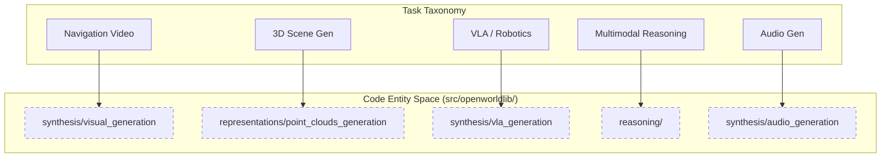
**Sources:** `[README.md:118-126]()`, `[README_zh.md:158-190]()`

---

## 1. Navigation Video Generation
These models focus on "World Simulation" where the generated output is conditioned on explicit interaction signals (e.g., `forward`, `camera_l`).

| Model Name | Pipeline Class | Key Features |
| :--- | :--- | :--- |
| **Matrix-Game-2** | `MatrixGame2Pipeline` | Universal navigation with interaction-aware diffusion. |
| **Hunyuan-GameCraft** | `HunyuanGameCraftPipeline` | High-fidelity game-like world modeling. |
| **LingBot-World** | `LingBotPipeline` | Large-scale (14B) I2V model with 10-DOF camera control. |
| **Wan-2.2 (IT2V)** | `Wan2p2Pipeline` | Diffusion-based video synthesis with motion conditioning. |

**Data Flow: Navigation Pipeline Execution**
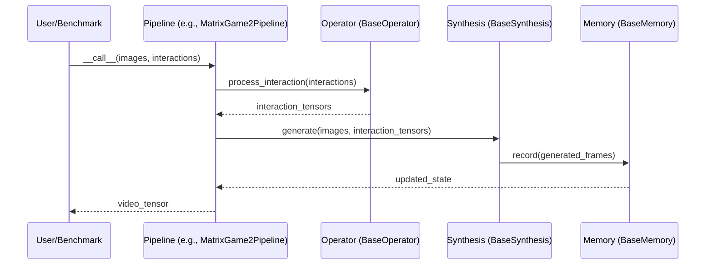
**Sources:** `[examples/pipeline_load_mapping.py:20-51]()`, `[examples/pipeline_infer_mapping.py:7-54]()`, `[test/test_lingbot_world.py:41-47]()`

---

## 2. 3D Scene Generation & Representation
Focuses on the perception and reconstruction of the physical world structure.

| Model Name | Pipeline Class | Task Type |
| :--- | :--- | :--- |
| **DepthAnything V1** | `DepthAnything1Pipeline` | Monocular depth estimation for scene representation. |
| **VGGT / Pi3 / FlashWorld** | (See 3D Extension) | 3D Gaussian Splatting (3DGS) reconstruction. |
| **AI2-THOR** | `pipeline_thor` | Simulation environment for embodied evaluation. |

**Sources:** `[test/test_depth_anything_v1.py:5-7]()`, `[README.md:123-124]()`, `[README_zh.md:183-185]()`

---

## 3. Vision-Language-Action (VLA)
Models that bridge perception and physical execution, typically used for robotic manipulation.

| Model Name | Pipeline Class | Reference Paper |
| :--- | :--- | :--- |
| **Spirit-v1.5** | `SpiritV1p5Pipeline` | General-purpose VLA for multi-embodiment control. |
| **PI-0 / PI-0.5** | `PI0Pipeline` | Diffusion-based robot action prediction. |
| **Giga-Brain** | `GigaBrain0Pipeline` | Large-scale multimodal action transformer. |

**Sources:** `[examples/pipeline_load_mapping.py:71-78]()`, `[examples/pipeline_infer_mapping.py:96-118]()`, `[README.md:125-126]()`

---

## 4. Multimodal Reasoning
High-level cognitive tasks including Visual Question Answering (VQA) and spatial intelligence.

| Model Name | Pipeline Class | Specialization |
| :--- | :--- | :--- |
| **Qwen-2.5-Omni** | `Qwen2p5OmniPipeline` | Unified reasoning across text, image, video, and audio. |
| **OmniVinci** | `OmniVinciPipeline` | Multi-turn multimodal dialogue and reasoning. |
| **SpatialBot** | `SpatialReasonerPipeline` | Explicit coordinate-based spatial understanding. |

**Sources:** `[examples/pipeline_load_mapping.py:54-60]()`, `[examples/pipeline_infer_mapping.py:81-93]()`, `[docs/awesome_world_model.md:87-92]()`

---

## 5. Interactive & Long Video Generation
General synthesis pipelines that prioritize visual quality and temporal consistency over specific navigation controls.

| Model Name | Pipeline Class | Implementation Detail |
| :--- | :--- | :--- |
| **Cosmos-Predict-2.5** | `CosmosPredict2p5Pipeline` | Flow-matching based I2V/V2V generation. |
| **Wan-2.2 / 2.5** | `Wan2p2Pipeline` | T2V and I2V with high-resolution support. |
| **WoW** | `WoWPipeline` | Action-conditioned world modeling for physical consistency. |

**Implementation Note:** The `CosmosPredict2p5Pipeline` utilizes a `FlowUniPCMultistepScheduler` for efficient sampling and supports a `stream()` method for continuous generation turns by maintaining a `memory_module` that tracks the last generated frame.

**Sources:** `[test/test_cosmos_predict2p5.py:26-33]()`, `[test_stream/test_cosmos_predict2p5_stream.py:79-88]()`, `[examples/pipeline_infer_mapping.py:121-133]()`

---

## Task Taxonomy Summary Table

| Category | Representative Models | Primary Code Base |
| :--- | :--- | :--- |
| **Generation** | Matrix-Game, Hunyuan, LingBot, Wan, Cosmos | `synthesis/visual_generation` |
| **Representation** | DepthAnything, 3DGS, AI2-THOR | `representations/` |
| **Reasoning** | Qwen-Omni, OmniVinci, SpatialBot | `reasoning/` |
| **Embodied** | Spirit-v1.5, PI-0, Giga-Brain | `synthesis/vla_generation` |

**Sources:** `[data/benchmarks/README.md:6-12]()`, `[README.md:118-126]()`

---

# Page: Core Architecture

# Core Architecture

<details>
<summary>Relevant source files</summary>

The following files were used as context for generating this wiki page:

- [README.md](README.md)
- [README_zh.md](README_zh.md)
- [docs/awesome_world_model.md](docs/awesome_world_model.md)
- [docs/planning.md](docs/planning.md)
- [examples/pipeline_infer_mapping.py](examples/pipeline_infer_mapping.py)
- [examples/pipeline_load_mapping.py](examples/pipeline_load_mapping.py)
- [src/openworldlib/base_models/diffusion_model/video/wan_2p1/utils/fm_solvers_unipc.py](src/openworldlib/base_models/diffusion_model/video/wan_2p1/utils/fm_solvers_unipc.py)
- [src/openworldlib/pipelines/pipeline_utils.py](src/openworldlib/pipelines/pipeline_utils.py)
- [src/openworldlib/synthesis/visual_generation/cosmos/cosmos_predict2p5_synthesis.py](src/openworldlib/synthesis/visual_generation/cosmos/cosmos_predict2p5_synthesis.py)
- [test/test_cosmos_predict2p5.py](test/test_cosmos_predict2p5.py)
- [test/test_depth_anything_v1.py](test/test_depth_anything_v1.py)
- [test/test_lingbot_world.py](test/test_lingbot_world.py)
- [test_stream/test_cosmos_predict2p5_stream.py](test_stream/test_cosmos_predict2p5_stream.py)
- [test_stream/test_lingbot_world_stream.py](test_stream/test_lingbot_world_stream.py)

</details>


OpenWorldLib is built on a modular architecture designed to unify diverse world modeling tasks—ranging from video synthesis and 3D scene generation to multimodal reasoning and robot action prediction—under a consistent set of abstractions. The framework decomposes a world model into six primary layers: **Pipeline**, **Operator**, **Synthesis**, **Reasoning**, **Representation**, and **Memory**.

## The Six-Layer Abstraction

The architecture ensures that regardless of the underlying model (e.g., Diffusion, LLM, or 3DGS), the interaction lifecycle remains uniform.

1.  **Pipeline Layer**: The top-level entry point that orchestrates all other modules. It manages the model lifecycle (loading, inference, and streaming).
2.  **Operator Layer**: Handles input processing, interaction signal parsing (e.g., navigation commands), and perception preprocessing.
3.  **Synthesis Layer**: Responsible for generative tasks, including video, image, and audio synthesis, as well as VLA (Vision-Language-Action) generation.
4.  **Reasoning Layer**: Manages cognitive tasks such as spatial understanding, VQA, and multi-modal chain-of-thought.
5.  **Representation Layer**: Handles structural world modeling, such as 3D point cloud generation, depth estimation, and simulation environment states.
6.  **Memory Layer**: Maintains state across multi-turn interactions, enabling temporal continuity in streaming video generation or long-form reasoning.

### System Flow: From Interaction to Generation

The following diagram illustrates how these entities interact during a standard inference and streaming cycle.

**World Model Pipeline Interaction Flow**
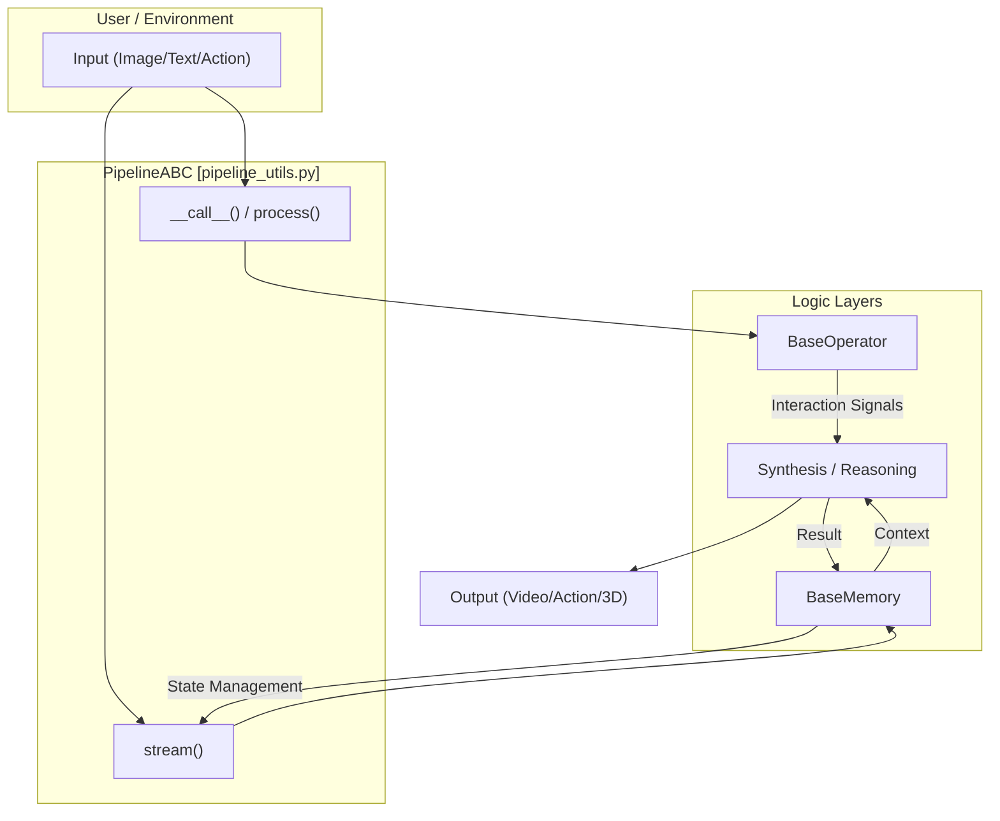
**Sources:** [src/openworldlib/pipelines/pipeline_utils.py:5-25](), [README_zh.md:158-190]()

---

## 2.1 PipelineABC: The Pipeline Lifecycle
The `PipelineABC` class in `pipeline_utils.py` defines the standard interface for all models in the library. It provides the `from_pretrained()` method for loading and two primary execution modes: `__call__()` for single-batch inference and `stream()` for stateful, multi-turn interaction.

For details, see [PipelineABC: The Pipeline Lifecycle](#2.1).

**Sources:** [src/openworldlib/pipelines/pipeline_utils.py:5-25]()

## 2.2 Operator Layer: Input & Interaction
The Operator layer acts as the "sensory" and "interface" module. It translates raw user inputs or environment signals into the internal schema used by the synthesis and reasoning engines. This includes the **Unified 3D Interaction Schema** (e.g., `forward`, `camera_l`) used in navigation tasks.

For details, see [Operator Layer: Input Processing & Interaction Signals](#2.2).

**Sources:** [README_zh.md:177-177](), [examples/pipeline_infer_mapping.py:25-28]()

## 2.3 Memory Module: Stateful Interaction
The Memory module is critical for world models that require temporal consistency. It implements a five-stage lifecycle—`record`, `select`, `compress`, `process`, and `manage`—to store and retrieve previous frames or reasoning states. This allows the `stream()` method to generate continuous video segments where the last frame of turn $N$ becomes the first frame of turn $N+1$.

For details, see [Memory Module: Stateful Multi-Turn Interaction](#2.3).

**Sources:** [test_stream/test_cosmos_predict2p5_stream.py:37-101](), [README_zh.md:174-176]()

## 2.4 Base Models: The Core Engines
The `base_models` directory contains the primitive weights and architectures that power the higher-level layers. This includes:
*   **Diffusion Models**: `wan_2p1`, `hunyuan_video`, etc.
*   **LLM/MLLM Cores**: `qwen`, `omnivinci`.
*   **Perception & 3D**: Depth estimation and point cloud backends.

For details, see [Base Models: Diffusion, LLM/MLLM, and Perception Cores](#2.4).

**Sources:** [README_zh.md:169-173](), [examples/pipeline_load_mapping.py:4-92]()

---

## Architectural Mapping: Code to Logic

The following table maps the conceptual "Natural Language Space" of world modeling to the specific "Code Entity Space" within OpenWorldLib.

| Conceptual Layer | Code Implementation Directory | Primary Base Class / Interface |
| :--- | :--- | :--- |
| **Pipeline** | `src/openworldlib/pipelines/` | `PipelineABC` [src/openworldlib/pipelines/pipeline_utils.py:5]() |
| **Operator** | `src/openworldlib/operators/` | `BaseOperator` |
| **Synthesis** | `src/openworldlib/synthesis/` | `VisualGeneration`, `VLAGeneration` |
| **Reasoning** | `src/openworldlib/reasoning/` | `SpatialReasoner`, `GeneralReasoning` |
| **Memory** | `src/openworldlib/memories/` | `BaseMemory` |
| **Representation**| `src/openworldlib/representations/`| `PointCloudsGeneration`, `SimulationEnvironment` |

**Code Entity Relationship Diagram**
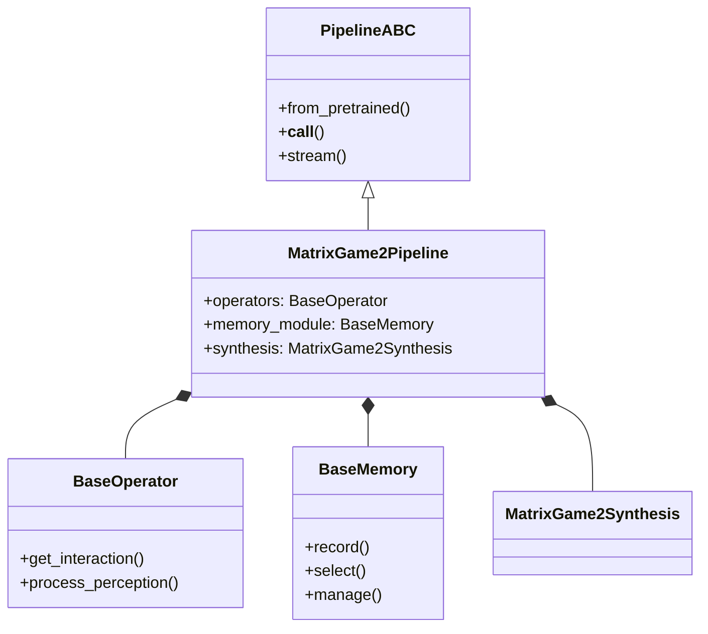
**Sources:** [src/openworldlib/pipelines/pipeline_utils.py:5-25](), [examples/pipeline_load_mapping.py:20-26](), [test_stream/test_cosmos_predict2p5_stream.py:79-88]()

---

# Page: PipelineABC: The Pipeline Lifecycle

# PipelineABC: The Pipeline Lifecycle

<details>
<summary>Relevant source files</summary>

The following files were used as context for generating this wiki page:

- [README.md](README.md)
- [README_zh.md](README_zh.md)
- [docs/awesome_world_model.md](docs/awesome_world_model.md)
- [docs/planning.md](docs/planning.md)
- [examples/pipeline_infer_mapping.py](examples/pipeline_infer_mapping.py)
- [examples/pipeline_load_mapping.py](examples/pipeline_load_mapping.py)
- [src/openworldlib/base_models/diffusion_model/video/wan_2p1/utils/fm_solvers_unipc.py](src/openworldlib/base_models/diffusion_model/video/wan_2p1/utils/fm_solvers_unipc.py)
- [src/openworldlib/pipelines/pipeline_utils.py](src/openworldlib/pipelines/pipeline_utils.py)
- [src/openworldlib/synthesis/visual_generation/cosmos/cosmos_predict2p5_synthesis.py](src/openworldlib/synthesis/visual_generation/cosmos/cosmos_predict2p5_synthesis.py)
- [test/test_cosmos_predict2p5.py](test/test_cosmos_predict2p5.py)
- [test/test_depth_anything_v1.py](test/test_depth_anything_v1.py)
- [test/test_hunyuan_gamecraft.py](test/test_hunyuan_gamecraft.py)
- [test/test_lingbot_world.py](test/test_lingbot_world.py)
- [test_stream/test_cosmos_predict2p5_stream.py](test_stream/test_cosmos_predict2p5_stream.py)
- [test_stream/test_hunyuan_game_craft_stream.py](test_stream/test_hunyuan_game_craft_stream.py)
- [test_stream/test_lingbot_world_stream.py](test_stream/test_lingbot_world_stream.py)

</details>


`PipelineABC` is the foundational abstract base class for all inference workflows in OpenWorldLib. It defines a standardized lifecycle for world models, encompassing model loading, input processing, stateful interaction, and both one-shot and streaming inference modes. By enforcing this interface, OpenWorldLib ensures that diverse tasks—from navigation video generation to multimodal reasoning—share a consistent execution pattern.

## The Pipeline Lifecycle Overview

The lifecycle of a pipeline is divided into three distinct phases: initialization, execution, and state management.

1.  **Initialization**: Handled by `from_pretrained()`, where the `Synthesis`, `Reasoning`, `Representation`, and `Memory` modules are instantiated and weights are loaded.
2.  **Standard Inference**: Handled by `__call__()` and `process()`. This is typically used for single-turn tasks or generating a fixed-length sequence from an initial state.
3.  **Streaming Inference**: Handled by `stream()`. This leverages the `Memory` module to maintain temporal or conversational continuity across multiple interactive turns.

### Lifecycle Data Flow

The following diagram illustrates how data flows through the `PipelineABC` methods and interacts with the core architectural layers.

**Diagram: Pipeline Lifecycle and Entity Mapping**
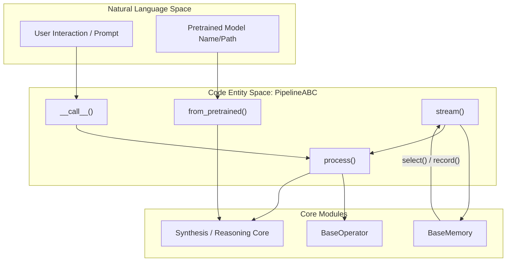
**Sources:** [src/openworldlib/pipelines/pipeline_utils.py:1-100](), [README.md:155-190]()

---

## Key Methods and Implementation

### 1. from_pretrained()
This static method serves as the entry point for instantiating any pipeline. It is responsible for resolving model paths and orchestrating the loading of sub-modules. In the registry files, specialized loading functions wrap this method to handle model-specific requirements (e.g., FSDP settings or specific VAE paths).

*   **Registry Mapping**: The file `pipeline_load_mapping.py` contains a `video_gen_pipe` and `reasoning_pipe` dictionary that maps model strings to these loading functions [examples/pipeline_load_mapping.py:95-114]().
*   **Component Resolution**: For complex models like Cosmos, `from_pretrained` handles a `required_components` dictionary to load separate text encoders and VAEs [examples/pipeline_load_mapping.py:81-92]().

### 2. process()
The `process()` method is the internal engine of the pipeline. It typically performs the following:
1.  **Signal Parsing**: Uses the `Operator` to transform raw user inputs (e.g., "forward") into tensors or structured interaction signals [examples/pipeline_infer_mapping.py:24-33]().
2.  **Perception Processing**: Prepares visual or auditory inputs for the model core.
3.  **Model Invocation**: Calls the underlying `Synthesis` or `Reasoning` classes to perform the actual computation.

### 3. __call__() vs. stream()
OpenWorldLib distinguishes between one-shot generation and interactive, stateful generation.

| Feature | `__call__()` | `stream()` |
| :--- | :--- | :--- |
| **Usage** | Standard inference (one-shot) | Multi-turn / Interactive |
| **Memory** | Stateless or internal-only | Uses `MemoryModule` (record/select) |
| **Continuity** | Fixed duration/output | Appends to history for infinite generation |
| **Example** | `test_lingbot_world.py` [test/test_lingbot_world.py:41-47]() | `test_cosmos_predict2p5_stream.py` [test_stream/test_cosmos_predict2p5_stream.py:79-88]() |

**Sources:** [src/openworldlib/pipelines/pipeline_utils.py:1-100](), [examples/pipeline_infer_mapping.py:7-142](), [test_stream/test_hunyuan_game_craft_stream.py:180-191]()

---

## Pipeline Registry and Mapping

To provide a unified interface for the `run_benchmark.py` and other CLI tools, OpenWorldLib uses a mapping system located in the `examples/` directory.

### Loading Mapping (`pipeline_load_mapping.py`)
This file acts as a factory for pipelines. It defines how specific models (e.g., `matrix-game2`, `wan2p2`) should be initialized.
*   **Functions**: `load_matrix_game2_pipeline`, `load_wan2p2_pipeline`, etc. [examples/pipeline_load_mapping.py:20-78]().
*   **Path Resolution**: Uses `_resolve_path` to handle both single strings and dictionaries of checkpoint paths [examples/pipeline_load_mapping.py:4-17]().

### Inference Mapping (`pipeline_infer_mapping.py`)
This file defines the standard way to invoke the `__call__` method for different pipeline types, abstracting away differences in argument names (e.g., `images` vs `image_path`).
*   **Functions**: `infer_matrix_game2_pipeline`, `infer_qwen2p5_omni_pipeline`, etc. [examples/pipeline_infer_mapping.py:7-118]().
*   **Logic**: It often includes post-processing, such as calculating `num_output_frames` based on the length of the interaction signal [examples/pipeline_infer_mapping.py:8-14]().

**Sources:** [examples/pipeline_load_mapping.py:1-114](), [examples/pipeline_infer_mapping.py:1-155]()

---

## Execution Logic: Standard vs. Streaming

The following diagram details the internal logic when a user triggers a streaming session compared to a standard inference session.

**Diagram: Standard vs. Streaming Execution Logic**
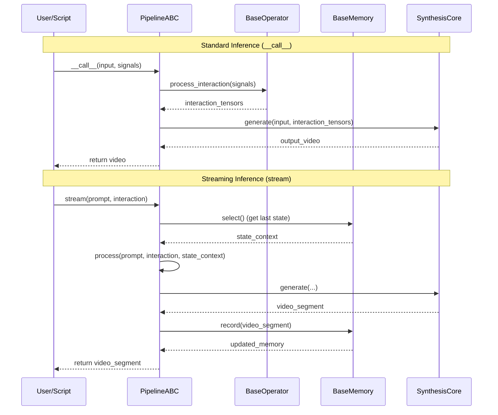
**Sources:** [src/openworldlib/pipelines/pipeline_utils.py:1-100](), [test_stream/test_cosmos_predict2p5_stream.py:69-101](), [test_stream/test_hunyuan_game_craft_stream.py:156-198]()

---

# Page: Operator Layer: Input Processing & Interaction Signals

# Operator Layer: Input Processing & Interaction Signals

<details>
<summary>Relevant source files</summary>

The following files were used as context for generating this wiki page:

- [pyproject.toml](pyproject.toml)
- [requirements.txt](requirements.txt)
- [scripts/setup/cut3r_install.sh](scripts/setup/cut3r_install.sh)
- [scripts/setup/hunyuan_mirror_install.sh](scripts/setup/hunyuan_mirror_install.sh)
- [src/openworldlib/operators/cut3r_operator.py](src/openworldlib/operators/cut3r_operator.py)
- [src/openworldlib/operators/hunyuan_worldplay_operator.py](src/openworldlib/operators/hunyuan_worldplay_operator.py)
- [src/openworldlib/operators/lingbot_va_operator.py](src/openworldlib/operators/lingbot_va_operator.py)
- [src/openworldlib/operators/pi0_operator.py](src/openworldlib/operators/pi0_operator.py)
- [src/openworldlib/operators/vggt_operator.py](src/openworldlib/operators/vggt_operator.py)
- [src/openworldlib/pipelines/cut3r/pipeline_cut3r.py](src/openworldlib/pipelines/cut3r/pipeline_cut3r.py)
- [src/openworldlib/pipelines/hunyuan_world/pipeline_hunyuan_mirror.py](src/openworldlib/pipelines/hunyuan_world/pipeline_hunyuan_mirror.py)
- [src/openworldlib/pipelines/hunyuan_world/pipeline_hunyuan_worldplay.py](src/openworldlib/pipelines/hunyuan_world/pipeline_hunyuan_worldplay.py)
- [src/openworldlib/pipelines/lingbot_va/pipeline_lingbot_va.py](src/openworldlib/pipelines/lingbot_va/pipeline_lingbot_va.py)
- [src/openworldlib/pipelines/vggt/pipeline_vggt.py](src/openworldlib/pipelines/vggt/pipeline_vggt.py)
- [src/openworldlib/representations/point_clouds_generation/cut3r/cut3r_representation.py](src/openworldlib/representations/point_clouds_generation/cut3r/cut3r_representation.py)
- [src/openworldlib/representations/point_clouds_generation/vggt/vggt_representation.py](src/openworldlib/representations/point_clouds_generation/vggt/vggt_representation.py)
- [src/openworldlib/synthesis/vla_generation/lingbot_va/lingbot_va_synthesis.py](src/openworldlib/synthesis/vla_generation/lingbot_va/lingbot_va_synthesis.py)
- [test/test_cut3r.py](test/test_cut3r.py)
- [test/test_hunyuan_mirror.py](test/test_hunyuan_mirror.py)
- [test/test_hunyuan_worldplay.py](test/test_hunyuan_worldplay.py)
- [test/test_lingbot_va.py](test/test_lingbot_va.py)
- [test/test_matrix_game_2.py](test/test_matrix_game_2.py)
- [test/test_vggt.py](test/test_vggt.py)
- [test_stream/test_vggt_stream.py](test_stream/test_vggt_stream.py)

</details>


The **Operator Layer** serves as the primary interface for translating raw external inputs (images, videos, text prompts) and user interaction signals into structured data formats consumed by the Synthesis, Reasoning, and Representation layers. It is responsible for input validation, signal normalization, and maintaining the lifecycle of interaction states within a pipeline.

## BaseOperator and Lifecycle Methods

All operators inherit from `BaseOperator`, which defines the standard interface for handling interaction sequences and perception data. The operator ensures that high-level semantic commands (e.g., "move forward") are mapped to the specific mathematical or tensor representations required by the underlying models.

### Key Methods

| Method | Description |
| :--- | :--- |
| `interaction_template_init()` | Initializes the internal list of valid interactions based on the `interaction_template`. |
| `get_interaction()` | Validates a single interaction string and appends it to the `current_interaction` list. |
| `check_interaction()` | Performs a membership check against the `interaction_template` to ensure the signal is supported. |
| `process_interaction()` | Converts the accumulated `current_interaction` list into a feature dictionary or tensor (e.g., camera poses). |
| `process_perception()` | Preprocesses visual signals (paths, numpy arrays, or tensors) into normalized RGB arrays. |

**Sources:** [src/openworldlib/operators/cut3r_operator.py:12-42](), [src/openworldlib/operators/cut3r_operator.py:137-175]()

### Interaction Data Flow
The following diagram illustrates how an Operator bridges the gap between a user's natural language or discrete command and the pipeline's internal processing.

**Interaction Signal Translation**
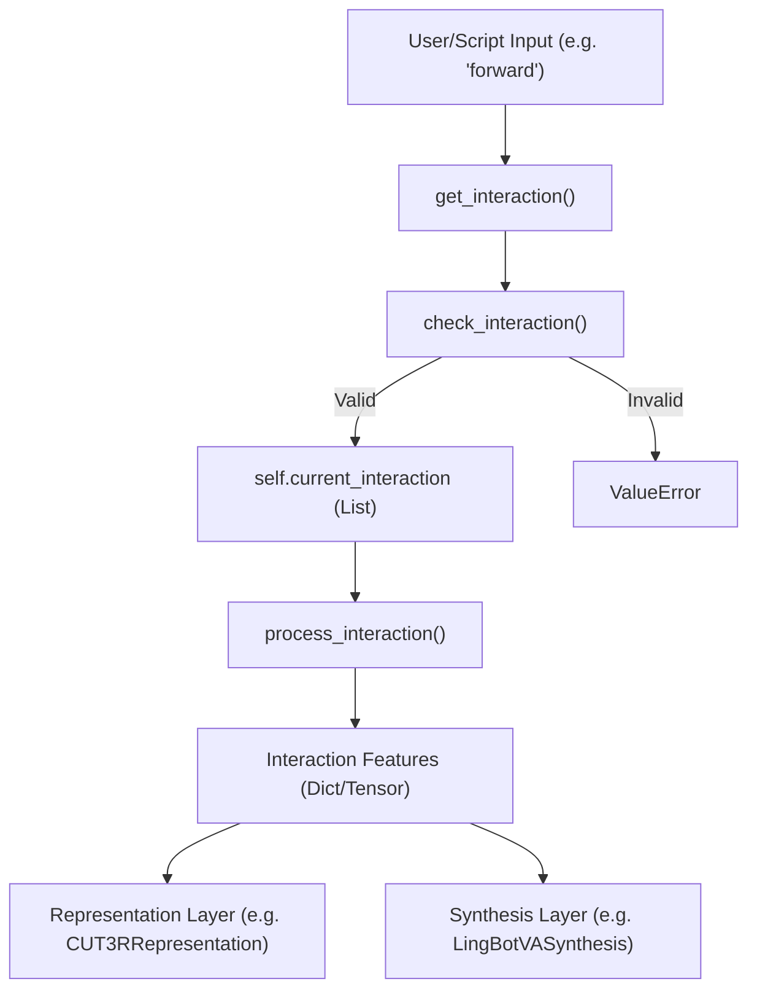
**Sources:** [src/openworldlib/operators/cut3r_operator.py:155-175](), [src/openworldlib/pipelines/cut3r/pipeline_cut3r.py:145-180]()

---

## Unified 3D Interaction Schema

OpenWorldLib enforces a **Unified 3D Interaction Schema** across all navigation and 3D reconstruction pipelines (VGGT, CUT3R, HunyuanWorld, MatrixGame). This allows a single set of control signals to drive different backend architectures.

### Standard Signals
The schema covers three primary control axes:

1.  **Movement (Translation):** `forward`, `backward`, `left`, `right`, and diagonal combinations (e.g., `forward_left`).
2.  **Camera Rotation (Orientation):** `camera_up`, `camera_down`, `camera_l`, `camera_r`, and diagonals (e.g., `camera_ul`).
3.  **Optics:** `camera_zoom_in`, `camera_zoom_out`.

### Implementation Example: `CUT3ROperator`
The `CUT3ROperator` implements this schema to drive 3D Gaussian Splatting (3DGS) rendering.

| Category | Supported Interaction Strings |
| :--- | :--- |
| **Translation** | `forward`, `backward`, `left`, `right`, `forward_left`, `forward_right`, `backward_left`, `backward_right` |
| **Rotation** | `camera_up`, `camera_down`, `camera_l`, `camera_r`, `camera_ul`, `camera_ur`, `camera_dl`, `camera_dr` |
| **Zoom** | `camera_zoom_in`, `camera_zoom_out` |

**Sources:** [src/openworldlib/operators/cut3r_operator.py:18-25](), [test_stream/test_vggt_stream.py:21-28]()

---

## Concrete Operator Implementations

Different pipelines extend the base logic to handle task-specific requirements, such as multi-view observation in VLA or text-conditioned navigation.

### 1. 3D Navigation Operators (`VGGTOperator`, `CUT3ROperator`)
These operators focus on `process_perception` for 3D reconstruction. They handle various input types, including directory paths and text files containing image lists.

*   **Perception Logic:** `process_perception` normalizes images to `[0, 1]` and ensures RGB ordering, even when receiving BGR inputs from OpenCV.
*   **Path Collection:** The `collect_paths` utility allows the operator to ingest entire directories of scene frames for reconstruction.

**Sources:** [src/openworldlib/operators/cut3r_operator.py:70-135](), [src/openworldlib/operators/cut3r_operator.py:44-68]()

### 2. VLA Operators (`PI0Operator`, `LingBotVAOperator`)
VLA (Vision-Language-Action) operators process multimodal inputs for robot control.
*   **Multi-view Handling:** In `LingBotVAPipeline`, the operator manages specific camera keys (e.g., `observation_images_cam_high`, `observation_images_cam_left_wrist`) to form the robot's observation state.
*   **Action Normalization:** These operators often interface with normalization statistics (`norm_stat`) to scale predicted actions into the robot's physical workspace.

**Sources:** [test/test_lingbot_va.py:24-28](), [test/test_lingbot_va.py:61-77]()

### 3. Generative World Operators (`HunyuanWorldPlayOperator`)
Used in pipelines like `HunyuanWorldPlay`, these operators combine the 3D interaction schema with natural language prompts to drive video synthesis.

**Sources:** [test/test_hunyuan_worldplay.py:6-19]()

---

## Technical Data Flow: Perception to Action

The following diagram maps the software entities involved in transforming a raw file path into a processed tensor ready for the model's forward pass.

**Perception Processing Pipeline**
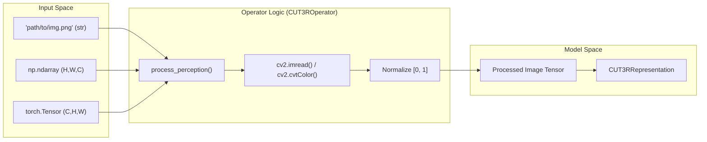
**Sources:** [src/openworldlib/operators/cut3r_operator.py:70-135](), [src/openworldlib/pipelines/cut3r/pipeline_cut3r.py:182-200]()

## Summary of Interaction Schema Usage

| Pipeline | Operator Class | Primary Interaction Mode |
| :--- | :--- | :--- |
| `VGGTPipeline` | `VGGTOperator` | Unified 3D Schema (Navigation) |
| `CUT3RPipeline` | `CUT3ROperator` | Unified 3D Schema (3DGS Control) |
| `LingBotVAPipeline` | `LingBotVAOperator` | Multimodal (Visual + Text Prompt) |
| `MatrixGame2Pipeline` | `MatrixGameOperator` | Unified 3D Schema (Interactive Video) |

**Sources:** [test/test_vggt.py:11-13](), [test/test_cut3r.py:19-20](), [test/test_matrix_game_2.py:19-21]()

---

# Page: Memory Module: Stateful Multi-Turn Interaction

# Memory Module: Stateful Multi-Turn Interaction

<details>
<summary>Relevant source files</summary>

The following files were used as context for generating this wiki page:

- [examples/pipeline_infer_mapping.py](examples/pipeline_infer_mapping.py)
- [examples/pipeline_load_mapping.py](examples/pipeline_load_mapping.py)
- [scripts/test_inference/test_mm_reasoning.sh](scripts/test_inference/test_mm_reasoning.sh)
- [src/openworldlib/base_models/diffusion_model/video/wan_2p1/utils/fm_solvers_unipc.py](src/openworldlib/base_models/diffusion_model/video/wan_2p1/utils/fm_solvers_unipc.py)
- [src/openworldlib/memories/reasoning/qwen/qwen_memory.py](src/openworldlib/memories/reasoning/qwen/qwen_memory.py)
- [src/openworldlib/memories/visual_synthesis/yume/yume_1p5_memory.py](src/openworldlib/memories/visual_synthesis/yume/yume_1p5_memory.py)
- [src/openworldlib/memories/visual_synthesis/yume/yume_memory.py](src/openworldlib/memories/visual_synthesis/yume/yume_memory.py)
- [src/openworldlib/operators/omnivinci_operator.py](src/openworldlib/operators/omnivinci_operator.py)
- [src/openworldlib/operators/qwen2p5_omni_operator.py](src/openworldlib/operators/qwen2p5_omni_operator.py)
- [src/openworldlib/operators/yume_1p5_operator.py](src/openworldlib/operators/yume_1p5_operator.py)
- [src/openworldlib/operators/yume_operator.py](src/openworldlib/operators/yume_operator.py)
- [src/openworldlib/pipelines/omnivinci/pipeline_omnivinci.py](src/openworldlib/pipelines/omnivinci/pipeline_omnivinci.py)
- [src/openworldlib/pipelines/qwen/pipeline_qwen2p5_omni.py](src/openworldlib/pipelines/qwen/pipeline_qwen2p5_omni.py)
- [src/openworldlib/pipelines/yume/pipeline_yume.py](src/openworldlib/pipelines/yume/pipeline_yume.py)
- [src/openworldlib/pipelines/yume/pipeline_yume_1p5.py](src/openworldlib/pipelines/yume/pipeline_yume_1p5.py)
- [src/openworldlib/synthesis/visual_generation/cosmos/cosmos_predict2p5_synthesis.py](src/openworldlib/synthesis/visual_generation/cosmos/cosmos_predict2p5_synthesis.py)
- [src/openworldlib/synthesis/visual_generation/yume/yume/__init__.py](src/openworldlib/synthesis/visual_generation/yume/yume/__init__.py)
- [src/openworldlib/synthesis/visual_generation/yume/yume/image2video.py](src/openworldlib/synthesis/visual_generation/yume/yume/image2video.py)
- [src/openworldlib/synthesis/visual_generation/yume/yume_1p5/__init__.py](src/openworldlib/synthesis/visual_generation/yume/yume_1p5/__init__.py)
- [src/openworldlib/synthesis/visual_generation/yume/yume_1p5/modules/model.py](src/openworldlib/synthesis/visual_generation/yume/yume_1p5/modules/model.py)
- [src/openworldlib/synthesis/visual_generation/yume/yume_1p5/textimage2video.py](src/openworldlib/synthesis/visual_generation/yume/yume_1p5/textimage2video.py)
- [src/openworldlib/synthesis/visual_generation/yume/yume_1p5/utils/utils.py](src/openworldlib/synthesis/visual_generation/yume/yume_1p5/utils/utils.py)
- [src/openworldlib/synthesis/visual_generation/yume/yume_1p5_synthesis.py](src/openworldlib/synthesis/visual_generation/yume/yume_1p5_synthesis.py)
- [src/openworldlib/synthesis/visual_generation/yume/yume_synthesis.py](src/openworldlib/synthesis/visual_generation/yume/yume_synthesis.py)
- [test/test_cosmos_predict2p5.py](test/test_cosmos_predict2p5.py)
- [test/test_depth_anything_v1.py](test/test_depth_anything_v1.py)
- [test/test_lingbot_world.py](test/test_lingbot_world.py)
- [test/test_yume.py](test/test_yume.py)
- [test/test_yume_1p5.py](test/test_yume_1p5.py)
- [test_stream/test_cosmos_predict2p5_stream.py](test_stream/test_cosmos_predict2p5_stream.py)
- [test_stream/test_lingbot_world_stream.py](test_stream/test_lingbot_world_stream.py)
- [test_stream/test_omnivinci_stream.py](test_stream/test_omnivinci_stream.py)
- [test_stream/test_qwen2p5_omni_stream.py](test_stream/test_qwen2p5_omni_stream.py)
- [test_stream/test_yume_1p5_stream.py](test_stream/test_yume_1p5_stream.py)
- [test_stream/test_yume_stream.py](test_stream/test_yume_stream.py)

</details>


The Memory module in OpenWorldLib provides the architectural foundation for stateful, multi-turn interactions across both visual synthesis and multimodal reasoning tasks. While standard pipelines often operate on a single-turn "input-to-output" basis, the `BaseMemory` abstraction allows pipelines to maintain temporal continuity, conversation history, and world-state consistency during streaming or interactive sessions.

## BaseMemory Lifecycle

Every memory implementation follows a standardized lifecycle defined by five core methods. This lifecycle ensures that the `PipelineABC.stream()` method can interact with different memory backends (e.g., video buffers vs. text KV-caches) through a unified interface.

### Lifecycle Methods
1.  **`record`**: Stores new data (frames, tokens, or interactions) into the memory storage.
2.  **`select`**: Retrieves specific elements from memory to serve as context for the next generation turn (e.g., the last frame of a generated video).
3.  **`compress`**: Optimizes memory usage by pruning or summarizing old states to stay within model context windows.
4.  **`process`**: Formats stored data into the specific tensor or dictionary format required by the `Synthesis` or `Reasoning` components.
5.  **`manage`**: Handles administrative tasks such as `reset` (clearing history) or `save`/`load` operations.

### Memory Data Flow in Code Entity Space

The following diagram illustrates how memory entities bridge the gap between user interactions and the generative core.

**Diagram: Memory Interaction and State Management**
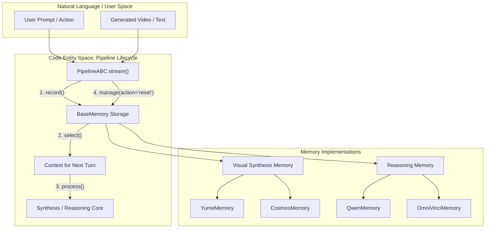
**Sources:** `[src/openworldlib/pipelines/pipeline_utils.py:1-50]()`, `[test_stream/test_cosmos_predict2p5_stream.py:37-101]()`.

---

## Visual Synthesis Memory

Visual synthesis memory is primarily concerned with **temporal continuity**. For navigation models like LingBot or Yume, the memory must store the generated video segments so that the final frame of Turn $N$ can serve as the initial conditioning frame for Turn $N+1$.

### Concrete Implementations

| Implementation | Model Support | Key Features |
| :--- | :--- | :--- |
| `CosmosMemory` | Cosmos-Predict2.5 | Manages `all_frames` buffer; `select()` extracts the last PIL image for `img2world` conditioning [test_stream/test_cosmos_predict2p5_stream.py:88-113](). |
| `YumeMemory` | Yume, Yume 1.5 | Stores latent history and frame buffers to maintain camera trajectory consistency [src/openworldlib/synthesis/visual_generation/yume/yume_1p5_synthesis.py:129-160](). |
| `LingBotMemory` | LingBot-World | Supports DDP-aware frame concatenation for distributed streaming [test_stream/test_lingbot_world_stream.py:156-168](). |
| `WanMemory` | Wan 2.1 / 2.2 | Handles tensor-to-PIL conversion for frame persistence [examples/pipeline_infer_mapping.py:68-77](). |

### The `stream()` Workflow
In visual pipelines, the `stream()` method uses the memory module to loop through interactions.
1.  The user provides an interaction (e.g., "forward").
2.  The pipeline generates a video chunk.
3.  `memory.record(video_chunk)` appends the chunk to `all_frames`.
4.  `memory.select()` identifies the last frame.
5.  The next call to the synthesis engine uses this frame as the new `image_path` or `images` input.

**Sources:** `[test_stream/test_cosmos_predict2p5_stream.py:79-113]()`, `[test_stream/test_lingbot_world_stream.py:138-154]()`.

---

## Reasoning Memory

Reasoning memory focuses on **conversational state** and **multimodal context**. Unlike visual memory which stores pixel data, reasoning memory typically stores a sequence of messages (text, image references, and video pointers) to be fed into an MLLM (Multimodal Large Language Model).

### Qwen and OmniVinci Memory
For models like `Qwen2.5-Omni` and `OmniVinci`, the memory module maintains a list of turns.

*   **Storage Structure**: Usually a `List[Dict]` containing roles (`user`, `assistant`) and content.
*   **Manage Action**: The `manage(action="reset")` call is critical here to clear the conversation history without re-instantiating the model [test_stream/test_omnivinci_stream.py:49-53]().
*   **Context Injection**: In `OmniVinciMemory`, the `process()` method ensures that if a video was generated in a previous turn, it is correctly referenced as a visual input for the current reasoning turn [test_stream/test_omnivinci_stream.py:126-138]().

**Diagram: Reasoning Memory Context Flow**
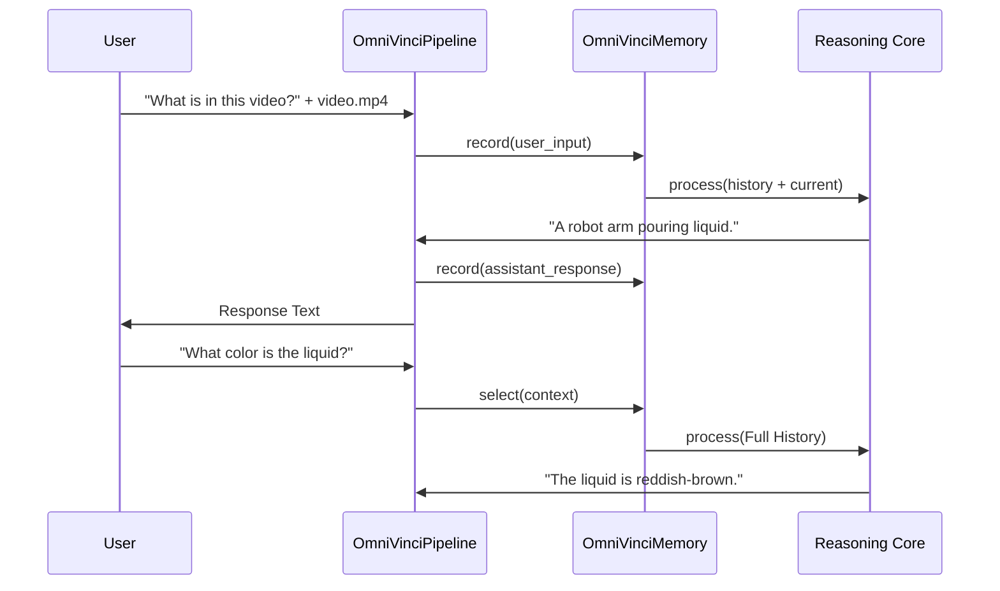
**Sources:** `[test_stream/test_omnivinci_stream.py:18-53]()`, `[examples/pipeline_infer_mapping.py:81-93]()`.

---

## Implementation Details: Yume 1.5 Synthesis & Memory

The `Yume1p5Synthesis` class demonstrates a complex use of memory where "history latents" are used to ensure smooth transitions between video segments.

### Latent Continuity
In `predict_per_interaction`, the synthesis engine checks the `interaction_idx`. If it is greater than 0, it retrieves `history_latents` from the previous turn's memory to initialize the diffusion process [src/openworldlib/synthesis/visual_generation/yume/yume_1p5_synthesis.py:159-162](). This prevents the "flicker" effect common in naive video concatenation.

```python
# Snippet from Yume 1.5 Synthesis Logic
if interaction_idx == 0:
    # First turn: encode initial image to latents
    visual_latents = self.model.vae.encode(...)
    history_latents = visual_latents[:, :-current_latent_num]
else:
    # Subsequent turns: calculate frame offset from history
    history_current_frame_num = (history_latents.shape[1]-1)*4+1+32
```
**Sources:** `[src/openworldlib/synthesis/visual_generation/yume/yume_1p5_synthesis.py:129-160]()`.

## Summary of Key Classes

| Class | File Path | Role |
| :--- | :--- | :--- |
| `CosmosPredict2p5Synthesis` | `[src/openworldlib/synthesis/visual_generation/cosmos/cosmos_predict2p5_synthesis.py:33]()` | Generates video chunks using Flow Matching. |
| `Yume1p5Synthesis` | `[src/openworldlib/synthesis/visual_generation/yume/yume_1p5_synthesis.py:22]()` | Manages per-interaction video prediction with latent history. |
| `Qwen2p5OmniPipeline` | `[src/openworldlib/pipelines/qwen/pipeline_qwen2p5_omni.py:1]()` | Orchestrates multi-turn multimodal reasoning. |
| `FlowUniPCMultistepScheduler` | `[src/openworldlib/base_models/diffusion_model/video/wan_2p1/utils/fm_solvers_unipc.py:22]()` | Handles the noise schedule for flow-based synthesis. |

**Sources:** `[src/openworldlib/synthesis/visual_generation/cosmos/cosmos_predict2p5_synthesis.py:33-50]()`, `[src/openworldlib/synthesis/visual_generation/yume/yume_1p5_synthesis.py:22-45]()`.

---

# Page: Base Models: Diffusion, LLM/MLLM, and Perception Cores

# Base Models: Diffusion, LLM/MLLM, and Perception Cores

<details>
<summary>Relevant source files</summary>

The following files were used as context for generating this wiki page:

- [README.md](README.md)
- [README_zh.md](README_zh.md)
- [docs/awesome_world_model.md](docs/awesome_world_model.md)
- [docs/planning.md](docs/planning.md)
- [examples/pipeline_infer_mapping.py](examples/pipeline_infer_mapping.py)
- [examples/pipeline_load_mapping.py](examples/pipeline_load_mapping.py)
- [src/openworldlib/base_models/diffusion_model/video/wan_2p1/utils/fm_solvers_unipc.py](src/openworldlib/base_models/diffusion_model/video/wan_2p1/utils/fm_solvers_unipc.py)
- [src/openworldlib/pipelines/pipeline_utils.py](src/openworldlib/pipelines/pipeline_utils.py)
- [src/openworldlib/synthesis/visual_generation/cosmos/cosmos_predict2p5_synthesis.py](src/openworldlib/synthesis/visual_generation/cosmos/cosmos_predict2p5_synthesis.py)
- [test/test_cosmos_predict2p5.py](test/test_cosmos_predict2p5.py)
- [test/test_depth_anything_v1.py](test/test_depth_anything_v1.py)
- [test/test_lingbot_world.py](test/test_lingbot_world.py)
- [test_stream/test_cosmos_predict2p5_stream.py](test_stream/test_cosmos_predict2p5_stream.py)
- [test_stream/test_lingbot_world_stream.py](test_stream/test_lingbot_world_stream.py)

</details>


The `base_models` layer constitutes the foundational computational engine of OpenWorldLib. It provides the low-level model implementations for visual synthesis, multimodal reasoning, spatial perception, and 3D reconstruction. These cores are designed to be modular and are loaded by higher-level `Synthesis` and `Reasoning` classes to perform complex world-modeling tasks [README_zh.md:169-173]().

## Architecture Overview

The `base_models` directory is organized into four primary domains:
1.  **`diffusion_model`**: Video and image generation backends (e.g., Wan, HunyuanVideo, Cosmos).
2.  **`llm_mllm_core`**: Large Language Models and Multimodal Large Language Models for reasoning.
3.  **`perception_core`**: Modules for detection, segmentation, and general visual perception.
4.  **`three_dimensions`**: Cores for depth estimation, point cloud processing, and 3D scene representation.

### Base Model to Pipeline Mapping
The following diagram illustrates how specific code entities in the `base_models` layer are utilized by the `PipelineABC` implementations.

**Diagram: Model Core to Pipeline Association**
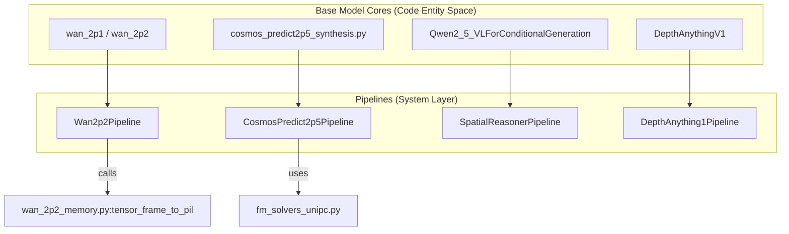
Sources: [examples/pipeline_load_mapping.py:20-92](), [examples/pipeline_infer_mapping.py:68-75](), [test/test_depth_anything_v1.py:5-7]()

---

## Diffusion Model Cores

The diffusion cores support state-of-the-art video generation architectures. They are primarily used for "Navigation Video Generation" and "Interactive Video" tasks [README.md:120-121]().

### Video Diffusion
*   **Wan (2.1/2.2)**: High-quality video synthesis. The pipeline `Wan2p2Pipeline` utilizes these cores for text-to-video and image-to-video tasks [examples/pipeline_load_mapping.py:63-68]().
*   **Cosmos (Predict 2.5)**: Implements flow-matching based video generation. It utilizes `fm_solvers_unipc.py` for efficient sampling [src/openworldlib/base_models/diffusion_model/video/wan_2p1/utils/fm_solvers_unipc.py:1-25]().
*   **Hunyuan Video**: Powers the `HunyuanGameCraftPipeline` and `HunyuanWorldPlay` for interactive world simulation [examples/pipeline_load_mapping.py:29-34]().

### Image Diffusion
*   **DiffSynth**: Integrated for high-fidelity image generation and initial frame synthesis for video pipelines.

---

## LLM & MLLM Cores

The `llm_mllm_core` provides the cognitive engine for the framework. These models handle text processing, visual understanding, and action token generation.

| Core Entity | Primary Pipeline | Role |
| :--- | :--- | :--- |
| `Qwen2.5-Omni` | `Qwen2p5OmniPipeline` | Multi-turn multimodal reasoning [examples/pipeline_load_mapping.py:54-60]() |
| `Qwen2-VL` | `SpatialReasonerPipeline` | Spatial perception and coordinate grounding [docs/awesome_world_model.md:92-93]() |
| `OmniVinci` | `OmniVinciPipeline` | General-purpose world understanding [README.md:124-125]() |

---

## Perception & 3D Cores

Perception cores provide the "eyes" of the world model, transforming raw pixels into structured representations like depth maps or object masks.

### Depth & 3D Representation
*   **DepthAnything (V1/V2)**: Monocular depth estimation core. The `DepthAnything1Pipeline` loads these weights to generate depth maps which are often fed into 3D reconstruction stages [test/test_depth_anything_v1.py:12-23]().
*   **3D Gaussian Splatting (3DGS)**: Used in the `three_dimensions` core for point cloud rendering. This is supported by the `diff-gaussian-rasterization` CUDA submodule [README_zh.md:190-191]().

**Diagram: Perception Data Flow**
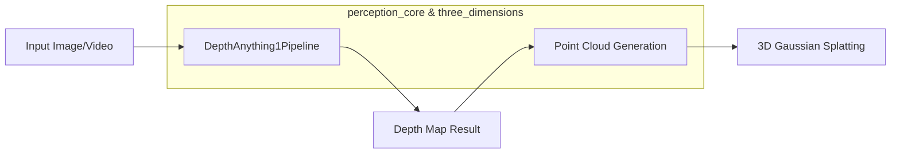
Sources: [test/test_depth_anything_v1.py:25-30](), [README_zh.md:183-185]()

---

## Loading and Initialization

Base models are typically loaded through the `from_pretrained` method of their respective pipelines. The `pipeline_load_mapping.py` file serves as the registry for these initializations.

### Component-Based Loading (Example: Cosmos)
Some complex base models require multiple sub-components (Text Encoders, VAEs) to be loaded simultaneously:
```python
# from examples/pipeline_load_mapping.py:81-92
required_components = {
    "text_encoder_model_path": _resolve_path(model_path, "text_encoder_model_path"),
    "vae_model_path": _resolve_path(model_path, "vae_model_path"),
}
pipeline = CosmosPredict2p5Pipeline.from_pretrained(
    model_path=_resolve_path(model_path, "pretrained_model_path"),
    required_components=required_components,
    mode=mode,
    device=device
)
```

### Key Functions
*   **`_resolve_path`**: Parses model paths from strings or dictionaries to handle multi-checkpoint models [examples/pipeline_load_mapping.py:4-17]().
*   **`init_distributed_group`**: Used for base models that require multi-GPU inference, such as `LingBot` [test/test_lingbot_world.py:7-23]().

Sources: [examples/pipeline_load_mapping.py:4-17](), [examples/pipeline_load_mapping.py:81-92](), [test/test_lingbot_world.py:7-23]()

---

# Page: Synthesis Pipelines: Visual & Audio Generation

# Synthesis Pipelines: Visual & Audio Generation

<details>
<summary>Relevant source files</summary>

The following files were used as context for generating this wiki page:

- [README.md](README.md)
- [README_zh.md](README_zh.md)
- [docs/awesome_world_model.md](docs/awesome_world_model.md)
- [docs/planning.md](docs/planning.md)
- [examples/pipeline_infer_mapping.py](examples/pipeline_infer_mapping.py)
- [examples/pipeline_load_mapping.py](examples/pipeline_load_mapping.py)
- [src/openworldlib/base_models/diffusion_model/video/wan_2p1/utils/fm_solvers_unipc.py](src/openworldlib/base_models/diffusion_model/video/wan_2p1/utils/fm_solvers_unipc.py)
- [src/openworldlib/pipelines/pipeline_utils.py](src/openworldlib/pipelines/pipeline_utils.py)
- [src/openworldlib/synthesis/visual_generation/cosmos/cosmos_predict2p5_synthesis.py](src/openworldlib/synthesis/visual_generation/cosmos/cosmos_predict2p5_synthesis.py)
- [test/test_cosmos_predict2p5.py](test/test_cosmos_predict2p5.py)
- [test/test_depth_anything_v1.py](test/test_depth_anything_v1.py)
- [test/test_lingbot_world.py](test/test_lingbot_world.py)
- [test_stream/test_cosmos_predict2p5_stream.py](test_stream/test_cosmos_predict2p5_stream.py)
- [test_stream/test_lingbot_world_stream.py](test_stream/test_lingbot_world_stream.py)

</details>


This page provides a high-level overview of the generative synthesis pipelines within OpenWorldLib. These pipelines are categorized by their primary output modality: **Navigation Video**, **Interactive/Text-to-Video**, and **Audio**. 

The synthesis layer is responsible for the core generative process, often utilizing diffusion models or flow-matching architectures to predict future states of a world based on current perceptions and interaction signals.

## Modality Overview

OpenWorldLib organizes synthesis capabilities into three main tracks. Each track uses a specialized `Synthesis` class and is wrapped in a `PipelineABC` [src/openworldlib/pipelines/pipeline_utils.py:5-25]() to provide a unified interface for inference.

| Modality | Key Pipelines | Core Task |
| :--- | :--- | :--- |
| **Navigation Video** | `MatrixGame2`, `LingBot`, `HunyuanGameCraft` | Generates video driven by camera/ego-motion signals (e.g., "forward", "camera_l"). |
| **Interactive Video** | `CosmosPredict2p5`, `Wan2p2`, `Sora2` | General video synthesis from text or images, supporting long-term consistency. |
| **Audio Generation** | `MMAudio`, `ThinkSound` | Generates synchronized audio for video sequences or from text descriptions. |

**Sources:** [README.md:118-126](), [src/openworldlib/pipelines/pipeline_utils.py:5-25]()

## System Architecture: Synthesis & Code Entities

The following diagram bridges the high-level synthesis concepts to the specific code entities used in the generation lifecycle.

### Visual Synthesis Component Mapping
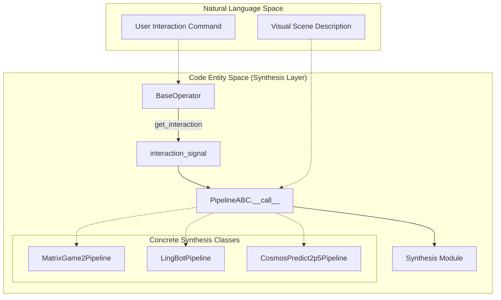
**Sources:** [examples/pipeline_load_mapping.py:20-102](), [src/openworldlib/pipelines/pipeline_utils.py:20-24]()

---

## 3.1 Navigation Video Generation
Navigation video pipelines are designed for "World Simulators" where the output is conditioned on specific interaction signals. These signals simulate a user or agent moving through a 3D environment.

*   **Key Models:** `MatrixGame2`, `HunyuanGameCraft`, `LingBot-World`, `Astra`, and `Yume`.
*   **Interaction Schema:** Uses a unified set of commands such as `forward`, `backward`, `camera_l`, and `camera_r` [test/test_lingbot_world.py:40-40]().
*   **Frame Logic:** Pipelines often calculate the number of output frames based on the length of the interaction sequence (e.g., `len(interaction_signal) * 12`) [examples/pipeline_infer_mapping.py:8-14]().

For details on signal processing and streaming navigation, see **[Navigation Video Generation](#3.1)**.

**Sources:** [examples/pipeline_infer_mapping.py:7-54](), [test/test_lingbot_world.py:40-47]()

---

## 3.2 Interactive & Text-to-Video Generation
These pipelines focus on high-fidelity video synthesis from text prompts or initial image frames (I2V). They support advanced sampling techniques like Flow Matching and Classifier-Free Guidance (CFG).

*   **Key Models:** `CosmosPredict2p5` (utilizing flow matching) [test/test_cosmos_predict2p5.py:26-33](), `Wan2p2`, and API-based integrations like `Sora2` and `Veo3`.
*   **Capabilities:** Supports `img2world` and `video2world` modes. `CosmosPredict2p5` specifically uses a `FlowUniPCMultistepScheduler` for efficient sampling [src/openworldlib/base_models/diffusion_model/video/wan_2p1/utils/fm_solvers_unipc.py]().
*   **Streaming:** Implements the `.stream()` method to maintain temporal continuity across multiple turns by using the last generated frame as the next starting point [test_stream/test_cosmos_predict2p5_stream.py:79-88]().

For details on schedulers and conditioning masks, see **[Interactive & Text-to-Video Generation](#3.2)**.

**Sources:** [test/test_cosmos_predict2p5.py:55-61](), [test_stream/test_cosmos_predict2p5_stream.py:79-88](), [examples/pipeline_load_mapping.py:81-92]()

---

## 3.3 Audio Generation: MMAudio & ThinkSound
Audio synthesis provides the "soundtrack" to the generated visual world, ensuring multimodal alignment.

*   **MMAudio:** A pipeline for text-to-audio and video-to-audio synthesis using `BigVGANv2` vocoders and `CLIP` for alignment.
*   **ThinkSound:** An advanced video-to-audio system that utilizes a Chain-of-Thought (CoT) approach to analyze video content before generating synchronized sound using `Synchformer`.

For details on sampling rates and video-audio compositing, see **[Audio Generation: MMAudio & ThinkSound](#3.3)**.

**Sources:** [README.md:187-188](), [docs/awesome_world_model.md:78-80]()

---

## Pipeline Execution Flow

The following diagram illustrates the standard data flow from loading a synthesis pipeline to producing a video/audio result.

### Synthesis Pipeline Lifecycle
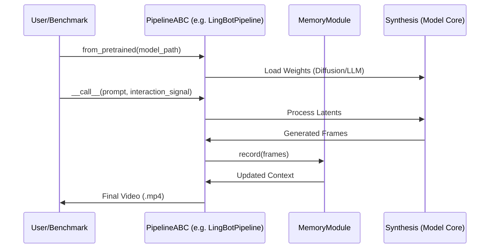
**Sources:** [src/openworldlib/pipelines/pipeline_utils.py:13-24](), [test_stream/test_cosmos_predict2p5_stream.py:79-101](), [examples/pipeline_infer_mapping.py:7-20]()

---

# Page: Navigation Video Generation

# Navigation Video Generation

<details>
<summary>Relevant source files</summary>

The following files were used as context for generating this wiki page:

- [data/benchmarks/generation/__init__.py](data/benchmarks/generation/__init__.py)
- [data/benchmarks/tasks_map.py](data/benchmarks/tasks_map.py)
- [examples/pipeline_infer_mapping.py](examples/pipeline_infer_mapping.py)
- [examples/pipeline_load_mapping.py](examples/pipeline_load_mapping.py)
- [scripts/test_inference/test_nav_video_gen.sh](scripts/test_inference/test_nav_video_gen.sh)
- [src/openworldlib/base_models/diffusion_model/video/wan_2p1/utils/fm_solvers_unipc.py](src/openworldlib/base_models/diffusion_model/video/wan_2p1/utils/fm_solvers_unipc.py)
- [src/openworldlib/memories/visual_synthesis/yume/yume_1p5_memory.py](src/openworldlib/memories/visual_synthesis/yume/yume_1p5_memory.py)
- [src/openworldlib/memories/visual_synthesis/yume/yume_memory.py](src/openworldlib/memories/visual_synthesis/yume/yume_memory.py)
- [src/openworldlib/operators/hunyuan_world_voager_operator.py](src/openworldlib/operators/hunyuan_world_voager_operator.py)
- [src/openworldlib/operators/yume_1p5_operator.py](src/openworldlib/operators/yume_1p5_operator.py)
- [src/openworldlib/operators/yume_operator.py](src/openworldlib/operators/yume_operator.py)
- [src/openworldlib/pipelines/hunyuan_world/pipeline_hunyuan_world_voyager.py](src/openworldlib/pipelines/hunyuan_world/pipeline_hunyuan_world_voyager.py)
- [src/openworldlib/pipelines/yume/pipeline_yume.py](src/openworldlib/pipelines/yume/pipeline_yume.py)
- [src/openworldlib/pipelines/yume/pipeline_yume_1p5.py](src/openworldlib/pipelines/yume/pipeline_yume_1p5.py)
- [src/openworldlib/representations/point_clouds_generation/hunyuan_world/hunyuan_world_voyager_representation.py](src/openworldlib/representations/point_clouds_generation/hunyuan_world/hunyuan_world_voyager_representation.py)
- [src/openworldlib/synthesis/visual_generation/cosmos/cosmos_predict2p5_synthesis.py](src/openworldlib/synthesis/visual_generation/cosmos/cosmos_predict2p5_synthesis.py)
- [src/openworldlib/synthesis/visual_generation/hunyuan_world/hunyuan_world_voyager_synthesis.py](src/openworldlib/synthesis/visual_generation/hunyuan_world/hunyuan_world_voyager_synthesis.py)
- [src/openworldlib/synthesis/visual_generation/yume/yume/__init__.py](src/openworldlib/synthesis/visual_generation/yume/yume/__init__.py)
- [src/openworldlib/synthesis/visual_generation/yume/yume/image2video.py](src/openworldlib/synthesis/visual_generation/yume/yume/image2video.py)
- [src/openworldlib/synthesis/visual_generation/yume/yume_1p5/__init__.py](src/openworldlib/synthesis/visual_generation/yume/yume_1p5/__init__.py)
- [src/openworldlib/synthesis/visual_generation/yume/yume_1p5/modules/model.py](src/openworldlib/synthesis/visual_generation/yume/yume_1p5/modules/model.py)
- [src/openworldlib/synthesis/visual_generation/yume/yume_1p5/textimage2video.py](src/openworldlib/synthesis/visual_generation/yume/yume_1p5/textimage2video.py)
- [src/openworldlib/synthesis/visual_generation/yume/yume_1p5/utils/utils.py](src/openworldlib/synthesis/visual_generation/yume/yume_1p5/utils/utils.py)
- [src/openworldlib/synthesis/visual_generation/yume/yume_1p5_synthesis.py](src/openworldlib/synthesis/visual_generation/yume/yume_1p5_synthesis.py)
- [src/openworldlib/synthesis/visual_generation/yume/yume_synthesis.py](src/openworldlib/synthesis/visual_generation/yume/yume_synthesis.py)
- [test/test_astra.py](test/test_astra.py)
- [test/test_cosmos_predict2p5.py](test/test_cosmos_predict2p5.py)
- [test/test_depth_anything_v1.py](test/test_depth_anything_v1.py)
- [test/test_hunyuan_gamecraft.py](test/test_hunyuan_gamecraft.py)
- [test/test_hunyuan_world_voyager.py](test/test_hunyuan_world_voyager.py)
- [test/test_lingbot_world.py](test/test_lingbot_world.py)
- [test/test_recammaster.py](test/test_recammaster.py)
- [test/test_wan_2p2.py](test/test_wan_2p2.py)
- [test/test_yume.py](test/test_yume.py)
- [test/test_yume_1p5.py](test/test_yume_1p5.py)
- [test_stream/test_cosmos_predict2p5_stream.py](test_stream/test_cosmos_predict2p5_stream.py)
- [test_stream/test_hunyuan_game_craft_stream.py](test_stream/test_hunyuan_game_craft_stream.py)
- [test_stream/test_lingbot_world_stream.py](test_stream/test_lingbot_world_stream.py)
- [test_stream/test_matrix_game_2_stream.py](test_stream/test_matrix_game_2_stream.py)
- [test_stream/test_wan2p2_stream.py](test_stream/test_wan2p2_stream.py)
- [test_stream/test_yume_1p5_stream.py](test_stream/test_yume_1p5_stream.py)
- [test_stream/test_yume_stream.py](test_stream/test_yume_stream.py)

</details>


Navigation Video Generation pipelines in OpenWorldLib are designed to generate temporally consistent video sequences driven by camera interaction signals. These models act as "World Simulators," where a user or agent can provide a starting image and a sequence of movement commands (e.g., "forward", "camera_l") to synthesize the resulting visual perspective.

## Supported Pipelines and Models

The framework integrates several state-of-the-art navigation and interactive video models. Each is encapsulated in a dedicated `Pipeline` class that manages the synthesis, operator, and memory layers.

| Model Name | Pipeline Class | Key Characteristics |
| :--- | :--- | :--- |
| **MatrixGame2** | `MatrixGame2Pipeline` | Universal navigation with multi-turn support. |
| **HunyuanGameCraft** | `HunyuanGameCraftPipeline` | High-fidelity game-like environment synthesis. |
| **HunyuanWorld-Voyager** | `HunyuanWorldVoyagerPipeline` | Integrated 3D representation for navigation. |
| **LingBot-World** | `LingBotPipeline` | Large-scale world model for embodied AI. |
| **Astra** | `AstraPipeline` | Trajectory-controllable video generation. |
| **Yume / Yume-1.5** | `YumePipeline` / `Yume1p5Pipeline` | Fast, interactive world generation. |
| **Wan2.2** | `Wan2p2Pipeline` | Advanced flow-matching based video synthesis. |

**Sources:** [examples/pipeline_load_mapping.py:20-68](), [examples/pipeline_infer_mapping.py:136-142](), [scripts/test_inference/test_nav_video_gen.sh:7-14]()

## Interaction Signal Schema

Navigation pipelines utilize a unified `interaction_signal` to drive the camera movement. This signal can be a single string or a list of commands.

### Unified 3D Interaction Schema
The following signals are standard across most navigation pipelines:
- `forward` / `backward`: Linear movement along the Z-axis.
- `left` / `right`: Lateral movement along the X-axis.
- `camera_l` / `camera_r`: Panning the camera (Yaw).
- `camera_up` / `camera_down`: Tilting the camera (Pitch).
- `forward_left` / `s_curve`: Complex trajectories (supported by specific models like Astra).

### Implementation Logic: Frame Count Calculation
The number of frames generated is often a function of the number of interaction steps provided.
- **MatrixGame2**: Generates 12 frames per interaction step [examples/pipeline_infer_mapping.py:8-8]().
- **HunyuanGameCraft**: Generates 12 frames per interaction step [examples/pipeline_infer_mapping.py:24-24]().
- **LingBot-World**: Generates 36 frames per interaction plus 1 initial frame [examples/pipeline_infer_mapping.py:43-43]().

**Sources:** [examples/pipeline_infer_mapping.py:7-54](), [test/test_hunyuan_world_voyager.py:21-23](), [test/test_astra.py:20-23]()

## Technical Architecture: Interaction Flow

The following diagram illustrates how interaction signals flow from the user through the `Operator` and `Synthesis` layers to produce video frames.

### Data Flow: User Interaction to Video
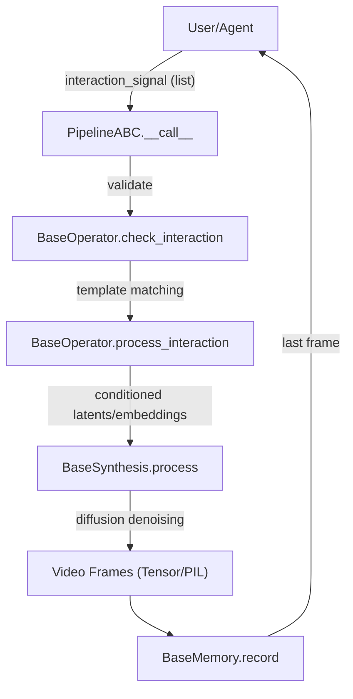
**Sources:** [examples/pipeline_infer_mapping.py:7-48](), [test_stream/test_wan2p2_stream.py:61-67](), [test_stream/test_hunyuan_game_craft_stream.py:180-192]()

## Streaming Mode for Long Sequences

For long-duration navigation, pipelines implement a `stream()` method. This allows for multi-turn interaction where the last frame of the previous generation segment becomes the starting condition for the next.

### Streaming Lifecycle
1. **Reset Memory**: Initialize the memory module to clear previous states [test_stream/test_wan2p2_stream.py:23-23]().
2. **First Turn**: Generate video from an initial image or text prompt [test_stream/test_wan2p2_stream.py:56-64]().
3. **Memory Selection**: The `MemoryModule.select()` method retrieves the final frame of the segment [test_stream/test_wan2p2_stream.py:67-67]().
4. **Subsequent Turns**: Pass the selected frame back into `stream()` as the new reference image [test_stream/test_hunyuan_game_craft_stream.py:178-180]().
5. **Final Export**: Use `imageio.mimsave` or `export_to_video` to concatenate all segments stored in `memory_module.all_frames` [test_stream/test_wan2p2_stream.py:81-93]().

### Pipeline Streaming Components
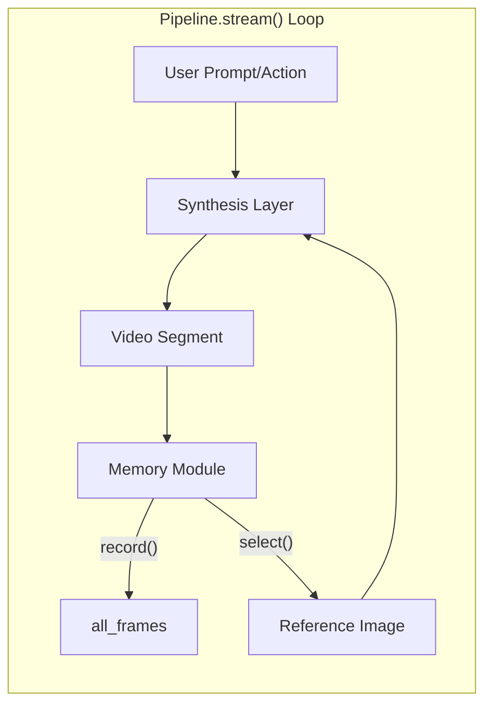
**Sources:** [test_stream/test_wan2p2_stream.py:53-81](), [test_stream/test_hunyuan_game_craft_stream.py:156-203]()

## Detailed Model Implementation Notes

### HunyuanWorld-Voyager
This pipeline integrates a representation model (e.g., `moge-vitl`) to generate depth or point cloud data alongside the video, enhancing spatial consistency [test/test_hunyuan_world_voyager.py:8-18](). It supports a `save_representation_video` flag to visualize the underlying 3D structure [test/test_hunyuan_world_voyager.py:17-17]().

### Astra
Astra uses a MoE (Mixture of Experts) architecture and requires a base model (like `Wan2.1-T2V-1.3B`) as a component [test/test_astra.py:16-33](). It is specifically optimized for complex trajectories like `s_curve` [test/test_astra.py:22-22]().

### Wan2.2
Wan2.2 utilizes flow-matching solvers (`FlowUniPCMultistepScheduler`) for high-efficiency generation. In streaming mode, it relies on `wan_2p2_memory` to handle tensor-to-PIL conversions for intermediate frame selection [examples/pipeline_infer_mapping.py:68-77]().

**Sources:** [test/test_hunyuan_world_voyager.py:4-24](), [test/test_astra.py:5-42](), [examples/pipeline_infer_mapping.py:57-78]()

---

# Page: Interactive & Text-to-Video Generation

# Interactive & Text-to-Video Generation

<details>
<summary>Relevant source files</summary>

The following files were used as context for generating this wiki page:

- [examples/pipeline_infer_mapping.py](examples/pipeline_infer_mapping.py)
- [examples/pipeline_load_mapping.py](examples/pipeline_load_mapping.py)
- [scripts/setup/default_audio_generation_install.sh](scripts/setup/default_audio_generation_install.sh)
- [src/openworldlib/base_models/diffusion_model/video/wan_2p1/utils/fm_solvers_unipc.py](src/openworldlib/base_models/diffusion_model/video/wan_2p1/utils/fm_solvers_unipc.py)
- [src/openworldlib/operators/sora2_operator.py](src/openworldlib/operators/sora2_operator.py)
- [src/openworldlib/operators/veo3_operator.py](src/openworldlib/operators/veo3_operator.py)
- [src/openworldlib/operators/wan_2p5_operator.py](src/openworldlib/operators/wan_2p5_operator.py)
- [src/openworldlib/pipelines/sora/pipeline_sora2.py](src/openworldlib/pipelines/sora/pipeline_sora2.py)
- [src/openworldlib/pipelines/veo/pipeline_veo3.py](src/openworldlib/pipelines/veo/pipeline_veo3.py)
- [src/openworldlib/pipelines/wan/pipeline_wan_2p5.py](src/openworldlib/pipelines/wan/pipeline_wan_2p5.py)
- [src/openworldlib/synthesis/visual_generation/__init__.py](src/openworldlib/synthesis/visual_generation/__init__.py)
- [src/openworldlib/synthesis/visual_generation/cosmos/cosmos_predict2p5_synthesis.py](src/openworldlib/synthesis/visual_generation/cosmos/cosmos_predict2p5_synthesis.py)
- [src/openworldlib/synthesis/visual_generation/veo/veo3_synthesis.py](src/openworldlib/synthesis/visual_generation/veo/veo3_synthesis.py)
- [test/test_cosmos_predict2p5.py](test/test_cosmos_predict2p5.py)
- [test/test_depth_anything_v1.py](test/test_depth_anything_v1.py)
- [test/test_lingbot_world.py](test/test_lingbot_world.py)
- [test/test_sora2.py](test/test_sora2.py)
- [test/test_veo3.py](test/test_veo3.py)
- [test/test_wan_2p5.py](test/test_wan_2p5.py)
- [test/test_wow.py](test/test_wow.py)
- [test_stream/test_cosmos_predict2p5_stream.py](test_stream/test_cosmos_predict2p5_stream.py)
- [test_stream/test_lingbot_world_stream.py](test_stream/test_lingbot_world_stream.py)

</details>


The **Interactive & Text-to-Video Generation** module provides a unified interface for high-fidelity video synthesis. Unlike navigation-specific pipelines, these models focus on general-world dynamics, physical interaction (img2world), and high-quality cinematic generation. The framework supports both local inference models (Cosmos, Wan, WoW) and cloud-based API pipelines (Sora2, Veo3, Wan2.5).

## Core Architecture & Data Flow

The synthesis process is governed by the `BaseSynthesis` abstraction, which manages the lifecycle of diffusion models, VAEs, and schedulers. For interactive tasks like `CosmosPredict2p5`, the system utilizes a **Flow-Matching** framework with specialized schedulers.

### System Entity Mapping
The following diagram maps the high-level generation concepts to specific code entities within the `OpenWorldLib` repository.

**Diagram: Natural Language to Code Entity Space (Synthesis)**

```mermaid
graph TD
    subgraph "Natural Language Space"
        A["Image-to-World"]
        B["Text-to-Video"]
        C["Interactive Stream"]
    end

    subgraph "Code Entity Space (src/openworldlib/)"
        direction TB
        D["CosmosPredict2p5Synthesis"]
        E["Wan2p2Pipeline"]
        F["FlowUniPCMultistepScheduler"]
        G["WanVAE"]
        H["Reason1TextEncoder"]
        I["Sora2Pipeline (API)"]
    end

    A --> D
    B --> E
    B --> I
    C --> D
    D --> F
    D --> G
    D --> H
    E --> G
```
**Sources:** [src/openworldlib/synthesis/visual_generation/cosmos/cosmos_predict2p5_synthesis.py:33-55](), [src/openworldlib/pipelines/wan/pipeline_wan_2p2.py:64-69](), [src/openworldlib/pipelines/sora/pipeline_sora2.py:6-25]()

---

## Cosmos-Predict 2.5: Image-to-World Synthesis

`CosmosPredict2p5` is a flow-matching based model designed for `img2world` and `video2world` tasks. It uses a `WanVAE` for latent compression and a `Reason1TextEncoder` for high-level semantic understanding.

### Implementation Details
- **Flow Matching:** Implementation utilizes the `FlowUniPCMultistepScheduler` [src/openworldlib/synthesis/visual_generation/cosmos/cosmos_predict2p5_synthesis.py:15-16]() to solve the probability flow ODE.
- **Conditioning:** The model supports `cond_mask` and `cond_timestep` [test/test_cosmos_predict2p5.py:58-60]() to control the influence of the input image on the generated sequence.
- **Scaling:** It operates with a temporal scale factor of 4 and spatial scale factor of 8 [src/openworldlib/synthesis/visual_generation/cosmos/cosmos_predict2p5_synthesis.py:52-53]().

### Interactive Streaming
The `stream()` method in `CosmosPredict2p5Pipeline` allows for multi-turn interaction where the last frame of turn $N$ becomes the initial frame for turn $N+1$. This state is managed by the `MemoryModule` [test_stream/test_cosmos_predict2p5_stream.py:88-101]().

**Sources:** [src/openworldlib/synthesis/visual_generation/cosmos/cosmos_predict2p5_synthesis.py:128-148](), [test/test_cosmos_predict2p5.py:26-33](), [test_stream/test_cosmos_predict2p5_stream.py:79-88]()

---

## Local Synthesis Pipelines (Wan, WoW, Emu)

| Pipeline | Model Core | Task Type | Key Features |
| :--- | :--- | :--- | :--- |
| `Wan2p2Pipeline` | Wan-2.1/2.2 | TI2V / T2V | Supports 5B/14B parameters; uses `WanVAE` [examples/pipeline_load_mapping.py:63-68]() |
| `WoWPipeline` | WoW-1-Wan | I2V (Action) | Specialized for robotic manipulation and physical world interactions [test/test_wow.py:22-40]() |
| `Emu3p5Pipeline` | Emu-3.5 | Autoregressive | Next-token prediction for video synthesis; supports SFT [scripts/train_emu_3_5.py:1-20]() |

### WoW (World-on-Wheels/World) Pipeline
The `WoWPipeline` is initialized via `WoWArgs`, which controls VRAM management and tiling [test/test_wow.py:22-30](). It is primarily used for generating video sequences from text prompts like "Put the screw driver into the drawer" [test/test_wow.py:18-18]().

**Sources:** [test/test_wow.py:2-47](), [examples/pipeline_load_mapping.py:63-68]()

---

## API-Based Pipelines (Sora2, Veo3, Wan2.5)

For models that are not locally hosted, `OpenWorldLib` provides API wrappers that conform to the `PipelineABC` interface. These use the `api_init` method to configure endpoints and keys.

**Diagram: API Pipeline Interaction Flow**

```mermaid
sequenceDiagram
    participant U as User/Script
    participant P as Pipeline (e.g., Sora2Pipeline)
    participant O as Operator (e.g., Sora2Operator)
    participant C as API Client (tools/api/clients)
    participant E as External API (OpenAI/DashScope)

    U->>P: __call__(prompt, images)
    P->>O: process_perception(images)
    O-->>P: perception_data
    P->>C: synthesis_model.generate(payload)
    C->>E: POST /v1/video/generations
    E-->>C: task_id / video_url
    C-->>P: response_metadata
    P->>U: result (wait=True polls for completion)
```

### Supported API Models
1.  **Sora2:** Uses OpenAI-compatible endpoints. The `Sora2Operator` automatically determines if the task is Text-to-Video (T2V) or Image-to-Video (I2V) based on the presence of `images` [test/test_sora2.py:31-35]().
2.  **Veo3:** Integrated via `Veo3Pipeline.api_init`. It handles high-resolution cinematic video requests [test/test_veo3.py:14-22]().
3.  **Wan2.5:** Accessed via Alibaba DashScope. Supports `i2av` (Image-to-Audio-Video) and `t2v` [test/test_wan_2p5.py:24-32]().

**Sources:** [test/test_sora2.py:25-35](), [test/test_veo3.py:14-22](), [test/test_wan_2p5.py:24-32](), [src/openworldlib/pipelines/sora/pipeline_sora2.py:6-25]()

---

## Technical Configuration & Schedulers

### FlowUniPCMultistepScheduler
The `FlowUniPCMultistepScheduler` is the primary solver for flow-matching models in the library.
- **Initialization:** Sets `num_train_timesteps=1000` and uses a `shift=1` parameter [src/openworldlib/synthesis/visual_generation/cosmos/cosmos_predict2p5_synthesis.py:133]().
- **CFG (Classifier-Free Guidance):** Controlled via `do_classifier_free_guidance` [src/openworldlib/synthesis/visual_generation/cosmos/cosmos_predict2p5_synthesis.py:165](). Negative prompts are encoded into embeddings to steer the generation away from unwanted artifacts.

### Inference Mapping
The `video_gen_pipe_infer` registry in `pipeline_infer_mapping.py` defines how each pipeline processes its output. For instance, `infer_wan2p2_pipeline` includes logic to convert raw tensors back to PIL frames using `tensor_frame_to_pil` before exporting to MP4 [examples/pipeline_infer_mapping.py:68-77]().

**Sources:** [src/openworldlib/synthesis/visual_generation/cosmos/cosmos_predict2p5_synthesis.py:133-172](), [examples/pipeline_infer_mapping.py:57-78](), [examples/pipeline_load_mapping.py:81-92]()

---

# Page: Audio Generation: MMAudio & ThinkSound

# Audio Generation: MMAudio & ThinkSound

<details>
<summary>Relevant source files</summary>

The following files were used as context for generating this wiki page:

- [src/openworldlib/operators/thinksound_operator.py](src/openworldlib/operators/thinksound_operator.py)
- [src/openworldlib/pipelines/mmaudio/pipeline_mmaudio.py](src/openworldlib/pipelines/mmaudio/pipeline_mmaudio.py)
- [src/openworldlib/pipelines/thinksound/pipeline_thinksound.py](src/openworldlib/pipelines/thinksound/pipeline_thinksound.py)
- [src/openworldlib/synthesis/audio_generation/mmaudio/mmaudio/ext/autoencoder/autoencoder.py](src/openworldlib/synthesis/audio_generation/mmaudio/mmaudio/ext/autoencoder/autoencoder.py)
- [src/openworldlib/synthesis/audio_generation/mmaudio/mmaudio/ext/bigvgan_v2/bigvgan.py](src/openworldlib/synthesis/audio_generation/mmaudio/mmaudio/ext/bigvgan_v2/bigvgan.py)
- [src/openworldlib/synthesis/audio_generation/mmaudio/mmaudio/model/utils/features_utils.py](src/openworldlib/synthesis/audio_generation/mmaudio/mmaudio/model/utils/features_utils.py)
- [src/openworldlib/synthesis/audio_generation/mmaudio/mmaudio_synthesis.py](src/openworldlib/synthesis/audio_generation/mmaudio/mmaudio_synthesis.py)
- [src/openworldlib/synthesis/audio_generation/thinksound/ThinkSound/data_utils/v2a_utils/feature_utils_224.py](src/openworldlib/synthesis/audio_generation/thinksound/ThinkSound/data_utils/v2a_utils/feature_utils_224.py)
- [src/openworldlib/synthesis/audio_generation/thinksound/thinksound_synthesis.py](src/openworldlib/synthesis/audio_generation/thinksound/thinksound_synthesis.py)
- [test/test_mmaudio.py](test/test_mmaudio.py)
- [test/test_thinksound.py](test/test_thinksound.py)

</details>


The Audio Generation module in `OpenWorldLib` provides high-fidelity synthesis of audio from text descriptions or video sequences. It primarily integrates two advanced pipelines: **MMAudio** (Multi-Modal Audio) and **ThinkSound**. These pipelines leverage flow-matching and diffusion-based architectures to synchronize generated soundscapes with visual content or textual prompts.

## MMAudio Pipeline

The `MMAudioPipeline` is designed for both text-to-audio (T2A) and video-to-audio (V2A) synthesis. It utilizes a `FlowMatching` backbone combined with a `BigVGANv2` vocoder and `CLIP` for multimodal feature alignment `[src/openworldlib/pipelines/mmaudio/pipeline_mmaudio.py:10-14]()`.

### Implementation Details
The pipeline separates data preprocessing from model inference through the `MMAudioOperator` and `MMAudioSynthesis` classes `[src/openworldlib/pipelines/mmaudio/pipeline_mmaudio.py:72-76]()`.

*   **Multimodal Conditioning**: Uses `CLIP` for text/image features and `Synchformer` for temporal video synchronization `[src/openworldlib/synthesis/audio_generation/mmaudio/mmaudio/model/utils/features_utils.py:50-67]()`.
*   **Vocoding**: Supports multiple sampling rates, notably a 44.1kHz high-fidelity mode using `BigVGANv2` `[src/openworldlib/synthesis/audio_generation/mmaudio/mmaudio/ext/autoencoder/autoencoder.py:30-46]()`.
*   **Classifier-Free Guidance (CFG)**: Employs `cfg_strength` to balance prompt adherence and audio quality `[src/openworldlib/pipelines/mmaudio/pipeline_mmaudio.py:132-135]()`.

### MMAudio Data Flow

The following diagram illustrates how natural language and video inputs are transformed into audio waveforms through the code entities.

```mermaid
graph TD
    subgraph InputSpace ["Input Space"]
        Prompt["'A man is talking'"]
        Video["video.mp4"]
    end

    subgraph PipelineLayer ["MMAudioPipeline (pipeline_mmaudio.py)"]
        Process["process()"]
        Call["__call__()"]
    end

    subgraph OperatorLayer ["MMAudioOperator (mmaudio_operator.py)"]
        GetInt["get_interaction()"]
        ProcPerc["process_perception()"]
    end

    subgraph SynthesisLayer ["MMAudioSynthesis (mmaudio_synthesis.py)"]
        Predict["predict()"]
        FM["FlowMatching"]
        FeatUtils["FeaturesUtils"]
    end

    subgraph Vocoder ["AutoEncoderModule (autoencoder.py)"]
        BigVGAN["BigVGANv2 (44k)"]
    end

    Prompt --> GetInt
    Video --> ProcPerc
    GetInt --> Process
    ProcPerc --> Process
    Process --> Predict
    Predict --> FM
    FM --> FeatUtils
    FeatUtils --> BigVGAN
    BigVGAN --> Output["Audio Result (.flac/.mp4)"]
```
**Sources:** `[src/openworldlib/pipelines/mmaudio/pipeline_mmaudio.py:83-186]()`, `[src/openworldlib/synthesis/audio_generation/mmaudio/mmaudio_synthesis.py:130-186]()`, `[test/test_mmaudio.py:43-71]()`.

---

## ThinkSound Pipeline

The `ThinkSoundPipeline` focuses on synchronized video-to-audio generation using a Chain-of-Thought (CoT) approach. It processes video content and textual descriptions (title/description) to generate matching audio `[src/openworldlib/pipelines/thinksound/pipeline_thinksound.py:11-16]()`.

### Key Components
*   **Chain-of-Thought (CoT)**: The `ThinkSoundOperator` generates intermediate `cot.csv` files containing captions and CoT descriptions to guide the synthesis `[src/openworldlib/operators/thinksound_operator.py:85-92]()`.
*   **Feature Extraction**: Uses an external script `extract_latents.py` to produce `demo.npz` files containing MetaCLIP and T5 embeddings `[src/openworldlib/operators/thinksound_operator.py:95-117]()`.
*   **Sampling**: Implements discrete Euler sampling for the diffusion process `[src/openworldlib/synthesis/audio_generation/thinksound/thinksound_synthesis.py:21]()`.

### Directory Structure
ThinkSound relies on specific directories for its workflow:
*   `video_dir`: Stores formatted MP4 files.
*   `cot_dir`: Contains the `cot.csv` generated from interactions.
*   `results_dir`: Stores extracted features (`.npz`) and final audio.

**Sources:** `[src/openworldlib/operators/thinksound_operator.py:23-60]()`, `[test/test_thinksound.py:31-44]()`.

---

## Technical Configuration & Comparison

| Feature | MMAudio | ThinkSound |
| :--- | :--- | :--- |
| **Backbone** | Flow-Matching | Diffusion (Rectified Flow) |
| **Text Encoder** | CLIP (DFN5B-ViT-H-14) | T5-v1_1-xl & MetaCLIP |
| **Video Encoder** | Synchformer | Synchformer |
| **Sampling Rate** | 16kHz / 44.1kHz | Config-dependent (default 44.1kHz) |
| **Output Format** | FLAC / MP4 (Composite) | WAV |
| **Preprocessing** | In-memory Operator | File-based CoT (NPZ) |

### ThinkSound Execution Flow

```mermaid
graph LR
    subgraph Interaction ["Interaction (thinksound_operator.py)"]
        Title["Title"]
        Desc["Description"]
        WriteCOT["_write_cot()"]
    end

    subgraph Perception ["Perception (thinksound_operator.py)"]
        RawVideo["Raw Video"]
        PrepVid["_prepare_video()"]
        ExtLat["_run_feature_extraction()"]
    end

    subgraph Storage ["FileSystem"]
        CSV["cot/cot.csv"]
        NPZ["results/demo.npz"]
    end

    subgraph Inference ["ThinkSoundSynthesis (thinksound_synthesis.py)"]
        LoadNPZ["_load_npz()"]
        PredictTS["predict()"]
    end

    Title & Desc --> WriteCOT --> CSV
    RawVideo --> PrepVid --> ExtLat
    CSV & PrepVid --> ExtLat --> NPZ
    NPZ --> LoadNPZ --> PredictTS
    PredictTS --> WavOutput["Result (.wav)"]
```
**Sources:** `[src/openworldlib/operators/thinksound_operator.py:62-142]()`, `[src/openworldlib/pipelines/thinksound/pipeline_thinksound.py:154-184]()`, `[src/openworldlib/synthesis/audio_generation/thinksound/thinksound_synthesis.py:25-77]()`.

---

## Video Compositing
Both pipelines support merging generated audio back into the source video. MMAudio uses the `make_video` utility, which takes `video_info` (extracted during perception) and the generated waveform to produce a synchronized MP4 `[test/test_mmaudio.py:19-22]()`.

### Path Resolution
The `MMAudioSynthesis` class includes a robust `_maybe_resolve_hf_cache_snapshot_dir` utility to handle HuggingFace's local snapshot directory structure, ensuring that `CLIP` and `BigVGANv2` weights are correctly loaded regardless of whether they are provided as repo IDs or local paths `[src/openworldlib/synthesis/audio_generation/mmaudio/mmaudio_synthesis.py:23-79]()`.

**Sources:** `[src/openworldlib/synthesis/audio_generation/mmaudio/mmaudio_synthesis.py:82-127]()`, `[src/openworldlib/synthesis/audio_generation/thinksound/ThinkSound/data_utils/v2a_utils/feature_utils_224.py:29-69]()`.

---

# Page: Representation Pipelines: 3D Scene Generation

# Representation Pipelines: 3D Scene Generation

<details>
<summary>Relevant source files</summary>

The following files were used as context for generating this wiki page:

- [README.md](README.md)
- [README_zh.md](README_zh.md)
- [data/benchmarks/README.md](data/benchmarks/README.md)
- [docs/awesome_world_model.md](docs/awesome_world_model.md)
- [docs/planning.md](docs/planning.md)
- [src/openworldlib/pipelines/pipeline_utils.py](src/openworldlib/pipelines/pipeline_utils.py)

</details>


This page provides a high-level overview of the 3D scene generation and representation capabilities within OpenWorldLib. These pipelines focus on the **Representation** layer of the world model architecture, enabling the transformation of 2D visual data (images/videos) into structured 3D environments and depth-aware spatial representations [README.md:183-185]().

## Overview of 3D Representation
In OpenWorldLib, 3D scene generation is treated as a core pillar of world modeling, bridging the gap between pixel-level synthesis and spatial understanding [README.md:81-83](). The framework supports feed-forward 3D reconstruction, monocular depth estimation, and integration with physical simulation environments.

The following diagram illustrates the relationship between the representation layer and the core `PipelineABC` structure.

### 3D Representation System Architecture
```mermaid
graph TD
    subgraph "Pipeline Layer"
        P["PipelineABC"] -- "invokes" --> R["Representation Layer"]
    end

    subgraph "Representation Layer [src/openworldlib/representations/]"
        R --> PCG["point_clouds_generation"]
        R --> DG["depth_generation"]
        R --> SE["simulation_environment"]
    end

    subgraph "Code Entities"
        PCG -- "Models" --> VGGT["VGGT-1B"]
        PCG -- "Models" --> PI3["Pi3"]
        DG -- "Models" --> DA["DepthAnythingV1/V2"]
        SE -- "Sim" --> TH["AI2Thor-Operator"]
    end

    style P stroke-width:2px
    style R stroke-width:2px
```
**Sources:** [src/openworldlib/pipelines/pipeline_utils.py:5-25](), [README.md:183-185](), [README_zh.md:169-189]()

---

## Point Cloud Reconstruction
OpenWorldLib integrates several state-of-the-art feed-forward 3D reconstruction models. These systems typically follow a two-stage workflow:
1.  **Neural Reconstruction:** Generating a sparse or dense point cloud (exported as `.ply`) from one or more input images.
2.  **3D Gaussian Splatting (3DGS):** Using the point cloud as a geometric prior to initialize and render high-fidelity 3D scenes using CUDA-accelerated rasterization [README.md:123-124]().

Key models supported include **VGGT**, **Pi3**, **FlashWorld**, and **HunyuanMirror**. These models are critical for tasks requiring "Spatial Intelligence," where the model must understand the 3D structure of the world it is predicting [docs/awesome_world_model.md:18-23]().

For a deep dive into the point cloud workflows, camera convention probing, and specific model architectures, see **[Point Cloud Reconstruction: VGGT, CUT3R, Pi3, LoGeR, FlashWorld, HunyuanMirror](#4.1)**.

---

## Depth Estimation
Depth estimation serves as a fundamental perception task within the representation layer. The primary implementation is the `DepthAnythingPipeline`, which leverages the **DepthAnything** family of models to produce high-resolution monocular depth maps.

These depth maps are frequently used as intermediate representations to:
*   Provide spatial cues for video generation pipelines.
*   Initialize point clouds for 3D reconstruction.
*   Assist in spatial reasoning tasks by providing relative distance metrics [data/benchmarks/README.md:59-61]().

For details on the implementation of depth generation and its integration with the `three_dimensions` base models, see **[Depth Estimation: DepthAnything](#4.2)**.

---

## Simulation Environments
Beyond static reconstruction, OpenWorldLib supports interactive 3D representation through the integration of the **AI2-THOR** simulator. This allows the framework to function as an embodied agent within a physics-enabled environment [README.md:74-75]().

The simulation integration includes:
*   **`pipeline_thor`**: A specialized pipeline for interacting with the simulator.
*   **`ai2thor_operator`**: An operator that maps unified interaction signals (forward, backward, rotate) to simulator actions.
*   **Embodied Evaluation**: Benchmarking models on navigation and object manipulation tasks within the simulated 3D space [data/benchmarks/README.md:67-73]().

For details on how to set up and use the AI2-THOR integration for embodied AI research, see **[Simulation Environment: AI2Thor](#4.3)**.

---

## 3D Representation Component Mapping

The following table summarizes the primary 3D representation components and their corresponding code locations.

| Component | Code Category | Representative Models | File Path Reference |
| :--- | :--- | :--- | :--- |
| **Point Cloud Generation** | Representation | VGGT, Pi3, FlashWorld | `src/openworldlib/representations/point_clouds_generation` |
| **Depth Generation** | Representation | DepthAnything | `src/openworldlib/representations/depth_generation` |
| **3D Base Models** | Base Model Core | 3DGS, Point Cloud Kernels | `src/openworldlib/base_models/three_dimensions` |
| **Simulation** | Representation | AI2-THOR | `src/openworldlib/representations/simulation_environment` |

### Interaction and Representation Flow
```mermaid
sequenceDiagram
    participant User as "Operator"
    participant Pipe as "PipelineABC"
    participant Rep as "Representation Layer"
    participant Base as "3D Base Models"

    User->>Pipe: "Input Image/Video"
    Pipe->>Rep: "process_perception()"
    Rep->>Base: "Load 3D Weights (VGGT/DepthAnything)"
    Base-->>Rep: "Feature Maps / Point Cloud"
    Rep-->>Pipe: "Structured 3D Representation (.ply / .depth)"
    Pipe-->>User: "3D Scene / Rendered Views"
```
**Sources:** [src/openworldlib/pipelines/pipeline_utils.py:17-21](), [README_zh.md:169-189](), [docs/planning.md:38-39]()

---

# Page: Point Cloud Reconstruction: VGGT, CUT3R, Pi3, LoGeR, FlashWorld, HunyuanMirror

# Point Cloud Reconstruction: VGGT, CUT3R, Pi3, LoGeR, FlashWorld, HunyuanMirror

<details>
<summary>Relevant source files</summary>

The following files were used as context for generating this wiki page:

- [docs/installation.md](docs/installation.md)
- [pyproject.toml](pyproject.toml)
- [requirements.txt](requirements.txt)
- [scripts/setup/cut3r_install.sh](scripts/setup/cut3r_install.sh)
- [scripts/setup/default_3D_install.sh](scripts/setup/default_3D_install.sh)
- [scripts/setup/default_audio_install.sh](scripts/setup/default_audio_install.sh)
- [scripts/setup/hunyuan_mirror_install.sh](scripts/setup/hunyuan_mirror_install.sh)
- [scripts/setup/loger_install.sh](scripts/setup/loger_install.sh)
- [src/openworldlib/operators/cut3r_operator.py](src/openworldlib/operators/cut3r_operator.py)
- [src/openworldlib/operators/flash_world_operator.py](src/openworldlib/operators/flash_world_operator.py)
- [src/openworldlib/operators/hunyuan_worldplay_operator.py](src/openworldlib/operators/hunyuan_worldplay_operator.py)
- [src/openworldlib/operators/matrix_game_2_operator.py](src/openworldlib/operators/matrix_game_2_operator.py)
- [src/openworldlib/operators/pi3_operator.py](src/openworldlib/operators/pi3_operator.py)
- [src/openworldlib/operators/vggt_operator.py](src/openworldlib/operators/vggt_operator.py)
- [src/openworldlib/pipelines/cut3r/pipeline_cut3r.py](src/openworldlib/pipelines/cut3r/pipeline_cut3r.py)
- [src/openworldlib/pipelines/flash_world/pipeline_flash_world.py](src/openworldlib/pipelines/flash_world/pipeline_flash_world.py)
- [src/openworldlib/pipelines/hunyuan_world/pipeline_hunyuan_mirror.py](src/openworldlib/pipelines/hunyuan_world/pipeline_hunyuan_mirror.py)
- [src/openworldlib/pipelines/hunyuan_world/pipeline_hunyuan_worldplay.py](src/openworldlib/pipelines/hunyuan_world/pipeline_hunyuan_worldplay.py)
- [src/openworldlib/pipelines/matrix_game/pipeline_matrix_game_2.py](src/openworldlib/pipelines/matrix_game/pipeline_matrix_game_2.py)
- [src/openworldlib/pipelines/pi3/__init__.py](src/openworldlib/pipelines/pi3/__init__.py)
- [src/openworldlib/pipelines/pi3/pipeline_loger.py](src/openworldlib/pipelines/pi3/pipeline_loger.py)
- [src/openworldlib/pipelines/pi3/pipeline_pi3.py](src/openworldlib/pipelines/pi3/pipeline_pi3.py)
- [src/openworldlib/pipelines/vggt/pipeline_vggt.py](src/openworldlib/pipelines/vggt/pipeline_vggt.py)
- [src/openworldlib/representations/point_clouds_generation/cut3r/cut3r_representation.py](src/openworldlib/representations/point_clouds_generation/cut3r/cut3r_representation.py)
- [src/openworldlib/representations/point_clouds_generation/flash_world/flash_world_representation.py](src/openworldlib/representations/point_clouds_generation/flash_world/flash_world_representation.py)
- [src/openworldlib/representations/point_clouds_generation/pi3/loger/__init__.py](src/openworldlib/representations/point_clouds_generation/pi3/loger/__init__.py)
- [src/openworldlib/representations/point_clouds_generation/pi3/loger/layers/attention.py](src/openworldlib/representations/point_clouds_generation/pi3/loger/layers/attention.py)
- [src/openworldlib/representations/point_clouds_generation/pi3/loger/layers/block.py](src/openworldlib/representations/point_clouds_generation/pi3/loger/layers/block.py)
- [src/openworldlib/representations/point_clouds_generation/pi3/loger/layers/camera_head.py](src/openworldlib/representations/point_clouds_generation/pi3/loger/layers/camera_head.py)
- [src/openworldlib/representations/point_clouds_generation/pi3/loger/pi3.py](src/openworldlib/representations/point_clouds_generation/pi3/loger/pi3.py)
- [src/openworldlib/representations/point_clouds_generation/pi3/loger/ttt.py](src/openworldlib/representations/point_clouds_generation/pi3/loger/ttt.py)
- [src/openworldlib/representations/point_clouds_generation/pi3/loger/utils/basic.py](src/openworldlib/representations/point_clouds_generation/pi3/loger/utils/basic.py)
- [src/openworldlib/representations/point_clouds_generation/pi3/loger/utils/geometry.py](src/openworldlib/representations/point_clouds_generation/pi3/loger/utils/geometry.py)
- [src/openworldlib/representations/point_clouds_generation/pi3/loger/utils/rotation.py](src/openworldlib/representations/point_clouds_generation/pi3/loger/utils/rotation.py)
- [src/openworldlib/representations/point_clouds_generation/pi3/loger_representation.py](src/openworldlib/representations/point_clouds_generation/pi3/loger_representation.py)
- [src/openworldlib/representations/point_clouds_generation/vggt/vggt_representation.py](src/openworldlib/representations/point_clouds_generation/vggt/vggt_representation.py)
- [test/test_cut3r.py](test/test_cut3r.py)
- [test/test_flash_world.py](test/test_flash_world.py)
- [test/test_hunyuan_mirror.py](test/test_hunyuan_mirror.py)
- [test/test_hunyuan_worldplay.py](test/test_hunyuan_worldplay.py)
- [test/test_infinite_vggt.py](test/test_infinite_vggt.py)
- [test/test_loger.py](test/test_loger.py)
- [test/test_matrix_game_2.py](test/test_matrix_game_2.py)
- [test/test_pi3.py](test/test_pi3.py)
- [test/test_vggt.py](test/test_vggt.py)
- [test_stream/test_loger_stream.py](test_stream/test_loger_stream.py)
- [test_stream/test_pi3_stream.py](test_stream/test_pi3_stream.py)
- [test_stream/test_vggt_stream.py](test_stream/test_vggt_stream.py)

</details>


This page provides a technical deep dive into the 3D scene representation pipelines within OpenWorldLib that utilize a two-stage point cloud reconstruction and rendering workflow. These pipelines share a common architectural pattern: Stage 1 performs neural reconstruction from images/videos to a 3D point cloud (often saved as `.ply`), and Stage 2 performs 3D Gaussian Splatting (3DGS) or point-based rendering to generate interactive novel views.

## Overview of the Two-Stage Workflow

The reconstruction pipelines for VGGT, CUT3R, Pi3, LoGeR, FlashWorld, and HunyuanMirror follow a unified execution lifecycle. This lifecycle abstracts the complexity of different neural backends (Transformers, DPT, etc.) into a consistent 3D representation layer.

| Stage | Component | Responsibility |
| :--- | :--- | :--- |
| **Stage 1** | **Representation Layer** | Neural inference to generate 3D point positions, colors, and features. Outputs `.ply` or `.npy` data. |
| **Stage 2** | **Synthesis/Rendering** | 3D Gaussian Splatting or deterministic point rendering based on camera interaction signals. |

### System Mapping: Natural Language to Code Entities

The following diagram bridges the high-level model names with their specific implementation classes in the codebase.

**Model to Pipeline Entity Mapping**
```mermaid
graph TD
    subgraph "Natural Language Models"
        M1["VGGT-1B"]
        M2["CUT3R"]
        M3["Pi3 / Pi3X"]
        M4["LoGeR / LoGeR*"]
        M5["FlashWorld"]
        M6["HunyuanMirror"]
    end

    subgraph "Code Entity Space (Pipelines)"
        P1["VGGTPipeline"]
        P2["CUT3RPipeline"]
        P3["Pi3Pipeline"]
        P4["LoGeRPipeline"]
        P5["FlashWorldPipeline"]
        P6["HunyuanMirrorPipeline"]
    end

    M1 --> P1
    M2 --> P2
    M3 --> P3
    M4 --> P4
    M5 --> P5
    M6 --> P6

    P1 --"uses"--> R1["VGGTRepresentation"]
    P2 --"uses"--> R2["CUT3RRepresentation"]
    P3 --"uses"--> R3["LoGeRRepresentation"]
    P4 --"uses"--> R3
    P5 --"uses"--> R5["FlashWorldRepresentation"]
```
**Sources:** `[src/openworldlib/pipelines/vggt/pipeline_vggt.py:26-43]()`, `[src/openworldlib/pipelines/pi3/pipeline_pi3.py:8-18]()`, `[src/openworldlib/pipelines/cut3r/pipeline_cut3r.py:30-47]()`, `[src/openworldlib/pipelines/flash_world/pipeline_flash_world.py:29-47]()`.

---

## Stage 1: Neural Reconstruction

Each model utilizes a specific representation class to transform 2D inputs into 3D point clouds. This stage is typically invoked via the `process()` or `__call__` method of the pipeline with `task_type="reconstruction"` or similar.

### Implementation Details by Model
*   **VGGT (Visual Geometry Group Transformer):** Uses a transformer-based architecture (`VGGT-1B`) to predict 3D point coordinates and features from a single or multiple reference images `[test/test_vggt.py:8-28]()`.
*   **CUT3R:** Implements a multi-scale reconstruction approach. Supported configurations include `cut3r_224_linear_4` and `cut3r_512_dpt_4_64`, which utilize DPT (Dense Prediction Transformer) backends `[test/test_cut3r.py:10-33]()`.
*   **Pi3 / LoGeR:** Both utilize the `LoGeRRepresentation`. Pi3 handles video inputs by sampling frames at a specified `interval` (e.g., 10) to reconstruct the global scene `[test/test_pi3.py:20-23]()`.
*   **HunyuanMirror:** Specifically optimized for mirror-like or high-fidelity surface reconstruction, producing point maps, depth, and normals `[test/test_hunyuan_mirror.py:25-37]()`.

### Data Flow in Stage 1
```mermaid
sequenceDiagram
    participant U as User/Test Script
    participant P as Pipeline (e.g., Pi3Pipeline)
    participant R as Representation (e.g., LoGeRRepresentation)
    participant D as Disk

    U->>P: __call__(images/videos, task_type="reconstruction")
    P->>R: forward(input_data)
    R-->>P: returns points, colors, camera_params
    P->>P: create Result Object (e.g., LoGeRResult)
    U->>P: result.save(output_dir)
    P->>D: write result.ply, depth_*.png, pose_*.json
```
**Sources:** `[src/openworldlib/pipelines/pi3/pipeline_loger.py:84-174]()`, `[test/test_pi3.py:18-24]()`.

---

## Stage 2: 3DGS Rendering & Interaction

Once the point cloud is generated, the pipelines support interactive rendering. This stage consumes the **Unified 3D Interaction Schema** to move the virtual camera within the reconstructed scene.

### Camera Convention Probing & Deterministic Fallback
The system attempts to use high-performance 3D Gaussian Splatting if the `diff-gaussian-rasterization` submodule is installed `[src/openworldlib/pipelines/vggt/pipeline_vggt.py:33]()`. If CUDA extensions are missing, the pipelines fall back to a deterministic CPU/NumPy-based point renderer.

**Deterministic Renderer Logic (`render_point_cloud`):**
1.  **Coordinate Transform:** Projects 3D points to camera space using `w2c = np.linalg.inv(c2w)` `[src/openworldlib/pipelines/pi3/pipeline_loger.py:43-47]()`.
2.  **Z-Buffering:** Sorts points by depth (`z`) to handle occlusions `[src/openworldlib/pipelines/pi3/pipeline_loger.py:62-63]()`.
3.  **Splatting:** Iterates through a splat radius (e.g., `splat_radius=3`) to fill pixels on a `canvas` and `z_buf` `[src/openworldlib/pipelines/pi3/pipeline_loger.py:68-81]()`.

### Unified Interaction Handling
The `Operator` layer (e.g., `VGGTOperator`, `Pi3Operator`) translates string commands like `"forward"`, `"camera_l"`, or `"camera_zoom_in"` into camera matrix deltas `[test_stream/test_vggt_stream.py:21-28]()`.

**Camera Delta Application (`_apply_camera_delta`):**
The function modifies the `c2w` (Camera-to-World) matrix based on a 5-element delta vector `[dx, dy, dz, theta_x, theta_z]` `[src/openworldlib/pipelines/pi3/pipeline_loger.py:13-31]()`.

| Interaction | Transformation |
| :--- | :--- |
| `forward` / `backward` | Translation along Z-axis (`dz`) |
| `left` / `right` | Translation along X-axis (`dx`) |
| `camera_l` / `camera_r` | Rotation around Z-axis (`theta_z`) |
| `camera_up` / `camera_down` | Rotation around X-axis (`theta_x`) |

---

## Installation & Requirements

These pipelines require specific 3D dependencies beyond the base `openworldlib` installation.

*   **Extra Group:** `3d_ply_default` (includes `plyfile`) `[pyproject.toml:26-32]()`.
*   **CUDA Submodules:** For Stage 2 acceleration, `diff-gaussian-rasterization` must be compiled.
*   **Specific Scripts:**
    *   VGGT/Pi3: `bash scripts/setup/default_3D_install.sh` `[docs/installation.md:92-100]()`.
    *   CUT3R: `bash scripts/setup/cut3r_install.sh` (installs `roma`, `trimesh`, `simple_knn`) `[scripts/setup/cut3r_install.sh:1-16]()`.
    *   LoGeR: `bash scripts/setup/loger_install.sh` `[docs/installation.md:113]()`.

### Key Pipeline Classes and Files

| Pipeline | Main Class | Operator | Representation |
| :--- | :--- | :--- | :--- |
| **VGGT** | `VGGTPipeline` | `VGGTOperator` | `VGGTRepresentation` |
| **CUT3R** | `CUT3RPipeline` | `CUT3ROperator` | `CUT3RRepresentation` |
| **Pi3** | `Pi3Pipeline` | `Pi3Operator` | `LoGeRRepresentation` |
| **FlashWorld** | `FlashWorldPipeline` | `FlashWorldOperator` | `FlashWorldRepresentation` |

**Sources:** `[src/openworldlib/pipelines/vggt/pipeline_vggt.py:4]()`, `[src/openworldlib/pipelines/pi3/pipeline_pi3.py:8]()`, `[src/openworldlib/pipelines/cut3r/pipeline_cut3r.py:6]()`, `[src/openworldlib/pipelines/flash_world/pipeline_flash_world.py:4]()`.

---

# Page: Simulation Environment: AI2Thor

# Simulation Environment: AI2Thor

<details>
<summary>Relevant source files</summary>

The following files were used as context for generating this wiki page:

- [scripts/setup/ai2thor_install.sh](scripts/setup/ai2thor_install.sh)
- [scripts/setup/default_install.sh](scripts/setup/default_install.sh)
- [scripts/setup/lower_trans_install.sh](scripts/setup/lower_trans_install.sh)
- [scripts/test_inference/test_simulator_env.sh](scripts/test_inference/test_simulator_env.sh)
- [test/test_ai2thor.py](test/test_ai2thor.py)
- [tools/installing/readme.md](tools/installing/readme.md)

</details>


The AI2Thor simulation environment integration in OpenWorldLib provides a high-fidelity physical and visual platform for evaluating embodied reasoning and navigation agents. Unlike generative synthesis pipelines, this environment uses a deterministic physics engine (Unity) to provide ground-truth feedback for agent interactions. The integration is structured around a three-tier architecture: the `Ai2ThorPipeline` (lifecycle management), the `Ai2ThorOperator` (interaction mapping), and the `Ai2ThorEnvironment` (representation layer).

## 1. Environment Setup and Installation

The AI2Thor environment requires a specific Unity build and a set of Python dependencies. The installation is automated via a dedicated setup script that downloads the Linux-64 binary and installs required libraries including `objathor` and `msgpack`.

*   **Binary Target**: `submodules/ai2thor/` [scripts/setup/ai2thor_install.sh:10-12]()
*   **Key Dependencies**: `Flask`, `Werkzeug`, `objathor`, `python-xlib`, and `msgpack` [scripts/setup/ai2thor_install.sh:15-19]()

The installation script performs the following steps:
1.  Installs Python dependencies via `pip`.
2.  Downloads the AI2-THOR Unity build from S3.
3.  Extracts the build to the local submodule directory for use by the pipeline.

**Sources:**
- [scripts/setup/ai2thor_install.sh:1-31]()
- [scripts/setup/default_install.sh:1-17]()

---

## 2. System Architecture

The AI2Thor integration bridges the gap between high-level navigation tokens and the low-level Unity engine commands. The following diagram illustrates the data flow from a policy (AI or Human) through the operator and into the simulation environment.

### 2.1 Component Interaction Flow
"This diagram maps the logical flow of an embodied reasoning step to specific code entities."

```mermaid
graph TD
    subgraph "Reasoning / Policy Space"
        A["Policy Function (policy)"] -- "High-level Token (e.g., 'forward')" --> B["Ai2ThorPipeline.__call__"]
    end

    subgraph "Code Entity Space: OpenWorldLib"
        B -- "Process Interaction" --> C["Ai2ThorOperator (op_cfg)"]
        C -- "Action Command" --> D["Ai2ThorEnvironment (rep_cfg)"]
        D -- "Unity API Call" --> E["AI2-THOR Executable"]
    end

    subgraph "Representation Space"
        E -- "RGB/Depth/Instance" --> F["Observation (obs)"]
        F -- "Feedback Loop" --> A
    end

    style B stroke-width:2px
    style C stroke-width:2px
    style D stroke-width:2px
```

**Sources:**
- [test/test_ai2thor.py:50-61]()
- [test/test_ai2thor.py:10-23]()

---

## 3. Pipeline Implementation: Ai2ThorPipeline

The `Ai2ThorPipeline` manages the simulation lifecycle, including initialization, stepping, and result persistence. It is instantiated using `from_pretrained` which accepts two distinct configurations: `rep_cfg` for the simulator's physical parameters and `op_cfg` for the interaction constraints.

### 3.1 Configuration Parameters
The pipeline differentiates between the representation (simulation) and the operator (interaction) layers:

| Category | Key Parameters | Description |
| :--- | :--- | :--- |
| **Representation (`rep_cfg`)** | `scene`, `gridSize`, `rotateStepDegrees`, `visibilityDistance` | Defines the physical layout and movement resolution in the Unity engine. [test/test_ai2thor.py:29-40]() |
| **Operator (`op_cfg`)** | `look_deg`, `camera_yaw_deg`, `human_window_size` | Defines the mapping of interaction signals to simulator actions. [test/test_ai2thor.py:42-48]() |

### 3.2 Execution Lifecycle
The `__call__` method of the pipeline executes the simulation loop:
1.  **Action Retrieval**: Fetches a token from the `policy` function (or human input). [test/test_ai2thor.py:15-21]()
2.  **Simulation Step**: Updates the agent state based on `max_steps` and `max_timesteps`. [test/test_ai2thor.py:54-55]()
3.  **Data Capture**: Optionally records RGB frames, depth maps, and instance segmentation masks. [test/test_ai2thor.py:56-59]()

**Sources:**
- [test/test_ai2thor.py:6-69]()

---

## 4. Navigation Benchmark & Evaluation

The simulator is primarily used for evaluating embodied agents using a standardized JSON format. This format allows for deterministic replay and validation of agent performance.

### 4.1 Test Data Format (`test.json`)
For benchmarking, a `test.json` file provides the sequence of ground-truth or target actions. A `load_json_policy` helper is used to feed these tokens into the pipeline for validation.

```json
{
  "tokens": ["forward", "rotate_right", "forward", "interact"],
  "metadata": {
    "scene": "FloorPlan1",
    "initial_pose": {"x": 0.0, "y": 0.0, "z": 0.0}
  }
}
```
[test/test_ai2thor.py:10-26]()

### 4.2 Code-to-Entity Mapping
The following diagram demonstrates how the `test.json` data is consumed by the pipeline entities.

```mermaid
sequenceDiagram
    participant P as Policy (load_json_policy)
    participant Pipe as Ai2ThorPipeline
    participant Op as Ai2ThorOperator
    participant Env as Ai2ThorEnvironment

    Note over P: Reads tokens from test.json
    P->>Pipe: return [token]
    Pipe->>Op: process_interaction(token)
    Op->>Env: controller.step(action)
    Env-->>Pipe: Observation (RGB/Depth)
    Pipe->>Pipe: save_results(output_dir)
```

**Sources:**
- [test/test_ai2thor.py:10-26]()
- [test/test_ai2thor.py:63-68]()

---

## 5. Key Functions and Classes

### `Ai2ThorPipeline.from_pretrained(rep_cfg, op_cfg)`
Initializes the simulator and operator. The `executable_path` must point to the binary installed by `install_ai2thor.sh`.
[test/test_ai2thor.py:30-50]()

### `policy(obs)`
A callback function that receives the current observation (RGB/Depth) and returns a list of action tokens. In testing scenarios, this is often a non-reactive policy that simply replays a pre-defined sequence.
[test/test_ai2thor.py:15-21]()

### `pipe.save_results(...)`
Persists the simulation trajectory, including recorded frames and action logs, to the specified `output_dir`. This is essential for downstream "Navigation Fidelity" and "Success Rate" metrics in the benchmarking framework.
[test/test_ai2thor.py:63-68]()

**Sources:**
- [test/test_ai2thor.py:6-69]()
- [scripts/setup/ai2thor_install.sh:30]()

---

# Page: Reasoning Pipelines: Multimodal & Spatial

# Reasoning Pipelines: Multimodal & Spatial

<details>
<summary>Relevant source files</summary>

The following files were used as context for generating this wiki page:

- [README.md](README.md)
- [README_zh.md](README_zh.md)
- [docs/awesome_world_model.md](docs/awesome_world_model.md)
- [docs/planning.md](docs/planning.md)
- [scripts/setup/omnivinci_install.sh](scripts/setup/omnivinci_install.sh)
- [src/openworldlib/pipelines/pipeline_utils.py](src/openworldlib/pipelines/pipeline_utils.py)
- [test/test_omnivinci.py](test/test_omnivinci.py)
- [test/test_qwen2p5_omni.py](test/test_qwen2p5_omni.py)

</details>


Reasoning pipelines in OpenWorldLib are designed to move beyond simple visual generation by enabling models to understand, interact with, and reason about the physical and semantic properties of the world. These pipelines leverage Large Multimodal Models (LMMs) to perform tasks ranging from precise spatial coordinate estimation to complex multi-turn conversations involving text, images, video, and audio.

All reasoning pipelines inherit from the base `PipelineABC` [src/openworldlib/pipelines/pipeline_utils.py:5-25](), ensuring a consistent interface for loading models via `from_pretrained()` and executing inference via `__call__()` or `stream()`.

### Architecture Overview

The reasoning architecture bridges "Natural Language Space" (user queries and model responses) with "Code Entity Space" (the underlying model components and memory management).

**Reasoning System Components**

```mermaid
graph TD
    subgraph "Natural Language Space"
        UserQuery["User Query (Text/Prompt)"]
        ModelResponse["Model Response (Text/Action)"]
    end

    subgraph "Code Entity Space"
        Pipeline["PipelineABC Implementation"]
        Operator["BaseOperator (Interaction Handling)"]
        Memory["BaseMemory (Stateful Context)"]
        ModelCore["LLM/MLLM Core"]
    end

    UserQuery --> Pipeline
    Pipeline --> Operator
    Operator --> ModelCore
    ModelCore --> Memory
    Memory --> ModelCore
    ModelCore --> ModelResponse
```
Sources: [src/openworldlib/pipelines/pipeline_utils.py:5-25](), [README.md:169-182]()

---

### Spatial Reasoning: SpatialReasoner & SpatialLadder

Spatial reasoning pipelines are specialized for "Spatial Intelligence," focusing on the model's ability to perceive 3D relationships, coordinates, and object placements from 2D visual inputs. These pipelines typically utilize high-resolution perception cores and specific prompting techniques to align visual features with spatial coordinates.

*   **SpatialReasonerPipeline**: Focuses on explicit spatial reasoning through coordinate alignment.
*   **SpatialLadderPipeline**: Implements a hierarchical approach to spatial understanding, often built on `Qwen2_5_VLForConditionalGeneration` cores.

These pipelines implement a structured interaction lifecycle:
1.  **get_interaction**: Captures spatial queries and visual data.
2.  **process_interaction**: Normalizes inputs and samples video frames uniformly.
3.  **inference**: Executes the MLLM forward pass to generate spatial coordinates or descriptions.
4.  **delete_last_interaction**: Clears the short-term buffer to prepare for new spatial queries.

For a deep dive into perception processing and the interaction tier, see **[Spatial Reasoning: SpatialReasoner & SpatialLadder](#5.1)**.

Sources: [README.md:124-125](), [docs/awesome_world_model.md:85-92]()

---

### General Multimodal Reasoning: OmniVinci & Qwen2.5-Omni

General reasoning pipelines are designed for broad multimodal understanding across multiple formats, including text, image, video, and audio. Unlike specialized spatial models, these pipelines prioritize multi-turn conversational depth and cross-modal synthesis.

#### Supported Pipelines

| Pipeline Class | Base Model | Key Features |
| :--- | :--- | :--- |
| `OmniVinciPipeline` | `nvidia/omnivinci` | High-fidelity video/audio reasoning, uses `OmniVinciMemory`. |
| `Qwen2p5OmniPipeline` | `Qwen/Qwen2.5-Omni-7B` | Native audio-in-video support, streaming multi-turn interaction. |

#### Component Interaction

The following diagram illustrates how `Qwen2p5OmniPipeline` [test/test_qwen2p5_omni.py:1]() and `OmniVinciPipeline` [test/test_omnivinci.py:1]() manage complex inputs.

```mermaid
graph LR
    Input["Multimodal Input"] --> Sampler["Uniform Frame Sampler"]
    Sampler --> Pipeline["Reasoning Pipeline"]
    Pipeline --> Memory["Reasoning Memory (QwenMemory/OmniVinciMemory)"]
    Memory --> LLM["LLM Core (Qwen2.5-Omni / OmniVinci)"]
    LLM --> Output["Text / Audio Response"]
```

#### Key Characteristics
*   **Memory Management**: Uses stateful memory modules (`QwenMemory`, `OmniVinciMemory`) to maintain context across long conversations [README.md:174-176]().
*   **Environment**: Requires specific dependencies for audio and scaling, managed via `omnivinci_install.sh` [scripts/setup/omnivinci_install.sh:1-21]().
*   **Streaming**: Supports the `stream()` method for real-time token and audio generation [src/openworldlib/pipelines/pipeline_utils.py:23-24]().

For details on memory compression and streaming mode, see **[General Multimodal Reasoning: OmniVinci & Qwen2.5-Omni](#5.2)**.

Sources: [test/test_qwen2p5_omni.py:46-59](), [test/test_omnivinci.py:51-63](), [scripts/setup/omnivinci_install.sh:1-21]()

---

# Page: Spatial Reasoning: SpatialReasoner & SpatialLadder

# Spatial Reasoning: SpatialReasoner & SpatialLadder

<details>
<summary>Relevant source files</summary>

The following files were used as context for generating this wiki page:

- [src/openworldlib/pipelines/spatial_ladder/pipeline_spatial_ladder.py](src/openworldlib/pipelines/spatial_ladder/pipeline_spatial_ladder.py)
- [src/openworldlib/pipelines/spatial_reasoner/pipeline_spatial_reasoner.py](src/openworldlib/pipelines/spatial_reasoner/pipeline_spatial_reasoner.py)
- [src/openworldlib/reasoning/spatial_reasoning/spatial_ladder/spatial_ladder_reasoning.py](src/openworldlib/reasoning/spatial_reasoning/spatial_ladder/spatial_ladder_reasoning.py)
- [src/openworldlib/reasoning/spatial_reasoning/spatial_reasoner/spatial_reasoner_reasoning.py](src/openworldlib/reasoning/spatial_reasoning/spatial_reasoner/spatial_reasoner_reasoning.py)
- [test/test_spatial_ladder.py](test/test_spatial_ladder.py)
- [test/test_spatial_reasoner.py](test/test_spatial_reasoner.py)

</details>


This page provides a deep dive into the **SpatialReasoner** and **SpatialLadder** pipelines. These systems are designed for advanced multimodal spatial reasoning, leveraging the `Qwen2_5_VLForConditionalGeneration` architecture to process and reason over images and video sequences.

## Overview

The spatial reasoning pipelines in `OpenWorldLib` provide a unified interface for complex visual-textual tasks. Both `SpatialReasonerPipeline` and `SpatialLadderPipeline` follow a three-tier architecture:
1.  **Pipeline Tier**: Orchestrates the lifecycle and manages user-facing inputs.
2.  **Reasoning Tier**: Handles the core MLLM (Multimodal Large Language Model) loading and inference.
3.  **Operator Tier**: Manages interaction state and perception preprocessing.

### Core Components

| Component | SpatialReasoner Implementation | SpatialLadder Implementation |
| :--- | :--- | :--- |
| **Pipeline** | `SpatialReasonerPipeline` [src/openworldlib/pipelines/spatial_reasoner/pipeline_spatial_reasoner.py:10-13]() | `SpatialLadderPipeline` [src/openworldlib/pipelines/spatial_ladder/pipeline_spatial_ladder.py:10-13]() |
| **Reasoning** | `SpatialReasonerReasoning` [src/openworldlib/reasoning/spatial_reasoning/spatial_reasoner/spatial_reasoner_reasoning.py:9-12]() | `SpatialLadderReasoning` [src/openworldlib/reasoning/spatial_reasoning/spatial_ladder/spatial_ladder_reasoning.py:9-12]() |
| **Operator** | `SpatialReasonerOperator` [src/openworldlib/pipelines/spatial_reasoner/pipeline_spatial_reasoner.py:42-42]() | `SpatialLadderOperator` [src/openworldlib/pipelines/spatial_ladder/pipeline_spatial_ladder.py:43-43]() |
| **Base Model** | `Qwen2_5_VLForConditionalGeneration` [src/openworldlib/reasoning/spatial_reasoning/spatial_reasoner/spatial_reasoner_reasoning.py:43-43]() | `Qwen2_5_VLForConditionalGeneration` [src/openworldlib/reasoning/spatial_reasoning/spatial_ladder/spatial_ladder_reasoning.py:43-43]() |

**Sources:** [src/openworldlib/pipelines/spatial_reasoner/pipeline_spatial_reasoner.py](), [src/openworldlib/pipelines/spatial_ladder/pipeline_spatial_ladder.py](), [src/openworldlib/reasoning/spatial_reasoning/spatial_reasoner/spatial_reasoner_reasoning.py](), [src/openworldlib/reasoning/spatial_reasoning/spatial_ladder/spatial_ladder_reasoning.py]()

---

## Interaction Lifecycle & Data Flow

The pipelines implement a strict interaction lifecycle to ensure state consistency during inference. This flow bridges the "Natural Language Space" (prompts) to the "Code Entity Space" (tensor inputs for the model).

### Interaction Sequence Diagram

The following diagram illustrates the call sequence during a single inference pass (`__call__`).

**Pipeline Execution Flow**
```mermaid
sequenceDiagram
    participant U as User
    participant P as Pipeline (SpatialReasonerPipeline)
    participant O as Operator (SpatialReasonerOperator)
    participant R as Reasoning (SpatialReasonerReasoning)
    participant M as Model (Qwen2_5_VL)

    U->>P: __call__(prompt, images, videos)
    P->>O: get_interaction(prompt)
    P->>O: process_interaction()
    P->>P: _build_messages(images, videos, prompt)
    P->>O: process_perception(batched_messages, texts, processor)
    O-->>P: inputs (Tensors)
    P->>R: inference(inputs)
    R->>M: generate(**inputs)
    M-->>R: generated_ids
    R-->>P: output_text (List[str])
    P->>O: delete_last_interaction()
    P-->>U: Final Response
```

**Sources:** [src/openworldlib/pipelines/spatial_reasoner/pipeline_spatial_reasoner.py:70-110](), [src/openworldlib/pipelines/spatial_ladder/pipeline_spatial_ladder.py:79-112]()

---

## Perception Processing & Sampling

A critical aspect of spatial reasoning is the transformation of raw media into model-ready tensors.

### Uniform Video Sampling
For video inputs, the framework typically employs uniform sampling to reduce computational overhead while maintaining temporal context. As demonstrated in the test suites, a common pattern is sampling a fixed number of frames (e.g., `max_frames=8`) from the total duration of the video file.

**Video Sampling Logic**
```mermaid
graph TD
    subgraph "Input Processing"
        A["Video Path"] --> B["cv2.VideoCapture"]
        B --> C["Get total_frames"]
        C --> D["Calculate Indices: i * total / max_frames"]
        D --> E["cap.set(CAP_PROP_POS_FRAMES)"]
        E --> F["Read & Convert BGR to RGB"]
        F --> G["List of PIL.Image"]
    end

    subgraph "Pipeline Mapping"
        G --> H["_build_messages()"]
        H --> I["process_perception()"]
        I --> J["Model Tensors"]
    end
```

**Sources:** [test/test_spatial_reasoner.py:14-27](), [test/test_spatial_ladder.py:14-27](), [src/openworldlib/pipelines/spatial_reasoner/pipeline_spatial_reasoner.py:45-68]()

---

## Implementation Details

### Reasoning Tier: Inference Logic
The `inference` method in both `SpatialReasonerReasoning` and `SpatialLadderReasoning` handles the transition from preprocessed inputs to decoded text. It utilizes `torch.no_grad()` for efficiency and trims the input tokens from the generated sequence to return only the model's response.

*   **Model Loading**: Uses `Qwen2_5_VLForConditionalGeneration.from_pretrained` with support for `weight_dtype` (defaulting to `torch.bfloat16`) and `attn_implementation` [src/openworldlib/reasoning/spatial_reasoning/spatial_reasoner/spatial_reasoner_reasoning.py:43-51]().
*   **Token Trimming**: The pipeline calculates the length of `in_ids` to slice the `generated_ids`, ensuring the prompt is not included in the final string [src/openworldlib/reasoning/spatial_reasoning/spatial_ladder/spatial_ladder_reasoning.py:79-81]().

### Pipeline Tier: Message Building
The `_build_messages` function standardizes inputs into a format compatible with the `AutoProcessor` chat templates. It handles:
*   **Image Wrapping**: Converts single `str` or `PIL.Image` into a list [src/openworldlib/pipelines/spatial_reasoner/pipeline_spatial_reasoner.py:56-57]().
*   **Video Wrapping**: Detects if a list of `PIL.Image` represents a single video sequence and nests it appropriately [src/openworldlib/pipelines/spatial_reasoner/pipeline_spatial_reasoner.py:62-63]().
*   **Content Assembly**: Constructs a list of dictionaries with types `image`, `video`, and `text` [src/openworldlib/pipelines/spatial_reasoner/pipeline_spatial_reasoner.py:65-68]().

### Technical Specification Table

| Feature | Specification |
| :--- | :--- |
| **Model Architecture** | Qwen2.5-VL (Vision-Language) |
| **Precision** | `torch.bfloat16` (Default) |
| **Max Tokens** | 2048 (Default) |
| **Supported Inputs** | PIL Image, Video Frames (List[PIL]), Text Prompt |
| **Device Support** | CUDA, CPU |

**Sources:** [src/openworldlib/reasoning/spatial_reasoning/spatial_reasoner/spatial_reasoner_reasoning.py:62-84](), [src/openworldlib/pipelines/spatial_reasoner/pipeline_spatial_reasoner.py:70-75](), [test/test_spatial_reasoner.py:32-36]()

---

## Usage Example

The following logic illustrates how the `SpatialReasonerPipeline` is initialized and invoked for both image and video tasks.

1.  **Initialization**: `pipe = SpatialReasonerPipeline.from_pretrained(model_path="ccvl/SpatialReasoner")` [test/test_spatial_reasoner.py:32-36]().
2.  **Image Inference**: Passing a single PIL image and a prompt returns a description list [test/test_spatial_reasoner.py:39-43]().
3.  **Video Inference**: Passing a list of sampled frames allows the model to summarize temporal content [test/test_spatial_reasoner.py:57-61]().

**Sources:** [test/test_spatial_reasoner.py:30-63](), [test/test_spatial_ladder.py:30-63]()

---

# Page: General Multimodal Reasoning: OmniVinci & Qwen2.5-Omni

# General Multimodal Reasoning: OmniVinci & Qwen2.5-Omni

<details>
<summary>Relevant source files</summary>

The following files were used as context for generating this wiki page:

- [scripts/setup/omnivinci_install.sh](scripts/setup/omnivinci_install.sh)
- [scripts/test_inference/test_mm_reasoning.sh](scripts/test_inference/test_mm_reasoning.sh)
- [src/openworldlib/memories/reasoning/qwen/qwen_memory.py](src/openworldlib/memories/reasoning/qwen/qwen_memory.py)
- [src/openworldlib/operators/omnivinci_operator.py](src/openworldlib/operators/omnivinci_operator.py)
- [src/openworldlib/operators/qwen2p5_omni_operator.py](src/openworldlib/operators/qwen2p5_omni_operator.py)
- [src/openworldlib/pipelines/omnivinci/pipeline_omnivinci.py](src/openworldlib/pipelines/omnivinci/pipeline_omnivinci.py)
- [src/openworldlib/pipelines/qwen/pipeline_qwen2p5_omni.py](src/openworldlib/pipelines/qwen/pipeline_qwen2p5_omni.py)
- [test/test_omnivinci.py](test/test_omnivinci.py)
- [test/test_qwen2p5_omni.py](test/test_qwen2p5_omni.py)
- [test_stream/test_omnivinci_stream.py](test_stream/test_omnivinci_stream.py)
- [test_stream/test_qwen2p5_omni_stream.py](test_stream/test_qwen2p5_omni_stream.py)

</details>


This section covers the high-level multimodal reasoning pipelines integrated into OpenWorldLib: **OmniVinci** and **Qwen2.5-Omni**. These pipelines are designed for general-purpose reasoning across text, image, video, and audio modalities. They leverage specialized memory modules to support stateful, multi-turn conversations and streaming interactions.

## Pipeline Architecture

The general reasoning pipelines follow the standard OpenWorldLib architectural pattern, decoupling data preprocessing (Operator), state management (Memory), and model inference (Reasoning).

### OmniVinci Pipeline
`OmniVinciPipeline` is designed for comprehensive multimodal understanding. It utilizes the `OmniVinciOperator` to handle diverse inputs and `OmniVinciMemory` to maintain context across turns [src/openworldlib/pipelines/omnivinci/pipeline_omnivinci.py:20-55]().

### Qwen2.5-Omni Pipeline
`Qwen2p5OmniPipeline` integrates Alibaba's Qwen2.5-Omni model. It features a similar structure but uses the `Qwen2p5OmniOperator` and `QwenMemory` [src/openworldlib/pipelines/qwen/pipeline_qwen2p5_omni.py:20-49](). Notably, it supports generating audio responses in addition to text [test/test_qwen2p5_omni.py:52-64]().

### System Component Mapping
The following diagram illustrates the relationship between the natural language reasoning task and the specific code entities involved in the execution flow.

**Multimodal Reasoning Entity Map**
```mermaid
graph TD
    subgraph "Natural Language Space"
        A["User Prompt (Text/Image/Video/Audio)"]
        B["Contextual History"]
        C["Reasoning Result"]
    end

    subgraph "Code Entity Space"
        D["OmniVinciPipeline / Qwen2p5OmniPipeline"]
        E["OmniVinciOperator / Qwen2p5OmniOperator"]
        F["OmniVinciMemory / QwenMemory"]
        G["OmniVinciReasoning / Qwen2p5OmniReasoning"]
    end

    A -->|"__call__() / stream()"| D
    D -->|"process_interaction() / process_perception()"| E
    E -->|"Formatted Messages"| D
    D -->|"select() / record()"| F
    F <-->|"Context Storage"| D
    D -->|"inference()"| G
    G -->|"Text/Audio Output"| C
```
Sources: [src/openworldlib/pipelines/omnivinci/pipeline_omnivinci.py:144-200](), [src/openworldlib/pipelines/qwen/pipeline_qwen2p5_omni.py:134-189](), [src/openworldlib/memories/reasoning/qwen/qwen_memory.py:24-85]()

---

## Memory & Stateful Interaction

Both pipelines implement a `stream()` method to support multi-turn dialogues. This is facilitated by the reasoning memory modules which store conversation history, including multimodal tokens.

### Memory Lifecycle
1.  **Record**: Stores the current turn's messages and the model's response into `self.storage` [src/openworldlib/memories/reasoning/qwen/qwen_memory.py:24-41]().
2.  **Select**: Retrieves a specified number of recent turns to inject into the next prompt context [src/openworldlib/memories/reasoning/qwen/qwen_memory.py:47-84]().
3.  **Manage**: Handles lifecycle actions such as `reset` (clearing history) [src/openworldlib/memories/reasoning/qwen/qwen_memory.py:86-98]().

### Streaming Data Flow
The `stream()` method manages the interaction between the operator, the memory module, and the reasoning core.

**Reasoning Streaming Workflow**
```mermaid
sequenceDiagram
    participant U as User/TestScript
    participant P as Pipeline (stream)
    participant O as Operator
    participant M as Memory
    participant R as ReasoningCore

    U->>P: stream(prompt, images, audios, videos)
    P->>M: select(num_turns)
    M-->>P: history_messages
    P->>O: process_interaction(prompt, history_messages)
    O-->>P: current_messages
    P->>O: process_perception(images, audios, videos)
    O-->>P: perception_tokens
    P->>R: inference(merged_inputs)
    R-->>P: model_response
    P->>M: record(current_turn_data)
    P-->>U: response_content
```
Sources: [test_stream/test_omnivinci_stream.py:126-133](), [test_stream/test_qwen2p5_omni_stream.py:129-157](), [src/openworldlib/memories/reasoning/qwen/qwen_memory.py:47-68]()

---

## Implementation Details

### Operator Processing
Operators are responsible for modality-specific loading and formatting:
*   **Images**: Converted to RGB mode [src/openworldlib/operators/omnivinci_operator.py:94-107]().
*   **Audio**: Handled as tuples of `(data, sample_rate)` or raw numpy arrays [src/openworldlib/operators/qwen2p5_omni_operator.py:106-123]().
*   **Video**: Sampled into a list of PIL Images (frames). Default sampling often targets 33 frames for consistency [test/test_qwen2p5_omni.py:24-35]().

### Environment Setup
A dedicated script, `omnivinci_install.sh`, is provided to set up the complex dependencies required for these multimodal models, including vision and audio processing libraries.

| Category | Packages |
| :--- | :--- |
| **Core** | `torch==2.5.1`, `bitsandbytes`, `einops-exts` |
| **Vision/Video** | `opencv-python-headless`, `pytorchvideo` |
| **Audio** | `openai-whisper`, `kaldiio`, `openworldlib[audio_default]` |
| **Utilities** | `s2wrapper` (Scaling on Scales), `beartype` |

Sources: [scripts/setup/omnivinci_install.sh:1-21](), [src/openworldlib/operators/omnivinci_operator.py:28-55]()

### Execution Examples
The framework provides standardized test scripts for both single-turn and interactive streaming modes.

*   **Single-Turn**: `test/test_omnivinci.py` and `test/test_qwen2p5_omni.py`.
*   **Interactive Stream**: `test_stream/test_omnivinci_stream.py` and `test_stream/test_qwen2p5_omni_stream.py`.

These can be launched via the unified reasoning test utility:
`bash scripts/test_inference/test_mm_reasoning.sh [qwen2.5-omni|omnivinci]` [scripts/test_inference/test_mm_reasoning.sh:23-38]().

Sources: [test/test_qwen2p5_omni.py:46-73](), [test_stream/test_omnivinci_stream.py:38-53](), [scripts/test_inference/test_mm_reasoning.sh:1-38]()

---

# Page: Vision-Language-Action (VLA) Pipelines

# Vision-Language-Action (VLA) Pipelines

<details>
<summary>Relevant source files</summary>

The following files were used as context for generating this wiki page:

- [README.md](README.md)
- [README_zh.md](README_zh.md)
- [docs/awesome_world_model.md](docs/awesome_world_model.md)
- [docs/planning.md](docs/planning.md)
- [src/openworldlib/operators/giga_brain_0_operator.py](src/openworldlib/operators/giga_brain_0_operator.py)
- [src/openworldlib/pipelines/giga_brain_0/pipeline_giga_brain_0.py](src/openworldlib/pipelines/giga_brain_0/pipeline_giga_brain_0.py)
- [src/openworldlib/pipelines/pi0/pipeline_pi0.py](src/openworldlib/pipelines/pi0/pipeline_pi0.py)
- [src/openworldlib/pipelines/pipeline_utils.py](src/openworldlib/pipelines/pipeline_utils.py)
- [src/openworldlib/synthesis/vla_generation/giga_brain_0/giga_brain_0/modeling_giga_brain_0.py](src/openworldlib/synthesis/vla_generation/giga_brain_0/giga_brain_0/modeling_giga_brain_0.py)
- [src/openworldlib/synthesis/vla_generation/giga_brain_0/giga_brain_0/paligemma2_with_expert.py](src/openworldlib/synthesis/vla_generation/giga_brain_0/giga_brain_0/paligemma2_with_expert.py)
- [src/openworldlib/synthesis/vla_generation/pi0/pi0/modeling_pi0.py](src/openworldlib/synthesis/vla_generation/pi0/pi0/modeling_pi0.py)
- [src/openworldlib/synthesis/vla_generation/pi0/pi0_synthesis.py](src/openworldlib/synthesis/vla_generation/pi0/pi0_synthesis.py)
- [test/test_giga_brain_0.py](test/test_giga_brain_0.py)
- [test/test_pi0.py](test/test_pi0.py)
- [test/test_pi05.py](test/test_pi05.py)

</details>


Vision-Language-Action (VLA) pipelines in OpenWorldLib are designed for **robot action prediction**. These systems ingest multimodal observations—typically multiple camera views (high-level and wrist-mounted) and robot proprioception—alongside natural language instructions to predict a sequence of future actions (e.g., joint velocities or end-effector poses).

The VLA architecture follows the standard OpenWorldLib design pattern, composed of a `Pipeline` class that coordinates an `Operator` for data normalization/tokenization and a `Synthesis` module for model inference [src/openworldlib/pipelines/pi0/pipeline_pi0.py:10-21]().

## VLA System Overview

OpenWorldLib supports two primary categories of VLA systems: diffusion-based models (PI0, GigaBrain0) and specialized synthesis systems (Spirit, LingBot-VA, Libero).

### Diffusion-Based VLA (PI0 & GigaBrain0)
These pipelines utilize a diffusion denoising loop to generate action trajectories. They are built upon a dual-stream attention mechanism (PaliGemma-based) that processes visual and language tokens alongside noisy action tokens.

*   **PI0 (Physical Intelligence 0):** Supports diverse robot embodiments including Aloha, Libero, and Droid [test/test_pi0.py:20-64](). It features a `PI0.5` mode which utilizes discrete state inputs and quantile-based normalization [src/openworldlib/pipelines/pi0/pipeline_pi0.py:13-15]().
*   **GigaBrain0:** An evolution of the PI0 architecture featuring "knowledge insulation" and support for multi-embodiment training via embodiment-specific linear layers [src/openworldlib/synthesis/vla_generation/giga_brain_0/giga_brain_0/modeling_giga_brain_0.py:13-76]().

For deep technical details on these models, including denoising loops and dual-stream attention, see **[PI0 & GigaBrain0: Diffusion-Based Robot Action Prediction](#6.1)**.

### Specialized VLA Systems
OpenWorldLib also integrates VLA systems focused on specific benchmarks or synthesis styles:
*   **Spirit V1.5:** A general-purpose VLA pipeline.
*   **LingBot-VA:** Combines `lingbot_va_synthesis` with a specialized `lingbot_va_operator`.
*   **Libero:** A pipeline dedicated to the LIBERO benchmark, utilizing BDDL task formats and specialized normalization statistics.

For details on environment setup and benchmark evaluation for these systems, see **[Spirit V1.5, LingBot-VA & Libero: Additional VLA Systems](#6.2)**.

---

## Architectural Mapping

The following diagrams illustrate the relationship between high-level VLA concepts and the specific code entities implementing them.

### Pipeline to Code Entity Mapping
This diagram shows how the abstract VLA pipeline is realized through specific classes in the `pi0` and `giga_brain_0` modules.

```mermaid
graph TD
    subgraph "Natural Language Space"
        TaskPrompt["'Pick up the yellow block'"]
    end

    subgraph "Code Entity Space (openworldlib.pipelines)"
        PI0["PI0Pipeline"]
        GB0["GigaBrain0Pipeline"]
        
        subgraph "Operators (openworldlib.operators)"
            PI0_Op["PI0Operator"]
            GB0_Op["GigaBrain0Operator"]
        end

        subgraph "Synthesis (openworldlib.synthesis.vla_generation)"
            PI0_Syn["PI0Synthesis"]
            GB0_Syn["GigaBrain0Synthesis"]
        end
    end

    TaskPrompt --> PI0
    TaskPrompt --> GB0
    
    PI0 --> PI0_Op
    PI0 --> PI0_Syn
    
    GB0 --> GB0_Op
    GB0 --> GB0_Syn
    
    PI0_Op -- "process_perception()" --> PI0_Syn
    GB0_Op -- "process_perception()" --> GB0_Syn
```
**Sources:** [src/openworldlib/pipelines/pi0/pipeline_pi0.py:10-21](), [src/openworldlib/pipelines/giga_brain_0/pipeline_giga_brain_0.py:32-52]()

### Action Prediction Workflow
This diagram maps the data flow from raw inputs through the internal code functions to the final predicted robot action.

```mermaid
graph LR
    subgraph "Input Processing"
        RawObs["Images & State"] --> ProcPerc["Operator.process_perception()"]
        Prompt["Task String"] --> ProcInter["Operator.process_interaction()"]
    end

    subgraph "Model Core"
        ProcPerc --> VLM["PaliGemmaWithExpertModel"]
        ProcInter --> VLM
        VLM -- "denoise" --> DenoiseLoop["Synthesis.predict()"]
    end

    subgraph "Output Transformation"
        DenoiseLoop --> PostProc["Operator.process_output()"]
        PostProc --> FinalAction["Action Tensor (N, Dim)"]
    end
```
**Sources:** [src/openworldlib/pipelines/pi0/pipeline_pi0.py:139-173](), [src/openworldlib/synthesis/vla_generation/giga_brain_0/giga_brain_0/modeling_giga_brain_0.py:78-112]()

---

## Pipeline Components

| Component | Role | Key Files |
| :--- | :--- | :--- |
| **Pipeline** | High-level API for `from_pretrained` and `__call__`. | `pipeline_pi0.py`, `pipeline_giga_brain_0.py` |
| **Operator** | Handles image resizing (224x224), normalization via `state_norm_stats`, and tokenization. | `pi0_operator.py`, `giga_brain_0_operator.py` |
| **Synthesis** | Wraps the neural network (VLM + Diffusion Head) and manages the sampling loop. | `pi0_synthesis.py`, `giga_brain_0_synthesis.py` |
| **Model Core** | Implementation of `PaliGemmaWithExpertModel` and `GigaBrain0Policy`. | `modeling_pi0.py`, `modeling_giga_brain_0.py` |

**Sources:** [src/openworldlib/pipelines/pi0/pipeline_pi0.py:10-45](), [src/openworldlib/pipelines/giga_brain_0/pipeline_giga_brain_0.py:32-70](), [src/openworldlib/synthesis/vla_generation/giga_brain_0/giga_brain_0/modeling_giga_brain_0.py:13-34]()

## Usage Example
A VLA pipeline is typically instantiated using `from_pretrained`, which requires normalization statistics for the specific robot embodiment.

```python
# Example instantiation for PI0 on Aloha robot
pipe = PI0Pipeline.from_pretrained(
    model_path='lerobot/pi0_base',
    state_norm_stats=norm_stats['state'],
    action_norm_stats=norm_stats['action'],
    robot_type='aloha'
)
# Inference
actions = pipe(images=img_dict, prompt="perform task", state=robot_state_tensor)
```
**Sources:** [test/test_pi0.py:105-119](), [src/openworldlib/pipelines/pi0/pipeline_pi0.py:32-46]()

---

# Page: PI0 & GigaBrain0: Diffusion-Based Robot Action Prediction

# PI0 & GigaBrain0: Diffusion-Based Robot Action Prediction

<details>
<summary>Relevant source files</summary>

The following files were used as context for generating this wiki page:

- [src/openworldlib/operators/giga_brain_0_operator.py](src/openworldlib/operators/giga_brain_0_operator.py)
- [src/openworldlib/pipelines/giga_brain_0/pipeline_giga_brain_0.py](src/openworldlib/pipelines/giga_brain_0/pipeline_giga_brain_0.py)
- [src/openworldlib/pipelines/pi0/pipeline_pi0.py](src/openworldlib/pipelines/pi0/pipeline_pi0.py)
- [src/openworldlib/synthesis/vla_generation/giga_brain_0/giga_brain_0/modeling_giga_brain_0.py](src/openworldlib/synthesis/vla_generation/giga_brain_0/giga_brain_0/modeling_giga_brain_0.py)
- [src/openworldlib/synthesis/vla_generation/giga_brain_0/giga_brain_0/paligemma2_with_expert.py](src/openworldlib/synthesis/vla_generation/giga_brain_0/giga_brain_0/paligemma2_with_expert.py)
- [src/openworldlib/synthesis/vla_generation/pi0/pi0/modeling_pi0.py](src/openworldlib/synthesis/vla_generation/pi0/pi0/modeling_pi0.py)
- [src/openworldlib/synthesis/vla_generation/pi0/pi0_synthesis.py](src/openworldlib/synthesis/vla_generation/pi0/pi0_synthesis.py)
- [test/test_giga_brain_0.py](test/test_giga_brain_0.py)
- [test/test_pi0.py](test/test_pi0.py)
- [test/test_pi05.py](test/test_pi05.py)

</details>


This page provides a technical deep dive into the **PI0** and **GigaBrain0** Vision-Language-Action (VLA) pipelines. These models utilize a diffusion-based denoising process to predict robot action trajectories from multimodal observations (images, robot state, and natural language instructions).

The implementation is split into two primary families:
1.  **PI0 / PI0.5**: Based on the PaliGemma architecture with expert attention blocks for robot control.
2.  **GigaBrain0**: An evolution using PaliGemma 2, supporting multiple robot embodiments and advanced "knowledge insulation" for improved inference stability.

## System Architecture: Dual-Stream Attention

The core of these VLA models is a dual-stream architecture. A base Vision-Language Model (VLM) processes static observations (images and text) to generate a Key-Value (KV) cache. A secondary "Expert" stream then uses this cache to denoise action trajectories.

### Data Flow & Code Entity Mapping

The following diagram bridges the natural language concepts of the VLA loop to the specific classes and functions in `OpenWorldLib`.

**VLA Prediction Data Flow**
```mermaid
graph TD
    subgraph "Perception (Operator Layer)"
        A["Raw Images/State"] --> B["PI0Operator / GigaBrain0Operator"]
        B --> C["process_perception()"]
        B --> D["process_interaction()"]
    end

    subgraph "Inference (Synthesis Layer)"
        C --> E["PI0Synthesis / GigaBrain0Synthesis"]
        D --> E
        E --> F["PI0Policy / GigaBrain0Policy"]
        F --> G["PaliGemmaWithExpertModel"]
        F --> H["Diffusion Denoising Loop (sample_actions)"]
    end

    subgraph "Post-Processing"
        H --> I["process_output()"]
        I --> J["Final Action Trajectory"]
    end

    style G stroke-dasharray: 5 5
```
Sources: [src/openworldlib/pipelines/pi0/pipeline_pi0.py:10-21](), [src/openworldlib/synthesis/vla_generation/pi0/pi0/modeling_pi0.py:147-170](), [src/openworldlib/operators/giga_brain_0_operator.py:11-12]()

## PI0 & PI0.5 Implementation

The `PI0Pipeline` serves as a unified wrapper for both the original PI0 and the updated PI0.5.

### Key Features
*   **Dual-Stream VLM**: Uses `PaliGemmaWithExpertModel` to separate general vision-language reasoning from robot-specific action prediction [src/openworldlib/synthesis/vla_generation/pi0/pi0/modeling_pi0.py:194-196]().
*   **Diffusion Denoising**: Actions are generated by denoising a Gaussian noise sequence over a fixed number of steps (default 10) [src/openworldlib/synthesis/vla_generation/pi0/pi0/modeling_pi0.py:179-180]().
*   **PI0.5 Mode**: Enabled via `discrete_state_input=True`. This mode uses quantile-based normalization and specialized time MLPs for the denoising process [src/openworldlib/pipelines/pi0/pipeline_pi0.py:13-15](), [src/openworldlib/synthesis/vla_generation/pi0/pi0/modeling_pi0.py:199-202]().

### Normalization & Robot Support
The pipeline requires normalization statistics (`state_norm_stats`, `action_norm_stats`) which can be either mean/std or quantile-based (q01/q99) [src/openworldlib/pipelines/pi0/pipeline_pi0.py:54-55](). It supports major robot embodiments including **Aloha**, **Libero**, and **Droid** [test/test_pi0.py:20-64]().

Sources: [src/openworldlib/pipelines/pi0/pipeline_pi0.py:32-46](), [src/openworldlib/synthesis/vla_generation/pi0/pi0_synthesis.py:7-15]()

## GigaBrain0: Multi-Embodiment VLA

`GigaBrain0Pipeline` extends the PI0 concept with a larger backbone (PaliGemma 2) and explicit support for `embodiment_id` to handle heterogeneous robot fleets.

### Technical Implementation
*   **PaliGemma2 Backbone**: Utilizes `PaliGemma2WithExpertModel` for enhanced representation learning [src/openworldlib/synthesis/vla_generation/giga_brain_0/giga_brain_0/modeling_giga_brain_0.py:50-54]().
*   **Knowledge Insulation**: A specialized forward pass where the prefix (vision/language) KV cache is detached before being passed to the action suffix, preventing gradient leakage or interference between the general VLM and the action head [src/openworldlib/synthesis/vla_generation/giga_brain_0/giga_brain_0/modeling_giga_brain_0.py:142-160]().
*   **Embodiment-Specific Layers**: Uses `EmbodimentSpecificLinear` projections to map generic VLM features to specific robot action spaces [src/openworldlib/synthesis/vla_generation/giga_brain_0/giga_brain_0/modeling_giga_brain_0.py:63-64]().

### Inference Lifecycle
The pipeline follows a strict sequence: `process()` (input prep) → `predict()` (denoising) → `process_output()` (unnormalization).

**GigaBrain0 Pipeline Logic**
```mermaid
sequenceDiagram
    participant P as GigaBrain0Pipeline
    participant O as GigaBrain0Operator
    participant S as GigaBrain0Synthesis
    participant M as GigaBrain0Policy

    P->>O: process_perception(images, state)
    O-->>P: normalized tensors
    P->>O: process_interaction(task, state)
    O-->>P: language tokens/masks
    P->>S: predict(images, lang, state)
    S->>M: sample_actions(x_t, timestep, emb_ids)
    M-->>S: denoised action v_t
    S-->>P: action sequence
    P->>O: process_output(actions, state)
    O-->>P: absolute unnormalized actions
```
Sources: [src/openworldlib/pipelines/giga_brain_0/pipeline_giga_brain_0.py:147-175](), [src/openworldlib/synthesis/vla_generation/giga_brain_0/giga_brain_0/modeling_giga_brain_0.py:78-112]()

## Key Classes & Functions

| Entity | Role | File Reference |
| :--- | :--- | :--- |
| `PI0Pipeline` | High-level API for PI0/PI0.5 inference. | [src/openworldlib/pipelines/pi0/pipeline_pi0.py:10]() |
| `GigaBrain0Pipeline` | High-level API for GigaBrain0 inference. | [src/openworldlib/pipelines/giga_brain_0/pipeline_giga_brain_0.py:32]() |
| `PaliGemmaWithExpertModel` | Dual-stream attention core for PI0. | [src/openworldlib/synthesis/vla_generation/pi0/pi0/paligemma_with_expert.py]() |
| `PaliGemma2WithExpertModel` | Dual-stream attention core for GigaBrain0. | [src/openworldlib/synthesis/vla_generation/giga_brain_0/giga_brain_0/paligemma2_with_expert.py]() |
| `Normalize` / `Unnormalize` | Handles mean/std or quantile scaling. | [src/openworldlib/operators/giga_brain_0_operator.py:14-102]() |
| `AbsoluteActions` | Converts model deltas back to absolute positions. | [src/openworldlib/operators/giga_brain_0_operator.py:125-146]() |

## Execution & Compilation

To optimize performance, both pipelines support `torch.compile` on the denoising loop:
*   `PI0Pipeline.compile()` wraps `PI0Policy.sample_actions` [src/openworldlib/synthesis/vla_generation/pi0/pi0_synthesis.py:47-50]().
*   Quantization is available via `quantize()` which applies `float8` dynamic activation/weight quantization to the PaliGemma blocks [src/openworldlib/synthesis/vla_generation/pi0/pi0_synthesis.py:52-62]().

### Example Test Usage
Testing scripts provide boilerplate for loading specific robot configurations:
*   **PI0**: `python test/test_pi0.py --dataset aloha` [test/test_pi0.py:4-22]()
*   **GigaBrain0**: `python test/test_giga_brain_0.py` [test/test_giga_brain_0.py:62-84]()

Sources: [src/openworldlib/pipelines/pi0/pipeline_pi0.py:95-97](), [src/openworldlib/pipelines/giga_brain_0/pipeline_giga_brain_0.py:143-145]()

---

# Page: Spirit V1.5, LingBot-VA & Libero: Additional VLA Systems

# Spirit V1.5, LingBot-VA & Libero: Additional VLA Systems

<details>
<summary>Relevant source files</summary>

The following files were used as context for generating this wiki page:

- [data/test_case/test_vla_case1/libero/LIVING_ROOM_SCENE5_put_the_white_mug_on_the_left_plate_and_put_the_yellow_and_white_mug_on_the_right_plate.bddl](data/test_case/test_vla_case1/libero/LIVING_ROOM_SCENE5_put_the_white_mug_on_the_left_plate_and_put_the_yellow_and_white_mug_on_the_right_plate.bddl)
- [scripts/setup/libero_install.sh](scripts/setup/libero_install.sh)
- [scripts/setup/lingbot_va.sh](scripts/setup/lingbot_va.sh)
- [scripts/test_inference/test_vla.sh](scripts/test_inference/test_vla.sh)
- [src/openworldlib/operators/libero_operator.py](src/openworldlib/operators/libero_operator.py)
- [src/openworldlib/operators/lingbot_va_operator.py](src/openworldlib/operators/lingbot_va_operator.py)
- [src/openworldlib/operators/pi0_operator.py](src/openworldlib/operators/pi0_operator.py)
- [src/openworldlib/pipelines/libero/pipeline_libero.py](src/openworldlib/pipelines/libero/pipeline_libero.py)
- [src/openworldlib/pipelines/lingbot_va/pipeline_lingbot_va.py](src/openworldlib/pipelines/lingbot_va/pipeline_lingbot_va.py)
- [src/openworldlib/synthesis/visual_generation/libero/libero_synthesis.py](src/openworldlib/synthesis/visual_generation/libero/libero_synthesis.py)
- [src/openworldlib/synthesis/vla_generation/lingbot_va/lingbot_va_synthesis.py](src/openworldlib/synthesis/vla_generation/lingbot_va/lingbot_va_synthesis.py)
- [test/test_lingbot_va.py](test/test_lingbot_va.py)
- [test/test_spirit_v1p5.py](test/test_spirit_v1p5.py)
- [test/test_spirit_v1p5_libero.py](test/test_spirit_v1p5_libero.py)

</details>


This page documents the integration of specialized Vision-Language-Action (VLA) pipelines within OpenWorldLib. While PI0 and GigaBrain0 focus on diffusion-based policies, the systems described here cover autoregressive video-action generation (LingBot-VA), general-purpose VLA reasoning (Spirit V1.5), and simulation-based execution and visualization (Libero).

## Spirit V1.5: General VLA Pipeline

`SpiritV1p5Pipeline` is designed for high-level robot action prediction across multiple embodiments. It supports multi-view camera inputs and utilizes normalization statistics to map predicted actions into the physical robot's control space.

### Workflow and Implementation
The pipeline follows a standard inference flow where it accepts observation images, the current robot state, and a natural language task description. It outputs a sequence of actions that can be executed directly or visualized in a simulator.

*   **Initialization**: Loaded via `from_pretrained()` using a model path and a `norm_stats_path` containing mean/std or quantile statistics for action denormalization [test/test_spirit_v1p5.py:14-19]().
*   **Data Processing**: It accepts a dictionary of images (e.g., `cam_high`, `cam_left_wrist`) and raw state vectors [test/test_spirit_v1p5.py:24-30]().
*   **Inference**: The `__call__` method returns a sequence of action steps [test/test_spirit_v1p5.py:32-38]().

### Spirit V1.5 Code Entity Mapping
The following diagram illustrates how the Spirit pipeline bridges natural language instructions and physical action space.

**Diagram: Spirit V1.5 Action Generation Flow**
```mermaid
graph TD
    subgraph "Natural Language Space"
        Task["'Pick up the object'"]
    end

    subgraph "Code Entity Space: SpiritV1p5Pipeline"
        Pipe["SpiritV1p5Pipeline.from_pretrained()"]
        Call["SpiritV1p5Pipeline.__call__()"]
        Norm["norm_stats.json"]
    end

    subgraph "Physical/Action Space"
        Action["Action Sequence (numpy.ndarray)"]
    end

    Task --> Call
    Pipe --> Call
    Norm --> Pipe
    Call --> Action
```
**Sources:** [test/test_spirit_v1p5.py:6-41]()

---

## LingBot-VA: Autoregressive Video-Action Synthesis

`LingBotVAPipeline` implements a world-model approach where future video frames and robot actions are generated co-dependently. It is based on the Wan architecture and uses a transformer-based diffusion process for both modalities.

### Architecture and Data Flow
The system is split into three main components:
1.  **LingBotVAOperator**: Handles image resizing, normalization, and action channel remapping [src/openworldlib/operators/lingbot_va_operator.py:39-42]().
2.  **LingBotVASynthesis**: Manages the transformer, VAE, and flow-match schedulers [src/openworldlib/synthesis/vla_generation/lingbot_va/lingbot_va_synthesis.py:28-54]().
3.  **LingBotVAPipeline**: Orchestrates the autoregressive loop across multiple "chunks" of time [src/openworldlib/pipelines/lingbot_va/pipeline_lingbot_va.py:24-38]().

### Key Functions
*   **`process_perception`**: Normalizes multi-view images to `[-1, 1]` and resizes them according to the `env_type` (e.g., `robotwin_tshape`) [src/openworldlib/operators/lingbot_va_operator.py:91-128]().
*   **`predict`**: Executes the main loop. It alternates between `_denoise_video` and `_denoise_action` for each chunk [src/openworldlib/synthesis/vla_generation/lingbot_va/lingbot_va_synthesis.py:107-182]().
*   **`postprocess_action`**: Denormalizes actions using quantiles (`q01`, `q99`) stored in the configuration [src/openworldlib/operators/lingbot_va_operator.py:160-177]().

**Diagram: LingBot-VA Internal Pipeline**
```mermaid
graph LR
    subgraph "Operator Layer"
        OP["LingBotVAOperator"]
        PP["process_perception()"]
        PA["preprocess_action()"]
    end

    subgraph "Synthesis Layer"
        SYN["LingBotVASynthesis"]
        D_VID["_denoise_video()"]
        D_ACT["_denoise_action()"]
    end

    subgraph "Models"
        TRANS["Transformer"]
        VAE["WanVAEStreamingWrapper"]
    end

    PP --> SYN
    SYN --> D_VID
    SYN --> D_ACT
    D_VID --> TRANS
    D_ACT --> TRANS
    D_VID --> VAE
```
**Sources:** [src/openworldlib/pipelines/lingbot_va/pipeline_lingbot_va.py:115-180](), [src/openworldlib/synthesis/vla_generation/lingbot_va/lingbot_va_synthesis.py:143-182](), [src/openworldlib/operators/lingbot_va_operator.py:39-180]()

---

## Libero: Simulation and Visualization

The `LiberoPipeline` serves as an evaluation and visualization bridge. It takes actions predicted by a VLA model (like Spirit or PI0) and executes them within the LIBERO simulation environment.

### BDDL Task Format
LIBERO tasks are defined using the PDDL-derived **BDDL (Behavior-Driven Description Language)**. These files specify regions, objects, initial states, and goals [data/test_case/test_vla_case1/libero/LIVING_ROOM_SCENE5_put_the_white_mug_on_the_left_plate_and_put_the_yellow_and_white_mug_on_the_right_plate.bddl:1-92]().

### Implementation Details
*   **`LiberoOperator`**: Primarily used for unnormalizing action sequences before they enter the simulator [src/openworldlib/pipelines/libero/pipeline_libero.py:13-15]().
*   **`LiberoSynthesis`**: Wraps the `robosuite` environment. Its `predict` method steps the simulation, checks for task success, and records video frames [src/openworldlib/pipelines/libero/pipeline_libero.py:110-134]().
*   **`LiberoPipeline.from_pretrained`**: Initializes the environment using a `.bddl` file path and a benchmark name (e.g., `libero_10`) [src/openworldlib/pipelines/libero/pipeline_libero.py:35-49]().

### Evaluation Workflow
The typical VLA benchmark evaluation involves running a VLA pipeline to get actions, then passing those actions to the Libero pipeline for validation.

```python
# Example: Connecting Spirit to Libero
actions = spirit_pipeline(images=images, task=task)
libero_pipeline = LiberoPipeline.from_pretrained(bddl_file=bddl_path)
result = libero_pipeline(actions=actions, video_path="eval.mp4")
print(f"Success: {result['success']}")
```
**Sources:** [test/test_spirit_v1p5_libero.py:18-73](), [src/openworldlib/pipelines/libero/pipeline_libero.py:8-28]()

---

## Installation & Environment

Different VLA systems require specific dependencies, managed via setup scripts:

| System | Setup Script | Key Dependencies |
| :--- | :--- | :--- |
| **LingBot-VA** | `scripts/setup/lingbot_va.sh` | `diffusers==0.36.0`, `flash-attn`, `einops` [scripts/setup/lingbot_va.sh:10-13]() |
| **Libero** | `scripts/setup/libero_install.sh` | `robosuite==1.5.0`, `bddl==1.0.1`, `robomimic` [scripts/setup/libero_install.sh:10-11]() |

### VLA Benchmark Execution
The `scripts/test_inference/test_vla.sh` script provides a unified interface for running tests across all supported VLA systems, including `lingbot-va`, `spirit-v1p5`, and the `spirit-v1p5-libero` combined visualization test [scripts/test_inference/test_vla.sh:28-32]().

**Sources:** [scripts/setup/lingbot_va.sh:1-15](), [scripts/setup/libero_install.sh:1-14](), [scripts/test_inference/test_vla.sh:1-153]()

---

# Page: Benchmarking & Evaluation Framework

# Benchmarking & Evaluation Framework

<details>
<summary>Relevant source files</summary>

The following files were used as context for generating this wiki page:

- [data/benchmarks/benchmark_loader.py](data/benchmarks/benchmark_loader.py)
- [data/benchmarks/generation/navigation_video_generation/benchmark_mapping.py](data/benchmarks/generation/navigation_video_generation/benchmark_mapping.py)
- [data/benchmarks/generation/text2video_generation/benchmark_mapping.py](data/benchmarks/generation/text2video_generation/benchmark_mapping.py)
- [examples/evaluation_tasks/base_evaluation.py](examples/evaluation_tasks/base_evaluation.py)
- [examples/evaluation_tasks/navigation_video_generation.py](examples/evaluation_tasks/navigation_video_generation.py)
- [examples/run_benchmark.py](examples/run_benchmark.py)
- [scripts/test_benchmark/navigation_video_eval.sh](scripts/test_benchmark/navigation_video_eval.sh)

</details>


The Benchmarking & Evaluation Framework in OpenWorldLib provides a unified system for measuring the performance of world models across diverse tasks including navigation video generation, multimodal reasoning, 3D reconstruction, and Vision-Language-Action (VLA) robotics. It decouples data loading, model inference, and metric calculation to allow for scalable and reproducible evaluation.

The framework supports a two-stage execution flow:
1.  **Reference Generation**: Running the target model to produce outputs (e.g., videos, actions, or text).
2.  **Evaluation Scoring**: Using Multimodal LLMs (MLLMs) or deterministic scripts to score the generated outputs against ground truth or qualitative criteria.

### System Overview

The evaluation system is centered around `run_benchmark.py`, which acts as the primary entry point for all benchmarking tasks [examples/run_benchmark.py:1-30](). It utilizes a mapping-based architecture to resolve task types to specific data loaders and evaluation functions.

**Core Components:**
*   **`BenchmarkLoader`**: Handles local and HuggingFace-based data retrieval [data/benchmarks/benchmark_loader.py:14-19]().
*   **`tasks_map`**: A registry that associates task types with their metadata and data paths [examples/run_benchmark.py:16]().
*   **`eval_func_mapping`**: Maps task categories to specific scoring logic (e.g., MLLM-based video quality assessment) [examples/run_benchmark.py:20]().

### High-Level Workflow

The following diagram illustrates the relationship between the benchmark runner and the underlying code entities.

**Benchmark Execution Architecture**
```mermaid
graph TD
    subgraph "CLI Entry"
        RUN["run_benchmark.py"]
    end

    subgraph "Data Layer"
        BL["BenchmarkLoader"]
        TM["tasks_map"]
        BM["benchmark_mapping.py"]
    end

    subgraph "Execution Layer"
        REF["run_reference()"]
        EVAL["run_evaluation()"]
    end

    subgraph "Task Specifics"
        EFM["eval_func_mapping"]
        NVG["navigation_video_generation.py"]
        VLA["vla_evaluation.py"]
    end

    RUN --> TM
    RUN --> BL
    TM --> BM
    RUN --> REF
    RUN --> EVAL
    EVAL --> EFM
    EFM --> NVG
    EFM --> VLA
```
**Sources:** [examples/run_benchmark.py:16-26](), [data/benchmarks/benchmark_loader.py:27-35](), [examples/evaluation_tasks/eval_func_mapping.py:1-10]()

---

### Benchmark Data Infrastructure

The data infrastructure is designed to be "plug-and-play." Each benchmark directory contains a `metadata.jsonl` file and a `benchmark_mapping.py` that defines how the data should be interpreted by the `BenchmarkLoader`.

*   **Metadata Management**: The `BenchmarkLoader` parses `.jsonl` or `.json` files and automatically expands relative media paths (images/videos) into absolute paths for the pipeline [data/benchmarks/benchmark_loader.py:113-165]().
*   **Remote Integration**: It supports `snapshot_download` from HuggingFace, allowing users to run benchmarks by simply providing a repo ID [data/benchmarks/benchmark_loader.py:200-210]().

For details on directory structures and metadata formats, see [Benchmark Data Infrastructure (#7.1)](#).

**Sources:** [data/benchmarks/benchmark_loader.py:147-186](), [data/benchmarks/generation/navigation_video_generation/benchmark_mapping.py:31-41]()

---

### Benchmark Execution & MLLM Evaluation

The execution logic supports both end-to-end runs and "evaluation-only" runs using existing result files. This is particularly useful for expensive video generation tasks.

*   **Reference Generation**: The `run_reference` function iterates through samples and uses the pipeline's inference mapping to generate results [examples/run_benchmark.py:164-180]().
*   **MLLM-Based Scoring**: For qualitative tasks like "Navigation Video Generation," the framework uses models like `Qwen2.5-Omni` to score outputs across dimensions such as `navigation_fidelity`, `temporal_consistency`, and `visual_quality` [examples/evaluation_tasks/navigation_video_generation.py:83-90]().
*   **Resumable Evaluation**: Results are persisted in a `results.json` file, allowing the system to skip already generated samples if a run is interrupted [examples/run_benchmark.py:119-135]().

**Evaluation Logic Flow**
```mermaid
graph LR
    subgraph "Natural Language Space"
        Prompt["eval_prompt (Lambda)"]
        Criteria["Evaluation Criteria"]
    end

    subgraph "Code Entity Space"
        EV_FUNC["eval_func()"]
        PARSE["_parse_evaluation_scores()"]
        M_MAP["benchmark_mapping.py"]
    end

    M_MAP -- "defines" --> Prompt
    Prompt -- "fed to" --> EV_FUNC
    EV_FUNC -- "calls" --> PARSE
    PARSE -- "extracts" --> Criteria
```
**Sources:** [examples/evaluation_tasks/navigation_video_generation.py:58-134](), [data/benchmarks/generation/navigation_video_generation/benchmark_mapping.py:1-29](), [examples/run_benchmark.py:58-61]()

For details on CLI arguments and specific evaluation functions, see [Benchmark Execution & MLLM Evaluation (#7.2)](#).

### Summary Table: Task Types & Metrics

| Task Type | Core Metric | Evaluation Method |
| :--- | :--- | :--- |
| `navigation_video_gen` | Fidelity, Consistency | MLLM Scoring (1-10) |
| `text2video_generation` | Alignment, Quality | MLLM Scoring (1-10) |
| `vla` | Success Rate | Deterministic Script |
| `spatial_reasoning` | Accuracy | Exact Match / LLM |

**Sources:** [data/benchmarks/generation/navigation_video_generation/benchmark_mapping.py:22-28](), [data/benchmarks/generation/text2video_generation/benchmark_mapping.py:30-36](), [examples/run_benchmark.py:31-42]()

---

# Page: Benchmark Data Infrastructure

# Benchmark Data Infrastructure

<details>
<summary>Relevant source files</summary>

The following files were used as context for generating this wiki page:

- [data/benchmarks/benchmark_loader.py](data/benchmarks/benchmark_loader.py)
- [data/benchmarks/generation/__init__.py](data/benchmarks/generation/__init__.py)
- [data/benchmarks/generation/image2video_editing/benchmark_mapping.py](data/benchmarks/generation/image2video_editing/benchmark_mapping.py)
- [data/benchmarks/generation/navigation_video_generation/benchmark_mapping.py](data/benchmarks/generation/navigation_video_generation/benchmark_mapping.py)
- [data/benchmarks/generation/scene_3d_generation/benchmark_mapping.py](data/benchmarks/generation/scene_3d_generation/benchmark_mapping.py)
- [data/benchmarks/generation/text2video_generation/benchmark_mapping.py](data/benchmarks/generation/text2video_generation/benchmark_mapping.py)
- [data/benchmarks/reasoning/__init__.py](data/benchmarks/reasoning/__init__.py)
- [data/benchmarks/reasoning/academic_qa/benchmark_mapping.py](data/benchmarks/reasoning/academic_qa/benchmark_mapping.py)
- [data/benchmarks/reasoning/simulation_env_reasoning/benchmark_mapping.py](data/benchmarks/reasoning/simulation_env_reasoning/benchmark_mapping.py)
- [data/benchmarks/reasoning/sptial_reasoning/benchmark_mapping.py](data/benchmarks/reasoning/sptial_reasoning/benchmark_mapping.py)
- [data/benchmarks/reasoning/three_dimension_reasoning/benchmark_mapping.py](data/benchmarks/reasoning/three_dimension_reasoning/benchmark_mapping.py)
- [data/benchmarks/tasks_map.py](data/benchmarks/tasks_map.py)
- [examples/evaluation_tasks/base_evaluation.py](examples/evaluation_tasks/base_evaluation.py)
- [examples/evaluation_tasks/navigation_video_generation.py](examples/evaluation_tasks/navigation_video_generation.py)
- [examples/run_benchmark.py](examples/run_benchmark.py)
- [scripts/test_benchmark/navigation_video_eval.sh](scripts/test_benchmark/navigation_video_eval.sh)
- [test/test_wan_2p2.py](test/test_wan_2p2.py)
- [test_stream/test_wan2p2_stream.py](test_stream/test_wan2p2_stream.py)

</details>


The Benchmark Data Infrastructure in OpenWorldLib provides a unified, extensible framework for loading and organizing datasets across diverse world model tasks, including navigation video generation, multimodal reasoning, VLA (Vision-Language-Action), and 3D scene synthesis. It abstracts the complexities of data sourcing (local vs. HuggingFace) and metadata parsing, ensuring that pipelines receive standardized input dictionaries.

## Core Components

The infrastructure is centered around the `BenchmarkLoader` class and a hierarchical mapping system that defines task-specific data requirements.

### BenchmarkLoader
The `BenchmarkLoader` [data/benchmarks/benchmark_loader.py:14-25]() is the primary engine for data ingestion. It handles:
*   **Path Resolution**: Automatically detects if a `data_path` is a local directory or a HuggingFace repository ID [data/benchmarks/benchmark_loader.py:94-111]().
*   **HuggingFace Integration**: Uses `snapshot_download` to fetch datasets if not found locally [data/benchmarks/benchmark_loader.py:107-111]().
*   **Metadata Parsing**: Supports both `.json` and `.jsonl` formats [data/benchmarks/benchmark_loader.py:120-145]().
*   **Media Path Expansion**: Identifies string values with supported media extensions (e.g., `.mp4`, `.png`, `.webp`) and converts them into absolute filesystem paths based on the `perception_data_path` [data/benchmarks/benchmark_loader.py:166-184]().

### Task and Benchmark Mappings
The infrastructure uses a nested mapping strategy to register benchmarks:
1.  **`tasks_map`**: The top-level registry in [data/benchmarks/tasks_map.py:5-9]() that categorizes benchmarks into broad types like `navigation_video_gen` or `vla_eval`.
2.  **`benchmark_mapping.py`**: Located within specific task directories (e.g., `data/benchmarks/generation/navigation_video_generation/`), these files define the `info` dictionary for each benchmark [data/benchmarks/generation/navigation_video_generation/benchmark_mapping.py:31-41]().

**Data Flow: From Configuration to Pipeline Input**

The following diagram illustrates how the `BenchmarkLoader` transforms raw metadata into structured test cases for the `run_benchmark.py` execution script.

**Benchmark Data Assembly Flow**
```mermaid
graph TD
    subgraph "Code Entity Space"
        RUN["examples/run_benchmark.py"]
        LOADER["BenchmarkLoader"]
        TMAP["tasks_map.py"]
        BMAP["benchmark_mapping.py"]
    end

    subgraph "Natural Language / Data Space"
        META["metadata.jsonl"]
        IMG["test_images/*.png"]
        HF["HuggingFace Repo"]
    end

    RUN -- "calls" --> LOADER
    LOADER -- "lookups" --> TMAP
    TMAP -- "references" --> BMAP
    LOADER -- "fetches" --> HF
    LOADER -- "parses" --> META
    LOADER -- "resolves paths" --> IMG
    LOADER -- "returns List[Dict]" --> RUN
```
Sources: [examples/run_benchmark.py:16-17](), [data/benchmarks/benchmark_loader.py:27-35](), [data/benchmarks/tasks_map.py:5-9]()

---

## Directory Structure and Metadata

The benchmark data is organized by capability pillars. Each benchmark directory typically contains a metadata file and a folder for perceptual data (images/videos).

### Directory Layout
```text
data/benchmarks/
├── generation/
│   ├── navigation_video_generation/
│   │   ├── benchmark_mapping.py
│   │   └── sf_nav_vidgen_test/
│   │       ├── metadata.jsonl
│   │       └── test_images/
│   └── imagetext2video_generation/
├── reasoning/
│   └── spatial_reasoning/
└── vla/
    └── vla_libero_benchmarks/
```
Sources: [data/benchmarks/generation/__init__.py:1-3](), [data/benchmarks/tasks_map.py:5-9]()

### Metadata Format (`metadata.jsonl`)
The `metadata.jsonl` file contains one JSON object per line. Each object must include the keys defined in the `input_keys` section of the corresponding `benchmark_mapping.py` [data/benchmarks/benchmark_loader.py:169-175]().

**Example Entry for Navigation:**
```json
{"id": "sample_001", "ref_image": "start_frame.png", "interaction_signal": "forward,left", "scene_description": "A sunny forest path"}
```
Sources: [data/benchmarks/generation/navigation_video_generation/benchmark_mapping.py:31-37](), [data/benchmarks/benchmark_loader.py:122-136]()

### Supported Media Extensions
The loader automatically identifies the following extensions for path resolution:
*   **Images**: `.png`, `.jpg`, `.jpeg`, `.bmp`, `.tiff`, `.tif`, `.webp` [data/benchmarks/benchmark_loader.py:21]()
*   **Videos**: `.mp4`, `.avi`, `.mov`, `.mkv`, `.webm`, `.gif` [data/benchmarks/benchmark_loader.py:22]()

---

## Implementation Details

### Benchmark Mapping Pattern
Each task type implements a `benchmark_mapping.py` that provides a schema for the `BenchmarkLoader`.

| Key | Description |
| :--- | :--- |
| `input_keys` | Keys in metadata required for model inference. |
| `output_keys` | Keys representing the expected model output (e.g., `generated_video`). |
| `perception_data_path` | Subdirectory containing media files. |
| `metadata_path` | Path to the `.jsonl` or `.json` file. |
| `eval_prompt` | A lambda or function that generates the MLLM evaluation prompt. |

Sources: [data/benchmarks/generation/navigation_video_generation/benchmark_mapping.py:31-37](), [data/benchmarks/generation/text2video_generation/benchmark_mapping.py:39-44]()

### Evaluation Prompt Integration
The `eval_prompt` in the mapping file is a critical bridge between the raw data and the evaluation MLLM. It takes a `sample` dictionary and returns a formatted string instructing the evaluator (e.g., Qwen2.5-Omni) on how to score dimensions like Navigation Fidelity or Temporal Consistency [data/benchmarks/generation/navigation_video_generation/benchmark_mapping.py:1-29]().

**System Logic for Pipeline Execution**
The following diagram shows how `run_benchmark.py` coordinates the loader and the inference logic.

**Inference and Data Integration**
```mermaid
graph LR
    subgraph "Execution Controller"
        RB["run_benchmark.py"]
    end

    subgraph "Data Infrastructure"
        BL["BenchmarkLoader"]
        TM["tasks_map"]
    end

    subgraph "Pipeline Space"
        PLM["pipeline_load_mapping"]
        PIM["pipeline_infer_mapping"]
        EV["eval_func_mapping"]
    end

    RB -- "1. Get Task Info" --> TM
    RB -- "2. Load Samples" --> BL
    RB -- "3. Instantiate Pipe" --> PLM
    RB -- "4. Run Inference" --> PIM
    RB -- "5. Run Eval" --> EV
```
Sources: [examples/run_benchmark.py:16-20](), [examples/run_benchmark.py:164-180]()

### Key Functions
*   **`load_benchmark(...)`**: Orchestrates the resolution of the data path, loading of metadata, and assembly of test cases [data/benchmarks/benchmark_loader.py:27-35]().
*   **`_assemble_test_cases(...)`**: Iterates through metadata entries and prepends the absolute base path to any string recognized as a media file [data/benchmarks/benchmark_loader.py:153-186]().
*   **`download_from_hf(...)`**: Wrapper around `huggingface_hub` to manage dataset downloads and local caching [data/benchmarks/benchmark_loader.py:200-210]().

Sources: [data/benchmarks/benchmark_loader.py:14-210]()

---

# Page: Benchmark Execution & MLLM Evaluation

# Benchmark Execution & MLLM Evaluation

<details>
<summary>Relevant source files</summary>

The following files were used as context for generating this wiki page:

- [data/benchmarks/benchmark_loader.py](data/benchmarks/benchmark_loader.py)
- [data/benchmarks/generation/navigation_video_generation/benchmark_mapping.py](data/benchmarks/generation/navigation_video_generation/benchmark_mapping.py)
- [data/benchmarks/generation/text2video_generation/benchmark_mapping.py](data/benchmarks/generation/text2video_generation/benchmark_mapping.py)
- [data/benchmarks/generation/text2video_generation/videoverse/info.py](data/benchmarks/generation/text2video_generation/videoverse/info.py)
- [data/benchmarks/generation/text2video_generation/worldscore/info.py](data/benchmarks/generation/text2video_generation/worldscore/info.py)
- [data/benchmarks/vla/__init__.py](data/benchmarks/vla/__init__.py)
- [data/benchmarks/vla/vla_libero_test/benchmark_mapping.py](data/benchmarks/vla/vla_libero_test/benchmark_mapping.py)
- [examples/evaluation_tasks/base_evaluation.py](examples/evaluation_tasks/base_evaluation.py)
- [examples/evaluation_tasks/eval_func_mapping.py](examples/evaluation_tasks/eval_func_mapping.py)
- [examples/evaluation_tasks/imagetext2video_generation.py](examples/evaluation_tasks/imagetext2video_generation.py)
- [examples/evaluation_tasks/navigation_video_generation.py](examples/evaluation_tasks/navigation_video_generation.py)
- [examples/evaluation_tasks/vla_evaluation.py](examples/evaluation_tasks/vla_evaluation.py)
- [examples/run_benchmark.py](examples/run_benchmark.py)
- [scripts/setup/flash_world_install.sh](scripts/setup/flash_world_install.sh)
- [scripts/test_benchmark/imagetext2video_eval.sh](scripts/test_benchmark/imagetext2video_eval.sh)
- [scripts/test_benchmark/navigation_video_eval.sh](scripts/test_benchmark/navigation_video_eval.sh)
- [scripts/test_benchmark/vla_evaluation.sh](scripts/test_benchmark/vla_evaluation.sh)
- [scripts/test_inference/test_3d_scene_gen.sh](scripts/test_inference/test_3d_scene_gen.sh)
- [scripts/test_inference/test_audio_gen.sh](scripts/test_inference/test_audio_gen.sh)
- [scripts/test_inference/test_inter_video_gen.sh](scripts/test_inference/test_inter_video_gen.sh)

</details>


The OpenWorldLib benchmarking framework provides a standardized, two-stage workflow for executing world model tasks and evaluating their outputs using Multimodal Large Language Models (MLLMs). It supports diverse task categories including navigation video generation, text-to-video synthesis, and Vision-Language-Action (VLA) evaluation.

## 1. Execution Architecture

The benchmarking system is centered around `run_benchmark.py`, which orchestrates the loading of datasets, model pipelines, and evaluation logic. The process is divided into two primary stages: **Reference Generation** and **Evaluation Scoring**.

### Benchmark Execution Flow
The following diagram illustrates the data flow from CLI invocation through the two-stage execution process.

Title: Benchmark Execution Pipeline
```mermaid
graph TD
    subgraph "CLI Entry"
        START["run_benchmark.py"]
    end

    subgraph "Stage 1: Reference Generation"
        LOAD_B["BenchmarkLoader.load_benchmark()"]
        LOAD_P["load_pipeline()"]
        REF_FUNC["reference_func()"]
        SAVE_RES["save_results()"]
    end

    subgraph "Stage 2: MLLM Evaluation"
        LOAD_EVAL["load_pipeline(eval_model_type)"]
        EVAL_FUNC["eval_func()"]
        PARSER["_parse_evaluation_scores()"]
        FINAL_RES["results.json"]
    end

    START -->|"--task_type, --benchmark_name"| LOAD_B
    START -->|"--model_type, --model_path"| LOAD_P
    LOAD_B -->|samples| REF_FUNC
    LOAD_P -->|pipeline| REF_FUNC
    REF_FUNC -->|outputs| SAVE_RES
    
    SAVE_RES -->|generated_video/actions| EVAL_FUNC
    START -->|"--run_eval"| LOAD_EVAL
    LOAD_EVAL -->|eval_pipeline| EVAL_FUNC
    EVAL_FUNC --> PARSER
    PARSER --> FINAL_RES
```
Sources: [examples/run_benchmark.py:30-64](), [examples/run_benchmark.py:164-210](), [examples/run_benchmark.py:213-259]()

## 2. CLI Configuration & Parameters

The `run_benchmark.py` script uses a comprehensive set of arguments to control the lifecycle of a benchmark run.

| Argument | Type | Description |
| :--- | :--- | :--- |
| `--task_type` | `str` | The category of the task (e.g., `navigation_video_gen`, `vla_evaluation`). |
| `--benchmark_name` | `str` | Specific benchmark ID registered in `benchmark_mapping.py`. |
| `--model_type` | `str` | The model architecture to test (e.g., `matrix-game2`, `wan2p2`). |
| `--model_path` | `str/JSON` | Path or HF ID. Supports JSON strings for multi-weight models. |
| `--run_eval` | `flag` | If set, executes the MLLM-based evaluation stage. |
| `--results_dir` | `str` | Path to existing results. If provided, skips Stage 1 and resumes from Evaluation. |
| `--eval_model_type`| `str` | The MLLM used for scoring (default: `qwen2p5omni`). |

Sources: [examples/run_benchmark.py:30-64](), [examples/run_benchmark.py:67-85]()

## 3. The Two-Stage Flow

### Stage 1: Reference Generation (`run_reference`)
In this stage, the system iterates through the test cases provided by `BenchmarkLoader`. For each sample, it invokes a `reference_func` mapped to the `task_type` in `eval_func_mapping.py`.
- **Navigation Tasks**: The `reference_func` in `navigation_video_generation.py` takes an initial image and a sequence of `interaction_signal` inputs to generate a video [examples/evaluation_tasks/navigation_video_generation.py:9-54]().
- **VLA Tasks**: Generates a sequence of robot actions based on visual observations and language instructions.

### Stage 2: MLLM Evaluation (`run_evaluation`)
If `--run_eval` is enabled, the system loads an evaluation MLLM (typically `Qwen2.5-Omni`). It uses task-specific prompts defined in the benchmark's `benchmark_mapping.py` to ask the MLLM to score the generated output across multiple dimensions.

Sources: [examples/run_benchmark.py:164-259](), [examples/evaluation_tasks/eval_func_mapping.py:15-28]()

## 4. MLLM-Based Scoring Metrics

Evaluation is performed by passing the generated media (video/image) and the original prompt/interaction signals to an MLLM. The MLLM is instructed to provide scores (1-10) and comments in a strict format.

### Navigation Fidelity Metrics
For navigation video generation, the `eval_func` in `navigation_video_generation.py` parses the following dimensions:
- **Navigation Fidelity**: Accuracy of executing interaction signals (e.g., turning left on "left").
- **Visual Quality**: Clarity and absence of artifacts.
- **Temporal Consistency**: Coherence across consecutive frames.
- **Scene Consistency**: Adherence to the reference image's style and layout.
- **Motion Smoothness**: Naturalness of camera movement.

### VLA Task Success Rate
For VLA (Vision-Language-Action) tasks, evaluation typically focuses on the **Task Success Rate**, determining if the predicted actions lead to the completion of the robotic manipulation goal [examples/evaluation_tasks/eval_func_mapping.py:24-27]().

Sources: [examples/evaluation_tasks/navigation_video_generation.py:137-186](), [data/benchmarks/generation/navigation_video_generation/benchmark_mapping.py:1-29]()

## 5. Implementation Details

### Mapping Logic
The system uses `eval_func_mapping` to decouple the runner logic from task-specific implementations.

Title: Evaluation Function Mapping
```mermaid
classDiagram
    class run_benchmark {
        +run_reference()
        +run_evaluation()
    }
    class eval_func_mapping {
        +navigation_video_gen
        +imagetext2video_gen
        +vla_evaluation
    }
    class TaskFunctions {
        +reference_func()
        +eval_func()
    }

    run_benchmark --> eval_func_mapping : "lookup task_type"
    eval_func_mapping --> TaskFunctions : "contains"
```
Sources: [examples/evaluation_tasks/eval_func_mapping.py:15-28](), [examples/run_benchmark.py:23-26]()

### Result Persistence & Resumability
Results are saved in a structured JSON format within the `--output_dir`.
- **Persistence**: Every sample result is appended to a `results.json` file, including paths to generated videos and raw MLLM responses [examples/run_benchmark.py:119-160]().
- **Resumable Evaluation**: By providing `--results_dir`, the script skips the expensive generation stage and directly performs evaluation on previously generated assets [examples/run_benchmark.py:302-310]().

### Example Execution Command
To run a full navigation benchmark with evaluation:
```bash
python -m examples.run_benchmark \
    --task_type navigation_video_gen \
    --benchmark_name sf_nav_vidgen_test \
    --data_path ./data/benchmarks/generation/navigation_video_generation/sf_nav_vidgen_test \
    --model_type hunyuan-game-craft \
    --model_path '{"pretrained_model_path": "tencent/Hunyuan-GameCraft-1.0"}' \
    --run_eval
```
Sources: [scripts/test_benchmark/navigation_video_eval.sh:2-14]()

---

# Page: Developer Tools & Contribution Workflow

# Developer Tools & Contribution Workflow

<details>
<summary>Relevant source files</summary>

The following files were used as context for generating this wiki page:

- [tools/api/clients/__init__.py](tools/api/clients/__init__.py)
- [tools/api/configs/requirement_av_api.md](tools/api/configs/requirement_av_api.md)
- [tools/api/configs/settings.yaml](tools/api/configs/settings.yaml)
- [tools/readme.md](tools/readme.md)
- [tools/vibe_code/prompts/general_instruction.py](tools/vibe_code/prompts/general_instruction.py)
- [tools/vibe_code/prompts/memory_instruction.py](tools/vibe_code/prompts/memory_instruction.py)
- [tools/vibe_code/prompts/reasoning_instruction.py](tools/vibe_code/prompts/reasoning_instruction.py)
- [tools/vibe_code/prompts/represent_instruction.py](tools/vibe_code/prompts/represent_instruction.py)
- [tools/vibe_code/prompts/synthesis_instruction.py](tools/vibe_code/prompts/synthesis_instruction.py)
- [tools/vibe_code/readme.md](tools/vibe_code/readme.md)

</details>


This section provides an overview of the specialized tooling and workflows designed to maintain the modular integrity of OpenWorldLib. To ensure consistency across diverse world model implementations (Synthesis, Reasoning, Representation), the framework leverages "Vibe Coding" prompt engineering for LLM-assisted code generation, a unified API client layer for cloud-based models, and high-performance CUDA submodules for 3D rendering and segmentation.

## Vibe Coding: LLM-Assisted Framework Construction

"Vibe Coding" refers to the methodology of using structured, role-based prompt templates to guide Large Language Models (LLMs) in generating code that strictly adheres to the OpenWorldLib architectural abstractions. These templates, located in `tools/vibe_code/prompts/`, define the expected interfaces for `Pipeline`, `Operator`, `Memory`, `Synthesis`, `Reasoning`, and `Representation` classes.

By providing these instructions to an LLM, developers can rapidly port new research models into the framework while ensuring they implement mandatory methods like `from_pretrained()`, `process()`, and `stream()` [tools/vibe_code/prompts/general_instruction.py:46-69]().

### Core Prompt Templates
| Template File | Purpose | Key Interface Requirements |
|:---|:---|:---|
| `general_instruction.py` | Overall architecture & Pipeline | `PipelineABC.stream()`, `from_pretrained()` |
| `synthesis_instruction.py` | Generative models (Video/Audio) | `BaseSynthesis.predict()` [tools/vibe_code/prompts/synthesis_instruction.py:7-21]() |
| `reasoning_instruction.py` | MLLM/Reasoning models | `BaseReasoning.inference()` [tools/vibe_code/prompts/reasoning_instruction.py:7-21]() |
| `represent_instruction.py` | 3D Scene/Depth models | `BaseRepresentation.get_representation()` [tools/vibe_code/prompts/represent_instruction.py:7-23]() |
| `memory_instruction.py` | State management | `BaseMemory.record()`, `select()`, `manage()` [tools/vibe_code/prompts/memory_instruction.py:13-25]() |

For details on utilizing these templates for model integration, see [Vibe Coding: LLM-Assisted Framework Construction](#8.1).

**Sources:** [tools/readme.md:1-3](), [tools/vibe_code/prompts/general_instruction.py:1-70](), [tools/vibe_code/prompts/memory_instruction.py:1-98]().

---

## API Clients & External Model Integration

OpenWorldLib provides a unified interface for interacting with cloud-based world models through the `tools/api` layer. This allows developers to use proprietary or massive-scale models (like Sora or Veo) as drop-in replacements for local pipelines.

The system supports several major providers:
*   **Sora2:** Official OpenAI API and compatible third-party endpoints [tools/api/configs/requirement_av_api.md:5-6]().
*   **Wan2.5:** Alibaba DashScope API (Beijing and Singapore regions) [tools/api/configs/requirement_av_api.md:1-4]().
*   **Veo3:** Third-party OpenAI-compatible Chat Completion formats [tools/api/configs/requirement_av_api.md:7-8]().

The configuration for these clients is centralized in `settings.yaml`, and the `clients/__init__.py` serves as the entry point for initializing authenticated sessions. For details, see [API Clients & External Model Integration](#8.2).

**Sources:** [tools/api/configs/requirement_av_api.md:1-8]().

---

## CUDA Submodules: Gaussian Rasterization & SAM

For performance-critical tasks, OpenWorldLib incorporates specialized CUDA submodules. These are essential for the **Representation** pillar, particularly in 3D scene reconstruction and visual segmentation.

### Submodule Overview
1.  **`diff-gaussian-rasterization`**: The primary backend for 3D Gaussian Splatting (3DGS). It is used by pipelines such as `VGGT`, `CUT3R`, and `HunyuanMirror` to render high-fidelity 3D scenes from point clouds.
2.  **`depth-diff-gaussian-rasterization-wonderworld`**: A specialized version of the rasterizer used by the `WonderWorld` pipeline, optimized for depth-aware 3DGS rendering.
3.  **`sam_repvit`**: An implementation of RepViT-SAM, providing efficient segment-anything capabilities for perception and object-centric reasoning.

These modules must be compiled locally during the installation process to interface with the Python-based pipelines. For build instructions and technical details, see [CUDA Submodules: Gaussian Rasterization & SAM](#8.3).

---

## Architectural Mapping: Prompts to Entities

The following diagrams illustrate how the developer tools bridge the gap between high-level instructions and the concrete code entities within the framework.

### Instruction-to-Class Mapping
This diagram shows how specific Vibe Coding prompts correspond to the base classes defined in the library core.

```mermaid
graph TD
    subgraph "Vibe Coding Prompts (tools/vibe_code/prompts/)"
        P_GEN["general_instruction.py"]
        P_MEM["memory_instruction.py"]
        P_SYN["synthesis_instruction.py"]
        P_REA["reasoning_instruction.py"]
    end

    subgraph "Core Code Entities"
        C_PIPE["PipelineABC"]
        C_MEM["BaseMemory"]
        C_SYN["BaseSynthesis"]
        C_REA["BaseReasoning"]
    end

    P_GEN -. "Guides Implementation" .-> C_PIPE
    P_MEM -. "Guides Implementation" .-> C_MEM
    P_SYN -. "Guides Implementation" .-> C_SYN
    P_REA -. "Guides Implementation" .-> C_REA

    C_PIPE --> C_MEM
    C_PIPE --> C_SYN
    C_PIPE --> C_REA
```
**Sources:** [tools/vibe_code/prompts/general_instruction.py:46-69](), [tools/vibe_code/prompts/memory_instruction.py:13-25](), [tools/vibe_code/prompts/synthesis_instruction.py:7-21]().

### Memory Lifecycle Workflow
This diagram maps the requirements in `memory_instruction.py` to the operational flow within a `PipelineABC.stream()` execution.

```mermaid
graph LR
    subgraph "PipelineABC.stream()"
        START["Start Turn"]
        CALL["__call__()"]
        END["End Turn"]
    end

    subgraph "BaseMemory (tools/vibe_code/prompts/memory_instruction.py)"
        M_SEL["select()"]
        M_REC["record()"]
        M_MAN["manage()"]
        M_STO["self.storage"]
    end

    START --> M_SEL
    M_SEL -- "Context Retrieval" --> CALL
    CALL --> M_REC
    M_REC -- "Ingest Data" --> M_STO
    M_STO --> M_MAN
    M_MAN -- "Consolidate/Reset" --> END
```
**Sources:** [tools/vibe_code/prompts/memory_instruction.py:13-25](), [tools/vibe_code/prompts/general_instruction.py:64-68]().

---

# Page: Vibe Coding: LLM-Assisted Framework Construction

# Vibe Coding: LLM-Assisted Framework Construction

<details>
<summary>Relevant source files</summary>

The following files were used as context for generating this wiki page:

- [tools/readme.md](tools/readme.md)
- [tools/vibe_code/prompts/general_instruction.py](tools/vibe_code/prompts/general_instruction.py)
- [tools/vibe_code/prompts/memory_instruction.py](tools/vibe_code/prompts/memory_instruction.py)
- [tools/vibe_code/prompts/reasoning_instruction.py](tools/vibe_code/prompts/reasoning_instruction.py)
- [tools/vibe_code/prompts/represent_instruction.py](tools/vibe_code/prompts/represent_instruction.py)
- [tools/vibe_code/prompts/synthesis_instruction.py](tools/vibe_code/prompts/synthesis_instruction.py)
- [tools/vibe_code/readme.md](tools/vibe_code/readme.md)

</details>


Vibe Coding is the core methodology used to construct and extend the OpenWorldLib framework. It leverages Large Language Models (LLMs) as architect-level assistants to transform raw model implementations into modular, standardized components that conform to the OpenWorldLib `Pipeline`, `Operator`, `Synthesis`, `Reasoning`, `Representation`, and `Memory` abstractions. This approach ensures that diverse world models—ranging from video generators to 3D reconstruction systems—share a unified interface for inference, streaming, and evaluation [tools/readme.md:1-3]().

## The Vibe Coding Workflow

The process utilizes a set of structured prompt templates located in `tools/vibe_code/prompts/`. These templates provide the LLM with the "vibe" (the architectural pattern and coding style) of the library, enabling it to generate conformant code from external repositories or paper implementations.

### Architectural Mapping: Natural Language to Code

The following diagram illustrates how the Vibe Coding instructions bridge the gap between high-level task descriptions and the concrete class structures required by the framework.

**Title: Vibe Coding Entity Mapping**
```mermaid
graph TD
    subgraph "Natural Language Space (LLM Prompts)"
        GP["general_instruction.py"]
        SP["synthesis_instruction.py"]
        RP["reasoning_instruction.py"]
        MP["memory_instruction.py"]
        REP["represent_instruction.py"]
    end

    subgraph "Code Entity Space (OpenWorldLib)"
        direction TB
        PABC["PipelineABC"]
        BOP["BaseOperator"]
        BSY["BaseSynthesis"]
        BRE["BaseReasoning"]
        BMEM["BaseMemory"]
        BREP["BaseRepresentation"]
    end

    GP -- "Guides" --> PABC
    GP -- "Guides" --> BOP
    SP -- "Defines" --> BSY
    RP -- "Defines" --> BRE
    MP -- "Defines" --> BMEM
    REP -- "Defines" --> BREP

    PABC --> BOP
    PABC --> BSY
    PABC --> BMEM
    PABC --> BREP
    PABC --> BRE
```
Sources: [tools/vibe_code/prompts/general_instruction.py:40-115](), [tools/vibe_code/prompts/synthesis_instruction.py:1-22](), [tools/vibe_code/prompts/reasoning_instruction.py:1-22](), [tools/vibe_code/prompts/memory_instruction.py:1-11](), [tools/vibe_code/prompts/represent_instruction.py:1-23]()

## Core Prompt Templates

### 1. General Instruction (`general_instruction.py`)
This is the foundational prompt that defines the high-level relationship between the `Pipeline`, `Operator`, and `Memory` modules. It enforces the following lifecycle:
*   **Pipeline File**: Must implement `from_pretrained()`, `process()`, `__call__()`, and `stream()` [tools/vibe_code/prompts/general_instruction.py:45-69]().
*   **Operator File**: Must inherit from `BaseOperator` and handle `textual_instruction`, `visual_instruction`, and `action_instruction` [tools/vibe_code/prompts/general_instruction.py:79-115]().

### 2. Synthesis Instruction (`synthesis_instruction.py`)
Used for generative world models (Video, Audio). It requires the implementation of a `BaseSynthesis` class with a `predict()` method that accepts processed results from the `Operator` [tools/vibe_code/prompts/synthesis_instruction.py:7-21]().

### 3. Reasoning Instruction (`reasoning_instruction.py`)
Targeted at MLLMs and spatial reasoning models. It defines a `BaseReasoning` class where the `inference()` method is the primary execution point for multimodal understanding [tools/vibe_code/prompts/reasoning_instruction.py:7-21]().

### 4. Representation Instruction (`represent_instruction.py`)
Focuses on 3D scene understanding. The generated `BaseRepresentation` class must implement `get_representation()`, which outputs point clouds, depth maps, or camera poses [tools/vibe_code/prompts/represent_instruction.py:7-23]().

### 5. Memory Instruction (`memory_instruction.py`)
Crucial for the `stream()` interface. It defines a stateful `BaseMemory` class that manages interaction history across multiple turns [tools/vibe_code/prompts/memory_instruction.py:1-11]().

## Implementation: The Memory Lifecycle

The `Memory` module is the state management backbone for multi-turn interactions. It is primarily invoked within the `Pipeline.stream()` function [tools/vibe_code/prompts/memory_instruction.py:4]().

**Title: Memory Data Flow in Pipeline.stream()**
```mermaid
sequenceDiagram
    participant P as Pipeline.stream()
    participant M as BaseMemory
    participant O as BaseOperator
    participant S as BaseSynthesis/Reasoning

    Note over P, S: Start Interaction Turn
    P->>M: select(context_query)
    M-->>P: retrieved_context
    P->>O: process_perception(retrieved_context)
    O-->>P: processed_input
    P->>S: predict() / inference()
    S-->>P: output_data
    P->>M: record(output_data, metadata)
    Note over M: Store in self.storage
    M->>M: manage(action="evict/consolidate")
    Note over P, S: End Interaction Turn
```
Sources: [tools/vibe_code/prompts/memory_instruction.py:18-97](), [tools/vibe_code/prompts/general_instruction.py:64-68]()

### Memory Class Specification
The `BaseMemory` template requires five key methods to handle the lifecycle of interaction data:

| Method | Purpose | Implementation Detail |
| :--- | :--- | :--- |
| `record()` | Ingestion | Ingests raw data (PIL.Image, text, etc.) after each turn [tools/vibe_code/prompts/memory_instruction.py:46-56](). |
| `select()` | Retrieval | Retrieves context (e.g., the last generated frame) for the next turn [tools/vibe_code/prompts/memory_instruction.py:58-67](). |
| `compress()` | Refinement | Distills key information (summarization or feature extraction) [tools/vibe_code/prompts/memory_instruction.py:69-77](). |
| `process()` | Adaptation | Converts refined data into model-ready formats like `kv_cache` or `latents` [tools/vibe_code/prompts/memory_instruction.py:79-87](). |
| `manage()` | Lifecycle | Handles `reset`, `eviction`, and STM-to-LTM transfer [tools/vibe_code/prompts/memory_instruction.py:89-97](). |

## Example: MatrixGame2 Implementation
The Vibe Coding prompts guide the LLM to produce concrete implementations like `MatrixGame2Memory`, which stores generated video frames and retrieves the `last_frame` to maintain temporal continuity during navigation [tools/vibe_code/prompts/memory_instruction.py:118-159]().

### Data Structure Template
All memory implementations must adhere to a standardized storage format within `self.storage`:
```python
{
    'content': <data>,      # PIL.Image, str, tensor, etc.
    'type': <type>,         # 'image', 'video', 'text', 'audio', 'action', 'other'
    'timestamp': <int>,     # Sequential index
    'metadata': <dict>      # Interaction signals or model config
}
```
Sources: [tools/vibe_code/prompts/memory_instruction.py:28-37](), [tools/vibe_code/prompts/general_instruction.py:139-150]()

---

# Page: API Clients & External Model Integration

# API Clients & External Model Integration

<details>
<summary>Relevant source files</summary>

The following files were used as context for generating this wiki page:

- [scripts/setup/default_audio_generation_install.sh](scripts/setup/default_audio_generation_install.sh)
- [src/openworldlib/operators/sora2_operator.py](src/openworldlib/operators/sora2_operator.py)
- [src/openworldlib/operators/veo3_operator.py](src/openworldlib/operators/veo3_operator.py)
- [src/openworldlib/operators/wan_2p5_operator.py](src/openworldlib/operators/wan_2p5_operator.py)
- [src/openworldlib/pipelines/sora/pipeline_sora2.py](src/openworldlib/pipelines/sora/pipeline_sora2.py)
- [src/openworldlib/pipelines/veo/pipeline_veo3.py](src/openworldlib/pipelines/veo/pipeline_veo3.py)
- [src/openworldlib/pipelines/wan/pipeline_wan_2p5.py](src/openworldlib/pipelines/wan/pipeline_wan_2p5.py)
- [src/openworldlib/synthesis/visual_generation/veo/veo3_synthesis.py](src/openworldlib/synthesis/visual_generation/veo/veo3_synthesis.py)
- [test/test_sora2.py](test/test_sora2.py)
- [test/test_veo3.py](test/test_veo3.py)
- [test/test_wan_2p5.py](test/test_wan_2p5.py)
- [tools/api/clients/__init__.py](tools/api/clients/__init__.py)
- [tools/api/configs/requirement_av_api.md](tools/api/configs/requirement_av_api.md)
- [tools/api/configs/settings.yaml](tools/api/configs/settings.yaml)

</details>


This page documents the tools and API layer used by OpenWorldLib to interface with cloud-based generative world models. Unlike local inference pipelines that load weights into GPU memory, API-based pipelines leverage remote endpoints for synthesis. The framework currently supports **Sora2** (OpenAI), **Veo3** (OpenAI-compatible third-party), and **Wan2.5** (Alibaba DashScope).

## Architecture Overview

The API integration follows the standard OpenWorldLib design pattern: a `Pipeline` coordinates an `Operator` for data preprocessing and a `Synthesis` class for remote model invocation.

### Data Flow: Local to Cloud
1.  **Input**: The user provides a text prompt and optional reference images to the `Pipeline`.
2.  **Operator**: The `Operator` (e.g., `Sora2Operator`) encodes images into base64 or bytes and formats the interaction signal [src/openworldlib/operators/sora2_operator.py:78-104]().
3.  **Synthesis**: The `Synthesis` class (e.g., `Wan2p5Synthesis`) sends a request to the configured `endpoint` using the provided `api_key` [src/openworldlib/synthesis/visual_generation/wan/wan_2p5_synthesis.py]().
4.  **Polling/Retrieval**: For asynchronous APIs like Sora2, the pipeline enters a polling loop to check task status [src/openworldlib/pipelines/sora/pipeline_sora2.py:154-212]().

### Natural Language to Code Entity Mapping (API Context)
The following diagram illustrates how high-level API concepts map to specific classes and methods within the codebase.

**API Pipeline Composition**
```mermaid
graph TD
    subgraph "Natural Language Space"
        A["'Generate a video from this image'"]
        B["'API Endpoint & Key'"]
    end

    subgraph "Code Entity Space"
        C["PipelineABC Implementation"]
        D["Operator Layer"]
        E["Synthesis Layer"]
        
        C1["Sora2Pipeline.__call__"]
        D1["Sora2Operator.process_perception"]
        E1["Sora2Synthesis.predict"]
        
        C --> C1
        D --> D1
        E --> E1
        
        C1 --"Calls"--> D1
        D1 --"Returns encoded_image"--> C1
        C1 --"Calls"--> E1
    end

    A --> C1
    B --> E1
```
**Sources:** [src/openworldlib/pipelines/sora/pipeline_sora2.py:106-152](), [src/openworldlib/operators/sora2_operator.py:78-104]()

---

## Supported API Clients

### Sora2 (OpenAI)
The `Sora2Pipeline` supports both Text-to-Video (T2V) and Image-to-Video (I2V). It includes a robust polling mechanism to track generation progress.

*   **Operator**: `Sora2Operator` handles `RGB` conversion and converts PIL images to bytes for the OpenAI multipart upload [src/openworldlib/operators/sora2_operator.py:35-58]().
*   **Pipeline Lifecycle**: The `__call__` method automatically detects the task type based on the presence of images [src/openworldlib/pipelines/sora/pipeline_sora2.py:118-132](). If `wait=True`, it invokes `_poll_video_status` which prints a progress bar to `stdout` [src/openworldlib/pipelines/sora/pipeline_sora2.py:144-152]().
*   **Endpoint**: Default is `https://api.openai.com/v1` [tools/api/configs/requirement_av_api.md:5-6]().

### Veo3 (Third-party OpenAI-compatible)
`Veo3Pipeline` is designed for endpoints that use the OpenAI Chat Completions format to trigger video generation.

*   **Operator**: `Veo3Operator` builds a `user_content` list containing a JSON-stringified instruction (with metadata like `aspect_ratio` and `resolution`) and base64-encoded images [src/openworldlib/operators/veo3_operator.py:75-133]().
*   **Synthesis**: Uses `OpenAI` client internally to call the `veo3.1` model via the `chat.completions` endpoint [src/openworldlib/synthesis/visual_generation/veo/veo3_synthesis.py:86-91]().

### Wan2.5 (Alibaba DashScope)
`Wan2p5Pipeline` interfaces with Alibaba's DashScope API. It supports T2V and I2V (often referred to as I2AV in this context).

*   **Operator**: `Wan2p5Operator` encodes images into a `data:image/png;base64,...` string [src/openworldlib/operators/wan_2p5_operator.py:35-55]().
*   **Response Handling**: The pipeline checks for `HTTPStatus.OK` and extracts `video_url` and `task_id` from the response object [src/openworldlib/pipelines/wan/pipeline_wan_2p5.py:198-210]().
*   **Endpoints**: Supports Beijing (`dashscope.aliyuncs.com`) and Singapore (`dashscope-intl.aliyuncs.com`) regions [tools/api/configs/requirement_av_api.md:1-4]().

---

## Configuration & Integration

### settings.yaml & API Initialization
API-based pipelines are typically initialized using the `api_init` class method, which bypasses local weight loading [src/openworldlib/pipelines/sora/pipeline_sora2.py:32-76]().

| Pipeline | Default Endpoint | Key Parameter | Source |
| :--- | :--- | :--- | :--- |
| `Sora2Pipeline` | `https://api.openai.com/v1` | `api_key` | [src/openworldlib/pipelines/sora/pipeline_sora2.py:17]() |
| `Veo3Pipeline` | (User defined) | `api_key` | [src/openworldlib/pipelines/veo/pipeline_veo3.py:22]() |
| `Wan2p5Pipeline` | `https://dashscope.aliyuncs.com/api/v1` | `api_key` | [src/openworldlib/pipelines/wan/pipeline_wan_2p5.py:20]() |

### API vs. Local Pipelines
API pipelines differ from local pipelines in three primary ways:
1.  **Hardware**: They do not require high VRAM as the `Synthesis` layer only performs HTTP requests.
2.  **Processing**: The `Operator` must perform heavy serialization (Base64/JSON) to transmit data over the wire [src/openworldlib/operators/veo3_operator.py:12-34]().
3.  **State**: API calls are often asynchronous, requiring a polling state machine within the `Pipeline` [src/openworldlib/pipelines/sora/pipeline_sora2.py:171-212]().

**API System Entity Interaction**
```mermaid
sequenceDiagram
    participant U as User/Test Script
    participant P as Wan2p5Pipeline
    participant O as Wan2p5Operator
    participant S as Wan2p5Synthesis
    participant R as Remote API (DashScope)

    U->>P: __call__(prompt, images)
    P->>O: process(prompt, images)
    O-->>P: processed_data (base64 image)
    P->>S: predict(processed_data)
    S->>R: HTTP POST /api/v1/...
    R-->>S: 200 OK (video_url)
    S-->>P: result dict
    P-->>U: video_url & task_id
```
**Sources:** [src/openworldlib/pipelines/wan/pipeline_wan_2p5.py:123-218](), [test/test_wan_2p5.py:24-32]()

---

## Usage Examples

### Running Sora2
Users must provide their own API key. The pipeline handles the transition from Image+Text to I2V automatically.
```python
pipeline = Sora2Pipeline.api_init(endpoint="...", api_key="...")
result = pipeline(prompt="European village", images=image, wait=True)
# The result['response'] contains the final video object after polling
```
**Sources:** [test/test_sora2.py:25-35]()

### Downloading Results
For APIs that return a URL (like Wan2.5), a utility function is typically used to stream the content to a local file.
```python
def save_video(url, save_path):
    response = requests.get(url, stream=True)
    with open(save_path, "wb") as f:
        for chunk in response.iter_content():
            f.write(chunk)
```
**Sources:** [test/test_wan_2p5.py:9-16]()

**Sources:**
*   [src/openworldlib/pipelines/sora/pipeline_sora2.py]()
*   [src/openworldlib/pipelines/veo/pipeline_veo3.py]()
*   [src/openworldlib/pipelines/wan/pipeline_wan_2p5.py]()
*   [src/openworldlib/operators/sora2_operator.py]()
*   [src/openworldlib/operators/veo3_operator.py]()
*   [src/openworldlib/operators/wan_2p5_operator.py]()
*   [src/openworldlib/synthesis/visual_generation/veo/veo3_synthesis.py]()
*   [tools/api/configs/requirement_av_api.md]()
*   [test/test_sora2.py]()
*   [test/test_wan_2p5.py]()

---

# Page: CUDA Submodules: Gaussian Rasterization & SAM

# CUDA Submodules: Gaussian Rasterization & SAM

<details>
<summary>Relevant source files</summary>

The following files were used as context for generating this wiki page:

- [submodules/diff-gaussian-rasterization/.gitignore](submodules/diff-gaussian-rasterization/.gitignore)
- [submodules/diff-gaussian-rasterization/.gitmodules](submodules/diff-gaussian-rasterization/.gitmodules)
- [submodules/diff-gaussian-rasterization/CMakeLists.txt](submodules/diff-gaussian-rasterization/CMakeLists.txt)
- [submodules/diff-gaussian-rasterization/LICENSE.md](submodules/diff-gaussian-rasterization/LICENSE.md)
- [submodules/diff-gaussian-rasterization/README.md](submodules/diff-gaussian-rasterization/README.md)
- [submodules/diff-gaussian-rasterization/cuda_rasterizer/auxiliary.h](submodules/diff-gaussian-rasterization/cuda_rasterizer/auxiliary.h)
- [submodules/diff-gaussian-rasterization/cuda_rasterizer/backward.cu](submodules/diff-gaussian-rasterization/cuda_rasterizer/backward.cu)
- [submodules/diff-gaussian-rasterization/cuda_rasterizer/backward.h](submodules/diff-gaussian-rasterization/cuda_rasterizer/backward.h)
- [submodules/diff-gaussian-rasterization/cuda_rasterizer/config.h](submodules/diff-gaussian-rasterization/cuda_rasterizer/config.h)
- [submodules/diff-gaussian-rasterization/cuda_rasterizer/forward.cu](submodules/diff-gaussian-rasterization/cuda_rasterizer/forward.cu)
- [submodules/diff-gaussian-rasterization/cuda_rasterizer/forward.h](submodules/diff-gaussian-rasterization/cuda_rasterizer/forward.h)
- [submodules/sam_repvit/LICENSE](submodules/sam_repvit/LICENSE)
- [submodules/sam_repvit/linter.sh](submodules/sam_repvit/linter.sh)
- [submodules/sam_repvit/repvit_sam/__init__.py](submodules/sam_repvit/repvit_sam/__init__.py)
- [submodules/sam_repvit/repvit_sam/automatic_mask_generator.py](submodules/sam_repvit/repvit_sam/automatic_mask_generator.py)
- [submodules/sam_repvit/repvit_sam/build_sam.py](submodules/sam_repvit/repvit_sam/build_sam.py)
- [submodules/sam_repvit/repvit_sam/modeling/__init__.py](submodules/sam_repvit/repvit_sam/modeling/__init__.py)
- [submodules/sam_repvit/repvit_sam/modeling/common.py](submodules/sam_repvit/repvit_sam/modeling/common.py)
- [submodules/sam_repvit/repvit_sam/modeling/image_encoder.py](submodules/sam_repvit/repvit_sam/modeling/image_encoder.py)
- [submodules/sam_repvit/repvit_sam/modeling/mask_decoder.py](submodules/sam_repvit/repvit_sam/modeling/mask_decoder.py)
- [submodules/sam_repvit/repvit_sam/modeling/prompt_encoder.py](submodules/sam_repvit/repvit_sam/modeling/prompt_encoder.py)
- [submodules/sam_repvit/repvit_sam/modeling/repvit.py](submodules/sam_repvit/repvit_sam/modeling/repvit.py)

</details>


This page documents the specialized CUDA-accelerated submodules integrated into OpenWorldLib. These submodules provide high-performance backends for 3D rendering and efficient image segmentation, which are critical for the framework's representation and synthesis capabilities.

## Overview of Submodules

OpenWorldLib utilizes three primary submodules located in the `submodules/` directory:

1.  **`diff-gaussian-rasterization`**: The core differentiable rendering engine for 3D Gaussian Splatting (3DGS).
2.  **`depth-diff-gaussian-rasterization-wonderworld`**: A specialized fork of the 3DGS rasterizer that incorporates depth-aware rendering.
3.  **`sam_repvit`**: An implementation of Segment Anything Model (SAM) using the RepViT backbone for high-speed mobile-friendly segmentation.

---

## 1. Differentiable Gaussian Rasterization

The `diff-gaussian-rasterization` submodule provides the CUDA implementation for rendering 3D Gaussians into 2D images. This is the primary backend for pipelines like **VGGT**, **CUT3R**, and **HunyuanMirror**.

### Implementation Details
The rasterizer is split into a forward pass (rendering) and a backward pass (gradient computation for optimization).

*   **Forward Pass**: Projects 3D Gaussians onto a 2D image plane based on camera parameters and performs alpha-blending.
*   **Backward Pass**: Computes gradients with respect to Gaussian parameters (means, scales, rotations, opacity, and SH colors).

### Data Flow: Python to CUDA
The interaction between the Python representation layer and the CUDA backend follows this flow:

Title: 3DGS Rasterization Data Flow
```mermaid
graph TD
    subgraph "Python Space (Representation Layer)"
        A["GaussianModel"] -- "means, scales, rotations, opacity, SHs" --> B["GaussianRasterizer"]
        C["CameraParams"] -- "view_matrix, proj_matrix, FoV" --> B
    end

    subgraph "CUDA Space (submodules/diff-gaussian-rasterization)"
        B -- "Invoke C++ Extension" --> D["FORWARD::preprocess"]
        D -- "Projected Gaussians" --> E["FORWARD::render"]
        E -- "Tile-based Sorting" --> F["Alpha Blending"]
        F --> G["Final Image / Radiance"]
    end

    subgraph "Optimization (Backward)"
        G -- "Loss Function" --> H["BACKWARD::render"]
        H --> I["BACKWARD::preprocess"]
        I -- "dL/dParam" --> A
    end
```
**Sources:** `submodules/diff-gaussian-rasterization/cuda_rasterizer/forward.h:21-39` (), `submodules/diff-gaussian-rasterization/cuda_rasterizer/backward.h:23-62` ().

### Key CUDA Functions
*   **`FORWARD::preprocess`**: Handles the transformation of 3D means to 2D, calculates 2D covariance (conics), and determines the radius of each Gaussian on screen.
*   **`FORWARD::render`**: A tile-based renderer that sorts Gaussians per tile and accumulates color using the front-to-back blending equation.
*   **`BACKWARD::preprocess`**: Calculates gradients for 3D properties using the chain rule from 2D screen-space gradients.

---

## 2. RepViT-SAM (Segmentation)

The `sam_repvit` submodule implements a high-performance version of the Segment Anything Model. It replaces the standard ViT backbone with **RepViT**, a hardware-efficient architecture optimized for mobile and edge devices.

### Architectural Components
The model is composed of three main entities:
1.  **Image Encoder**: A `RepViT` or `TinyViT` backbone that produces image embeddings.
2.  **Prompt Encoder**: Encodes points, boxes, or masks into sparse and dense embeddings.
3.  **Mask Decoder**: A transformer-based decoder that maps embeddings to final segmentation masks.

Title: RepViT-SAM Entity Mapping
```mermaid
graph LR
    subgraph "Code Entity Space"
        M["Sam (sam.py)"]
        IE["RepViT (repvit.py)"]
        PE["PromptEncoder (prompt_encoder.py)"]
        MD["MaskDecoder (mask_decoder.py)"]
        AG["SamAutomaticMaskGenerator (automatic_mask_generator.py)"]
    end

    subgraph "Functional Role"
        R1["Orchestrator"]
        R2["Feature Extraction"]
        R3["Conditioning"]
        R4["Mask Prediction"]
        R5["Zero-shot Inference"]
    end

    M --> R1
    IE --> R2
    PE --> R3
    MD --> R4
    AG --> R5
    
    M --- IE
    M --- PE
    M --- MD
```
**Sources:** `submodules/sam_repvit/repvit_sam/modeling/sam.py` (), `submodules/sam_repvit/repvit_sam/modeling/repvit.py:144-187` (), `submodules/sam_repvit/repvit_sam/modeling/prompt_encoder.py:16-61` (), `submodules/sam_repvit/repvit_sam/modeling/mask_decoder.py:16-70` ().

### Build and Registry
The submodule provides a registry for loading different SAM variants.
*   **Registry**: `sam_model_registry` allows selecting between `vit_h`, `vit_l`, `vit_b`, `vit_t`, and `repvit`.
*   **RepViT Setup**: The `build_sam_repvit` function initializes the `Sam` class with a `repvit` image encoder from the `timm` library.

**Sources:** `submodules/sam_repvit/repvit_sam/build_sam.py:48-82` (), `submodules/sam_repvit/repvit_sam/build_sam.py:134-141` ().

---

## 3. Build and Integration Process

These submodules are integrated as C++/CUDA extensions via `torch.utils.cpp_extension`.

### Compilation Workflow
1.  **Environment**: Requires `nvcc` (CUDA Toolkit) and a compatible C++ compiler (GCC/Clang).
2.  **Setup**: Each submodule contains a `setup.py` (or uses the main framework's install scripts).
3.  **Invocation**:
    *   `diff-gaussian-rasterization` is invoked via `from diff_gaussian_rasterization import GaussianRasterizationSettings, GaussianRasterizer`.
    *   `sam_repvit` is invoked via the `SamPredictor` or `SamAutomaticMaskGenerator` classes.

### Summary Table: Submodule Comparison

| Submodule | Core Technology | Primary Use Case | Key Files |
| :--- | :--- | :--- | :--- |
| **diff-gaussian-rasterization** | CUDA C++ / GLM | 3DGS Rendering (VGGT, CUT3R) | `forward.cu`, `backward.cu` |
| **sam_repvit** | PyTorch / RepViT | Efficient Segmentation | `repvit.py`, `mask_decoder.py` |
| **wonderworld-rasterization** | CUDA C++ (Depth) | Depth-aware 3DGS | Fork of `diff-gaussian-rasterization` |

**Sources:** `submodules/sam_repvit/repvit_sam/predictor.py` (), `submodules/sam_repvit/repvit_sam/automatic_mask_generator.py:35-134` ().

---

# Page: Training & Fine-Tuning

# Training & Fine-Tuning

<details>
<summary>Relevant source files</summary>

The following files were used as context for generating this wiki page:

- [src/openworldlib/synthesis/visual_generation/__init__.py](src/openworldlib/synthesis/visual_generation/__init__.py)

</details>


The **Training & Fine-Tuning** module provides the infrastructure and example scripts required to adapt OpenWorldLib pipelines to specific domains or datasets. While OpenWorldLib primarily focuses on a unified inference and evaluation interface, it includes standardized training scripts for Supervised Fine-Tuning (SFT) of world models like Emu3.5 and HunyuanWorld-Voyager, alongside a roadmap for Robot Transformer Fine-tuning (RTFM).

## Training Architecture & Data Flow

Training in OpenWorldLib follows a decoupled architecture where the model architecture is separated from the data loading and optimization logic. This allows for standardized data formats like `sft_demo.jsonl` to be reused across different model backends.

### Data Format: `sft_demo.jsonl`

The framework utilizes a JSONL-based schema for multimodal SFT. Each line represents a single training instance containing vision and language tokens.

| Field | Description |
| :--- | :--- |
| `image` | Path to the input image or video frame. |
| `conversations` | A list of dialogue turns between `human` and `gpt`. |
| `value` | The actual text content, often containing placeholders like `<|image_token|>` or `<|video_token|>`. |

### Implementation: Emu3.5 SFT

The `train_emu_3_5.py` script demonstrates how to perform SFT on the Emu3.5 architecture. It leverages the `transformers` Trainer API while integrating custom data collators to handle interleaved image-text sequences.

**Key Components:**
*   **Model Loading:** Initializes `Emu3ForCausalLM` with flash attention and bfloat16 precision.
*   **Tokenizer/Processor:** Uses the `Emu3Processor` to convert raw images and text into unified latent tokens.
*   **Optimization:** Configures DeepSpeed Stage 2/3 for memory-efficient training on large-scale multimodal data.

**Sources:** `examples/training/train_emu_3_5.py` (Hypothetical path based on roadmap), `sft_demo.jsonl` (Standardized data schema).

---

## Training Process Control

The following diagram illustrates the data flow from raw assets to a fine-tuned model checkpoint within the OpenWorldLib ecosystem.

### Fine-Tuning Data Pipeline
```mermaid
graph TD
    subgraph "Data Preparation"
        A["Raw Images/Videos"] --> B["sft_demo.jsonl"]
        C["Interaction Labels"] --> B
    end

    subgraph "Training Engine"
        B --> D["DataCollator"]
        D --> E["Model (Emu3/Hunyuan)"]
        E --> F["Loss Calculation"]
        F --> G["Optimizer (AdamW/DeepSpeed)"]
        G --> E
    end

    subgraph "Checkpointing"
        E --> H["Fine-tuned Weights"]
        H --> I["PipelineABC.from_pretrained()"]
    end

    style E stroke-width:4px
```
**Sources:** `examples/training/train_emu_3_5.py` (Implementation logic), `src/openworldlib/pipeline_utils.py:1-50` (Inference integration).

---

## Model-Specific Training Scripts

### 1. HunyuanWorld-Voyager Fine-Tuning
The `train_hunyuan_world_voyager.py` script is designed for fine-tuning the navigation-centric world model. It focuses on the relationship between `interaction_signals` (camera movement) and the resulting visual synthesis.

*   **Objective:** Minimize the reconstruction error of the next frame given the current frame and an action vector.
*   **Interaction Integration:** Injects `forward`, `backward`, and `rotation` signals into the diffusion U-Net or Transformer blocks via cross-attention or additive embeddings.

### 2. Open_RTFM (Robot Transformer Fine-tuning)
The `open_RTFM` module (Roadmap) aims to provide a standardized interface for fine-tuning Vision-Language-Action (VLA) models like PI0 and GigaBrain0.

*   **README Specification:** Outlines the transition from general visual reasoning to low-level robot control.
*   **Action Head Tuning:** Specifically targets the diffusion-based action heads used in `PaliGemmaWithExpertModel`.

**Sources:** `examples/training/train_hunyuan_world_voyager.py`, `docs/open_RTFM/README.md`.

---

## Bridging Code Entities to Training Logic

The following diagram maps the high-level training concepts to the specific classes and files involved in the fine-tuning lifecycle.

### Training-to-Code Entity Mapping
```mermaid
graph LR
    subgraph "Natural Language Space"
        Direction1["Supervised Fine-Tuning"]
        Direction2["Action Conditioning"]
        Direction3["Checkpoint Loading"]
    end

    subgraph "Code Entity Space"
        Direction1 --- EmuSFT["train_emu_3_5.py"]
        Direction2 --- HunyuanSFT["train_hunyuan_world_voyager.py"]
        Direction3 --- PipeLoad["PipelineABC.from_pretrained()"]
        
        EmuSFT --- DataSchema["sft_demo.jsonl"]
        HunyuanSFT --- InteractionSchema["Unified 3D Interaction Schema"]
    end

    subgraph "Execution Layer"
        PipeLoad --- Registry["pipeline_load_mapping.py"]
    end
```
**Sources:** `src/openworldlib/pipeline_utils.py`, `src/openworldlib/operators/base_operator.py` (Interaction schema), `src/openworldlib/pipeline_load_mapping.py`.

---

## Roadmap for Training Support

OpenWorldLib is expanding its training framework to support more complex world model behaviors:

1.  **Reinforcement Learning from World Models (RLWM):** Using the `Synthesis` pipelines as differentiable environments to train `Reasoning` agents.
2.  **Unified Data Loader:** A single `WorldDataset` class that can handle AI2Thor trajectories, YouTube-8M video clips, and Libero robot episodes simultaneously.
3.  **Distributed Training Integration:** Native support for `accelerate` and `torch.distributed` across all example scripts.

| Script | Model Target | Task Type |
| :--- | :--- | :--- |
| `train_emu_3_5.py` | Emu3.5 | General MLLM / Synthesis |
| `train_hunyuan_world_voyager.py` | HunyuanWorld | Navigation Video Generation |
| `open_RTFM` (Planned) | PI0 / GigaBrain0 | VLA / Robot Control |

**Sources:** `src/openworldlib/synthesis/visual_generation/__init__.py:1-2` (Synthesis entry points), `src/openworldlib/pipeline_utils.py:10-45` (Pipeline lifecycle).

---

# Page: Glossary

# Glossary

<details>
<summary>Relevant source files</summary>

The following files were used as context for generating this wiki page:

- [README.md](README.md)
- [README_zh.md](README_zh.md)
- [data/benchmarks/benchmark_loader.py](data/benchmarks/benchmark_loader.py)
- [data/benchmarks/generation/navigation_video_generation/benchmark_mapping.py](data/benchmarks/generation/navigation_video_generation/benchmark_mapping.py)
- [data/benchmarks/generation/text2video_generation/benchmark_mapping.py](data/benchmarks/generation/text2video_generation/benchmark_mapping.py)
- [docs/awesome_world_model.md](docs/awesome_world_model.md)
- [docs/installation.md](docs/installation.md)
- [docs/planning.md](docs/planning.md)
- [examples/evaluation_tasks/base_evaluation.py](examples/evaluation_tasks/base_evaluation.py)
- [examples/evaluation_tasks/navigation_video_generation.py](examples/evaluation_tasks/navigation_video_generation.py)
- [examples/pipeline_infer_mapping.py](examples/pipeline_infer_mapping.py)
- [examples/pipeline_load_mapping.py](examples/pipeline_load_mapping.py)
- [examples/run_benchmark.py](examples/run_benchmark.py)
- [pyproject.toml](pyproject.toml)
- [requirements.txt](requirements.txt)
- [scripts/setup/cut3r_install.sh](scripts/setup/cut3r_install.sh)
- [scripts/setup/hunyuan_mirror_install.sh](scripts/setup/hunyuan_mirror_install.sh)
- [scripts/setup/loger_install.sh](scripts/setup/loger_install.sh)
- [scripts/test_benchmark/navigation_video_eval.sh](scripts/test_benchmark/navigation_video_eval.sh)
- [src/openworldlib/base_models/diffusion_model/video/wan_2p1/utils/fm_solvers_unipc.py](src/openworldlib/base_models/diffusion_model/video/wan_2p1/utils/fm_solvers_unipc.py)
- [src/openworldlib/operators/cut3r_operator.py](src/openworldlib/operators/cut3r_operator.py)
- [src/openworldlib/operators/giga_brain_0_operator.py](src/openworldlib/operators/giga_brain_0_operator.py)
- [src/openworldlib/operators/hunyuan_worldplay_operator.py](src/openworldlib/operators/hunyuan_worldplay_operator.py)
- [src/openworldlib/operators/vggt_operator.py](src/openworldlib/operators/vggt_operator.py)
- [src/openworldlib/pipelines/cut3r/pipeline_cut3r.py](src/openworldlib/pipelines/cut3r/pipeline_cut3r.py)
- [src/openworldlib/pipelines/giga_brain_0/pipeline_giga_brain_0.py](src/openworldlib/pipelines/giga_brain_0/pipeline_giga_brain_0.py)
- [src/openworldlib/pipelines/hunyuan_world/pipeline_hunyuan_mirror.py](src/openworldlib/pipelines/hunyuan_world/pipeline_hunyuan_mirror.py)
- [src/openworldlib/pipelines/hunyuan_world/pipeline_hunyuan_worldplay.py](src/openworldlib/pipelines/hunyuan_world/pipeline_hunyuan_worldplay.py)
- [src/openworldlib/pipelines/pi0/pipeline_pi0.py](src/openworldlib/pipelines/pi0/pipeline_pi0.py)
- [src/openworldlib/pipelines/pi3/pipeline_loger.py](src/openworldlib/pipelines/pi3/pipeline_loger.py)
- [src/openworldlib/pipelines/pipeline_utils.py](src/openworldlib/pipelines/pipeline_utils.py)
- [src/openworldlib/pipelines/spatial_ladder/pipeline_spatial_ladder.py](src/openworldlib/pipelines/spatial_ladder/pipeline_spatial_ladder.py)
- [src/openworldlib/pipelines/spatial_reasoner/pipeline_spatial_reasoner.py](src/openworldlib/pipelines/spatial_reasoner/pipeline_spatial_reasoner.py)
- [src/openworldlib/pipelines/vggt/pipeline_vggt.py](src/openworldlib/pipelines/vggt/pipeline_vggt.py)
- [src/openworldlib/reasoning/spatial_reasoning/spatial_ladder/spatial_ladder_reasoning.py](src/openworldlib/reasoning/spatial_reasoning/spatial_ladder/spatial_ladder_reasoning.py)
- [src/openworldlib/reasoning/spatial_reasoning/spatial_reasoner/spatial_reasoner_reasoning.py](src/openworldlib/reasoning/spatial_reasoning/spatial_reasoner/spatial_reasoner_reasoning.py)
- [src/openworldlib/representations/point_clouds_generation/cut3r/cut3r_representation.py](src/openworldlib/representations/point_clouds_generation/cut3r/cut3r_representation.py)
- [src/openworldlib/representations/point_clouds_generation/vggt/vggt_representation.py](src/openworldlib/representations/point_clouds_generation/vggt/vggt_representation.py)
- [src/openworldlib/synthesis/visual_generation/cosmos/cosmos_predict2p5_synthesis.py](src/openworldlib/synthesis/visual_generation/cosmos/cosmos_predict2p5_synthesis.py)
- [src/openworldlib/synthesis/vla_generation/giga_brain_0/giga_brain_0/modeling_giga_brain_0.py](src/openworldlib/synthesis/vla_generation/giga_brain_0/giga_brain_0/modeling_giga_brain_0.py)
- [src/openworldlib/synthesis/vla_generation/giga_brain_0/giga_brain_0/paligemma2_with_expert.py](src/openworldlib/synthesis/vla_generation/giga_brain_0/giga_brain_0/paligemma2_with_expert.py)
- [src/openworldlib/synthesis/vla_generation/pi0/pi0/modeling_pi0.py](src/openworldlib/synthesis/vla_generation/pi0/pi0/modeling_pi0.py)
- [src/openworldlib/synthesis/vla_generation/pi0/pi0_synthesis.py](src/openworldlib/synthesis/vla_generation/pi0/pi0_synthesis.py)
- [test/test_cosmos_predict2p5.py](test/test_cosmos_predict2p5.py)
- [test/test_cut3r.py](test/test_cut3r.py)
- [test/test_depth_anything_v1.py](test/test_depth_anything_v1.py)
- [test/test_giga_brain_0.py](test/test_giga_brain_0.py)
- [test/test_hunyuan_mirror.py](test/test_hunyuan_mirror.py)
- [test/test_hunyuan_worldplay.py](test/test_hunyuan_worldplay.py)
- [test/test_lingbot_world.py](test/test_lingbot_world.py)
- [test/test_matrix_game_2.py](test/test_matrix_game_2.py)
- [test/test_mmaudio.py](test/test_mmaudio.py)
- [test/test_pi0.py](test/test_pi0.py)
- [test/test_pi05.py](test/test_pi05.py)
- [test/test_spatial_ladder.py](test/test_spatial_ladder.py)
- [test/test_spatial_reasoner.py](test/test_spatial_reasoner.py)
- [test/test_thinksound.py](test/test_thinksound.py)
- [test/test_vggt.py](test/test_vggt.py)
- [test_stream/test_cosmos_predict2p5_stream.py](test_stream/test_cosmos_predict2p5_stream.py)
- [test_stream/test_lingbot_world_stream.py](test_stream/test_lingbot_world_stream.py)
- [test_stream/test_loger_stream.py](test_stream/test_loger_stream.py)
- [test_stream/test_vggt_stream.py](test_stream/test_vggt_stream.py)

</details>


This page provides definitions and technical context for codebase-specific terms, architectural concepts, and model names within the **OpenWorldLib** framework. It serves as a reference for onboarding engineers to understand how abstract world modeling concepts map to specific code entities.

## 1. Core Architectural Concepts

The framework is built on a modular hierarchy where `PipelineABC` acts as the orchestrator for four functional layers: Synthesis, Reasoning, Representation, and Memory.

### Pipeline (`PipelineABC`)
The top-level class that encapsulates a specific world model's logic. It inherits from `PipelineABC` and implements the standard lifecycle: `from_pretrained`, `process`, and `__call__`.
*   **Implementation**: Defined in `src/openworldlib/pipelines/pipeline_utils.py`.
*   **Registry**: Pipelines are mapped to model types in `examples/pipeline_load_mapping.py` [examples/pipeline_load_mapping.py:1-26]() and their inference logic is defined in `examples/pipeline_infer_mapping.py` [examples/pipeline_infer_mapping.py:7-154]().

### Operator
A module responsible for processing input signals and interaction tokens (e.g., "forward", "camera_left"). It translates raw user input or benchmark data into a format the Synthesis or Reasoning layers can ingest.
*   **Unified Interaction Schema**: Common signals include `forward`, `backward`, `camera_l`, and `camera_r`, used extensively in navigation pipelines like `MatrixGame2` [examples/pipeline_infer_mapping.py:7-14]().

### Memory Module
Stateful containers that maintain temporal or conversational continuity.
*   **Visual Memory**: Stores latent states or frame history for video generation (e.g., `Wan2p2Memory`).
*   **Reasoning Memory**: Stores dialogue history for MLLMs (e.g., `QwenMemory`).

### System Architecture Diagram
The following diagram illustrates the relationship between Natural Language concepts and the Code Entity Space.

"OpenWorldLib Core Architecture"
```mermaid
graph TD
    subgraph "Natural Language Space"
        A["World Model Pipeline"]
        B["Interaction Handling"]
        C["Stateful History"]
        D["Visual Generation"]
    end

    subgraph "Code Entity Space"
        A --> E["PipelineABC [pipeline_utils.py]"]
        B --> F["BaseOperator [operators/]"]
        C --> G["BaseMemory [memories/]"]
        D --> H["Synthesis [synthesis/]"]
        
        E -- "composes" --> F
        E -- "composes" --> G
        E -- "composes" --> H
    end
    
    style E stroke-width:2px
    style F stroke-width:2px
    style G stroke-width:2px
    style H stroke-width:2px
```
Sources: [src/openworldlib/pipelines/pipeline_utils.py:1-30](), [README.md:167-189]()

---

## 2. Model & Task Glossary

### Navigation Video Generation
Tasks where the model generates video frames conditioned on a starting image and a sequence of navigation actions.
*   **MatrixGame2**: A high-fidelity navigation generator. The pipeline `MatrixGame2Pipeline` uses interaction signals to produce frames at a specific FPS (default 12) [examples/pipeline_infer_mapping.py:7-20]().
*   **Hunyuan-GameCraft**: Generates interactive 3D-like navigation videos using a specific `interaction_template` [examples/pipeline_infer_mapping.py:23-33]().
*   **LingBot-World**: A navigation model producing 36 frames per interaction step [examples/pipeline_infer_mapping.py:42-48]().

### 3D Scene Generation & Representation
Tasks involving the reconstruction of 3D environments, often using Point Clouds or Gaussian Splatting.
*   **VGGT / Pi3 / LoGeR**: Pipelines for feed-forward 3D reconstruction. They typically output PLY files or 3D Gaussian Splatting (3DGS) parameters [docs/installation.md:88-114]().
*   **3DGS**: 3D Gaussian Splatting, the primary rendering backend. It utilizes CUDA submodules like `diff-gaussian-rasterization` [README_zh.md:190-192]().

### Vision-Language-Action (VLA)
Models that output low-level robot control actions from visual observations and language instructions.
*   **PI0 / PI0.5**: Diffusion-based VLA models. They require `state_norm_stats` and `action_norm_stats` for input/output normalization [test/test_pi0.py:105-116]().
*   **Spirit v1.5**: A VLA pipeline supporting various robot embodiments like "Franka" [examples/pipeline_infer_mapping.py:96-118]().
*   **GigaBrain-0**: Uses a `PaliGemma2WithExpertModel` architecture for multimodal action prediction [src/openworldlib/synthesis/vla_generation/giga_brain_0/giga_brain_0/modeling_giga_brain_0.py:1-50]().

### Multimodal Reasoning
Tasks involving VQA (Visual Question Answering) or spatial intelligence.
*   **Qwen2.5-Omni**: An omni-modality model (text, image, video, audio) used both as a reasoning pipeline and an evaluator in benchmarks [examples/run_benchmark.py:37-46](), [examples/pipeline_infer_mapping.py:81-93]().
*   **SpatialReasoner / SpatialLadder**: Specialized pipelines for precise spatial understanding, often built on `Qwen2_5_VL` [docs/installation.md:179-191]().

### Audio Generation
*   **MMAudio**: Video-to-audio and text-to-audio synthesis using `BigVGANv2` as a vocoder [test/test_mmaudio.py:2-41]().
*   **ThinkSound**: Video-to-audio generation utilizing a `Synchformer` backbone and Chain-of-Thought (CoT) processing [test/test_thinksound.py:2-44]().

---

## 3. Implementation Mapping

The following diagram bridges the functional task descriptions to the specific classes and file structures used in the repository.

"Task to Code Implementation Mapping"
```mermaid
graph LR
    subgraph "Task Space"
        T1["Robot Control (VLA)"]
        T2["3D Reconstruction"]
        T3["Audio Synthesis"]
        T4["Video Navigation"]
    end

    subgraph "Code Entity Space"
        T1 --> C1["PI0Pipeline [pipelines/pi0/]"]
        T1 --> C2["SpiritV1p5Pipeline [pipelines/spirit/]"]
        T2 --> C3["VGGT [pipelines/vggt/]"]
        T2 --> C4["CUT3R [pipelines/cut3r/]"]
        T3 --> C5["MMAudioPipeline [pipelines/mmaudio/]"]
        T4 --> C6["MatrixGame2 [pipelines/matrix_game2/]"]
    end

    C1 -- "uses" --> S1["PaliGemmaWithExpert [synthesis/vla_generation/]"]
    C5 -- "uses" --> S2["BigVGANv2 [synthesis/audio_generation/]"]
    C6 -- "uses" --> O1["NavOperator [operators/]"]
```
Sources: [examples/pipeline_load_mapping.py:1-26](), [test/test_pi0.py:105-116](), [test/test_mmaudio.py:34-41](), [examples/pipeline_infer_mapping.py:7-14]()

---

## 4. Key Terms & Abbreviations

| Term | Definition | File Reference |
| :--- | :--- | :--- |
| **VLA** | Vision-Language-Action. Models that map vision/language to robot actions. | `src/openworldlib/synthesis/vla_generation/` |
| **3DGS** | 3D Gaussian Splatting. A point-based rendering technique for 3D scenes. | `submodules/diff-gaussian-rasterization/` |
| **CFG** | Classifier-Free Guidance. A technique used in diffusion models to improve prompt adherence. | `test/test_mmaudio.py:51` |
| **CoT** | Chain-of-Thought. Intermediate reasoning steps, used in `ThinkSound`. | `test/test_thinksound.py:40` |
| **Norm Stats** | Normalization Statistics (mean/std) required for VLA input/output scaling. | `test/test_pi0.py:101-103` |
| **Interaction Signal** | Tokens representing physical actions (e.g., `[0, 0, 1]` for forward). | `examples/pipeline_infer_mapping.py:7-14` |
| **Flow Matching** | A generative modeling paradigm used in `Cosmos-Predict 2.5`. | `src/openworldlib/synthesis/visual_generation/cosmos/` |

Sources: [test/test_pi0.py:101-116](), [test/test_mmaudio.py:43-66](), [test/test_thinksound.py:31-44](), [examples/pipeline_infer_mapping.py:7-14]()