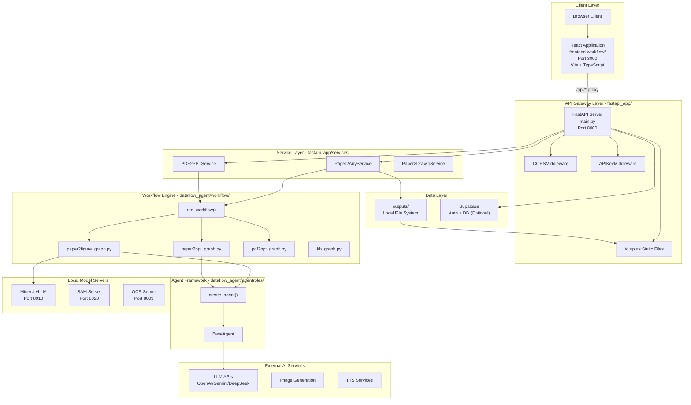
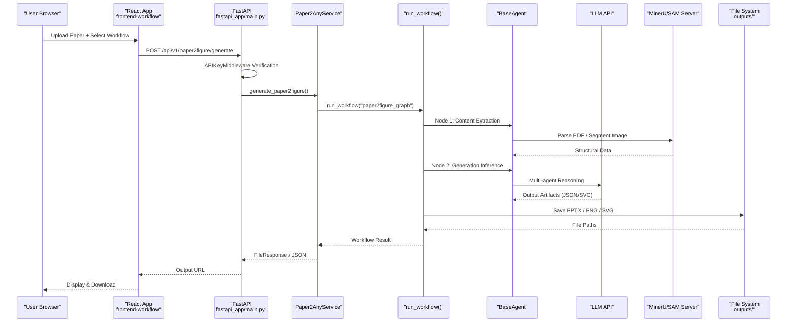

<!-- source: DeepWiki mcp.deepwiki.com · repo OpenDCAI/Paper2Any · page 1 Overview · fetched 2026-11-02 -->

# Overview

Relevant source files

The following files were used as context for generating this wiki page:

- [.gitignore](.gitignore)
- [README.md](README.md)
- [README_CN.md](README_CN.md)
- [fastapi_app/main.py](fastapi_app/main.py)
- [fastapi_app/routers/__init__.py](fastapi_app/routers/__init__.py)
- [fastapi_app/routers/paper2any.py](fastapi_app/routers/paper2any.py)
- [frontend-workflow/src/App.tsx](frontend-workflow/src/App.tsx)
- [frontend-workflow/src/components/AppSidebar.tsx](frontend-workflow/src/components/AppSidebar.tsx)
- [frontend-workflow/src/components/HomePage.tsx](frontend-workflow/src/components/HomePage.tsx)
- [frontend-workflow/src/config/homePageCatalog.ts](frontend-workflow/src/config/homePageCatalog.ts)
- [frontend-workflow/src/locales/en/common.json](frontend-workflow/src/locales/en/common.json)
- [frontend-workflow/src/locales/zh/common.json](frontend-workflow/src/locales/zh/common.json)
- [frontend-workflow/vite.config.ts](frontend-workflow/vite.config.ts)
- [static/new_readme/paper2citation/citation-explorer.png](static/new_readme/paper2citation/citation-explorer.png)
- [static/new_readme/paper2video/demo.gif](static/new_readme/paper2video/demo.gif)

**Purpose and Scope**: This document introduces Paper2Any, a multimodal AI-powered document processing system. It covers the system's purpose, architectural design, core components, and technology stack. For detailed installation instructions, see [Getting Started](#2). For specific workflow documentation, see [Paper2Any Workflows](#6).

---

## What is Paper2Any?

Paper2Any is an open-source document transformation platform that converts academic papers, PDFs, images, and text into editable scientific figures, presentations, diagrams, and multimedia content. The system leverages large language models (LLMs), vision-language models (VLMs), and specialized AI services to automate complex document processing workflows [README.md:5-18]().

**Primary Use Cases**:
- **📊 Paper2Figure**: Generate editable scientific figures (model architectures, technical roadmaps, experimental plots) [README.md:108]().
- **🎬 Paper2PPT**: Convert papers/text/topics to presentation slides with built-in table/figure extraction [README.md:110]().
- **🖼️ PDF2PPT**: Transform PDFs to editable PowerPoint while preserving accurate layouts [README.md:112]().
- **📚 Knowledge Base (KB)**: Create systems with semantic search and KB-driven PPT/podcast/mindmap generation [README.md:119]().
- **📝 Specialized Workflows**: Generate Drawio diagrams, academic rebuttals, videos, posters, and citation networks [README.md:109-118]().

The system operates as a web application with a React frontend and FastAPI backend, orchestrating multi-agent workflows through the `dataflow_agent` framework [fastapi_app/main.py:66-70]().

**Sources**: [README.md:1-120](), [fastapi_app/main.py:66-70]()

---

## Architecture Overview

Paper2Any implements a three-tier architecture: **Client Layer** (React SPA), **API Gateway Layer** (FastAPI), and **Service Layer** (workflow engine + agents). The system integrates both external AI APIs and self-hosted GPU model servers.

### System Architecture Diagram

**Sources**: [fastapi_app/main.py:72-135](), [frontend-workflow/vite.config.ts:25-40](), [README.md:102-120]()

---

## Technology Stack

Paper2Any combines multiple technologies across frontend, backend, workflow orchestration, and AI services:

| Layer | Technology | Purpose | Location |
|-------|-----------|---------|----------|
| **Frontend** | React 18 + TypeScript | User interface | `frontend-workflow/` |
| | Vite | Build tool & dev server | `vite.config.ts` |
| | Zustand | State management | `src/stores/` |
| | TailwindCSS | Styling | UI components |
| **Backend** | FastAPI | REST API server | `fastapi_app/main.py` |
| | Pydantic | Request/response validation | `fastapi_app/schemas.py` |
| | Uvicorn | ASGI server | Port 8000 |
| **Workflow Engine** | dataflow_agent | Multi-agent orchestration | `dataflow_agent/` |
| | LangGraph | Agent state machines | Graph-based agents |
| **AI Services** | OpenAI / Gemini / DeepSeek | LLM Providers | External |
| | MinerU / SAM / PaddleOCR | Local Vision/Parsing Models | Local Model Servers |
| **Data Storage** | Local Filesystem | Generated files | `outputs/` |
| | Supabase | Auth + DB (optional) | External |

**Sources**: [README.md:7-10](), [frontend-workflow/vite.config.ts:23-40](), [fastapi_app/main.py:1-140]()

---

## Request Flow

The following sequence illustrates a typical request flow for generating a scientific figure:

**Sources**: [fastapi_app/routers/paper2any.py:43-81](), [fastapi_app/main.py:84-115](), [README.md:108-118]()

---

## Core Components

### Frontend Application

The frontend is a React single-page application (SPA) built with Vite. It provides:
- **Navigation**: Managed via `AppSidebar` and `HomePage` [frontend-workflow/src/components/AppSidebar.tsx:41-189]().
- **Workflows**: Pages for Paper2Figure, Paper2PPT, MindMaps, Rebuttals, and more [frontend-workflow/src/App.tsx:29-49]().
- **User Management**: Authentication, points display, and file history [frontend-workflow/src/App.tsx:19-23]().
- **Design**: Glassmorphism UI with particle backgrounds [frontend-workflow/src/App.tsx:177-182]().

For details, see [Frontend Application](#3).

**Sources**: [frontend-workflow/src/App.tsx:1-202](), [frontend-workflow/src/components/AppSidebar.tsx:1-234]()

### Backend API

The FastAPI backend exposes RESTful endpoints for all workflows:
- **Routers**: Organized by feature (e.g., `paper2ppt`, `paper2any`, `kb`) [fastapi_app/main.py:87-114]().
- **Middleware**: Handles CORS and API Key/Quota verification [fastapi_app/main.py:72-85]().
- **Static Serving**: Serves generated files from the `outputs/` directory [fastapi_app/main.py:117-129]().

For details, see [Backend API](#4).

**Sources**: [fastapi_app/main.py:1-140](), [fastapi_app/routers/paper2any.py:1-135]()

### Workflow & Agent Framework (`dataflow_agent`)

The core intelligence resides in the `dataflow_agent` framework:
- **Workflows**: Defined as graphs in `dataflow_agent/workflow/` [fastapi_app/main.py:69]().
- **Agents**: Atomic units using the `BaseAgent` class with specific roles and prompts.
- **State**: Data flows through workflows via typed state objects.

For details, see [DataFlow-Agent Framework](#5).

**Sources**: [fastapi_app/main.py:66-70](), [README.md:104-120]()

---

## Deployment Options

Paper2Any supports multiple deployment modes:
1. **Local Development**: Running frontend (Vite) and backend (FastAPI) separately [frontend-workflow/vite.config.ts:25-40]().
2. **Docker**: Containerized deployment using Docker Compose.
3. **Local Model Servers**: Scaling GPU-heavy tasks (MinerU, SAM) on local hardware [README.md:119]().

For step-by-step installation, see [Getting Started](#2).

**Sources**: [README.md:52-53](), [fastapi_app/main.py:138-139]()

---

## Key Features Summary

Paper2Any provides a comprehensive suite of academic tools:
- **Paper2Figure**: Editable PPTX output for model architectures and roadmaps [README.md:108]().
- **Paper2PPT**: Intelligent slide deck generation from PDFs or topics [README.md:110]().
- **Paper2Video**: Video script and narration asset generation [README.md:115]().
- **Paper2Poster**: Academic poster layout and design [README.md:116]().
- **Knowledge Base**: RAG-based Q&A, podcast, and mindmap generation [README.md:119]().

For detailed descriptions, see [Key Features](#1.1).

**Sources**: [README.md:102-120](), [frontend-workflow/src/locales/en/common.json:11-26]()

---

