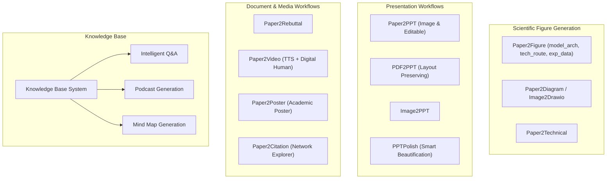
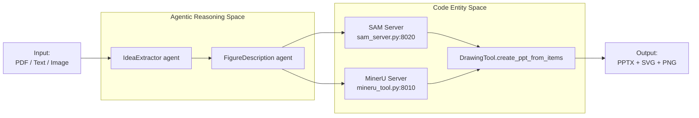
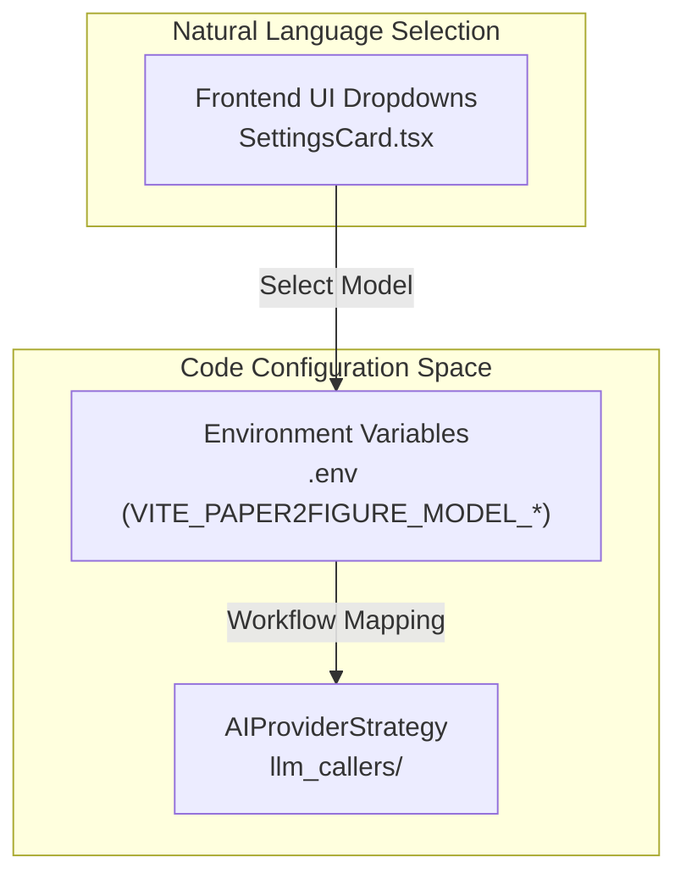

<!-- source: DeepWiki mcp.deepwiki.com · repo OpenDCAI/Paper2Any · page 1.1 Key Features · fetched 2026-11-02 -->

# Key Features

Relevant source files

The following files were used as context for generating this wiki page:

- [README.md](README.md)
- [README_CN.md](README_CN.md)
- [frontend-workflow/src/App.tsx](frontend-workflow/src/App.tsx)
- [frontend-workflow/src/components/AppSidebar.tsx](frontend-workflow/src/components/AppSidebar.tsx)
- [frontend-workflow/src/components/HomePage.tsx](frontend-workflow/src/components/HomePage.tsx)
- [frontend-workflow/src/components/paper2graph/SettingsCard.tsx](frontend-workflow/src/components/paper2graph/SettingsCard.tsx)
- [frontend-workflow/src/config/homePageCatalog.ts](frontend-workflow/src/config/homePageCatalog.ts)
- [frontend-workflow/src/locales/en/common.json](frontend-workflow/src/locales/en/common.json)
- [frontend-workflow/src/locales/en/paper2graph.json](frontend-workflow/src/locales/en/paper2graph.json)
- [frontend-workflow/src/locales/zh/common.json](frontend-workflow/src/locales/zh/common.json)
- [frontend-workflow/src/locales/zh/paper2graph.json](frontend-workflow/src/locales/zh/paper2graph.json)
- [static/new_readme/paper2citation/citation-explorer.png](static/new_readme/paper2citation/citation-explorer.png)
- [static/new_readme/paper2video/demo.gif](static/new_readme/paper2video/demo.gif)

This document provides a comprehensive reference of Paper2Any's core capabilities, organized by feature category. Each feature represents a complete workflow pipeline that processes academic papers, documents, or images into various output formats including presentations, figures, diagrams, and multimedia content.

For architectural details on how these features are implemented as workflows, see **1.2. Architecture Overview**. For specific workflow implementations, see **6. Paper2Any Workflows**. For Knowledge Base functionality, see **7. Knowledge Base System**.

---

## Purpose and Scope

Paper2Any implements **multimodal document processing workflows** focused on academic and technical content. The system converts papers, PDFs, images, and text into editable outputs through specialized AI-powered pipelines. This page catalogs all production features, their input/output formats, technical capabilities, and configuration options.

---

## Feature Categories

Paper2Any's features are organized into four primary categories:

**Sources:** [README.md:102-120](), [README_CN.md:94-111]()

---

## 1. Paper2Figure: Editable Scientific Figures

Generates **three types** of scientific visualizations from papers or text, outputting fully editable PPTX files with optional SVG exports.

### Graph Types

| Graph Type | Code Identifier | Output Formats | Primary Use Case |
|------------|----------------|----------------|------------------|
| Model Architecture | `model_arch` | PPTX, PNG, Drawio | Neural network diagrams, system architectures |
| Technical Roadmap | `tech_route` | PPTX, SVG, PNG | Process flows, methodology diagrams |
| Experimental Plot | `exp_data` | PPTX, PNG | Data visualization, charts, comparison plots |

### Technical Pipeline

**Sources:** [README.md:108](), [frontend-workflow/src/locales/zh/paper2graph.json:26-31](), [frontend-workflow/src/components/paper2graph/SettingsCard.tsx:107-112]()

---

## 2. Paper2PPT: Paper to Presentation

Converts academic papers, long documents, or topics into structured PowerPoint presentations. It supports two distinct paths: **Image-style** and **Editable-deck**.

### Feature Comparison

| Feature | Image-style (`paper2ppt-image`) | Editable-deck (`paper2ppt-frontend`) |
|---------|--------------------------------|--------------------------------------|
| **Format** | Image-based slides | 16:9 HTML/CSS (Export to PPTX/PDF) |
| **Editing** | Static images | Inline text editing & canvas modification |
| **Visuals** | High-fidelity atmosphere | Structured layout control |
| **Workflow** | `paper2ppt_parallel` | `paper2ppt_frontend` |

### Key Capabilities
- **AI Outline Editing:** Allows users to refine the presentation structure before slide generation [README.md:82]().
- **Table/Figure Extraction:** Automatically pulls tables and images from the source PDF [README.md:110]().
- **Long Document Support:** Capable of processing lengthy manuscripts into cohesive decks [README.md:110]().

**Sources:** [README.md:110](), [frontend-workflow/src/App.tsx:35-37](), [frontend-workflow/src/locales/en/common.json:32-33]()

---

## 3. Specialized Academic Workflows

### Paper2Video
Converts paper PDFs into presentation videos.
- **Pipeline:** Generates per-slide scripts → Synthesizes voiceover (TTS) → Optional Digital Human (LivePortrait/EchoMimic) → FFMPEG compositing [README.md:115]().
- **Assets:** Produces narration audio and video files [frontend-workflow/src/locales/en/common.json:48]().

### Paper2Poster
Turns paper PDFs into academic posters.
- **Workflow:** Automatic content提炼 (extraction), layout planning, color design, and export [README.md:116]().
- **Config:** Supports section titles, logo injection, and layout parameters [frontend-workflow/src/locales/en/common.json:49]().

### Paper2Rebuttal
AI-assisted generator for academic paper rebuttal letters.
- **Functionality:** Analyzes reviewer comments and provides response strategies [README.md:111]().
- **Structure:** Supports claims-to-evidence grounding and structured responses [frontend-workflow/src/locales/en/common.json:47]().

### Paper2Citation
Explores citation networks based on DOI or author names.
- **Tracking:** Identifies citing authors, institutions, and notable downstream works [README.md:117]().
- **Visualization:** Displays citation distribution and network statistics [frontend-workflow/src/locales/en/common.json:50]().

**Sources:** [README.md:111-117](), [frontend-workflow/src/locales/en/common.json:47-50]()

---

## 4. Conversion & Polish Features

### PDF2PPT & Image2PPT
- **PDF2PPT:** Layout-preserving conversion of existing PDFs to editable PPTX [README.md:112]().
- **Image2PPT:** Converts screenshots or images into structured, editable slides [README.md:113]().

### PPTPolish
- **Functionality:** AI-powered layout optimization and style transfer for existing PPT files [README.md:114]().
- **Optimization:** Refines design, beautifies content, and optimizes alignment [frontend-workflow/src/locales/en/common.json:44]().

### Image2Drawio
- **Workflow:** Converts static images (flowcharts, architecture diagrams) into editable DrawIO XML [README.md:109]().
- **Integration:** Allows direct editing in the DrawIO workbench after conversion [README_CN.md:142-143]().

**Sources:** [README.md:109-114](), [frontend-workflow/src/locales/en/common.json:41-44]()

---

## 5. Knowledge Base (KB) System

The KB system acts as a centralized repository for research assets, providing RAG-driven capabilities.

### Integrated Tools
- **Intelligent Q&A:** Semantic search and chat over uploaded documents [README.md:119]().
- **Podcast Generation:** Converts KB files into audio discussions (monologue or dialog) [README.md:119]().
- **Mind Map:** Generates Mermaid-based tree structures from KB content [README.md:119]().
- **Multi-file Synthesis:** Supports merging multiple documents into a single presentation or report [README.md:78]().

**Sources:** [README.md:78, 119](), [frontend-workflow/src/locales/en/common.json:45]()

---

## Technical Configuration & Model Selection

Paper2Any uses a three-layer model configuration system to manage its diverse workflows.

### Model Defaults by Feature
- **Paper2Figure (Model Arch):** `gemini-3-pro-image-preview` [frontend-workflow/src/components/paper2graph/SettingsCard.tsx:106]()
- **Paper2PPT:** `gpt-5.1`, `gpt-5.2`, `gemini-3-pro-preview` [README.md:358]()
- **PDF2PPT (VLM):** `qwen-vl-ocr-2025-11-20` [README.md:94]()

**Sources:** [frontend-workflow/src/components/paper2graph/SettingsCard.tsx:106-112](), [README.md:94, 358]()

---

