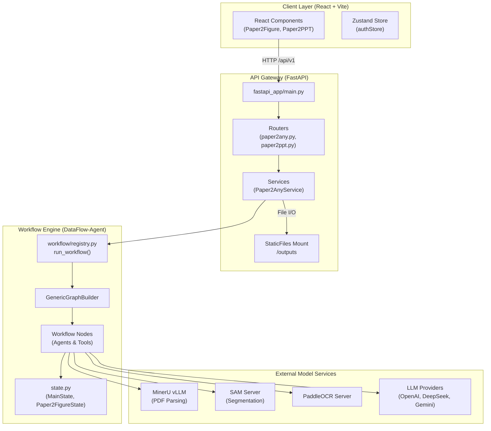
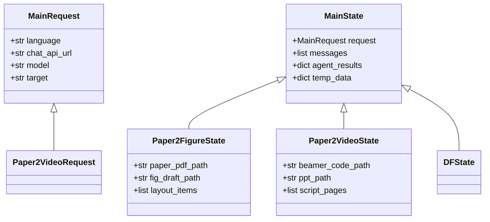
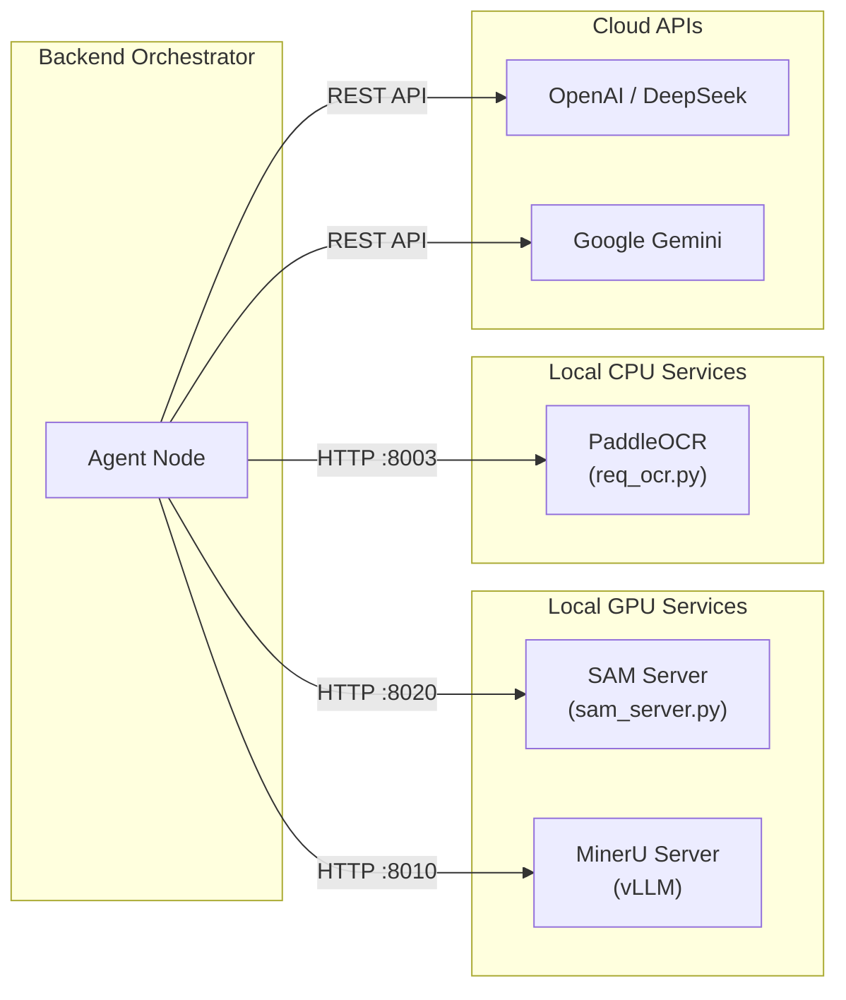
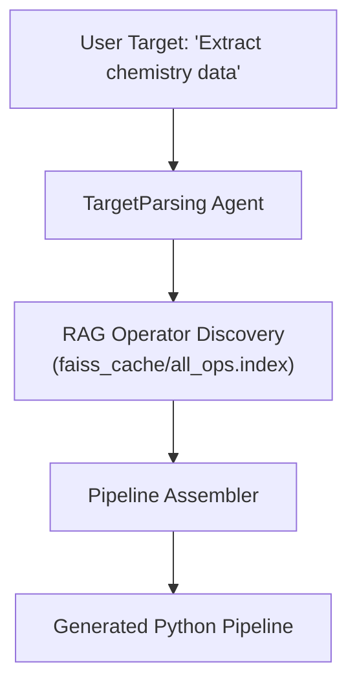

<!-- source: DeepWiki mcp.deepwiki.com · repo OpenDCAI/Paper2Any · page 1.2 Architecture Overview · fetched 2026-11-02 -->

# Architecture Overview

Relevant source files

The following files were used as context for generating this wiki page:

- [.gitignore](.gitignore)
- [README.md](README.md)
- [README_CN.md](README_CN.md)
- [dataflow_agent/agentroles/cores/base_agent.py](dataflow_agent/agentroles/cores/base_agent.py)
- [dataflow_agent/graphbuilder/graph_builder.py](dataflow_agent/graphbuilder/graph_builder.py)
- [dataflow_agent/promptstemplates/prompts_repo.py](dataflow_agent/promptstemplates/prompts_repo.py)
- [dataflow_agent/resources/faiss_cache/all_ops.index.meta](dataflow_agent/resources/faiss_cache/all_ops.index.meta)
- [dataflow_agent/state.py](dataflow_agent/state.py)
- [dataflow_agent/toolkits/optool/op_tools.py](dataflow_agent/toolkits/optool/op_tools.py)
- [dataflow_agent/toolkits/pipetool/pipe_tools.py](dataflow_agent/toolkits/pipetool/pipe_tools.py)
- [dataflow_agent/toolkits/resources/ops.json](dataflow_agent/toolkits/resources/ops.json)
- [fastapi_app/main.py](fastapi_app/main.py)
- [fastapi_app/routers/__init__.py](fastapi_app/routers/__init__.py)
- [fastapi_app/routers/paper2any.py](fastapi_app/routers/paper2any.py)
- [frontend-workflow/vite.config.ts](frontend-workflow/vite.config.ts)
- [static/new_readme/paper2citation/citation-explorer.png](static/new_readme/paper2citation/citation-explorer.png)
- [static/new_readme/paper2video/demo.gif](static/new_readme/paper2video/demo.gif)

This document describes the high-level system architecture of Paper2Any, a multimodal document processing system. It covers the three-tier structure (Frontend → Backend → Core Framework), component interactions, the agent execution model, and external model integrations.

---

## System Layers

Paper2Any implements a decoupled architecture where the frontend manages user interactions, the backend handles API orchestration and file management, and the core framework executes complex multi-agent workflows.

### Layer 1: Client Layer
**Frontend Application** (`frontend-workflow/`)

The React-based frontend is built with Vite and provides specialized interfaces for different document conversion tasks.

| Component Type | Purpose | Key Files |
|----------------|---------|-----------|
| **Page Components** | Workflow-specific UIs | `src/pages/Paper2Figure.tsx` `src/pages/Paper2PPT.tsx` `src/pages/Paper2Video.tsx` |
| **State Management** | Zustand stores for auth and session | `src/stores/authStore.ts` |
| **Service Layer** | API abstraction for backend calls | `src/services/paper2anyService.ts` |
| **Vite Proxy** | Routes `/api` to the FastAPI backend | [frontend-workflow/vite.config.ts:29-38]() |

### Layer 2: Application Layer
**FastAPI Backend** (`fastapi_app/`)

The backend acts as an API gateway, managing request validation, static file serving, and the bridge to the workflow engine.

| Module | Purpose | Key Files |
|--------|---------|-----------|
| **Main App** | App factory and middleware setup | [fastapi_app/main.py:57-135]() |
| **Routers** | REST endpoints for all features | [fastapi_app/routers/paper2any.py:43-134]() [fastapi_app/routers/paper2ppt.py]() |
| **Services** | Business logic and directory management | `fastapi_app/services/paper2any_service.py` |
| **Middleware** | API key and billing enforcement | [fastapi_app/middleware/api_key.py]() |

### Layer 3: Core Framework
**DataFlow-Agent Framework** (`dataflow_agent/`)

The core engine provides a graph-based orchestration environment for LLM agents and tools.

| Module | Purpose | Key Components |
|--------|---------|----------------|
| **Workflow Registry** | Centralized workflow lookup | `dataflow_agent/workflow/registry.py` |
| **Graph Builder** | DSL for defining agent DAGs | `dataflow_agent/graphbuilder/graph_builder.py` |
| **Agent System** | Multi-strategy agent execution | `dataflow_agent/agentroles/cores/base_agent.py` |
| **State Models** | Dataclass-based state tracking | [dataflow_agent/state.py:41-210]() |
| **Toolkits** | Domain-specific tool implementations | `dataflow_agent/toolkits/` |

---

## High-Level Architecture Diagram

The following diagram illustrates the end-to-end flow from the React UI through the FastAPI gateway into the LangGraph-powered agent framework.

**Sources:** [fastapi_app/main.py:86-130](), [README.md:102-120](), [dataflow_agent/state.py:41-55]()

---

## Agent Execution Framework

The `DataFlow-Agent` framework bridges natural language requirements to executable code entities. It uses a graph-based approach where nodes represent agents or functional blocks.

### State and Request Mapping

Workflows rely on structured `MainState` and `MainRequest` objects to maintain context across asynchronous agent calls.

**Sources:** [dataflow_agent/state.py:14-37](), [dataflow_agent/state.py:41-55](), [dataflow_agent/state.py:133-169]()

### Workflow Registration and Discovery

Workflows are defined using the `GenericGraphBuilder` and registered via a decorator pattern, allowing the backend to invoke them by string identifiers.

| Workflow ID | Purpose | State Class |
|-------------|---------|-------------|
| `paper2fig_with_sam` | Paper to editable figures | `Paper2FigureState` |
| `paper2ppt_parallel` | Paper to slide decks | `Paper2PPTState` |
| `paper2video` | Paper to narrated video | [dataflow_agent/state.py:133-169]() |
| `wf_intelligent_qa` | RAG-based knowledge base chat | `IntelligentQAState` |

---

## Model Services & External Integrations

Paper2Any offloads heavy multimodal tasks to specialized local servers or external APIs.

### Service Topology

**Sources:** [README.md:247-272](), [fastapi_app/main.py:125-130]()

### File and Output Management

The system maintains a strict directory structure for task isolation. Every workflow execution generates a unique timestamped directory under `outputs/{email}/{task_type}/{timestamp}/`.

- **Static Mount**: The `outputs/` directory is mounted at `/outputs` in FastAPI [fastapi_app/main.py:125-130]().
- **Persistence**: Results (PPTX, PNG, SVG) are served directly via this mount, allowing the frontend to preview and download artifacts using generated URLs.

**Sources:** [fastapi_app/main.py:116-130](), [fastapi_app/routers/paper2any.py:31-40]()

---

## Operator and Pipeline System

For generic data processing, Paper2Any uses an **Operator System** that allows for dynamic pipeline assembly.

### Operator Registry
The `OPERATOR_REGISTRY` tracks all available functional blocks (e.g., `FilterData`, `ExtractSmiles`). Metadata is dumped to `ops.json` for RAG-based discovery [dataflow_agent/toolkits/optool/op_tools.py:161-193]().

### Pipeline Assembly
The `pipeline_assembler` takes a high-level `target` description and matches it against available operators to generate executable Python code [dataflow_agent/toolkits/pipetool/pipe_tools.py:148-180]().

**Sources:** [dataflow_agent/toolkits/optool/op_tools.py:161-193](), [dataflow_agent/toolkits/pipetool/pipe_tools.py:148-180](), [dataflow_agent/promptstemplates/prompts_repo.py:76-113]()

---

