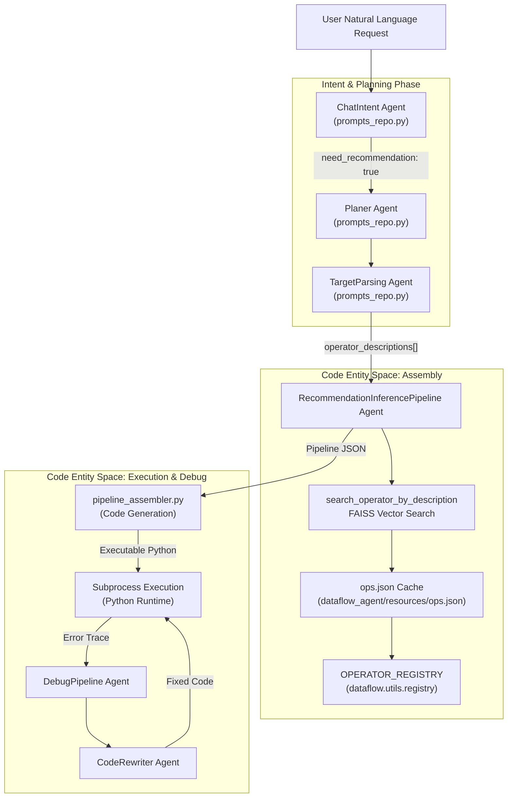
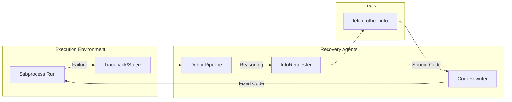

<!-- source: DeepWiki mcp.deepwiki.com · repo OpenDCAI/Paper2Any · page 10 Pipeline Recommendation · fetched 2026-11-02 -->

# Pipeline Recommendation

Relevant source files

The following files were used as context for generating this wiki page:

- [dataflow_agent/agentroles/cores/base_agent.py](dataflow_agent/agentroles/cores/base_agent.py)
- [dataflow_agent/graphbuilder/graph_builder.py](dataflow_agent/graphbuilder/graph_builder.py)
- [dataflow_agent/promptstemplates/prompts_repo.py](dataflow_agent/promptstemplates/prompts_repo.py)
- [dataflow_agent/resources/faiss_cache/all_ops.index.meta](dataflow_agent/resources/faiss_cache/all_ops.index.meta)
- [dataflow_agent/state.py](dataflow_agent/state.py)
- [dataflow_agent/toolkits/optool/op_tools.py](dataflow_agent/toolkits/optool/op_tools.py)
- [dataflow_agent/toolkits/pipetool/pipe_tools.py](dataflow_agent/toolkits/pipetool/pipe_tools.py)
- [dataflow_agent/toolkits/resources/ops.json](dataflow_agent/toolkits/resources/ops.json)

The Pipeline Recommendation system is an intelligent multi-agent workflow that automatically generates, debugs, and refines data processing pipelines based on natural language user requests. The system analyzes user intent, decomposes requirements into operator descriptions, searches for matching operators from the registry, assembles them into executable JSON pipelines, and iteratively debugs errors until the pipeline runs successfully.

For information about the operator registry and RAG-based discovery that powers pipeline assembly, see [Operator System](#9). For details on creating custom workflows and agents, see [Development Guide](#11).

---

## System Overview

The pipeline recommendation system operates through three primary workflows:

1.  **Multi-Agent Pipeline Generation** ([Multi-Agent Pipeline Generation](#10.1)): ChatIntent → Planer → TargetParsing → RecommendationInferencePipeline.
2.  **Debug Loop & Error Recovery** ([Debug Loop & Error Recovery](#10.2)): DebugPipeline → InfoRequester → CodeRewriter.
3.  **Pipeline Refinement** ([Pipeline Refinement](#10.3)): RefineTargetAnalyzer → RefinePlanner → JSONPipelineRefiner.

The system manages state using `PlanningState` [dataflow_agent/state.py:210-231](), which tracks the execution plan, current steps, and approval status.

### High-Level Architecture

The following diagram illustrates the flow from natural language intent to executable code entities.

**Pipeline Recommendation Architecture**

**Sources:** [dataflow_agent/promptstemplates/prompts_repo.py:76-193](), [dataflow_agent/toolkits/optool/op_tools.py:30-37](), [dataflow_agent/toolkits/pipetool/pipe_tools.py:1-20](), [dataflow_agent/state.py:84-101]()

---

## Multi-Agent Pipeline Generation Flow

The pipeline generation process transforms a natural language request into an executable JSON pipeline through a chain of specialized agents.

### Multi-Agent Chain

1.  **ChatIntent**: Detects if the user wants a recommendation (`need_recommendation`) or a new operator (`need_write_operator`) [dataflow_agent/promptstemplates/prompts_repo.py:302-340]().
2.  **Planer**: Decomposes the query into structured tasks and prompt templates [dataflow_agent/promptstemplates/prompts_repo.py:219-297]().
3.  **TargetParsing**: Breaks down requirements into specific functional descriptions for operators [dataflow_agent/promptstemplates/prompts_repo.py:76-113]().
4.  **RecommendationInferencePipeline**: Assembles the final pipeline JSON by matching descriptions to the `OPERATOR_REGISTRY` [dataflow_agent/promptstemplates/prompts_repo.py:118-193]().

**Agent State Management**
The `PlanningState` [dataflow_agent/state.py:210-231]() and `DFState` [dataflow_agent/state.py:84-101]() are used to pass context between these agents.

For detailed implementation of this flow, see [Multi-Agent Pipeline Generation](#10.1).

**Sources:** [dataflow_agent/state.py:210-231](), [dataflow_agent/promptstemplates/prompts_repo.py:76-340]()

---

## Debug Loop & Error Recovery

When a recommended pipeline fails during execution, the system enters a self-healing loop.

### Debug & Recovery Components

*   **DebugPipeline**: Analyzes the `error_trace` and `pipeline_code` to identify root causes [dataflow_agent/promptstemplates/prompts_repo.py:833-856]().
*   **InfoRequester**: Decides which module source code needs to be inspected (e.g., `dataflow.utils.storage`) and fetches it via tools [dataflow_agent/promptstemplates/prompts_repo.py:899-944]().
*   **CodeRewriter**: Applies the suggested fixes to generate new Python code, ensuring data flow keys (`input_key`, `output_key`) are correctly wired [dataflow_agent/promptstemplates/prompts_repo.py:861-894]().

**Debug Cycle Diagram**

For details on the retry mechanism and validators, see [Debug Loop & Error Recovery](#10.2).

**Sources:** [dataflow_agent/promptstemplates/prompts_repo.py:833-944](), [dataflow_agent/state.py:95-99]()

---

## Pipeline Refinement

The refinement system allows users to modify existing pipelines using natural language commands (e.g., "Add a sentiment analysis step after the filter").

### Refinement Workflow

1.  **RefineTargetAnalyzer**: Determines if the user wants to `add`, `remove`, or `replace` nodes [dataflow_agent/promptstemplates/prompts_repo.py:478-512]().
2.  **RefinePlanner**: Creates a step-by-step modification plan, including `new_node` configurations [dataflow_agent/promptstemplates/prompts_repo.py:515-545]().
3.  **JSONPipelineRefiner**: Executes the plan by modifying the JSON structure and verifying operator availability using the `search_operator_by_description` tool [dataflow_agent/promptstemplates/prompts_repo.py:548-616]().

**Refinement Operations Table**

| Operation | Logic | Code Entity |
| :--- | :--- | :--- |
| **Add** | Insert node at `position_hint` | `RefineTargetAnalyzer` [dataflow_agent/promptstemplates/prompts_repo.py:495-502]() |
| **Remove** | Delete node and reconnect edges | `JSONPipelineRefiner` [dataflow_agent/promptstemplates/prompts_repo.py:560-565]() |
| **Replace** | Swap node while maintaining wiring | `RefinePlanner` [dataflow_agent/promptstemplates/prompts_repo.py:528-535]() |

For details on modification operations and prompt logic, see [Pipeline Refinement](#10.3).

**Sources:** [dataflow_agent/promptstemplates/prompts_repo.py:478-616]()

---

