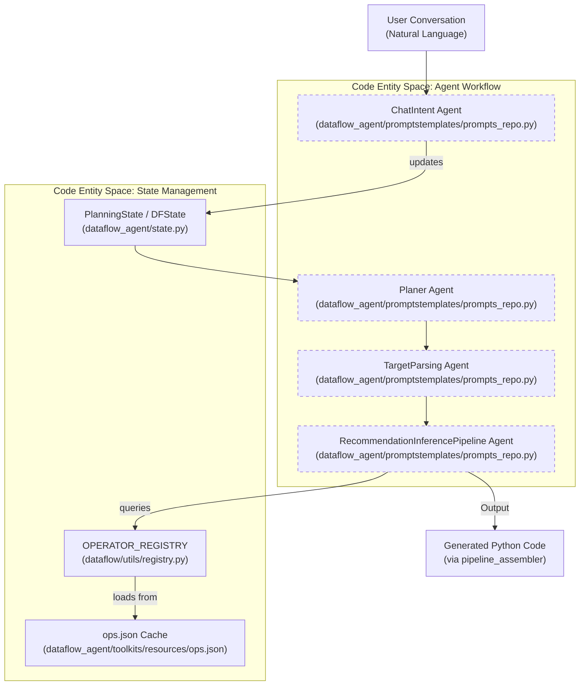
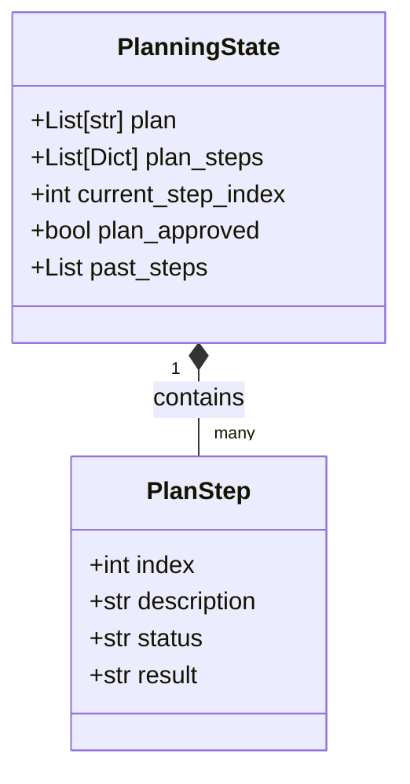

<!-- source: DeepWiki mcp.deepwiki.com · repo OpenDCAI/Paper2Any · page 10.1 Multi-Agent Pipeline Generation · fetched 2026-11-02 -->

# Multi-Agent Pipeline Generation

<details>
<summary>Relevant source files</summary>

The following files were used as context for generating this wiki page:

- [dataflow_agent/agentroles/cores/base_agent.py](dataflow_agent/agentroles/cores/base_agent.py)
- [dataflow_agent/graphbuilder/graph_builder.py](dataflow_agent/graphbuilder/graph_builder.py)
- [dataflow_agent/promptstemplates/prompts_repo.py](dataflow_agent/promptstemplates/prompts_repo.py)
- [dataflow_agent/resources/faiss_cache/all_ops.index.meta](dataflow_agent/resources/faiss_cache/all_ops.index.meta)
- [dataflow_agent/state.py](dataflow_agent/state.py)
- [dataflow_agent/toolkits/optool/op_tools.py](dataflow_agent/toolkits/optool/op_tools.py)
- [dataflow_agent/toolkits/pipetool/pipe_tools.py](dataflow_agent/toolkits/pipetool/pipe_tools.py)
- [dataflow_agent/toolkits/resources/ops.json](dataflow_agent/toolkits/resources/ops.json)

</details>


## Purpose and Scope

This document explains the multi-agent workflow that generates data processing pipeline recommendations from natural language user requests. It covers the sequential flow: **ChatIntent → Planer → TargetParsing → RecommendationInferencePipeline**, which transforms conversational intent into executable operator pipelines. This system leverages the `dataflow_agent` framework to orchestrate LLM agents, managing state through `PlanningState` and `DFState`.

For information about the underlying operator registry and RAG-based discovery mechanisms, see [Operator Registry](#9.1). For details on debugging and error recovery in generated pipelines, see [Debug Loop & Error Recovery](#10.2). For modifying existing pipelines, see [Pipeline Refinement](#10.3).

---

## System Overview

The pipeline generation system employs a four-stage agent workflow to convert user conversations into concrete data processing pipelines. Each stage uses specialized LLM agents with distinct prompt templates to progressively refine user intent into executable code.

### Architecture Diagram: Natural Language to Code Entity Space

This diagram illustrates how natural language requirements flow through specific code entities (Agents and State classes) to produce executable code.



**Sources:** [dataflow_agent/state.py:210-230](), [dataflow_agent/promptstemplates/prompts_repo.py:76-193](), [dataflow_agent/toolkits/optool/op_tools.py:30-36](), [dataflow_agent/toolkits/pipetool/pipe_tools.py:1-20]()

---

## Agent 1: ChatIntent - Intent Analysis

### Responsibility

The `ChatIntent` agent analyzes conversation history to determine whether the user requires a pipeline recommendation or operator development. It populates the initial fields of the `DFState` or `PlanningState`.

### Prompt Structure

The agent uses prompts defined in the `ChatIntent` class in `prompts_repo.py`:

| Prompt Type | Purpose | Location |
|-------------|---------|----------|
| `system_prompt_for_chat` | Defines role as intent analysis robot | [dataflow_agent/promptstemplates/prompts_repo.py:303-305]() |
| `task_prompt_for_chat` | Specifies intent detection rules and output format | [dataflow_agent/promptstemplates/prompts_repo.py:307-340]() |

### Output Schema and State Mapping

The agent's JSON output is mapped to `DFState` fields like `category` and `recommendation` [dataflow_agent/state.py:92-93]().

```json
{
    "need_recommendation": true,
    "need_write_operator": false,
    "assistant_reply": "I will recommend a suitable data processing pipeline...",
    "purpose": "User needs to process mathematics dataset..."
}
```

**Sources:** [dataflow_agent/promptstemplates/prompts_repo.py:302-340](), [dataflow_agent/state.py:85-101]()

---

## Agent 2: Planer - Task Decomposition

### Responsibility

The `Planer` agent decomposes complex queries into structured subtasks. It utilizes `PlanningState` to track the `plan_steps` and `current_step_index` [dataflow_agent/state.py:222-223]().

### Data Flow: PlanningState Management



### Key Features

1. **param_funcs**: Lists data objects required by each task [dataflow_agent/promptstemplates/prompts_repo.py:246-250]().
2. **depends_on**: Array of task indices indicating execution dependencies [dataflow_agent/promptstemplates/prompts_repo.py:251-255]().
3. **Tool Integration**: Uses `tools_info` to incorporate available tools like `local_tool_for_get_purpose` [dataflow_agent/toolkits/optool/op_tools.py:38-39]().

**Sources:** [dataflow_agent/state.py:198-230](), [dataflow_agent/promptstemplates/prompts_repo.py:219-297]()

---

## Agent 3: TargetParsing - Operator Description Generation

### Responsibility

The `TargetParsing` agent decomposes requirements into a sequence of operator functionality descriptions, which are stored in the `matched_ops` list within `DFState` [dataflow_agent/state.py:94]().

### Input/Output Example

- **Input**: `req.target` from `MainRequest` [dataflow_agent/state.py:30]().
- **Output**: `operator_descriptions` list [dataflow_agent/promptstemplates/prompts_repo.py:98]().

**Sources:** [dataflow_agent/promptstemplates/prompts_repo.py:76-113](), [dataflow_agent/state.py:85-101]()

---

## Agent 4: RecommendationInferencePipeline - Assembly

### Responsibility

The `RecommendationInferencePipeline` agent selects operators from `OPERATOR_REGISTRY` [dataflow/utils/registry.py:19]() and assembles them.

### Selection Logic and Registry Interaction

The agent uses the `ops.json` file, which is generated by `_dump_all_ops_to_file()` in `op_tools.py` [dataflow_agent/toolkits/optool/op_tools.py:161-193]().

| Feature | Code Entity | Role |
|---------|-------------|------|
| Registry | `OPERATOR_REGISTRY` | Source of all available operators |
| Metadata | `ops.json` | Cached JSON representation of operators |
| Parameters | `init_params` / `run_params` | Extracted via `inspect` for LLM context |

### Critical Rules

1. **Order**: Filter → Generate → Extract → Validate [dataflow_agent/promptstemplates/prompts_repo.py:148]().
2. **Custom Operators**: Use `PromptedGenerator` if built-in ops are insufficient [dataflow_agent/promptstemplates/prompts_repo.py:157]().

**Sources:** [dataflow_agent/promptstemplates/prompts_repo.py:118-193](), [dataflow_agent/toolkits/optool/op_tools.py:161-193]()

---

## Pipeline Assembly and Code Generation

The final step involves converting the agent's recommendation into Python code using the `pipeline_assembler` utilities.

### Code Generation Flow

1. **Prompt Selection**: `choose_prompt_template_by_llm` selects the best prompt class for an operator [dataflow_agent/toolkits/pipetool/pipe_tools.py:148-180]().
2. **Import Management**: `EXTRA_IMPORTS` tracks required modules [dataflow_agent/toolkits/pipetool/pipe_tools.py:23]().
3. **Registry Lookup**: `OPERATOR_REGISTRY.get(op_name)` retrieves the class definition [dataflow_agent/toolkits/pipetool/pipe_tools.py:165]().

### Operator Metadata Extraction

The system automatically extracts operator details to feed the LLM:
- **`_get_method_params`**: Uses `inspect.signature` to find `__init__` and `run` arguments [dataflow_agent/toolkits/optool/op_tools.py:107-123]().
- **`_call_get_desc_static`**: Calls the `@staticmethod get_desc(lang)` on operator classes [dataflow_agent/toolkits/optool/op_tools.py:74-93]().

**Sources:** [dataflow_agent/toolkits/pipetool/pipe_tools.py:148-220](), [dataflow_agent/toolkits/optool/op_tools.py:74-123]()

---

## Key Data Structures

### DFState and PlanningState

The system transitions from high-level intent to low-level execution details using these state models:

| Class | Key Fields | Purpose |
|-------|------------|---------|
| `MainRequest` | `target`, `model`, `language` | User's raw input [dataflow_agent/state.py:14-31]() |
| `DFState` | `recommendation`, `matched_ops`, `pipeline_structure_code` | Pipeline generation progress [dataflow_agent/state.py:85-101]() |
| `PlanningState` | `plan_steps`, `current_step_index`, `plan_approved` | Multi-step task tracking [dataflow_agent/state.py:210-230]() |

**Sources:** [dataflow_agent/state.py:14-230]()

---

