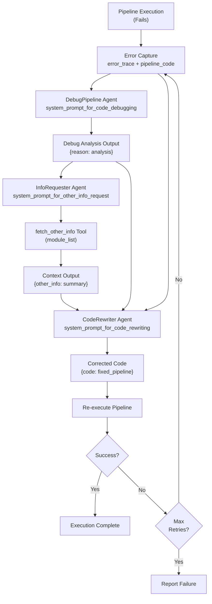
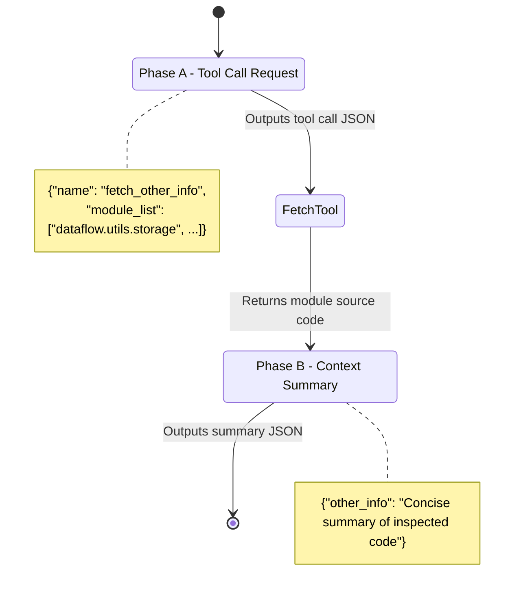

<!-- source: DeepWiki mcp.deepwiki.com · repo OpenDCAI/Paper2Any · page 10.2 Debug Loop & Error Recovery · fetched 2026-11-02 -->

# Debug Loop & Error Recovery

<details>
<summary>Relevant source files</summary>

The following files were used as context for generating this wiki page:

- [dataflow_agent/agentroles/cores/base_agent.py](dataflow_agent/agentroles/cores/base_agent.py)
- [dataflow_agent/graphbuilder/graph_builder.py](dataflow_agent/graphbuilder/graph_builder.py)
- [dataflow_agent/promptstemplates/prompts_repo.py](dataflow_agent/promptstemplates/prompts_repo.py)
- [dataflow_agent/resources/faiss_cache/all_ops.index.meta](dataflow_agent/resources/faiss_cache/all_ops.index.meta)
- [dataflow_agent/state.py](dataflow_agent/state.py)
- [dataflow_agent/toolkits/optool/op_tools.py](dataflow_agent/toolkits/optool/op_tools.py)
- [dataflow_agent/toolkits/pipetool/pipe_tools.py](dataflow_agent/toolkits/pipetool/pipe_tools.py)
- [dataflow_agent/toolkits/resources/ops.json](dataflow_agent/toolkits/resources/ops.json)

</details>


## Purpose and Scope

This document describes the **Debug Loop & Error Recovery** system, a multi-agent workflow that automatically detects, diagnoses, and repairs errors in dynamically generated pipelines. When a pipeline fails during execution, this system orchestrates specialized agents to analyze error traces, gather contextual information, and rewrite code to resolve issues.

This system is part of the **Pipeline Recommendation** workflow (see [10.1]() for pipeline generation). For information about operator writing workflows, see [9.4](). For general agent execution patterns, see [5.5]().

---

## System Architecture

The debug loop implements a three-phase error recovery pattern: **Analyze → Contextualize → Repair**. Each phase is handled by specialized agents that communicate through structured state objects defined in `dataflow_agent/state.py`.

### Debug Loop Flow



**Sources:** [dataflow_agent/promptstemplates/prompts_repo.py:833-944](), [dataflow_agent/state.py:95-101]()

---

## Core Agents

### DebugPipeline Agent

The **DebugPipeline** agent performs root-cause analysis on pipeline execution failures. It receives the failing code and error trace, then produces a detailed explanation of what went wrong and how to fix it.

**Prompt Class:** `DebugPipeline`  
**System Prompt:** [dataflow_agent/promptstemplates/prompts_repo.py:834-839]()  
**Task Prompt:** [dataflow_agent/promptstemplates/prompts_repo.py:840-856]()

#### Input Structure

| Field | Type | Description |
|-------|------|-------------|
| `pipeline_code` | string | Complete read-only pipeline source code |
| `error_trace` | string | Shell output or Python traceback |

#### Output Structure

```json
{
  "reason": "Root cause analysis with actionable fix suggestions"
}
```

The `reason` field must contain error analysis, detailed reasoning process, and concrete solutions with specific code references.

---

### InfoRequester Agent

The **InfoRequester** agent determines what additional context is needed to resolve an error. It analyzes the error and pipeline code to identify which module source files must be inspected, then uses the `fetch_other_info` tool to retrieve them.

**Prompt Class:** `InfoRequesterPrompt`  
**System Prompt:** [dataflow_agent/promptstemplates/prompts_repo.py:900-903]()  
**Task Prompt:** [dataflow_agent/promptstemplates/prompts_repo.py:905-944]()

#### Two-Phase Protocol



**Phase A Output:** Tool call specification
```json
{
  "name": "fetch_other_info",
  "module_list": ["dataflow.utils.storage", "pkg.a"]
}
```

**Phase B Output:** Context summary after tool execution
```json
{
  "other_info": "Concise yet complete summary of inspected code"
}
```

**Sources:** [dataflow_agent/promptstemplates/prompts_repo.py:900-944]()

---

### CodeRewriter Agent

The **CodeRewriter** agent synthesizes all debug information to produce corrected pipeline code. It consumes outputs from both `DebugPipeline` and `InfoRequester`, along with sample data, to generate fully fixed code.

**Prompt Class:** `CodeRewriter`  
**System Prompt:** [dataflow_agent/promptstemplates/prompts_repo.py:862-864]()  
**Task Prompt:** [dataflow_agent/promptstemplates/prompts_repo.py:865-894]()

#### Critical Rewriting Rules
1. **Data Flow Validation:** The `output_key` of operator N must match the `input_key` of operator N+1.
2. **Storage Pattern:** The `FileStorage` class uses `step()` method for stage management [dataflow_agent/promptstemplates/prompts_repo.py:880-883]().
3. **JSON Compliance:** Output must be valid JSON with double-quoted keys and no trailing commas.

---

### OpRewriter Agent

The **OpRewriter** agent specializes in fixing defective operator classes. Unlike `CodeRewriter` (which fixes pipelines), this agent repairs operator implementations based on instantiation failures.

**Prompt Class:** `OpRewriter`  
**System Prompt:** [dataflow_agent/promptstemplates/prompts_repo.py:952-973]()  
**Task Prompt:** [dataflow_agent/promptstemplates/prompts_repo.py:975-998]()

#### Repair Principles


**Sources:** [dataflow_agent/promptstemplates/prompts_repo.py:951-998]()

---

## State Management and Retry Mechanism

The system utilizes `DFState` to manage the debug lifecycle. Key fields include `need_debug`, `max_debug_rounds`, and `debug_history` to track iterations.

### State Transitions

| State Field | Code Entity | Purpose |
|-------------|-------------|---------|
| `need_debug` | `DFRequest.need_debug` | Flag to enable the recovery loop [dataflow_agent/state.py:67]() |
| `max_debug_rounds` | `DFRequest.max_debug_rounds` | Maximum allowed retry attempts [dataflow_agent/state.py:68]() |
| `code_debug_result` | `DFState.code_debug_result` | Stores the current iteration's repair outcome [dataflow_agent/state.py:98]() |
| `debug_history` | `DFState.debug_history` | Historical log of failed attempts and repairs [dataflow_agent/state.py:99]() |

### ReAct & Validator Patterns

Agents often employ a **ReAct** (Reason-Act) execution strategy with **ValidatorFunc** to ensure output quality before proceeding.

**ValidatorFunc Definition:**
Defined in `dataflow_agent/agentroles/cores/base_agent.py:78-92`(), it is a callable that takes raw content and parsed results, returning a `(bool, Optional[str])` tuple.

```python
# dataflow_agent/agentroles/cores/base_agent.py:78
ValidatorFunc = Callable[[str, Dict[str, Any]], Tuple[bool, Optional[str]]]
```

**Sources:** [dataflow_agent/state.py:57-101](), [dataflow_agent/agentroles/cores/base_agent.py:78-92]()

---

## Implementation Details: Pipeline Assembly

The `pipeline_assembler` logic (in `dataflow_agent/toolkits/pipetool/pipe_tools.py`) is often the target of these repairs. It handles complex tasks like:

1. **Prompt Template Selection:** `choose_prompt_template_by_llm` uses an LLM to select the most appropriate template from `ALLOWED_PROMPTS` [dataflow_agent/toolkits/pipetool/pipe_tools.py:148-164]().
2. **Operator Registry Inspection:** Uses `OPERATOR_REGISTRY` to find operator classes and their `__init__`/`run` signatures [dataflow_agent/toolkits/optool/op_tools.py:161-193]().
3. **Parameter Extraction:** `_get_method_params` uses `inspect` to map Python signatures to JSON-serializable parameter lists [dataflow_agent/toolkits/optool/op_tools.py:107-122]().

### Operator Metadata Structure
The system relies on `ops.json` (cached via `_ensure_ops_cache`) to provide the agents with the "Code Entity Space" context:

| JSON Field | Code Mapping |
|------------|--------------|
| `name` | `cls.__name__` |
| `init_params` | `cls.__init__` signature |
| `run_params` | `cls.run` signature |
| `description` | `cls.get_desc()` static method |

**Sources:** [dataflow_agent/toolkits/optool/op_tools.py:74-158](), [dataflow_agent/toolkits/pipetool/pipe_tools.py:148-220]()

---

## Example Recovery Scenarios

### Scenario 1: Storage Step Mismatch
**Error:** `KeyError` or `FileNotFoundError` during stage transition.
**Recovery:** `DebugPipeline` identifies missing `.step()` call. `CodeRewriter` inserts `storage = storage.step()` between operator calls.

### Scenario 2: Invalid Operator Parameter
**Error:** `TypeError: __init__() got an unexpected keyword argument 'wrong_param'`.
**Recovery:** `InfoRequester` fetches the operator definition via `fetch_other_info`. `CodeRewriter` aligns the instantiation in the pipeline with the actual class signature found in the registry [dataflow_agent/toolkits/optool/op_tools.py:97-105]().

**Sources:** [dataflow_agent/promptstemplates/prompts_repo.py:833-998](), [dataflow_agent/toolkits/optool/op_tools.py:161-193]()

---

