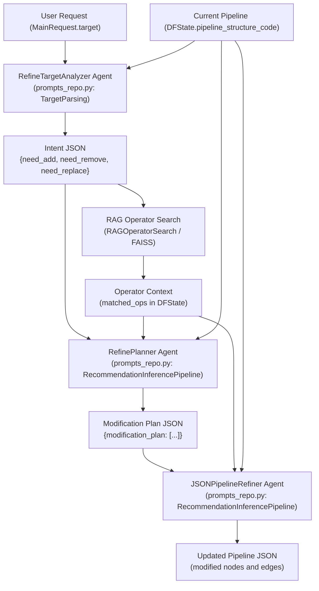
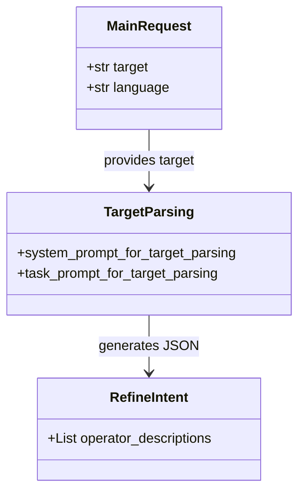

<!-- source: DeepWiki mcp.deepwiki.com · repo OpenDCAI/Paper2Any · page 10.3 Pipeline Refinement · fetched 2026-11-02 -->

# Pipeline Refinement

<details>
<summary>Relevant source files</summary>

The following files were used as context for generating this wiki page:

- [dataflow_agent/agentroles/cores/base_agent.py](dataflow_agent/agentroles/cores/base_agent.py)
- [dataflow_agent/graphbuilder/graph_builder.py](dataflow_agent/graphbuilder/graph_builder.py)
- [dataflow_agent/promptstemplates/prompts_repo.py](dataflow_agent/promptstemplates/prompts_repo.py)
- [dataflow_agent/resources/faiss_cache/all_ops.index.meta](dataflow_agent/resources/faiss_cache/all_ops.index.meta)
- [dataflow_agent/state.py](dataflow_agent/state.py)
- [dataflow_agent/toolkits/optool/op_tools.py](dataflow_agent/toolkits/optool/op_tools.py)
- [dataflow_agent/toolkits/pipetool/pipe_tools.py](dataflow_agent/toolkits/pipetool/pipe_tools.py)
- [dataflow_agent/toolkits/resources/ops.json](dataflow_agent/toolkits/resources/ops.json)

</details>


Pipeline Refinement is a multi-agent system for modifying existing data processing pipelines based on natural language user requests. It enables users to add, remove, or replace operators in their pipelines without manually editing JSON structures. The system maintains pipeline integrity by ensuring all modifications preserve the directed acyclic graph (DAG) structure and proper data flow between operators.

For information about generating new pipelines from scratch, see [Multi-Agent Pipeline Generation](#10.1). For automatic error fixing in pipelines, see [Debug Loop & Error Recovery](#10.2).

---

## Overview and Architecture

The Pipeline Refinement system follows a three-stage agent workflow that progressively transforms user intent into executable pipeline modifications. It operates within the `dataflow_agent` framework, utilizing specialized prompt templates to guide LLM reasoning.

### Pipeline Refinement Workflow



**Sources:** [dataflow_agent/state.py:84-101](), [dataflow_agent/promptstemplates/prompts_repo.py:76-113](), [dataflow_agent/promptstemplates/prompts_repo.py:118-230]()

---

## Stage 1: Intent Analysis (RefineTargetAnalyzer)

The `RefineTargetAnalyzer` parses user requests to determine the required structural changes. It leverages the `TargetParsing` prompt class to decompose natural language into specific operator functionality descriptions [dataflow_agent/promptstemplates/prompts_repo.py:76-113]().

### Intent Mapping

The analyzer identifies three primary operation types:

| Operation | Description | Examples |
|-----------|-------------|----------|
| **add** | Insert new operators | "Add a filter at the start" |
| **remove** | Delete operators | "Remove the duplicate removal step" |
| **replace** | Swap operators | "Use LLM instead of regex for extraction" |

### Data Flow to Code Space
The system maps the natural language `target` from `MainRequest` into a structured list of `operator_descriptions` [dataflow_agent/promptstemplates/prompts_repo.py:97-99]().



**Sources:** [dataflow_agent/state.py:13-37](), [dataflow_agent/promptstemplates/prompts_repo.py:81-113]()

---

## Stage 2: Modification Planning (RefinePlanner)

The `RefinePlanner` maps intent to the existing pipeline structure. It utilizes the `RecommendationInferencePipeline` logic to ensure execution order is maintained: Filter → Generate → Extract → Validate [dataflow_agent/promptstemplates/prompts_repo.py:145-149]().

### RAG-Based Operator Discovery
Before planning, the system performs a semantic search using `RAGOperatorSearch` against the `ops.json` cache [dataflow_agent/toolkits/optool/op_tools.py:195-208]().

1. **Query**: The description from Stage 1.
2. **Search**: FAISS index lookup in `dataflow_agent/resources/faiss_cache/`.
3. **Context**: Top-K matched operators with their `init_params` and `run_params` [dataflow_agent/toolkits/optool/op_tools.py:141-158]().

### Modification Strategy
The planner determines where to splice the graph:
- **insert_between**: Replaces an edge `A -> B` with `A -> New -> B`.
- **insert_at_start**: Connects `New` to the current entry point.
- **insert_at_end**: Connects all current terminal nodes to `New`.

**Sources:** [dataflow_agent/promptstemplates/prompts_repo.py:118-230](), [dataflow_agent/toolkits/optool/op_tools.py:161-193]()

---

## Stage 3: JSON Pipeline Refinement (JSONPipelineRefiner)

The `JSONPipelineRefiner` applies the plan to the `pipeline_structure_code` stored in `DFState` [dataflow_agent/state.py:96]().

### Operator Configuration Assembly
The refiner uses `pipeline_assembler` logic to wire parameters. It specifically handles:
- **LLM Serving**: Passing `llm_serving` objects to operators requiring them [dataflow_agent/toolkits/pipetool/pipe_tools.py:154-164]().
- **Prompt Templates**: Using `choose_prompt_template_by_llm` to select the most appropriate template for the new operator [dataflow_agent/toolkits/pipetool/pipe_tools.py:148-180]().

### Pipeline Code Generation
The final output is a modified JSON structure or Python code block. The system ensures `FileStorage` and `LLMServing` imports are included if the modification introduces operators requiring them [dataflow_agent/toolkits/pipetool/pipe_tools.py:23-31]().

```mermaid
graph LR
    subgraph "Code Entity Space"
        DFState["DFState.pipeline_structure_code"]
        Registry["OPERATOR_REGISTRY"]
        Assembler["pipeline_assembler.py"]
    end
    
    subgraph "Refinement Logic"
        Refiner["JSONPipelineRefiner"]
        PromptSelector["choose_prompt_template_by_llm"]
    end
    
    Refiner --> Assembler
    Assembler --> Registry : check params
    Assembler --> PromptSelector : get template
    PromptSelector --> DFState : update structure
```

**Sources:** [dataflow_agent/state.py:84-101](), [dataflow_agent/toolkits/pipetool/pipe_tools.py:148-180](), [dataflow_agent/toolkits/optool/op_tools.py:30-31]()

---

## Operator Integrity and Validation

To maintain a valid pipeline, the refinement process adheres to strict metadata rules extracted from the `OPERATOR_REGISTRY` [dataflow_agent/toolkits/optool/op_tools.py:30-31]().

### Metadata Extraction
The system periodically dumps operator info to `ops.json` using `_dump_all_ops_to_file` [dataflow_agent/toolkits/optool/op_tools.py:161-193](). This includes:
- **init_params**: Arguments for the class constructor (e.g., `llm_serving`, `data_num`) [dataflow_agent/toolkits/optool/op_tools.py:142]().
- **run_params**: Arguments for the `run` method (e.g., `input_key`, `output_key`) [dataflow_agent/toolkits/optool/op_tools.py:143]().

### DAG Preservation Rules
1. **Node Removal**: When a node is removed, the system must bridge the gap by connecting all predecessors of the deleted node to its successors.
2. **Parameter Wiring**: The `input_key` of a new node must match the `output_key` of its predecessor [dataflow_agent/toolkits/optool/op_tools.py:149-152]().

**Sources:** [dataflow_agent/toolkits/optool/op_tools.py:42-160](), [dataflow_agent/toolkits/pipetool/pipe_tools.py:1-31]()

---

## Integration with Agent Framework

Refinement agents are implemented as `BaseAgent` subclasses [dataflow_agent/agentroles/cores/base_agent.py:95-144]().

### Execution Mode
Refinement typically uses the **Simple** execution strategy (linear call) or **ReAct** if validation of the generated JSON is required [dataflow_agent/agentroles/cores/base_agent.py:187-190]().

### State Interaction
Agents read from `DFState` and write their results into `agent_results` [dataflow_agent/state.py:46]().

| Component | State Access |
|-----------|--------------|
| **RefineTargetAnalyzer** | Reads `request.target` |
| **RefinePlanner** | Reads `pipeline_structure_code` and `matched_ops` |
| **JSONPipelineRefiner** | Updates `pipeline_structure_code` |

**Sources:** [dataflow_agent/state.py:40-101](), [dataflow_agent/agentroles/cores/base_agent.py:181-210]()

---

