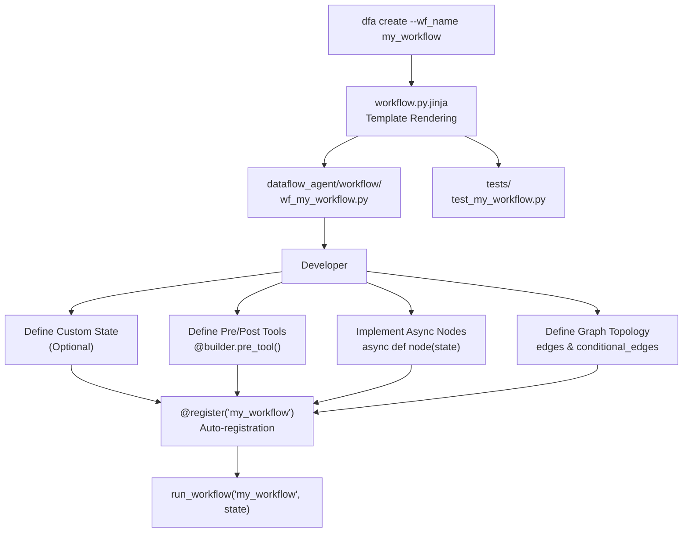
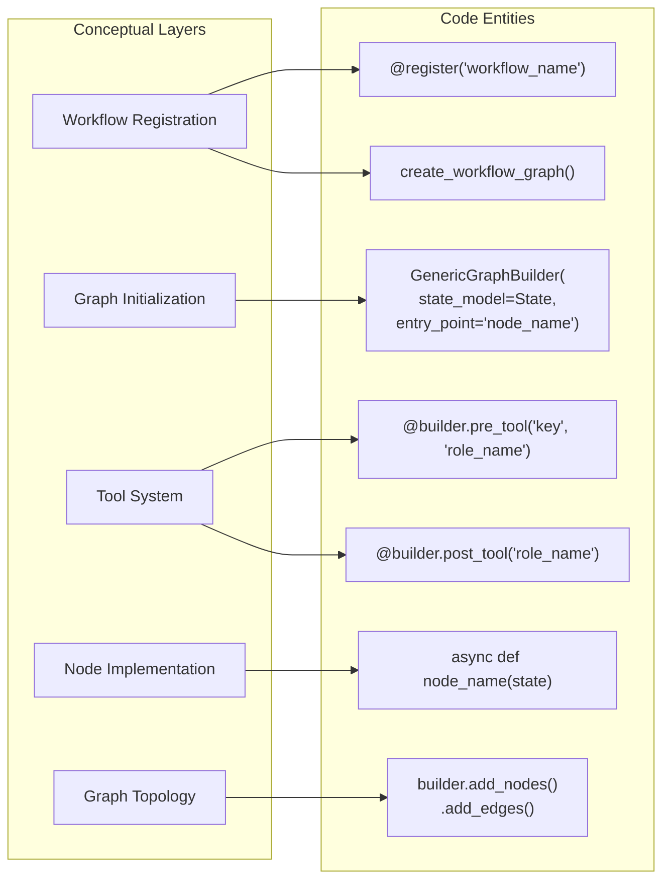
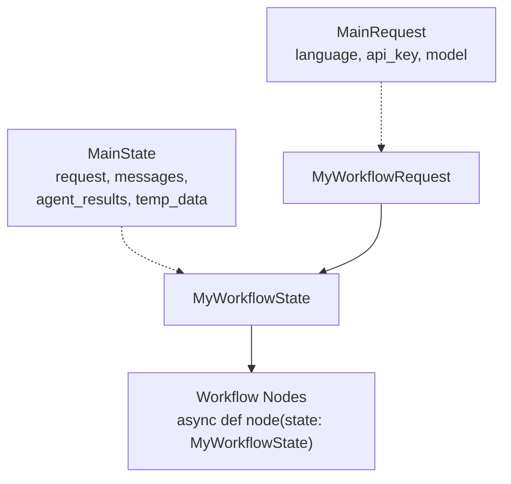
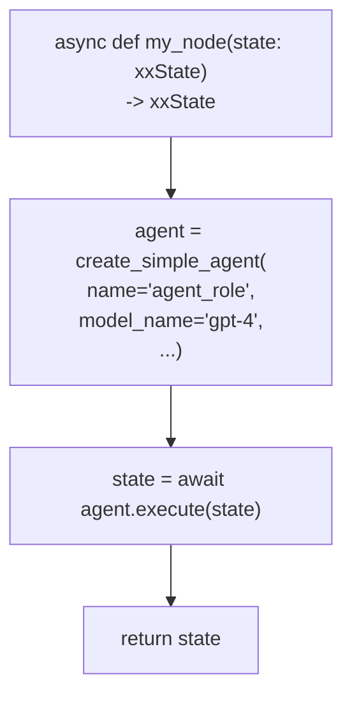
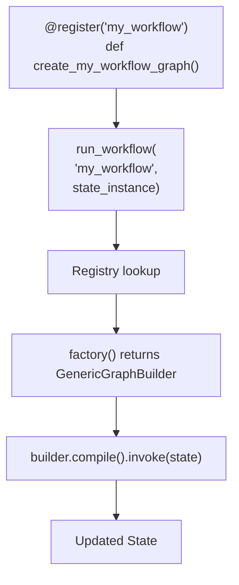

<!-- source: DeepWiki mcp.deepwiki.com · repo OpenDCAI/Paper2Any · page 11.1 Creating Custom Workflows · fetched 2026-11-02 -->

# Creating Custom Workflows

<details>
<summary>Relevant source files</summary>

The following files were used as context for generating this wiki page:

- [dataflow_agent/cli.py](dataflow_agent/cli.py)
- [dataflow_agent/templates/agent.py.jinja](dataflow_agent/templates/agent.py.jinja)
- [dataflow_agent/templates/test_workflow.py.jinja](dataflow_agent/templates/test_workflow.py.jinja)
- [dataflow_agent/templates/workflow.py.jinja](dataflow_agent/templates/workflow.py.jinja)

</details>


This guide explains how to create custom workflows in the DataFlow-Agent framework using the `GenericGraphBuilder` and the `@register` decorator. Workflows define multi-stage processing pipelines where each stage is an async node that can execute agents, transform data, or make conditional routing decisions.

**Scope**: This page covers workflow creation, node/edge definitions, tool systems, and state management.

---

## 1. Workflow Creation Overview

A workflow in DataFlow-Agent is a directed graph of async nodes connected by edges, orchestrated by LangGraph's `StateGraph`. The framework provides `GenericGraphBuilder` as a high-level abstraction for workflow construction [dataflow_agent/graphbuilder/graph_builder.py:1-50]().

### Workflow Creation Process



**Sources**: [dataflow_agent/cli.py:58-82](), [dataflow_agent/templates/workflow.py.jinja:1-10]()

---

## 2. Using the CLI to Generate Workflow Scaffold

The `dfa create` command in `dataflow_agent/cli.py` generates a complete workflow scaffold from the Jinja template [dataflow_agent/cli.py:27-47]().

### Command Syntax

```bash
dfa create --wf_name my_workflow
```

### Generated Files

| File Path | Purpose |
|-----------|---------|
| `dataflow_agent/workflow/wf_my_workflow.py` | Workflow source code with boilerplate structure [dataflow_agent/cli.py:62]() |
| `tests/test_my_workflow.py` | Test file with basic test case template [dataflow_agent/cli.py:74]() |

**Key Point**: Workflow files must have the `wf_` prefix to be automatically discovered by the workflow registry [dataflow_agent/cli.py:62]().

**Sources**: [dataflow_agent/cli.py:58-82](), [dataflow_agent/templates/workflow.py.jinja:1-10]()

---

## 3. Workflow File Structure

The generated workflow file follows a standardized structure with four main sections defined in the `workflow.py.jinja` template [dataflow_agent/templates/workflow.py.jinja:11-258]().

### Core Components Mapping



### Template Structure

```python
@register("workflow_name")
def create_workflow_graph() -> GenericGraphBuilder:
    # ========== INITIALIZATION ==========
    builder = GenericGraphBuilder(
        state_model=xxState,
        entry_point="step1"
    )
    
    # ========== TOOLS SECTION ==========
    @builder.pre_tool("placeholder", "agent_role_name")
    def tool_func(state): ...
    
    # ========== NODES SECTION ==========
    async def step1(state: xxState) -> xxState: ...
    
    # ========== GRAPH CONSTRUCTION ==========
    # ... builder.add_nodes(nodes).add_edges(edges)
    return builder
```

**Sources**: [dataflow_agent/templates/workflow.py.jinja:43-257]()

---

## 4. State and Request Models

Workflows operate on state objects that flow through nodes. All states typically inherit from `MainState` [dataflow_agent/templates/workflow.py.jinja:16-17]().

### State Inheritance Hierarchy



**Sources**: [dataflow_agent/templates/state_name.py.jinja:1-30](), [dataflow_agent/templates/test_workflow.py.jinja:16-21]()

---

## 5. The Tool System: Pre-Tools and Post-Tools

Tools inject context and functionality into agent execution. The `GenericGraphBuilder` provides decorators to bind tools to specific agent roles [dataflow_agent/templates/workflow.py.jinja:52-75]().

### Pre-Tools vs Post-Tools

| Aspect | Pre-Tool | Post-Tool |
|--------|----------|-----------|
| **Decorator** | `@builder.pre_tool("key", "role_name")` | `@builder.post_tool("role_name")` |
| **Execution Time** | Before agent LLM call | During agent execution (agent-invoked) |
| **Purpose** | Inject context into prompt | Provide callable functions to agent |
| **Return Type** | Any serializable data | Tool function decorated with `@tool` |

**Example Pre-Tool**:
```python
@builder.pre_tool("purpose", "step1")
def _purpose(state: xxState):
    return "context for prompt"
```

**Example Post-Tool**:
```python
@builder.post_tool("step2")
@tool
def _example_post_tool(date_str: str):
    """Tool documentation for the LLM"""
    return "result"
```

**Sources**: [dataflow_agent/templates/workflow.py.jinja:55-75]()

---

## 6. Implementing Workflow Nodes

Nodes are async functions that receive state and return updated state. They typically create and execute agents using convenience functions like `create_simple_agent` or `create_react_agent` [dataflow_agent/templates/workflow.py.jinja:82-200]().

### Node Signature and Structure



### Agent Creation Strategies
The framework supports several execution modes via configuration objects [dataflow_agent/templates/workflow.py.jinja:137-176]():
- **SimpleConfig**: Single LLM call.
- **ReactConfig**: Loop with validation and retries.
- **GraphConfig**: Execution of a sub-graph with tools.
- **VLMConfig**: Visual language model processing.

**Sources**: [dataflow_agent/templates/workflow.py.jinja:82-176]()

---

## 7. Workflow Registration and Execution

The `@register` decorator adds the workflow to the global registry, enabling execution by name via `run_workflow` [dataflow_agent/templates/workflow.py.jinja:43]().

### Registration to Execution Flow



**Sources**: [dataflow_agent/templates/workflow.py.jinja:43-49](), [dataflow_agent/templates/test_workflow.py.jinja:47]()

---

## 8. CLI Template System

The `dfa create` command uses Jinja2 templates located in `dataflow_agent/templates/` to generate boilerplate code [dataflow_agent/cli.py:8-9]().

### Available Generators
- `--wf_name`: Generates workflow and test files [dataflow_agent/cli.py:58-82]().
- `--agent_name`: Generates an agent class inheriting from `BaseAgent` [dataflow_agent/cli.py:86-96]().
- `--prompt_name`: Generates a prompt template repository [dataflow_agent/cli.py:116-126]().
- `--state_name`: Generates a dataclass state model [dataflow_agent/cli.py:146-156]().

**Sources**: [dataflow_agent/cli.py:27-156](), [dataflow_agent/templates/workflow.py.jinja:1-258](), [dataflow_agent/templates/agent.py.jinja:1-166]()

---

