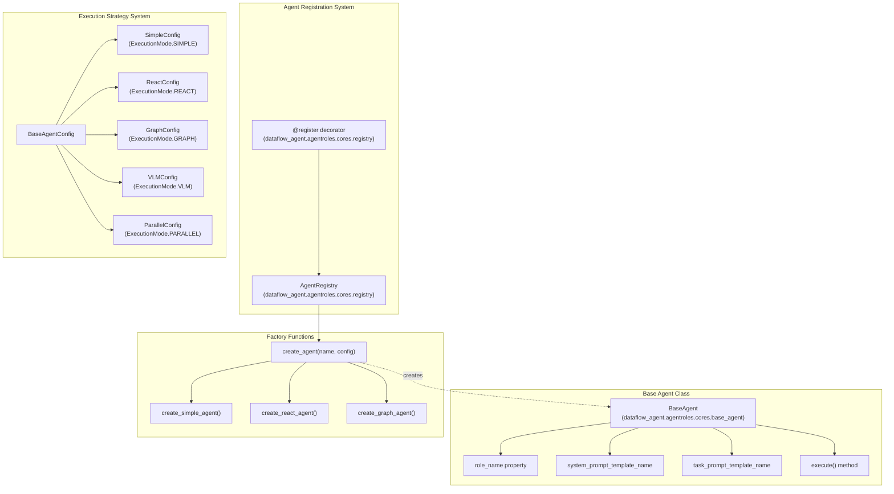
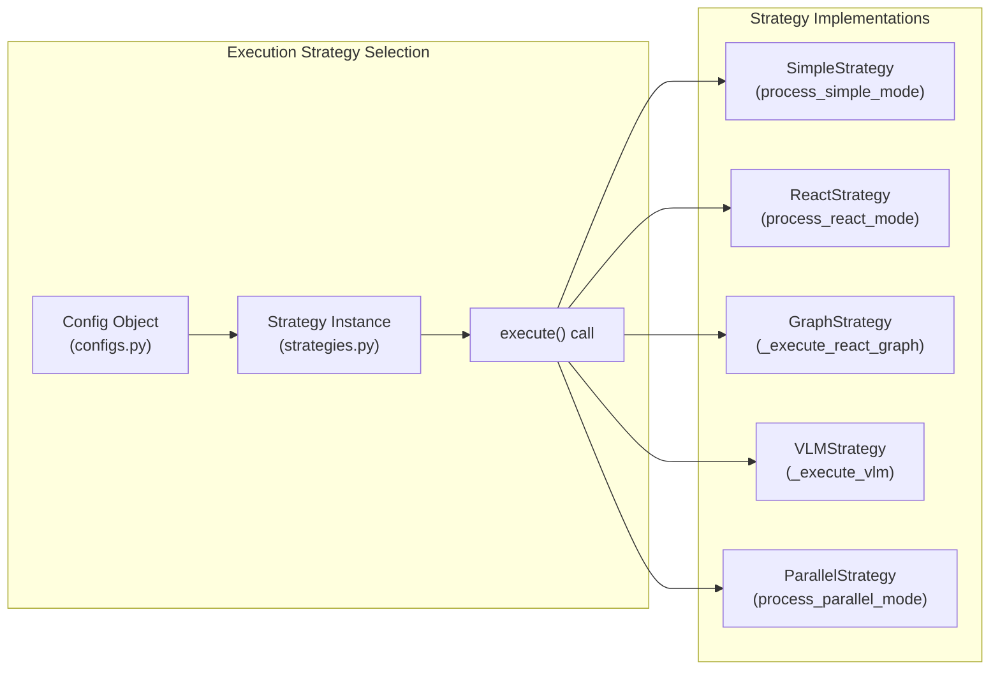

<!-- source: DeepWiki mcp.deepwiki.com · repo OpenDCAI/Paper2Any · page 11.2 Creating Custom Agents · fetched 2026-11-02 -->

# Creating Custom Agents

<details>
<summary>Relevant source files</summary>

The following files were used as context for generating this wiki page:

- [dataflow_agent/agentroles/__init__.py](dataflow_agent/agentroles/__init__.py)
- [dataflow_agent/agentroles/cores/__init__.py](dataflow_agent/agentroles/cores/__init__.py)
- [dataflow_agent/agentroles/cores/configs.py](dataflow_agent/agentroles/cores/configs.py)
- [dataflow_agent/agentroles/cores/strategies.py](dataflow_agent/agentroles/cores/strategies.py)
- [dataflow_agent/cli.py](dataflow_agent/cli.py)
- [dataflow_agent/templates/agent.py.jinja](dataflow_agent/templates/agent.py.jinja)
- [dataflow_agent/templates/agent_as_tool_name.py.jinja](dataflow_agent/templates/agent_as_tool_name.py.jinja)
- [dataflow_agent/templates/state_name.py.jinja](dataflow_agent/templates/state_name.py.jinja)
- [dataflow_agent/templates/test_workflow.py.jinja](dataflow_agent/templates/test_workflow.py.jinja)
- [dataflow_agent/templates/workflow.py.jinja](dataflow_agent/templates/workflow.py.jinja)

</details>


## Purpose and Scope

This document provides a comprehensive guide to implementing custom agents in the Paper2Any system. Agents are self-contained execution units that perform specific tasks within workflows, such as extracting ideas from papers, generating descriptions, or creating visual content. 

For information about defining workflows that orchestrate multiple agents, see [Creating Custom Workflows](11.1). For details on the underlying agent framework architecture, see [Agents](5.2).

---

## Agent Architecture Overview

The Paper2Any agent system implements a strategy pattern-based architecture with centralized registration and flexible execution modes.

### Natural Language to Code Entity Space
The following diagram bridges high-level agent concepts to specific code entities within the `dataflow_agent` package.



**Sources:** [dataflow_agent/agentroles/__init__.py:59-133](), [dataflow_agent/agentroles/cores/configs.py:6-15](), [dataflow_agent/agentroles/cores/registry.py]()

### Key Components

| Component | Purpose | Location |
|-----------|---------|----------|
| `BaseAgent` | Abstract base class for all agents | `dataflow_agent/agentroles/cores/base_agent.py` |
| `AgentRegistry` | Central registry for agent discovery | `dataflow_agent/agentroles/cores/registry.py` |
| `@register` | Decorator for agent registration | `dataflow_agent/agentroles/cores/registry.py` |
| `ExecutionStrategy` | Strategy objects defining execution modes | `dataflow_agent/agentroles/cores/strategies.py` |
| `BaseAgentConfig` | Dataclasses for configuring agent behavior | `dataflow_agent/agentroles/cores/configs.py` |

---

## Step 1: Define the Agent Class

Every custom agent must inherit from `BaseAgent` and be registered with the `@register` decorator.

### Basic Agent Structure
The system provides a Jinja2 template for generating new agents at `dataflow_agent/templates/agent.py.jinja`.

```python
from dataflow_agent.agentroles.cores.base_agent import BaseAgent
from dataflow_agent.agentroles.cores.registry import register
from dataflow_agent.state import MainState

@register("your_agent_name")
class YourCustomAgent(BaseAgent):
    """TODO: Describe agent responsibilities"""
    
    @classmethod
    def create(cls, tool_manager=None, **kwargs):
        return cls(tool_manager=tool_manager, **kwargs)

    @property
    def role_name(self) -> str:
        return "your_agent_name"
    
    @property
    def system_prompt_template_name(self) -> str:
        return "system_prompt_for_your_agent"
    
    @property
    def task_prompt_template_name(self) -> str:
        return "task_prompt_for_your_agent"
```

**Sources:** [dataflow_agent/templates/agent.py.jinja:27-50](), [dataflow_agent/agentroles/cores/registry.py]()

---

## Step 2: Implement Required Methods

### Prompt Parameter Construction
The `get_task_prompt_params()` method maps data from tools into the prompt template variables.

```python
def get_task_prompt_params(self, pre_tool_results: Dict[str, Any]) -> Dict[str, Any]:
    """Construct parameters for the task prompt template."""
    return {
        'custom_variable': pre_tool_results.get('data', ''),
    }
```

**Sources:** [dataflow_agent/templates/agent.py.jinja:52-62]()

### Result Write-Back
The `update_state_result()` method defines how the LLM's parsed output is saved back into the workflow state.

```python
def update_state_result(self, state: MainState, result: Dict[str, Any], pre_tool_results: Dict[str, Any]):
    """Write inference result to state fields."""
    state.xx = result  # Example: state.summary = result.get("summary")
    super().update_state_result(state, result, pre_tool_results)
```

**Sources:** [dataflow_agent/templates/agent.py.jinja:69-80]()

---

## Step 3: Choose an Execution Strategy

Paper2Any uses a Strategy pattern to handle different execution logic. Strategies are defined in `dataflow_agent/agentroles/cores/strategies.py`.

### Strategy Flow to Code Association



**Sources:** [dataflow_agent/agentroles/cores/strategies.py:26-121](), [dataflow_agent/agentroles/cores/configs.py:6-15]()

### Execution Strategy Comparison

| Strategy | Config Class | Mode Enum | Behavior |
|----------|--------------|-----------|----------|
| **Simple** | `SimpleConfig` | `SIMPLE` | Single LLM call via `process_simple_mode` |
| **ReAct** | `ReactConfig` | `REACT` | Loop with `max_retries` and `validators` |
| **Graph** | `GraphConfig` | `GRAPH` | Executes a LangGraph sub-graph with tools |
| **VLM** | `VLMConfig` | `VLM` | Specialized for vision (understanding/generation) |
| **Parallel** | `ParallelConfig` | `PARALLEL` | Concurrent execution with `concurrency_limit` |

**Sources:** [dataflow_agent/agentroles/cores/configs.py:46-84](), [dataflow_agent/agentroles/cores/strategies.py:26-121]()

---

## Step 4: Advanced Execution Modes

### ReAct Mode with Validators
ReAct mode allows the agent to self-correct based on validation failures.

```python
# In a workflow node
agent = create_react_agent(
    name="your_agent",
    max_retries=3,
    parser_type="json",
    # validators=[custom_validator_func]
)
```

**Sources:** [dataflow_agent/agentroles/__init__.py:211-250](), [dataflow_agent/agentroles/cores/strategies.py:36-59]()

### Planning Strategies
For complex tasks, the system supports `PlanSolveStrategy` and `PlanExecuteStrategy`. These strategies use a Planner to generate a multi-step `plan` and an Executor to carry it out.

**Sources:** [dataflow_agent/agentroles/cores/strategies.py:126-195](), [dataflow_agent/agentroles/cores/configs.py:88-195]()

---

## Step 5: Using the CLI for Generation

The `dfa` CLI tool (defined in `dataflow_agent/cli.py`) automates the creation of agent files and their corresponding prompt templates.

### Commands

*   **Generate Agent:** `dfa create --agent_name <name>`
    *   Creates file: `dataflow_agent/agentroles/common_agents/<name>_agent.py` [dataflow_agent/cli.py:86-96]()
*   **Generate Agent-as-Tool:** `dfa create --agent_as_tool_name <name>`
    *   Creates a specialized agent that implements tool schemas. [dataflow_agent/cli.py:131-141]()
*   **Generate Prompt Template:** `dfa create --prompt_name <name>`
    *   Creates prompt resource file in `dataflow_agent/promptstemplates/resources/`. [dataflow_agent/cli.py:116-126]()

**Sources:** [dataflow_agent/cli.py:27-157]()

---

## Complete Example: Simple Workflow Integration

Integrating a custom agent into a workflow using `create_simple_agent`.

```python
# Inside a workflow.py file
from dataflow_agent.agentroles import create_simple_agent

async def my_workflow_node(state: xxState) -> xxState:
    agent = create_simple_agent(
        name="my_custom_agent",
        model_name="gpt-4-turbo",
        temperature=0.1,
        parser_type="json"
    )
    # The agent uses get_task_prompt_params and update_state_result internally
    return await agent.execute(state)
```

**Sources:** [dataflow_agent/templates/workflow.py.jinja:98-106](), [dataflow_agent/agentroles/__init__.py:174-208]()

---

