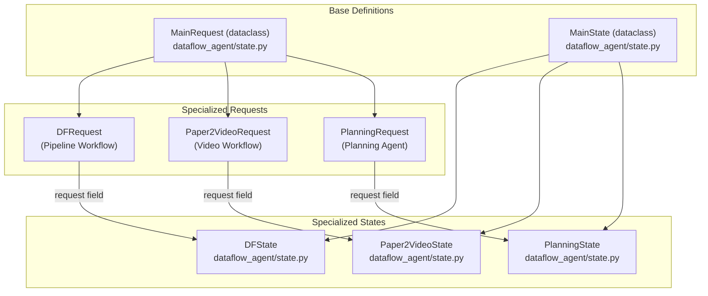
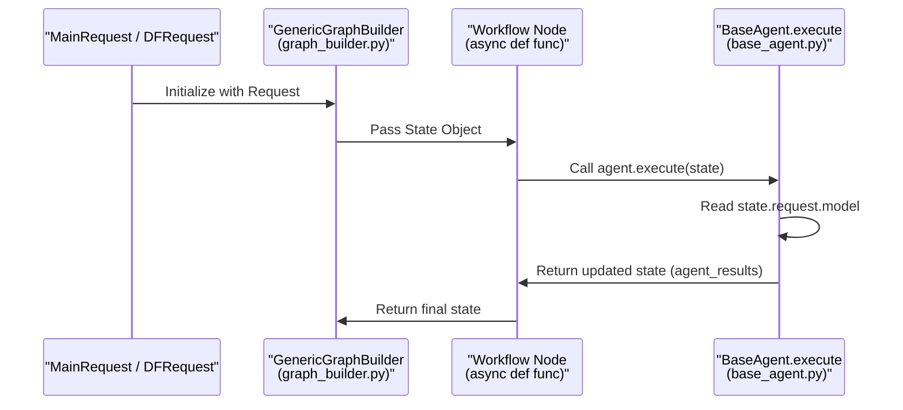

<!-- source: DeepWiki mcp.deepwiki.com · repo OpenDCAI/Paper2Any · page 11.3 Creating Custom State Models · fetched 2026-11-02 -->

# Creating Custom State Models

<details>
<summary>Relevant source files</summary>

The following files were used as context for generating this wiki page:

- [dataflow_agent/agentroles/cores/base_agent.py](dataflow_agent/agentroles/cores/base_agent.py)
- [dataflow_agent/cli.py](dataflow_agent/cli.py)
- [dataflow_agent/graphbuilder/graph_builder.py](dataflow_agent/graphbuilder/graph_builder.py)
- [dataflow_agent/promptstemplates/prompts_repo.py](dataflow_agent/promptstemplates/prompts_repo.py)
- [dataflow_agent/resources/faiss_cache/all_ops.index.meta](dataflow_agent/resources/faiss_cache/all_ops.index.meta)
- [dataflow_agent/state.py](dataflow_agent/state.py)
- [dataflow_agent/templates/agent.py.jinja](dataflow_agent/templates/agent.py.jinja)
- [dataflow_agent/templates/test_workflow.py.jinja](dataflow_agent/templates/test_workflow.py.jinja)
- [dataflow_agent/templates/workflow.py.jinja](dataflow_agent/templates/workflow.py.jinja)
- [dataflow_agent/toolkits/optool/op_tools.py](dataflow_agent/toolkits/optool/op_tools.py)
- [dataflow_agent/toolkits/pipetool/pipe_tools.py](dataflow_agent/toolkits/pipetool/pipe_tools.py)
- [dataflow_agent/toolkits/resources/ops.json](dataflow_agent/toolkits/resources/ops.json)

</details>


## Purpose and Scope

This page explains how to define custom State and Request models within the DataFlow-Agent framework. State models serve as the primary data container that flows through workflow nodes, carrying user configurations, intermediate processing results, and final outputs. Request models encapsulate specific user inputs and API settings.

For details on implementing workflows that utilize these states, see **11.1 Creating Custom Workflows**. For agent interactions, see **11.2 Creating Custom Agents**.

---

## State Model Architecture

### Base Classes

The framework provides two core base classes in `dataflow_agent/state.py` that utilize Python `dataclasses` for structured data management.

| Base Class | Location | Purpose |
|------------|----------|---------|
| `MainRequest` | [dataflow_agent/state.py:13-37]() | Base for all request/configuration objects. |
| `MainState` | [dataflow_agent/state.py:40-54]() | Base for all workflow state objects, containing message history and results. |

**Core Fields in MainRequest:**
[dataflow_agent/state.py:14-30]()
```python
@dataclass
class MainRequest:
    language: str = "en"              # User language preference
    chat_api_url: str = "..."         # LLM API endpoint
    api_key: str = "..."              # API key
    model: str = "gpt-4o"             # LLM model name
    target: str = ""                  # User requirement description
```

**Core Fields in MainState:**
[dataflow_agent/state.py:41-47]()
```python
@dataclass
class MainState:
    request: MainRequest                          # Configuration object
    messages: Annotated[list[BaseMessage], add_messages] # LangGraph message history
    agent_results: Dict[str, Any]                 # Results keyed by agent name
    temp_data: Dict[str, Any]                     # Temporary workflow data
```

**Sources:** [dataflow_agent/state.py:13-54]()

---

### State Inheritance Hierarchy

The following diagram illustrates how specialized states inherit from the base classes to support specific workflows like Paper2Video or Planning.

**Natural Language to Code Entity Space: State Hierarchy**


**Sources:** [dataflow_agent/state.py:57-217]()

---

## Creating Custom Request Classes

### Step 1: Define the Request Class
Custom Request classes extend `MainRequest` to include parameters specific to the workflow logic (e.g., TTS models for video or debug flags for pipelines).

**Example: Paper2VideoRequest**
[dataflow_agent/state.py:105-130]()
```python
@dataclass
class Paper2VideoRequest(MainRequest):
    paper_pdf_path: str = ""
    tts_model: str = "cosyvoice-v3-flash"
    talking_model: str = "liveportrait"
    use_specific_sound: bool = False
    ref_audio_path: str = ""
```

### Step 2: Field Type Patterns
| Pattern | Syntax | Usage |
|---------|--------|-------|
| **Simple Default** | `name: str = ""` | For primitive types (str, int, bool). |
| **Mutable Default**| `items: list = field(default_factory=list)` | **Mandatory** for lists/dicts to avoid shared state across instances. |
| **Lambda Factory** | `path: str = field(default_factory=lambda: str(PROJDIR / "path"))` | For dynamic defaults like resolved file paths. |

**Sources:** [dataflow_agent/state.py:1-4](), [dataflow_agent/state.py:127-130]()

---

## Creating Custom State Classes

### Step 1: Define the State Class
Custom State classes inherit from `MainState` and must override the `request` field with the corresponding custom Request type.

**Example: Paper2VideoState**
[dataflow_agent/state.py:133-168]()
```python
@dataclass
class Paper2VideoState(MainState):
    # Override request type for strict typing
    request: Paper2VideoRequest = field(default_factory=Paper2VideoRequest)
    
    # Workflow-specific tracking fields
    beamer_code_path: str = ""
    is_beamer_wrong: bool = False
    video_path: str = ""
    script_pages: List[Dict[str, Any]] = field(default_factory=list)
```

### Step 2: Complex State Management
For complex agents like the **Planning Agent**, states may include nested dataclasses like `PlanStep` to track granular execution status.

**Sources:** [dataflow_agent/state.py:198-217]()

---

## State Flow and Integration

### Workflow Integration
When defining a workflow via `GenericGraphBuilder`, the `state_model` is passed to ensure the underlying `StateGraph` enforces the correct schema.

**Data Flow: State Object Lifecycle**


**Sources:** [dataflow_agent/graphbuilder/graph_builder.py:18-23](), [dataflow_agent/agentroles/cores/base_agent.py:135-144]()

---

## CLI Code Generation

The `dfa` CLI tool automates the creation of state models using the `state_name.py.jinja` template.

**Command:**
```bash
dfa create --state_name MyCustom
```

**Implementation Details:**
- The CLI uses `to_snake` and `to_camel` utilities to format names [dataflow_agent/cli.py:11-18]().
- It renders the template located at `dataflow_agent/templates/state_name.py.jinja` [dataflow_agent/cli.py:149-156]().
- The generated file is placed in `dataflow_agent/states/my_custom_state.py` [dataflow_agent/cli.py:148]().

**Sources:** [dataflow_agent/cli.py:146-157]()

---

## Best Practices

1. **Explicit Request Overriding**: Always redefine the `request` field in your custom State class to ensure type hints work correctly in node functions [dataflow_agent/state.py:85-88]().
2. **Result Writing**: Agents should update the state primarily through the `update_state_result` method, which by default writes to `state.agent_results` [dataflow_agent/templates/agent.py.jinja:69-80]().
3. **Immutability and Safety**: Use `field(default_factory=...)` for all collection types to prevent bugs where one workflow instance's data leaks into another [dataflow_agent/state.py:44-47]().
4. **Annotated Messages**: Use `Annotated[list[BaseMessage], add_messages]` for the `messages` field to enable LangGraph's automatic message merging behavior [dataflow_agent/state.py:44]().

**Sources:** [dataflow_agent/state.py:44-47](), [dataflow_agent/templates/agent.py.jinja:69-80]()

---

