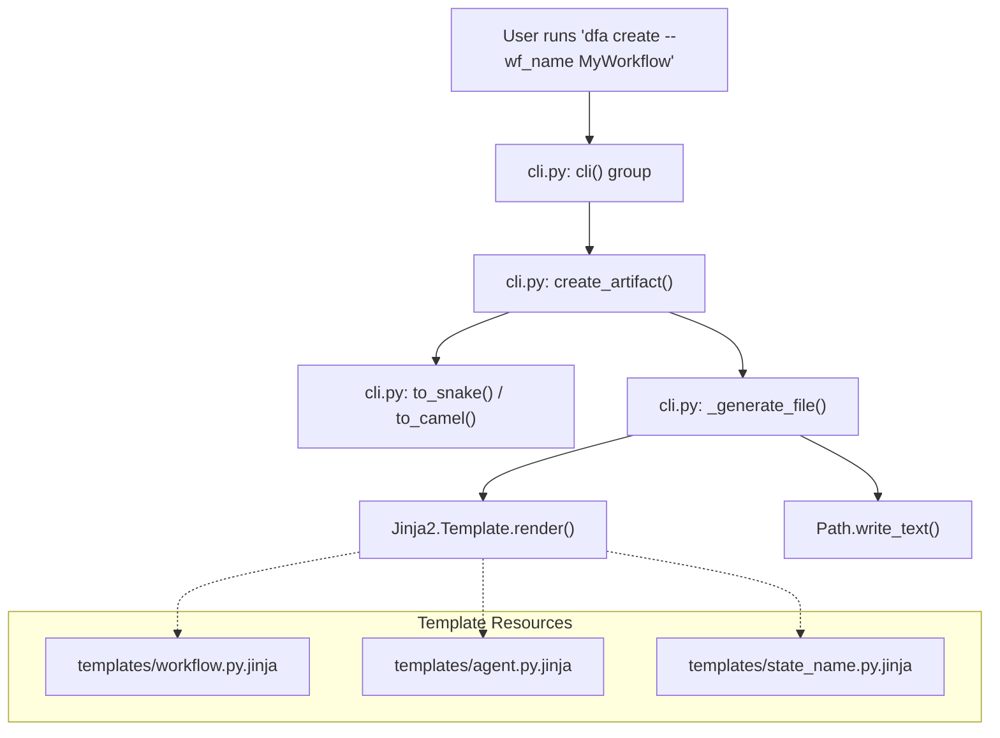
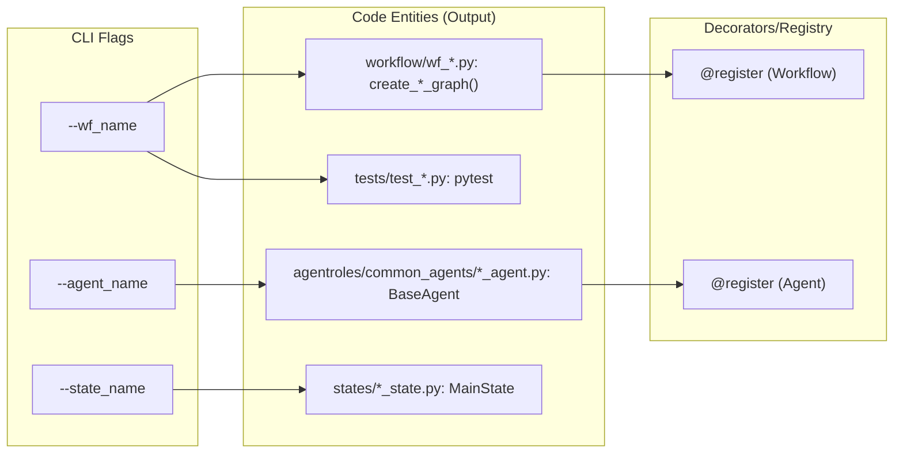

<!-- source: DeepWiki mcp.deepwiki.com · repo OpenDCAI/Paper2Any · page 11.4 CLI Code Generation · fetched 2026-11-02 -->

# CLI Code Generation

<details>
<summary>Relevant source files</summary>

The following files were used as context for generating this wiki page:

- [dataflow_agent/cli.py](dataflow_agent/cli.py)
- [dataflow_agent/templates/agent.py.jinja](dataflow_agent/templates/agent.py.jinja)
- [dataflow_agent/templates/test_workflow.py.jinja](dataflow_agent/templates/test_workflow.py.jinja)
- [dataflow_agent/templates/workflow.py.jinja](dataflow_agent/templates/workflow.py.jinja)

</details>


## Purpose and Scope

This document describes the CLI-based code generation system in DataFlow-Agent, specifically the `dfa create` command implemented in `dataflow_agent/cli.py` [dataflow_agent/cli.py:1-188](). This tool provides a scaffolding mechanism to quickly generate boilerplate code for workflows, agents, state models, prompt templates, and agent-as-tool components using Jinja2 templates located in `dataflow_agent/templates/` [dataflow_agent/cli.py:8-9]().

For information about writing custom workflows after generation, see [Creating Custom Workflows](11.1). For agent development details, see [Creating Custom Agents](11.2). For state model design, see [Creating Custom State Models](11.3).

---

## Overview

The CLI code generation system uses the `dfa create` command to generate code from predefined Jinja2 templates. This approach ensures consistency across the codebase and significantly reduces the time required to set up new components. The system supports six primary component types, each with its own template and naming conventions [dataflow_agent/cli.py:34-47]().

The generation process follows a simple pattern:
1. User invokes `dfa create` with a component type flag and name.
2. The `create_artifact` function identifies the appropriate Jinja2 template [dataflow_agent/cli.py:34-157]().
3. Template variables (snake_case names, CamelCase class names, and timestamps) are populated [dataflow_agent/cli.py:53-155]().
4. The `_generate_file` helper renders the template and writes it to the target path, ensuring directories exist and preventing overwrites [dataflow_agent/cli.py:160-184]().

---

## The `dfa create` Command

### Command Syntax

The `dfa create` command follows this general pattern:

```bash
dfa create --<component_type> <component_name>
```

### Available Options

| Flag | Purpose | Output File Path | Template Source |
|------|---------|---------------------|-----------------|
| `--wf_name` | Create a new workflow and test | `dataflow_agent/workflow/wf_<name>.py`<br/>`tests/test_<name>.py` | `workflow.py.jinja`<br/>`test_workflow.py.jinja` |
| `--agent_name` | Create a new agent class | `dataflow_agent/agentroles/common_agents/<name>_agent.py` | `agent.py.jinja` |
| `--state_name` | Create state and request classes | `dataflow_agent/states/<name>_state.py` | `state_name.py.jinja` |
| `--prompt_name` | Create prompt template repository | `dataflow_agent/promptstemplates/resources/pt_<name>_repo.py` | `prompt_repo.py.jinja` |
| `--gradio_name` | Create Gradio page | `gradio_app/pages/page_<name>.py` | `gradio_page.py.jinja` |
| `--agent_as_tool_name` | Create agent-as-tool | `dataflow_agent/agentroles/common_agents/<name>_agent.py` | `agent_as_tool_name.py.jinja` |

**Sources:** [dataflow_agent/cli.py:27-157]()

---

## Template System Architecture

### CLI Command Flow

The following diagram bridges the Natural Language CLI input to the specific Code Entities responsible for generation.

Title: CLI Command Execution Flow

**Sources:** [dataflow_agent/cli.py:1-188]()

### Code Entity Mapping

This diagram maps system concepts to specific file locations and class/function identifiers.

Title: Component Generation Mapping

**Sources:** [dataflow_agent/cli.py:58-157](), [dataflow_agent/templates/workflow.py.jinja:43-44](), [dataflow_agent/templates/agent.py.jinja:27-28]()

---

## Template Details

### Workflow Template (`workflow.py.jinja`)

The workflow template generates a complete functional skeleton [dataflow_agent/templates/workflow.py.jinja:1-49]():
- **Imports**: Includes `GenericGraphBuilder`, `register`, and agent creation helpers (`create_simple_agent`, `create_react_agent`, etc.) [dataflow_agent/templates/workflow.py.jinja:12-41]().
- **Registration**: Uses `@register("{{ wf_name }}")` to make the workflow discoverable by `run_workflow` [dataflow_agent/templates/workflow.py.jinja:43-44]().
- **Tools**: Provides boilerplate for `@builder.pre_tool` and `@builder.post_tool` [dataflow_agent/templates/workflow.py.jinja:55-75]().
- **Nodes**: Includes comprehensive examples of creating agents with different `ExecutionMode` configs (Simple, ReAct, Graph, VLM) [dataflow_agent/templates/workflow.py.jinja:82-176]().

### Agent Template (`agent.py.jinja`)

Generates a new agent class inheriting from `BaseAgent` [dataflow_agent/templates/agent.py.jinja:28]():
- **Metadata**: Sets `role_name` and template IDs for system/task prompts [dataflow_agent/templates/agent.py.jinja:37-50]().
- **Logic**: Provides stubs for `get_task_prompt_params` and `update_state_result` [dataflow_agent/templates/agent.py.jinja:52-80]().
- **Helpers**: Generates an async entry function (e.g., `async def my_agent(...)`) and a factory function `create_my_agent` [dataflow_agent/templates/agent.py.jinja:85-165]().

### Test Workflow Template (`test_workflow.py.jinja`)

Generates a pytest-compatible test file [dataflow_agent/templates/test_workflow.py.jinja:1-9]():
- **Setup**: Imports `run_workflow` and the relevant state models [dataflow_agent/templates/test_workflow.py.jinja:16-18]().
- **Execution**: Implements `run_{{ wf_name_snake }}_pipeline` to execute the graph [dataflow_agent/templates/test_workflow.py.jinja:25-48]().
- **Assertions**: Provides standard assertions to check for `agent_results` and message history [dataflow_agent/templates/test_workflow.py.jinja:52-80]().

---

## Code Generation Logic

The `cli.py` script uses several helper functions to transform user input into valid Python identifiers:

- `to_snake(s)`: Converts strings to `snake_case` using regex to handle spaces and hyphens [dataflow_agent/cli.py:11-15]().
- `to_camel(s)`: Converts strings to `PascalCase` (CamelCase) for class names [dataflow_agent/cli.py:17-18]().
- `_generate_file(dest, tpl_path, context, file_type)`: The core engine that:
    1. Creates parent directories [dataflow_agent/cli.py:164]().
    2. Checks if the destination file already exists to prevent accidental overwrites [dataflow_agent/cli.py:166-169]().
    3. Renders the Jinja2 template with the provided context [dataflow_agent/cli.py:175]().
    4. Writes the final UTF-8 encoded text to disk [dataflow_agent/cli.py:176]().

**Sources:** [dataflow_agent/cli.py:10-185]()

---

