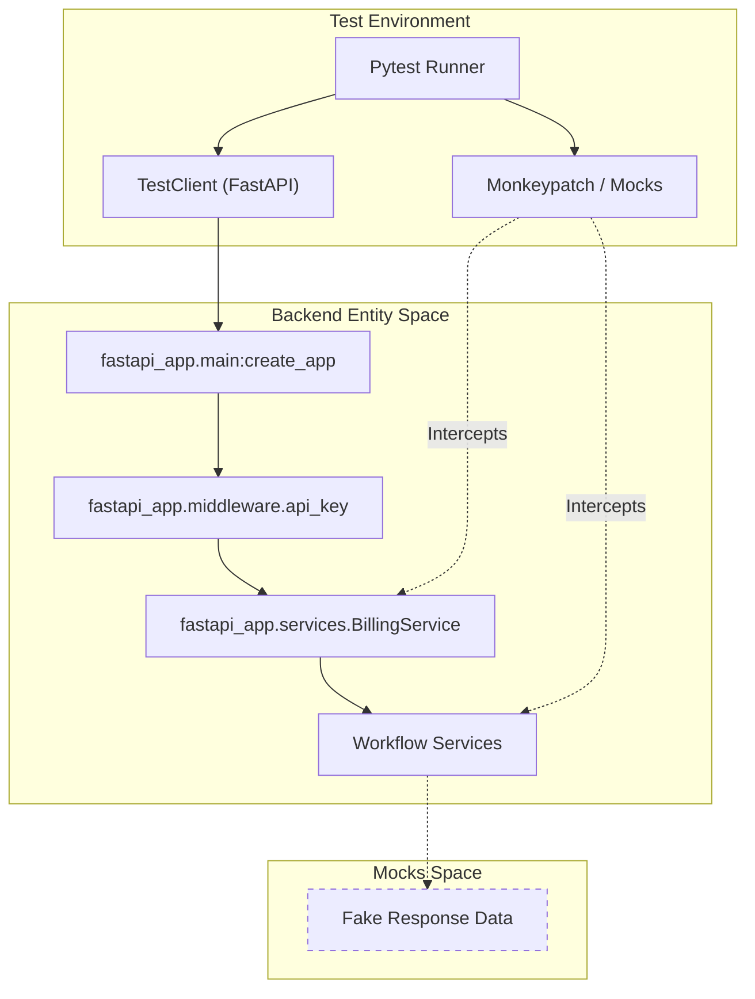
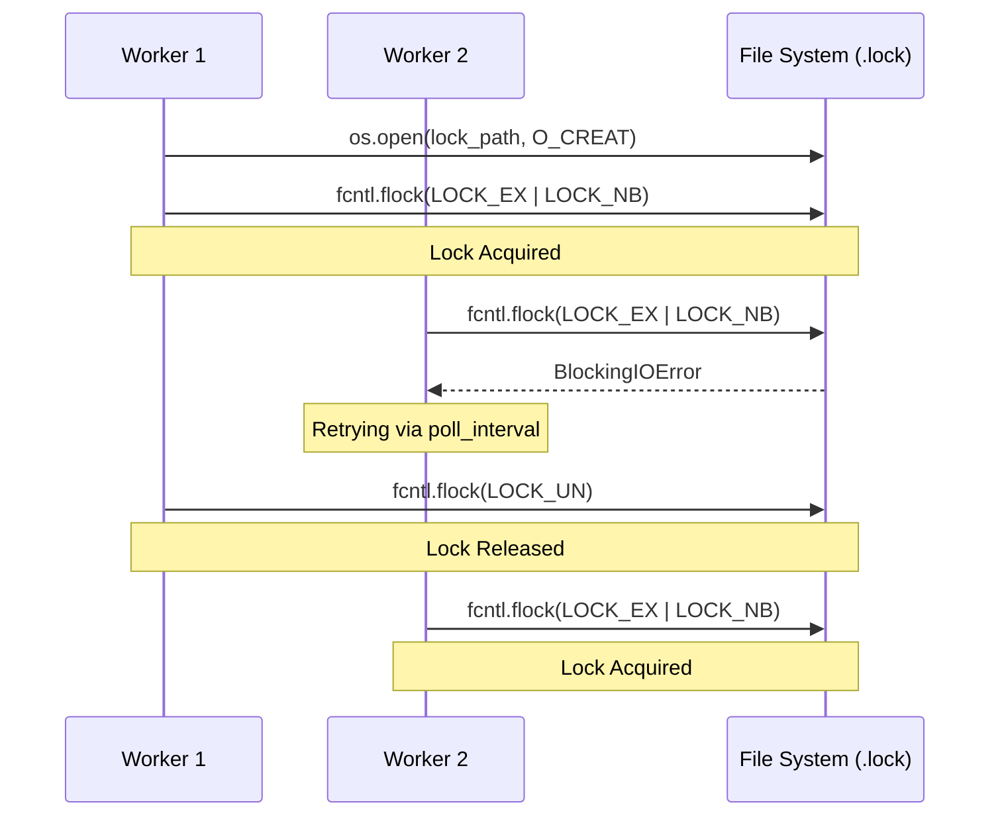

<!-- source: DeepWiki mcp.deepwiki.com · repo OpenDCAI/Paper2Any · page 11.5 Testing · fetched 2026-11-02 -->

# Testing

<details>
<summary>Relevant source files</summary>

The following files were used as context for generating this wiki page:

- [dataflow_agent/toolkits/p2vtool/1_merge.bash](dataflow_agent/toolkits/p2vtool/1_merge.bash)
- [deploy/app_config.sh](deploy/app_config.sh)
- [fastapi_app/__init__.py](fastapi_app/__init__.py)
- [fastapi_app/interprocess_lock.py](fastapi_app/interprocess_lock.py)
- [tests/test_mineru_remote_api.py](tests/test_mineru_remote_api.py)
- [tests/test_paper2poster_curator.py](tests/test_paper2poster_curator.py)
- [tests/test_paper2ppt_generate_route.py](tests/test_paper2ppt_generate_route.py)

</details>


The Paper2Any test infrastructure is designed to ensure the reliability of document conversion workflows, agentic reasoning, and backend API integrity. The system employs a combination of automated unit tests, integration tests using FastAPI's `TestClient`, and manual workflow validation scripts.

## Test Infrastructure Overview

The testing suite is partitioned into several layers to address different components of the multimodal pipeline:

1.  **Unit Tests (`tests/`)**: Focus on individual components like agent logic, data sanitization, and utility functions.
2.  **Route/Integration Tests**: Validate FastAPI endpoints, middleware behavior (e.g., API key validation), and service-layer orchestration.
3.  **Toolkit Tests**: Specialized tests for external tool integrations like MinerU, SAM, and PosterTool.
4.  **Manual Workflow Tests (`tests/manual/`)**: Scripts used for end-to-end validation of complex pipelines that require specific environment setups or large assets.

### Data Flow in Testing

Testing often involves mocking external dependencies (LLMs, GPU servers) to ensure deterministic results. The following diagram illustrates how the `TestClient` interacts with the backend services while bypassing real external calls via `monkeypatch`.

**Testing Component Interaction**



**Sources:** [tests/test_paper2ppt_generate_route.py:12-41](), [fastapi_app/main.py:1-40]()

---

## Unit and Integration Tests

### Paper2PPT Route Testing
The Paper2PPT tests verify that multipart form data (containing images and JSON) survives the middleware stack and correctly triggers billing events.

*   **Implementation**: Uses `monkeypatch` to replace `BillingService.consume_workflow` and `Paper2PPTService.generate_ppt` with "fake" versions that capture request parameters for assertion.
*   **Key Functions**: `test_paper2ppt_generate_multipart_survives_middleware` [tests/test_paper2ppt_generate_route.py:19-64]() and `test_paper2ppt_frontend_generate_bills_after_binding` [tests/test_paper2ppt_generate_route.py:66-106]().
*   **Validation**: Ensures that `result_path`, `model` names, and `reference_img` filenames are correctly propagated through the service layer.

### Poster Generation Testing
The `Paper2Poster` workflow involves complex storyboard curation. Tests in this area focus on data integrity during the curation phase.

*   **Logic**: The `StoryBoardCurator` is tested to ensure it removes visual asset references that do not exist in the source extraction, preventing rendering errors later in the pipeline.
*   **Key Function**: `test_curator_removes_nonexistent_visual_assets` [tests/test_paper2poster_curator.py:39-63]().

### MinerU Remote API Testing
Since MinerU parsing is often hosted on separate GPU servers, the test suite includes mocks for the asynchronous polling and zip-file extraction logic.

*   **Flow**:
    1.  Mock `requests.post` to simulate batch creation.
    2.  Mock `requests.get` to simulate the polling state (Running -> Done).
    3.  Verify that `mineru_tool.run_mineru_pdf_extract_http` correctly extracts the resulting ZIP and saves Markdown/images to the local output directory.
*   **Source**: [tests/test_mineru_remote_api.py:44-136]()

**Sources:** [tests/test_paper2ppt_generate_route.py:1-142](), [tests/test_paper2poster_curator.py:1-63](), [tests/test_mineru_remote_api.py:1-136]()

---

## Workflow-Specific Test Patterns

The following table summarizes how specific workflows are tested:

| Workflow | Test Focus | Key Code Entity |
| :--- | :--- | :--- |
| **Paper2PPT** | Multipart handling & Billing | `Paper2PPTService` [tests/test_paper2ppt_generate_route.py:16]() |
| **Paper2Poster** | Storyboard sanitization | `StoryBoardCurator` [tests/test_paper2poster_curator.py:36]() |
| **MinerU** | Async polling & ZIP extraction | `mineru_tool` [tests/test_mineru_remote_api.py:25]() |
| **Video Merge** | Shell script codec selection | `1_merge.bash` [dataflow_agent/toolkits/p2vtool/1_merge.bash:17]() |

### Inter-Process Lock Testing
Because Paper2Any uses multiple Uvicorn workers, certain resources (like GPU-bound SAM servers) are protected by `AsyncInterProcessSemaphore`. This is tested by ensuring file-based locks in `outputs/.locks` correctly manage concurrency.

**Locking Mechanism Data Flow**



**Sources:** [fastapi_app/interprocess_lock.py:23-71](), [deploy/app_config.sh:27-31]()

---

## Running Tests

### Automated Suite
Tests are typically executed using `pytest` from the project root.
```bash
# Run all tests
pytest tests/

# Run specific workflow tests
pytest tests/test_paper2ppt_generate_route.py
```

### Manual and Smoke Tests
For workflows involving heavy media (like `paper2video`), the system uses Bash scripts and Python CLI tools to verify local environment readiness.

1.  **Video Synthesis**: The `1_merge.bash` script can be tested manually to verify `ffmpeg` encoder availability (e.g., `h264_nvenc` vs `libx264`) [dataflow_agent/toolkits/p2vtool/1_merge.bash:17-30]().
2.  **Environment Check**: `deploy/app_config.sh` defines the expected paths for assets and model servers, which are used to validate the runtime environment before execution [deploy/app_config.sh:6-25]().

**Sources:** [deploy/app_config.sh:1-32](), [dataflow_agent/toolkits/p2vtool/1_merge.bash:1-98]()

---

