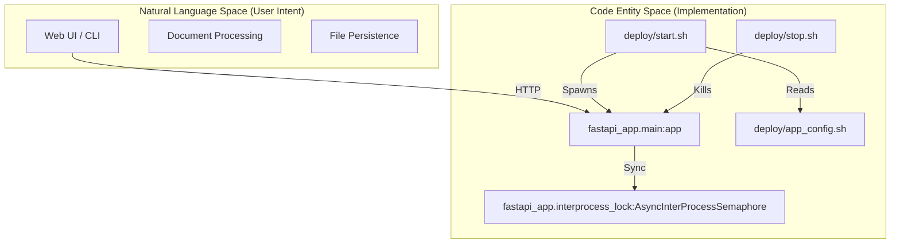
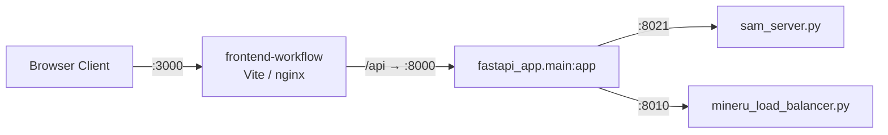

<!-- source: DeepWiki mcp.deepwiki.com · repo OpenDCAI/Paper2Any · page 12 Deployment · fetched 2026-11-02 -->

# Deployment

Relevant source files

The following files were used as context for generating this wiki page:

- [.dockerignore](.dockerignore)
- [Dockerfile](Dockerfile)
- [database/00_cleanup.sql](database/00_cleanup.sql)
- [dataflow_agent/toolkits/p2vtool/1_merge.bash](dataflow_agent/toolkits/p2vtool/1_merge.bash)
- [deploy/app_config.sh](deploy/app_config.sh)
- [deploy/start.sh](deploy/start.sh)
- [deploy/stop.sh](deploy/stop.sh)
- [fastapi_app/__init__.py](fastapi_app/__init__.py)
- [fastapi_app/interprocess_lock.py](fastapi_app/interprocess_lock.py)
- [tests/test_paper2ppt_generate_route.py](tests/test_paper2ppt_generate_route.py)

This page provides comprehensive deployment instructions for Paper2Any across different environments: local development, Docker containerized deployment, GPU-accelerated model services, and optional cloud integration with Supabase. 

For initial configuration of API keys and models, see [Configuration](#2.2). For first-time usage and running workflows, see [Quick Start](#2.3).

---

## Overview

Paper2Any supports three primary deployment modes:

| Deployment Mode | Use Case | Components Required | Complexity |
|----------------|----------|-------------------|------------|
| **Local Development** | Development, testing, single-user | Backend + Frontend | Low |
| **Docker** | Production, multi-user, easy updates | Backend + Frontend containers | Medium |
| **Full Stack + Models** | High-performance, GPU workloads | Backend + Frontend + MinerU + SAM + OCR | High |

All deployment modes can operate with or without Supabase integration. Without Supabase, the system provides full workflow functionality but lacks user authentication, quotas, and cloud storage.

---

## Deployment Architecture Options

The system architecture bridges the gap between high-level workflows and specific code entities responsible for execution.

### Natural Language to Code Entity Space

**Sources:** [fastapi_app/main.py:1-100](), [deploy/app_config.sh:1-32](), [deploy/start.sh:209-250](), [fastapi_app/interprocess_lock.py:23-31]()

---

## Port Allocation

Standard port assignments for Paper2Any services are managed via `deploy/app_config.sh` [deploy/app_config.sh:10-22]().

| Service | Port | Default Variable | Purpose |
|---------|------|------------------|---------|
| Frontend | 3000 | `FRONTEND_PORT` | Web UI |
| Backend | 8000 | `APP_PORT` | FastAPI application |
| SAM3 Server | 8021 | `SAM3_SERVER_URLS` | Segmentation service |

**Sources:** [deploy/app_config.sh:10-27](), [deploy/start.sh:198-215]()

---

## Local Development Setup

### Step 1: Environment Preparation
The system requires specific Python runtimes and system dependencies. `deploy/start.sh` performs validation using a script block to ensure `cv2`, `torch`, and `fastapi` are present [deploy/start.sh:24-38]().

### Step 2: Runtime Configuration
Configuration is derived from `deploy/app_config.sh` and can be overridden by environment variables or `logs/model_servers.env` [deploy/start.sh:16-22]().

### Step 3: Starting the Backend
The backend is typically started via `uvicorn` [fastapi_app/__init__.py:9-11](). The `deploy/start.sh` script automates this using `setsid` and `nohup` to ensure the process detaches from the shell [deploy/start.sh:218-250]().

For details, see [Local Development Setup](#12.1).

---

## Docker Deployment

The project provides a `Dockerfile` based on `python:3.11-slim` [Dockerfile:1]().

### Container Environment
The Docker image installs critical system dependencies including `inkscape`, `libreoffice`, and `wkhtmltopdf` [Dockerfile:10-30](). It exposes port `8000` for the FastAPI application [Dockerfile:39]().

### Volume Management
To ensure data persistence, the following directories should be mounted as volumes:
- `/app/outputs`: For generated artifacts.
- `/app/models`: For local model weights.

Note that `.dockerignore` excludes these directories from the build context to keep image sizes small [ .dockerignore:11-12]().

For details, see [Docker Deployment](#12.2).

---

## Model Service Deployment

Model services like MinerU and SAM require GPU allocation. The deployment scripts manage model paths for SAM3 checkpoints and RMBG models [deploy/start.sh:51-115]().

### Inter-Process Locking
When multiple workers are deployed, the system uses `AsyncInterProcessSemaphore` located in `fastapi_app/interprocess_lock.py` to manage access to shared resources using file locks in `outputs/.locks` [fastapi_app/interprocess_lock.py:15-33]().

For details, see [Model Service Deployment](#12.3).

---

## Supabase Setup

Supabase integration is used for user management, points/quota tracking, and cloud file storage.

### Database Initialization
The `database/` directory contains SQL scripts for setup. `00_cleanup.sql` is provided to reset the environment by dropping tables like `points_ledger`, `profiles`, and `usage_records` [database/00_cleanup.sql:48-54]().

### Backend Integration
The backend interacts with Supabase via `supabase_admin_service.py` and utilizes RLS (Row Level Security) policies defined in the schema to protect user data [database/00_cleanup.sql:19-21]().

For details, see [Supabase Setup](#12.4).

---

## Monitoring and Process Control

### Stopping Services
The `deploy/stop.sh` script provides a robust way to shut down the application by:
1. Checking PID files in `logs/uvicorn.pid` [deploy/stop.sh:11-14]().
2. Finding processes listening on `APP_PORT` using `lsof`, `ss`, or `netstat` [deploy/stop.sh:87-111]().
3. Sending `SIGTERM` followed by `SIGKILL` if the process group does not exit [deploy/stop.sh:131-146]().

### Logging
Logs are directed to the `logs/` directory, specifically `logs/app.log` for the main FastAPI application [deploy/start.sh:233]().

**Sources:** [deploy/stop.sh:1-164](), [deploy/start.sh:11-15]()

---

