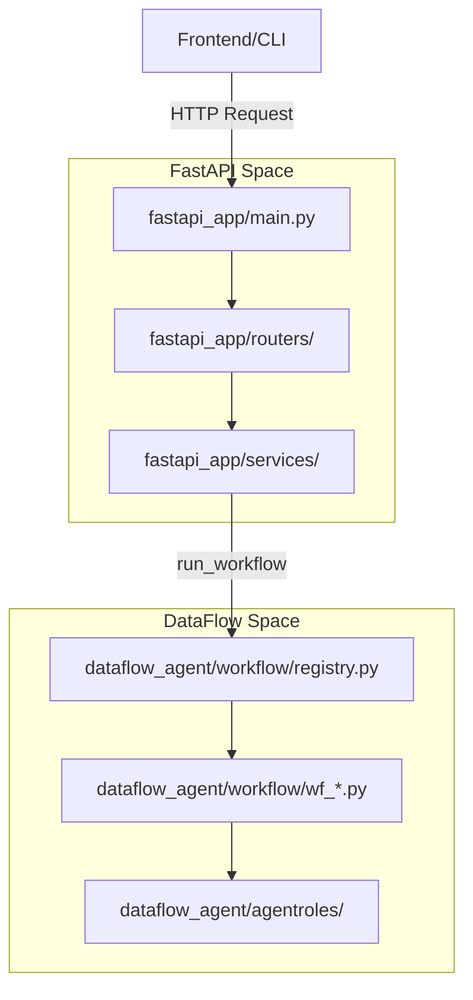
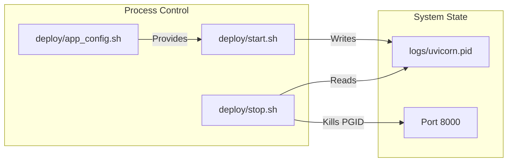

<!-- source: DeepWiki mcp.deepwiki.com · repo OpenDCAI/Paper2Any · page 12.1 Local Development Setup · fetched 2026-11-02 -->

# Local Development Setup

<details>
<summary>Relevant source files</summary>

The following files were used as context for generating this wiki page:

- [dataflow_agent/toolkits/p2vtool/1_merge.bash](dataflow_agent/toolkits/p2vtool/1_merge.bash)
- [deploy/app_config.sh](deploy/app_config.sh)
- [deploy/start.sh](deploy/start.sh)
- [deploy/stop.sh](deploy/stop.sh)
- [docs/contributing.md](docs/contributing.md)
- [docs/guides/index.md](docs/guides/index.md)
- [docs/guides/open_source_deployment.md](docs/guides/open_source_deployment.md)
- [docs/index.md](docs/index.md)
- [docs/installation.md](docs/installation.md)
- [docs/quickstart.md](docs/quickstart.md)
- [fastapi_app/__init__.py](fastapi_app/__init__.py)
- [fastapi_app/interprocess_lock.py](fastapi_app/interprocess_lock.py)
- [mkdocs.yml](mkdocs.yml)
- [tests/test_paper2ppt_generate_route.py](tests/test_paper2ppt_generate_route.py)

</details>


This page provides a step-by-step guide for setting up a local development environment for Paper2Any with hot reload capabilities. This setup is optimized for rapid iteration during feature development and debugging.

---

## Purpose and Prerequisites

### Development Environment Goals

A proper local development setup enables:
- **Backend hot reload**: FastAPI automatically restarts when Python files change.
- **Frontend hot module replacement (HMR)**: React components update instantly via Vite.
- **Environment Selection**: Flexible switching between minimal, full local, or Docker-based routes.
- **Process Management**: Clean start/stop of uvicorn and model workers using the `deploy/` script system.

### Prerequisites

| Requirement | Version | Purpose |
|------------|---------|---------|
| Python | 3.11 | Backend and Model Service runtime [docs/installation.md:33]() |
| Node.js | 20 | Frontend build tools and Vite dev server [docs/installation.md:34]() |
| Conda | Latest | Recommended for Python environment isolation [docs/quickstart.md:21]() |
| OS | Linux | Recommended for system dependencies like LibreOffice [docs/installation.md:36]() |

Sources: [docs/installation.md:12-38](), [docs/quickstart.md:21-39]()

---

## Backend Development Setup

### Directory Structure & Data Flow

The backend architecture separates the FastAPI service layer from the underlying DataFlow-Agent framework.



Sources: [docs/index.md:101-114](), [fastapi_app/__init__.py:13-17](), [docs/contributing.md:54-66]()

### Step 1: Create Python Environment

The project requires Python 3.11. Use Conda to create an isolated environment.

```bash
conda create -n paper2any python=3.11 -y
conda activate paper2any

pip install --upgrade pip
pip install -r requirements-paper.txt || pip install -r requirements-paper-backup.txt
```

Sources: [docs/quickstart.md:19-29](), [docs/installation.md:68-76]()

### Step 2: Configure Environment Variables

Paper2Any uses a three-tier configuration system:
1. `fastapi_app/.env`: Core backend settings (API keys, billing mode).
2. `frontend-workflow/.env`: Frontend UI and API base URL settings.
3. `deploy/profiles/*.env`: Deployment-specific overrides (GPU allocation, model paths).

```bash
cp fastapi_app/.env.example fastapi_app/.env
cp frontend-workflow/.env.example frontend-workflow/.env
cp deploy/profiles/nv.env.example deploy/profiles/nv.env
```

**Critical Variables in `fastapi_app/.env`:**
- `BACKEND_API_KEY`: Must match frontend `VITE_API_KEY` [docs/quickstart.md:69]().
- `APP_BILLING_MODE`: Set to `free` for local dev without Supabase [docs/quickstart.md:55]().
- `DF_API_URL` & `DF_API_KEY`: Credentials for the LLM provider [docs/quickstart.md:56-58]().

Sources: [docs/index.md:57-63](), [docs/quickstart.md:41-72]()

### Step 3: Run Backend with Hot Reload

The project provides a deployment script `deploy/start.sh` which handles environment validation and PID management.

```bash
bash deploy/start.sh
```

**Implementation Details:**
- **Environment Resolution**: `deploy/start.sh` calls `resolve_python` to find the Conda environment specified in `deploy/app_config.sh` [deploy/start.sh:117-154]().
- **Process Decoupling**: Uses `setsid` and `nohup` to detach the FastAPI process from the current shell session [deploy/start.sh:217-250]().
- **Worker Locking**: Uses `AsyncInterProcessSemaphore` (based on `fcntl.flock`) to manage hardware-constrained tasks across uvicorn workers [fastapi_app/interprocess_lock.py:23-50]().

Sources: [deploy/start.sh:209-253](), [fastapi_app/interprocess_lock.py:23-50]()

---

## Frontend Development Setup

### Step 1: Install Node Dependencies

```bash
cd frontend-workflow
npm ci
```

Sources: [docs/quickstart.md:31-39](), [docs/installation.md:84-90]()

### Step 2: Run Frontend

```bash
bash deploy/start_frontend.sh
```

By default, the frontend runs on `http://127.0.0.1:3000` and proxies API requests to `http://127.0.0.1:8000` [docs/index.md:74-77]().

---

## Deployment Routes

Paper2Any supports three distinct setup routes depending on resource availability.

### 1. Minimal Route (LLM-Only)
- **Components**: Frontend + Backend.
- **Models**: All heavy lifting (OCR, Parsing, VLM) is offloaded to remote LLM APIs (e.g., GPT-4o, Gemini).
- **Setup**: Follow the [Quick Start](#Step-2:-Configure-Environment-Variables) steps exactly.

### 2. Full Local Route (GPU Required)
- **Components**: Frontend + Backend + Local Model Servers (SAM3, MinerU, PaddleOCR).
- **Setup**:
  1. Run `bash script/prepare_local_models.sh` to download weights [docs/contributing.md:50]().
  2. Configure `deploy/profiles/nv.env` with GPU IDs.
  3. Run `bash script/start_model_servers.sh` [docs/contributing.md:51]().

### 3. Docker Route
- **Components**: All services containerized.
- **Setup**: Uses `docker-compose.yml` to orchestrate frontend, backend, and model workers with volume mounts for `outputs/` and `models/`.

Sources: [docs/index.md:79-81](), [docs/quickstart.md:97-110](), [docs/installation.md:92-104]()

---

## Key Development Components

### Process Management

The `deploy/` scripts maintain system state using PID files and port checks.



Sources: [deploy/start.sh:252](), [deploy/stop.sh:11-30](), [deploy/app_config.sh:9-16]()

### Inter-Process Communication

When multiple uvicorn workers are running, hardware resources (like a single GPU for SAM3) are protected by file-based locks.

- **Class**: `AsyncInterProcessSemaphore` [fastapi_app/interprocess_lock.py:23]()
- **Mechanism**: `fcntl.flock` on files in `outputs/.locks/` [fastapi_app/interprocess_lock.py:15-40]()
- **Usage**: Services use the `@asynccontextmanager` `hold()` to ensure exclusive access [fastapi_app/interprocess_lock.py:64-71]().

Sources: [fastapi_app/interprocess_lock.py:12-71]()

---

## Verification & Health Checks

After starting the services, verify the environment:

1. **Backend Health**: `GET http://127.0.0.1:8000/health` [docs/quickstart.md:88]()
2. **Runtime Config**: 
   ```bash
   curl -H "X-API-Key: your-key" http://127.0.0.1:8000/api/v1/account/runtime-config
   ```
   [docs/quickstart.md:92-95]()
3. **Frontend Access**: Open `http://127.0.0.1:3000` in a browser [docs/quickstart.md:87]().

Sources: [docs/quickstart.md:85-96]()

---

