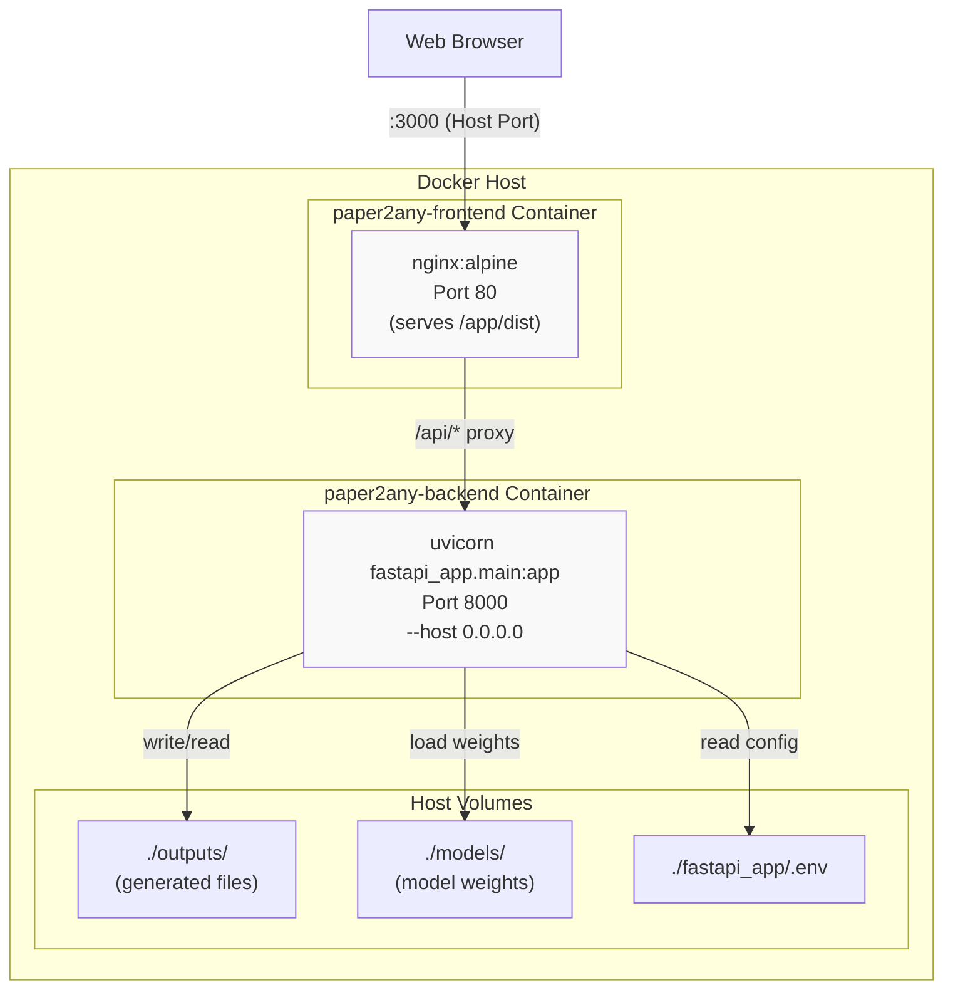
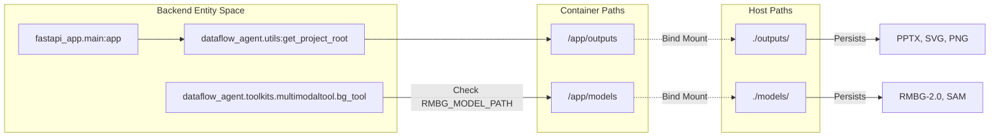

<!-- source: DeepWiki mcp.deepwiki.com · repo OpenDCAI/Paper2Any · page 12.2 Docker Deployment · fetched 2026-11-02 -->

# Docker Deployment

Relevant source files

The following files were used as context for generating this wiki page:

- [.dockerignore](.dockerignore)
- [Dockerfile](Dockerfile)
- [database/00_cleanup.sql](database/00_cleanup.sql)
- [dataflow_agent/toolkits/multimodaltool/bg_tool.py](dataflow_agent/toolkits/multimodaltool/bg_tool.py)
- [dataflow_agent/workflow/wf_paper2page_content.py](dataflow_agent/workflow/wf_paper2page_content.py)
- [dataflow_agent/workflow/wf_paper2page_content_for_long_paper.py](dataflow_agent/workflow/wf_paper2page_content_for_long_paper.py)
- [docker-compose.yml](docker-compose.yml)
- [frontend-workflow/Dockerfile](frontend-workflow/Dockerfile)
- [frontend-workflow/src/components/ParticleBackground.tsx](frontend-workflow/src/components/ParticleBackground.tsx)
- [frontend-workflow/src/components/knowledge-base/tools/MermaidPreview.tsx](frontend-workflow/src/components/knowledge-base/tools/MermaidPreview.tsx)
- [frontend-workflow/src/types/index.ts](frontend-workflow/src/types/index.ts)

This document describes the Docker-based deployment strategy for Paper2Any using Docker Compose. It covers the container architecture, volume mounting, environment configuration, and operational procedures for running both frontend and backend services in isolated containers.

---

## Container Architecture

Paper2Any uses a two-container architecture managed by Docker Compose: a frontend container running the React/Vite application (served via Nginx in production) and a backend container running the FastAPI server.

Title: Docker Deployment Component Interaction

Sources: [docker-compose.yml:1-34](), [Dockerfile:1-42](), [frontend-workflow/Dockerfile:1-19]()

---

## Docker Configuration Structure

### Backend Dockerfile (`Dockerfile`)
The backend image is based on `python:3.11-slim` and includes heavy system dependencies required for document processing, such as `libreoffice` for PPT conversion and `inkscape` for SVG handling [Dockerfile:1-25](). It also installs `wkhtmltopdf` manually to ensure compatibility [Dockerfile:26-30]().

### Frontend Dockerfile (`frontend-workflow/Dockerfile`)
The frontend uses a multi-stage build [frontend-workflow/Dockerfile:1-19]():
1.  **Build Stage**: Uses `node:20-alpine` to run `npm run build`, generating static assets in `/app/dist`.
2.  **Production Stage**: Uses `nginx:alpine` to serve the static files. It copies a custom `nginx.conf` to handle routing and API proxying [frontend-workflow/Dockerfile:13-16]().

### Docker Compose (`docker-compose.yml`)
The compose file orchestrates the two services and manages persistent storage [docker-compose.yml:1-34]().

| Service | Container Name | Port Mapping | Key Volumes |
| :--- | :--- | :--- | :--- |
| `paper2any-backend` | `paper2any-backend` | Host Network | `./outputs`, `./models`, `./fastapi_app/.env` |
| `paper2any-frontend` | `paper2any-frontend` | `3000:80` | N/A (Build-time ENV) |

**Note**: The backend uses `network_mode: host` to simplify communication with local model servers (MinerU/SAM) that might be running on the host GPU [docker-compose.yml:9]().

Sources: [docker-compose.yml:1-34](), [Dockerfile:1-42](), [frontend-workflow/Dockerfile:1-19]()

---

## Volume Mount & Data Flow

The backend relies on host-mounted volumes to manage large assets and persistent user data.

Title: Data Flow and Persistence

### Mounted Directories
*   **`/app/outputs`**: Maps to `./outputs`. This is where workflows like `paper2page_content` create timestamped directories for task results [dataflow_agent/workflow/wf_paper2page_content.py:23-40]().
*   **`/app/models`**: Maps to `./models`. Used by tools like `bg_tool.py` to load the `RMBG-2.0` model. The environment variable `RMBG_MODEL_PATH` is explicitly set to this path in `docker-compose.yml` [docker-compose.yml:12](), [dataflow_agent/toolkits/multimodaltool/bg_tool.py:35-37]().

Sources: [docker-compose.yml:13-16](), [dataflow_agent/workflow/wf_paper2page_content.py:23-40](), [dataflow_agent/toolkits/multimodaltool/bg_tool.py:33-42]()

---

## Environment Variable Injection

### Backend Runtime Config
The backend loads configuration from `./fastapi_app/.env` at runtime via a bind mount [docker-compose.yml:16](). This allows changing API keys or model settings without rebuilding the image.

### Frontend Build-time Config
Vite requires environment variables to be present during the build process to be bundled into the client-side code. These are passed as `args` in the `docker-compose.yml` [docker-compose.yml:23-27]():
*   `VITE_API_KEY`: Internal security key.
*   `VITE_API_BASE_URL`: The endpoint the frontend uses to contact the backend.

Sources: [docker-compose.yml:20-27](), [frontend-workflow/Dockerfile:8-11]()

---

## .dockerignore Configuration

To keep image sizes small and prevent sensitive data leakage, the `.dockerignore` file excludes several directories [ .dockerignore:1-20]():
*   **Build Artifacts**: `node_modules/`, `dist/`, `__pycache__/`.
*   **Data/Models**: `outputs/`, `models/` (these are handled via volumes).
*   **Environment**: `.git`, `.gitignore`, `tests/`.

Sources: [.dockerignore:1-20]()

---

## Operational Procedures

### Deployment Steps
1.  **Configure Environment**: Ensure `fastapi_app/.env` and `frontend-workflow/.env` are populated.
2.  **Launch**: Execute `docker compose up -d --build`.
3.  **Verify**:
    *   Frontend: `http://localhost:3000`
    *   Backend: `http://localhost:8000/docs` (Swagger UI)

### Handling Model Downloads
The `bg_tool.py` includes an `ensure_model` function that will attempt to download `RMBG-2.0` from ModelScope if it is missing from the `/app/models` directory [dataflow_agent/toolkits/multimodaltool/bg_tool.py:72-115](). Because of the volume mount, this download only happens once.

Sources: [dataflow_agent/toolkits/multimodaltool/bg_tool.py:72-115](), [docker-compose.yml:15]()

---

