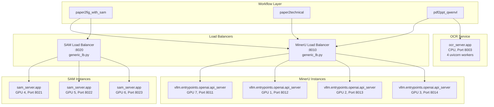
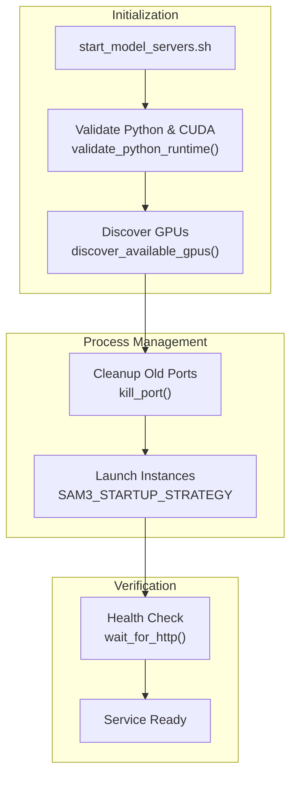

<!-- source: DeepWiki mcp.deepwiki.com · repo OpenDCAI/Paper2Any · page 12.3 Model Service Deployment · fetched 2026-11-02 -->

# Model Service Deployment

<details>
<summary>Relevant source files</summary>

The following files were used as context for generating this wiki page:

- [dataflow_agent/toolkits/model_servers/sam_server.py](dataflow_agent/toolkits/model_servers/sam_server.py)
- [script/start_model_servers.sh](script/start_model_servers.sh)

</details>


This document covers the deployment and configuration of local AI model servers that provide GPU-accelerated processing capabilities for Paper2Any workflows. These services include MinerU (vLLM-based VLM), SAM (Segment Anything Model), and OCR (PaddleOCR).

For information about integrating external LLM providers (OpenAI, Gemini, DeepSeek), see [LLM Integration](#8.4). For information about using these services within workflows, see [Model Services](#8).

## Architecture Overview

Paper2Any deploys three categories of local model services to optimize cost and latency for compute-intensive operations:

| Service | Purpose | Technology | Port | Workers | GPU |
|---------|---------|------------|------|---------|-----|
| MinerU | PDF parsing, VLM inference | vLLM + MinerU models | 8010 (LB) | 4 instances | Yes |
| SAM | Image segmentation, layout extraction | Segment Anything Model | 8020 (LB) | 3 instances | Yes |
| OCR | Text recognition from images | PaddleOCR | 8003 | 4 workers | No |

Each GPU-accelerated service (MinerU, SAM) runs multiple instances behind a load balancer to maximize throughput. The system follows a "One GPU, One Instance" principle for optimal resource utilization.

**Service Integration in Workflows**



Sources: [script/start_model_servers.sh:1-42](), [dataflow_agent/toolkits/model_servers/sam_server.py:24-38]()

## MinerU vLLM Deployment

MinerU provides vision-language model capabilities for PDF parsing and content extraction. The system deploys multiple vLLM instances, each dedicated to a single GPU.

### Instance Configuration

**MinerU vLLM Parameters**

```bash
CUDA_VISIBLE_DEVICES=$gpu_id python3 -m vllm.entrypoints.openai.api_server \
    --model "models/MinerU2.5-2509-1.2B" \
    --served-model-name "mineru" \
    --host 127.0.0.1 \
    --port $port \
    --logits-processors mineru_vl_utils:MinerULogitsProcessor \
    --gpu-memory-utilization 0.85 \
    --max-num-seqs 64 \
    --trust-remote-code \
    --enforce-eager
```

| Parameter | Value | Purpose |
|-----------|-------|---------|
| `--model` | `models/MinerU2.5-2509-1.2B` | Model weights path |
| `--served-model-name` | `mineru` | API endpoint identifier |
| `--gpu-memory-utilization` | `0.85` | Reserve 85% GPU memory for model |
| `--max-num-seqs` | `64` | Maximum concurrent sequences |
| `--logits-processors` | `mineru_vl_utils:MinerULogitsProcessor` | Custom token processing |
| `--enforce-eager` | - | Disable CUDA graph optimization |
| `--trust-remote-code` | - | Allow model custom code execution |

### GPU Allocation Strategy

The deployment script [script/start_model_servers.sh:25]() defines GPU allocation via environment variables. The script uses `discover_available_gpus` [script/start_model_servers.sh:147-194]() to identify usable hardware, supporting `nvidia-smi`, `mx-smi`, or `torch` direct queries.

By default, the script calculates backend URLs for the load balancer based on assigned ports [script/start_model_servers.sh:49-73]().

### Model Dependencies

MinerU requires a validated Python environment [script/start_model_servers.sh:104-112]() with:
- `cv2`
- `fastapi`
- `torch` (with CUDA support)
- `uvicorn`

Sources: [script/start_model_servers.sh:104-194]()

## SAM Server Deployment

The Segment Anything Model (SAM) service provides image segmentation for layout analysis and icon extraction. 

### Instance Configuration

Each SAM instance runs as a FastAPI application [dataflow_agent/toolkits/model_servers/sam_server.py:24](). It utilizes the `SAMRequest` schema [dataflow_agent/toolkits/model_servers/sam_server.py:39-42]() which accepts an `image_path`, `checkpoint`, and `device`.

The server implements aggressive memory management:
- **Empty Cache**: Calls `torch.cuda.empty_cache()` in the `finally` block of the `predict` function [dataflow_agent/toolkits/model_servers/sam_server.py:109-110]().
- **Model Freeing**: Provides a `/free_model` endpoint to release specific checkpoints from VRAM [dataflow_agent/toolkits/model_servers/sam_server.py:112-118]().

### Request and Response Models

| Entity | Description |
|--------|-------------|
| `SAMRequest` | Input containing `image_path` and `checkpoint` [dataflow_agent/toolkits/model_servers/sam_server.py:39-42]() |
| `SAMItemResponse` | Output per mask, including `mask_b64` (zlib compressed), `bbox`, and `area` [dataflow_agent/toolkits/model_servers/sam_server.py:44-50]() |
| `SAMResponse` | List of `SAMItemResponse` objects [dataflow_agent/toolkits/model_servers/sam_server.py:51-52]() |

### GPU Allocation

The `start_model_servers.sh` script manages SAM instances via `SAM3_GPUS` [script/start_model_servers.sh:24](). It uses `build_sam3_launch_gpu_ids` [script/start_model_servers.sh:239-243]() to map instances to specific hardware IDs.

Sources: [dataflow_agent/toolkits/model_servers/sam_server.py:39-122](), [script/start_model_servers.sh:239-243]()

## OCR Server Deployment

The OCR service uses PaddleOCR for text recognition from images and PDF pages.

### Service Configuration

The OCR server configuration in `start_model_servers.sh` [script/start_model_servers.sh:38-41]() defaults to:
- **Port**: 8003
- **Workers**: 1 (configurable via `OCR_WORKERS`)
- **Host**: `127.0.0.1`

### Usage in Workflows

The OCR service is launched as part of the unified model server lifecycle. It performs a health check via `wait_for_http` [script/start_model_servers.sh:114-131]() during startup to ensure the endpoint is responsive before the main application starts.

Sources: [script/start_model_servers.sh:38-41](), [script/start_model_servers.sh:114-131]()

## Load Balancing Architecture

The system implements a custom round-robin load balancer to distribute requests across model instances.

### Load Balancer Implementation

The script manages port listeners using `find_port_listener_pids` [script/start_model_servers.sh:49-73]() and `kill_port` [script/start_model_servers.sh:75-84]() to ensure a clean state before starting the load balancer.

### Startup and Management

The `start_model_servers.sh` script automates the entire lifecycle:

1. **Environment Setup**: Detects Python path and asset roots [script/start_model_servers.sh:13-18]().
2. **GPU Discovery**: Automatically identifies available GPUs using the `discover_available_gpus` function [script/start_model_servers.sh:147-194]().
3. **Asset Preparation**: Validates SAM3 paths (checkpoints, BPE vocab) using `prepare_sam3_paths` [script/start_model_servers.sh:196-237]().
4. **Health Monitoring**: Uses `wait_for_http` [script/start_model_servers.sh:114-131]() to verify each instance is ready.

**Service Management Flow**



Sources: [script/start_model_servers.sh:13-237](), [dataflow_agent/toolkits/model_servers/sam_server.py:120-122]()

---

