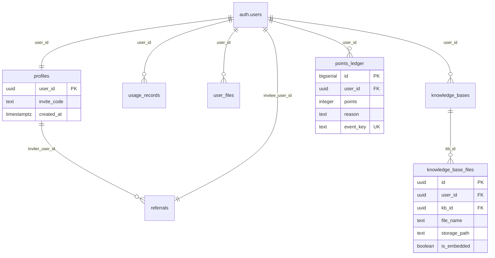
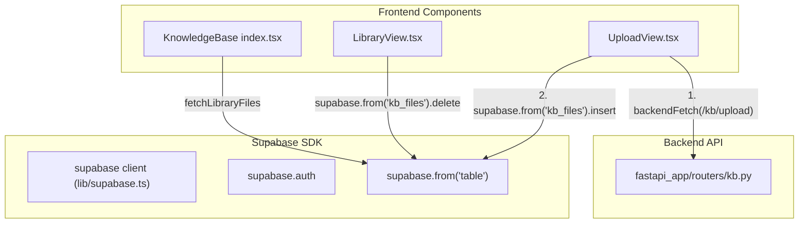

<!-- source: DeepWiki mcp.deepwiki.com · repo OpenDCAI/Paper2Any · page 12.4 Supabase Setup · fetched 2026-11-02 -->

# Supabase Setup

Relevant source files

The following files were used as context for generating this wiki page:

- [database/01_init_schema.sql](database/01_init_schema.sql)
- [dataflow_agent/workflow/wf_kb_podcast.py](dataflow_agent/workflow/wf_kb_podcast.py)
- [fastapi_app/routers/kb.py](fastapi_app/routers/kb.py)
- [fastapi_app/services/supabase_admin_service.py](fastapi_app/services/supabase_admin_service.py)
- [frontend-workflow/src/components/knowledge-base/LibraryView.tsx](frontend-workflow/src/components/knowledge-base/LibraryView.tsx)
- [frontend-workflow/src/components/knowledge-base/OutputView.tsx](frontend-workflow/src/components/knowledge-base/OutputView.tsx)
- [frontend-workflow/src/components/knowledge-base/UploadView.tsx](frontend-workflow/src/components/knowledge-base/UploadView.tsx)
- [frontend-workflow/src/components/knowledge-base/index.tsx](frontend-workflow/src/components/knowledge-base/index.tsx)
- [frontend-workflow/src/components/knowledge-base/tools/MindMapTool.tsx](frontend-workflow/src/components/knowledge-base/tools/MindMapTool.tsx)
- [frontend-workflow/src/components/knowledge-base/tools/PodcastTool.tsx](frontend-workflow/src/components/knowledge-base/tools/PodcastTool.tsx)
- [frontend-workflow/src/components/knowledge-base/tools/PptTool.tsx](frontend-workflow/src/components/knowledge-base/tools/PptTool.tsx)
- [frontend-workflow/src/lib/supabase.ts](frontend-workflow/src/lib/supabase.ts)

This page documents the process of setting up Supabase for Paper2Any, including project creation, schema migration, Row Level Security (RLS) policies, administrative services, and environment variable configuration. Supabase provides authentication, a PostgreSQL database, object storage, and Edge Functions for the application.

---

## Overview

Paper2Any uses Supabase as a backend-as-a-service provider to handle user-centric features. The system is designed to be "Supabase-optional"; if credentials are not provided, it falls back to a local-only mode with unlimited quotas.

**Key Roles of Supabase:**
- **Authentication**: Managed via Supabase Auth (Email, Phone OTP, OAuth).
- **Database**: PostgreSQL stores user profiles, points/quotas, and metadata for knowledge base files.
- **Storage**: Object storage for user-uploaded assets and generated workflow outputs.
- **Admin Service**: A Python-based service role client for backend-initiated database operations.

Sources: [frontend-workflow/src/lib/supabase.ts:1-42](), [fastapi_app/services/supabase_admin_service.py:11-28]()

---

## Database Schema Migration

The core database structure is defined in `database/01_init_schema.sql`. This script must be executed in the Supabase SQL Editor to initialize the environment.

### Schema Architecture

The following diagram illustrates the relationship between Supabase Auth entities and the application-specific tables defined in the schema.

**Diagram: Database Entity Relationship Mapping**

Sources: [database/01_init_schema.sql:41-168](), [database/01_init_schema.sql:214-283]()

### Key Tables and Logic
- **`usage_records`**: Tracks every workflow call for analytics [database/01_init_schema.sql:41-46]().
- **`user_files`**: Stores metadata for generated outputs like PPTs or Figures [database/01_init_schema.sql:68-76]().
- **`knowledge_base_files`**: Tracks files uploaded to the Knowledge Base system, including their embedding status and storage paths [database/01_init_schema.sql:155-168]().
- **`points_balance` (View)**: A virtual table that aggregates the `points_ledger` to provide real-time user balances [database/01_init_schema.sql:289-297]().

---

## Row Level Security (RLS)

Security is enforced at the database level using RLS policies. This ensures that even if a user bypasses the frontend, they can only access their own data.

### Policy Implementation Examples
The schema applies specific policies to the `knowledge_base_files` table to isolate user data:

| Operation | Policy Name | Logic |
|-----------|-------------|-------|
| **SELECT** | "Users can view own KB files" | `auth.uid() = user_id` |
| **INSERT** | "Users can insert own KB files" | `auth.uid() = user_id` |
| **DELETE** | "Users can delete own KB files" | `auth.uid() = user_id` |

Sources: [database/01_init_schema.sql:181-203]()

---

## Backend Integration: Supabase Admin Service

While the frontend uses the standard `anon` key, the FastAPI backend occasionally requires elevated privileges (bypassing RLS) for administrative tasks. This is handled by `fastapi_app/services/supabase_admin_service.py`.

### Implementation Details
- **`get_supabase_admin_client()`**: Initializes a singleton Supabase `Client` using the `SUPABASE_SERVICE_ROLE_KEY` [fastapi_app/services/supabase_admin_service.py:14-28]().
- **Timeout Configuration**: Uses `SUPABASE_POSTGREST_TIMEOUT_SECONDS` from settings to manage request durations [fastapi_app/services/supabase_admin_service.py:22-25]().

Sources: [fastapi_app/services/supabase_admin_service.py:11-33]()

---

## Frontend Data Flow

The frontend interacts with Supabase primarily through the `KnowledgeBase` component and its sub-views.

**Diagram: Knowledge Base Data Flow with Supabase**

### File Upload Process
1. **Backend Upload**: The file is first sent to the FastAPI backend via `backendFetch('/api/v1/kb/upload')` to be processed and stored on the server's local filesystem or cloud volume [frontend-workflow/src/components/knowledge-base/UploadView.tsx:104-116]().
2. **Metadata Registration**: Upon successful backend storage, the frontend calls `supabase.from('knowledge_base_files').insert()` to register the file's metadata and `storage_path` in the Supabase database [frontend-workflow/src/components/knowledge-base/UploadView.tsx:119-129]().

Sources: [frontend-workflow/src/components/knowledge-base/index.tsx:143-171](), [frontend-workflow/src/components/knowledge-base/UploadView.tsx:95-138]()

---

## Environment Variable Configuration

To enable Supabase integration, the following variables must be configured in the respective `.env` files.

### Frontend (`frontend-workflow/.env`)
- `VITE_SUPABASE_URL`: The project URL from the Supabase dashboard [frontend-workflow/src/lib/supabase.ts:11]().
- `VITE_SUPABASE_ANON_KEY`: The public anonymous key [frontend-workflow/src/lib/supabase.ts:12]().

### Backend (`fastapi_app/.env`)
- `SUPABASE_URL`: Project URL for admin service [fastapi_app/services/supabase_admin_service.py:18]().
- `SUPABASE_SERVICE_ROLE_KEY`: Secret key for administrative access [fastapi_app/services/supabase_admin_service.py:19]().
- `SUPABASE_POSTGREST_TIMEOUT_SECONDS`: (Optional) Timeout for DB queries [fastapi_app/services/supabase_admin_service.py:22]().

Sources: [frontend-workflow/src/lib/supabase.ts:11-30](), [fastapi_app/services/supabase_admin_service.py:17-26]()

---

## Knowledge Base Logic

The `fastapi_app/routers/kb.py` router manages the server-side logic for the Knowledge Base, while Supabase tracks the ownership.

- **Identity Resolution**: The backend uses `_resolve_kb_identity` to extract the user's email and ID from the auth context [fastapi_app/routers/kb.py:87-88]().
- **Path Security**: `_ensure_path_within_roots` ensures that users can only access files within their assigned directories (`outputs/kb_data/{email}/`), mirroring the isolation provided by Supabase RLS [fastapi_app/routers/kb.py:101-109]().

Sources: [fastapi_app/routers/kb.py:73-114]()

---

