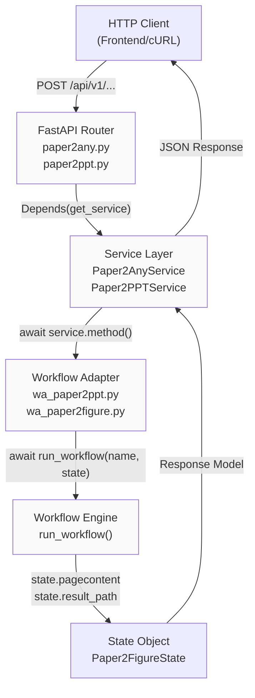
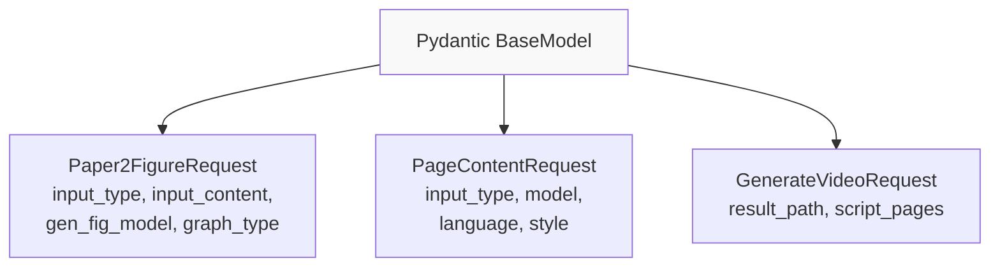
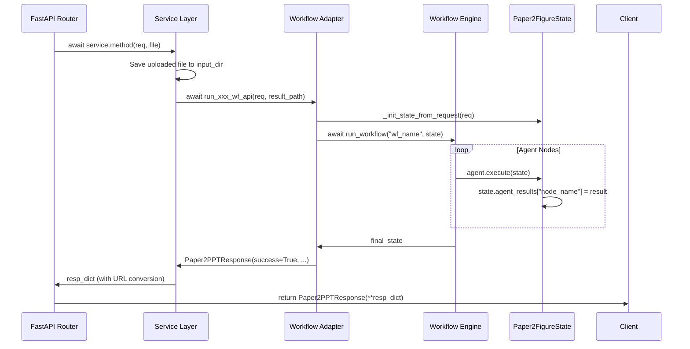

<!-- source: DeepWiki mcp.deepwiki.com · repo OpenDCAI/Paper2Any · page 13 API Reference · fetched 2026-11-02 -->

# API Reference

<details>
<summary>Relevant source files</summary>

The following files were used as context for generating this wiki page:

- [.gitignore](.gitignore)
- [dataflow_agent/workflow/wf_paper2ppt_parallel_consistent_style.py](dataflow_agent/workflow/wf_paper2ppt_parallel_consistent_style.py)
- [fastapi_app/main.py](fastapi_app/main.py)
- [fastapi_app/middleware/api_key.py](fastapi_app/middleware/api_key.py)
- [fastapi_app/routers/__init__.py](fastapi_app/routers/__init__.py)
- [fastapi_app/routers/paper2any.py](fastapi_app/routers/paper2any.py)
- [fastapi_app/routers/paper2ppt.py](fastapi_app/routers/paper2ppt.py)
- [fastapi_app/schemas.py](fastapi_app/schemas.py)
- [fastapi_app/services/paper2ppt_frontend_service.py](fastapi_app/services/paper2ppt_frontend_service.py)
- [fastapi_app/services/paper2ppt_service.py](fastapi_app/services/paper2ppt_service.py)
- [fastapi_app/workflow_adapters/wa_paper2ppt.py](fastapi_app/workflow_adapters/wa_paper2ppt.py)
- [frontend-workflow/src/components/paper2ppt/GenerateStep.tsx](frontend-workflow/src/components/paper2ppt/GenerateStep.tsx)
- [frontend-workflow/src/components/paper2ppt/index.tsx](frontend-workflow/src/components/paper2ppt/index.tsx)
- [frontend-workflow/vite.config.ts](frontend-workflow/vite.config.ts)

</details>


## Purpose and Scope

This document provides a comprehensive reference for the Paper2Any REST API, including endpoint specifications, request/response schemas, authentication patterns, and common conventions. The API is built using **FastAPI** [fastapi_app/main.py:30-30]() and exposes multiple workflow categories for document processing, figure generation, and knowledge base operations.

For detailed endpoint specifications by feature area, see:
- [Paper2Figure API](#13.1)
- [Paper2PPT API](#13.2)
- [PDF2PPT API](#13.3)
- [Knowledge Base API](#13.4)
- [Error Handling](#13.5)

For configuration and setup information, see [Configuration](#2.2).

---

## API Architecture Overview

The Paper2Any API follows a layered architecture where HTTP requests flow through routers, services, and workflow adapters before invoking agent-based workflows.

### High-Level Request Flow



**Sources:** [fastapi_app/routers/paper2any.py:11-17](), [fastapi_app/routers/paper2ppt.py:31-46](), [fastapi_app/services/paper2ppt_service.py:143-155](), [fastapi_app/workflow_adapters/wa_paper2ppt.py:1-11]()

---

## Base URL and Versioning

All API endpoints are prefixed with `/api/v1/` [fastapi_app/main.py:88-114](). The API does not use HTTP version headers; versioning is path-based.

| Environment | Base URL |
|-------------|----------|
| Local Development | `http://localhost:8000/api/v1/` |
| Production | `https://your-domain.com/api/v1/` |

The frontend proxies requests through `/api/*` to avoid CORS issues during development [frontend-workflow/vite.config.ts:29-38]().

**Sources:** [fastapi_app/main.py:88-114](), [frontend-workflow/vite.config.ts:29-38]()

---

## Common Request Patterns

### Pydantic Schema Hierarchy

All request models inherit from `BaseModel` and follow a structured field pattern for core settings like `chat_api_url` and `api_key` [fastapi_app/schemas.py:5-32]().



**Sources:** [fastapi_app/schemas.py:94-182](), [fastapi_app/schemas.py:208-221](), [fastapi_app/schemas.py:60-66]()

### Core Request Fields

The following fields appear in virtually all API requests:

| Field | Type | Required | Description |
|-------|------|----------|-------------|
| `chat_api_url` | `str` | Yes | LLM API endpoint URL (OpenAI-compatible) |
| `api_key` | `str` | Yes | API key for `chat_api_url` |
| `model` | `str` | No | LLM model name (e.g., `gpt-4o`) |
| `language` | `str` | No | Output language (`"en"` or `"zh"`) |
| `email` | `str` | No | User email for quota and output tracking |

**Sources:** [fastapi_app/schemas.py:108-128](), [fastapi_app/schemas.py:210-218]()

### File Upload Handling

Endpoints accepting file uploads use **FastAPI's `UploadFile`** with `multipart/form-data` encoding [fastapi_app/routers/paper2any.py:43-58](). Files are saved to a timestamped directory under `outputs/{email}/{workflow}/{timestamp}/input/` [fastapi_app/services/paper2ppt_service.py:203-208]().

**Example: Uploading a PDF for Paper2Figure**

```python
# Router endpoint signature
@router.post("/paper2figure/generate-json")
async def generate_paper2figure_json(
    request: Request,
    img_gen_model_name: str = Form(...),
    chat_api_url: Optional[str] = Form(None),
    api_key: Optional[str] = Form(None),
    file: Optional[UploadFile] = File(None),
    # ... other fields
):
```

**Sources:** [fastapi_app/routers/paper2any.py:84-106](), [fastapi_app/services/paper2ppt_service.py:203-208]()

---

## Common Response Patterns

### Response Models

All responses use Pydantic models for validation. Successful responses typically include:

| Field | Type | Description |
|-------|------|-------------|
| `success` | `bool` | `True` if workflow completed successfully |
| `result_path` | `str` | Server-side output directory (internal use) |
| `all_output_files` | `List[str]` | List of output file URLs (browser-accessible) |
| `error` | `Optional[str]` | Error message if `success=False` |

**Example: `Paper2FigureResponse`**

```python
class Paper2FigureResponse(BaseModel):
    success: bool
    error: Optional[str] = None
    ppt_filename: str = ""  # PPTX output URL
    svg_filename: str = ""  # SVG source (for tech route diagrams)
    all_output_files: List[str] = []  # All generated files
```

**Sources:** [fastapi_app/schemas.py:192-204]()

### Path-to-URL Conversion

The service layer converts local file paths to browser-accessible URLs using `_to_outputs_url()` [fastapi_app/utils.py](). This function resolves relative paths to the `outputs/` directory and prepends the request's base URL [fastapi_app/services/paper2ppt_service.py:143-155]().

**Sources:** [fastapi_app/utils.py](), [fastapi_app/services/paper2ppt_service.py:143-155]()

---

## State Management Flow

Workflows operate on **state objects** (e.g., `Paper2FigureState`) that accumulate results as they flow through agent nodes [dataflow_agent/workflow/wf_paper2ppt_parallel_consistent_style.py:112-173]().



**Sources:** [fastapi_app/workflow_adapters/wa_paper2ppt.py:72-123](), [dataflow_agent/workflow/wf_paper2ppt_parallel_consistent_style.py:112-173]()

---

## Authentication and Quota Management

### API Key Validation

The backend includes `APIKeyMiddleware` to verify access [fastapi_app/middleware/api_key.py](). Additionally, the `/system/verify-llm` endpoint allows testing LLM credentials before starting heavy workflows [fastapi_app/routers/paper2any.py:20-28]().

**Sources:** [fastapi_app/middleware/api_key.py](), [fastapi_app/routers/paper2any.py:20-28]()

### Quota System Integration

Endpoints consume "points" based on the complexity of the task. For example, generating a PPT slide may consume points per page [fastapi_app/routers/paper2ppt.py:128-169](). This is enforced via `BillingService` [fastapi_app/routers/paper2ppt.py:119-125]().

**Sources:** [fastapi_app/routers/paper2ppt.py:119-169](), [fastapi_app/services/billing_service.py]()

---

## Endpoint Categories

| Category | Base Path | Key Endpoints | Description |
|----------|-----------|---------------|-------------|
| **Paper2Figure** | `/api/v1/paper2figure/` | `POST /generate-json` | Generate scientific figures from papers. See [Paper2Figure API](#13.1) |
| **Paper2PPT** | `/api/v1/paper2ppt/` | `POST /page-content`<br/>`POST /generate` | Convert papers to PPT outlines and slides. See [Paper2PPT API](#13.2) |
| **PDF2PPT** | `/api/v1/pdf2ppt/` | `POST /generate` | PDF-to-PPTX conversion. See [PDF2PPT API](#13.3) |
| **Knowledge Base** | `/api/v1/kb/` | `POST /upload`<br/>`POST /chat` | RAG-based file management and Q&A. See [Knowledge Base API](#13.4) |
| **System** | `/api/v1/system/` | `POST /verify-llm` | LLM connectivity testing. |

**Sources:** [fastapi_app/main.py:88-114](), [fastapi_app/routers/paper2any.py](), [fastapi_app/routers/paper2ppt.py]()

---

## Error Response Format

All endpoints return a unified error response structure when failures occur [fastapi_app/schemas.py:16-21]():

```json
{
  "error": "Human-readable error message",
  "code": "ERROR_CODE",
  "details": {
    "additional": "context"
  }
}
```

**Sources:** [fastapi_app/schemas.py:16-21]()

---

## Output File Organization

All workflow outputs are stored under `outputs/` [fastapi_app/main.py:117-129]():

```
outputs/
└── {email or 'default'}/
    └── {workflow_name}/
        └── {timestamp}/
            ├── input/          # Original uploads
            ├── output/         # Final results (PDF, PPTX)
            └── auto/           # Intermediate parsing (MinerU)
```

**Sources:** [fastapi_app/main.py:117-129](), [fastapi_app/services/paper2ppt_service.py:203-208]()

---

## Version Management

Paper2PPT supports version tracking for edited slides via `ImageVersionManager` [fastapi_app/routers/paper2ppt.py:22-22](). This allows users to view and revert to previous versions of generated slide images [fastapi_app/routers/paper2ppt.py:210-213]().

**Sources:** [fastapi_app/routers/paper2ppt.py:22-22](), [dataflow_agent/utils/version_manager.py]()

---

