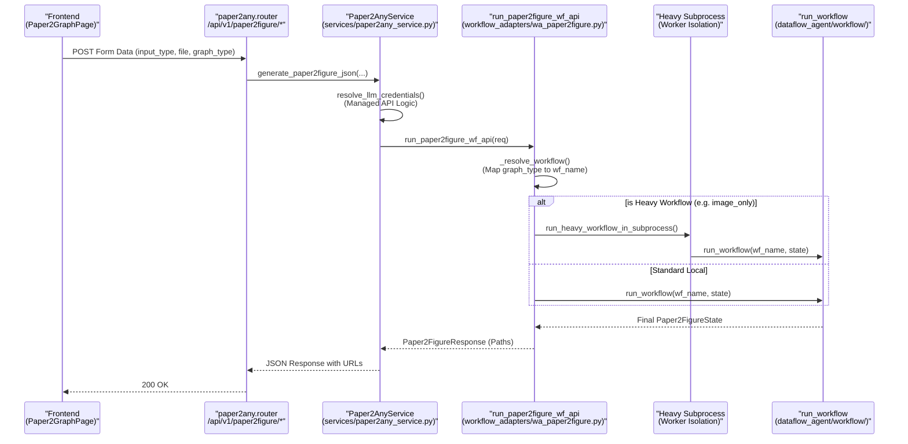
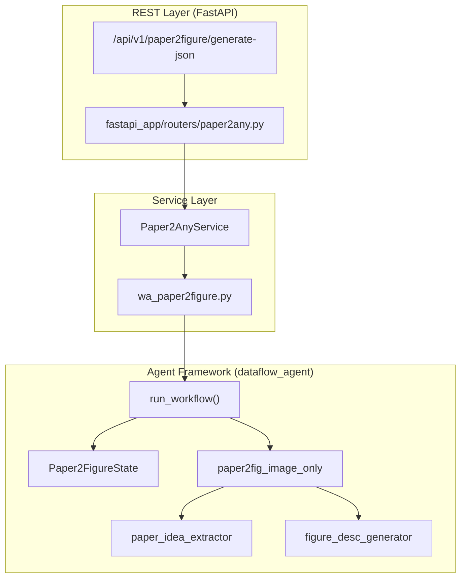

<!-- source: DeepWiki mcp.deepwiki.com · repo OpenDCAI/Paper2Any · page 13.1 Paper2Figure API · fetched 2026-11-02 -->

# Paper2Figure API

Relevant source files

The following files were used as context for generating this wiki page:

- [.gitignore](.gitignore)
- [dataflow_agent/workflow/wf_paper2figure_image_only.py](dataflow_agent/workflow/wf_paper2figure_image_only.py)
- [fastapi_app/.env.example](fastapi_app/.env.example)
- [fastapi_app/config/settings.py](fastapi_app/config/settings.py)
- [fastapi_app/main.py](fastapi_app/main.py)
- [fastapi_app/routers/__init__.py](fastapi_app/routers/__init__.py)
- [fastapi_app/routers/paper2any.py](fastapi_app/routers/paper2any.py)
- [fastapi_app/services/image2ppt_service.py](fastapi_app/services/image2ppt_service.py)
- [fastapi_app/services/paper2any_service.py](fastapi_app/services/paper2any_service.py)
- [fastapi_app/workflow_adapters/wa_paper2figure.py](fastapi_app/workflow_adapters/wa_paper2figure.py)
- [fastapi_app/workflow_adapters/wa_pdf2ppt.py](fastapi_app/workflow_adapters/wa_pdf2ppt.py)
- [frontend-workflow/vite.config.ts](frontend-workflow/vite.config.ts)

This document describes the Paper2Figure REST API endpoints for generating scientific diagrams, technical route diagrams, and experimental data visualizations from paper PDFs, text descriptions, or existing images. The API orchestrates a multi-stage workflow that includes idea extraction, LLM-based description generation, image synthesis, layout segmentation, element extraction, and PPT assembly.

---

## API Endpoints Overview

The Paper2Figure API is primarily served through the `paper2any` router. It supports generating diagrams via a standard file download or a JSON response containing file URLs.

| Endpoint | Method | Purpose | Return Type |
|----------|--------|---------|-------------|
| `/api/v1/paper2figure/generate` | POST | Generate diagram and return PPTX file directly | `FileResponse` (binary PPTX) |
| `/api/v1/paper2figure/generate-json` | POST | Generate diagram and return JSON with file URLs | `Paper2FigureResponse` (JSON) |
| `/api/v1/paper2figure/history` | GET | List previously generated files by email | JSON array of file metadata |
| `/api/v1/system/verify-llm` | POST | Verify LLM connectivity for the workflow | `VerifyLlmResponse` (JSON) |

**Sources:** [fastapi_app/routers/paper2any.py:11-135](), [fastapi_app/main.py:88-88]()

---

## Request Flow: Frontend to Workflow Execution

The Paper2Figure API acts as a bridge between the FastAPI routing layer and the underlying `dataflow_agent` framework.

**Sources:** [fastapi_app/routers/paper2any.py:84-135](), [fastapi_app/services/paper2any_service.py:223-305](), [fastapi_app/workflow_adapters/wa_paper2figure.py:188-210]()

---

## Request Parameters

Both generation endpoints accept FormData. The parameters are mapped to the `Paper2FigureRequest` schema.

### Core Parameters

| Parameter | Type | Default | Description |
|-----------|------|---------|-------------|
| `input_type` | `str` | Required | `'file'`, `'text'`, or `'image'`. |
| `graph_type` | `str` | `'model_arch'` | `'model_arch'`, `'tech_route'`, or `'exp_data'`. |
| `file` | `UploadFile` | Optional | The PDF or Image file to process. |
| `text` | `str` | Optional | Raw text description for `'text'` input mode. |
| `style` | `str` | `'cartoon'` | Visual style of the generated figure. |
| `figure_complex` | `str` | `'easy'` | Complexity level (`'easy'`, `'mid'`, `'hard'`). |
| `resolution` | `str` | `'2K'` | Output resolution for image generation. |
| `tech_route_palette` | `str` | `""` | Color palette for technical route SVG (e.g., `academic_blue`). |

### Managed API & Credentials
If `APP_BILLING_MODE` is set to `free`, the backend uses `ManagedApiService` to inject credentials from `fastapi_app/.env`. If `paid`, it expects `api_key` and `chat_api_url` from the request.

**Sources:** [fastapi_app/routers/paper2any.py:84-106](), [fastapi_app/services/managed_api_service.py:17-40](), [fastapi_app/config/settings.py:94-94]()

---

## Workflow Resolution Logic

The API uses `_resolve_workflow` in the adapter layer to select the specific agentic graph to execute based on the user's intent.

| Graph Type | Input Type | Condition | Selected Workflow |
|------------|------------|-----------|-------------------|
| `model_arch` | `FIGURE` | No `edit_prompt` | `pdf2ppt_qwenvl` (Image to PPT) |
| `model_arch` | Any | - | `paper2fig_image_only` |
| `tech_route` | Any | - | `paper2technical` |
| `exp_data` | Any | - | `paper2expfigure` |
| (Default) | Any | - | `paper2fig_with_sam` |

**Sources:** [fastapi_app/workflow_adapters/wa_paper2figure.py:93-117]()

---

## Data Model: `Paper2FigureResponse`

The response provides structured access to generated assets. Absolute local paths are converted to public URLs using `_to_outputs_url`.

| Field | Type | Description |
|-------|------|-------------|
| `success` | `bool` | Whether the generation succeeded. |
| `ppt_filename` | `str` | URL to the generated `.pptx` file. |
| `svg_filename` | `str` | URL to the `.svg` source (for technical routes). |
| `svg_image_filename` | `str` | URL to the rendered PNG of the SVG. |
| `all_output_files` | `List[str]` | List of all generated assets (icons, masks, drafts). |

**Sources:** [fastapi_app/schemas.py:144-154](), [fastapi_app/services/paper2any_service.py:288-305]()

---

## Implementation Details

### Subprocess Isolation
Heavy workflows like `paper2fig_image_only` (which involves complex image generation and VLM calls) are executed via `run_heavy_workflow_in_subprocess`. This provides worker isolation and prevents long-running tasks from blocking the main FastAPI event loop.

**Sources:** [fastapi_app/workflow_adapters/wa_paper2figure.py:190-201](), [fastapi_app/workflow_adapters/heavy_workflow_subprocess.py:1-50]()

### Inter-process Locking
To prevent GPU OOM or resource contention, the service uses `AsyncInterProcessSemaphore`.
- `TASK_LIMITER`: Limits general paper2any tasks.
- `VISUAL_WORKFLOW_LIMITER`: Limits workflows using SAM3 or other heavy visual models (e.g., `sam3_visual_workflows`).

**Sources:** [fastapi_app/services/paper2any_service.py:29-30](), [fastapi_app/interprocess_lock.py:1-20]()

### File Storage and URLs
Files are stored in `outputs/{email}/{task}/{timestamp}/`. The `StaticFiles` middleware mounts this directory to `/outputs`, allowing the frontend to access assets directly.

**Sources:** [fastapi_app/main.py:117-129](), [fastapi_app/services/paper2any_service.py:27-28]()

---

## Code Entity Association

The following diagram bridges the REST API space to the internal Agent Framework entities.

**Sources:** [fastapi_app/routers/paper2any.py:84-135](), [fastapi_app/services/paper2any_service.py:223-305](), [dataflow_agent/workflow/wf_paper2figure_image_only.py:47-50](), [dataflow_agent/state.py:1-50]()

---

