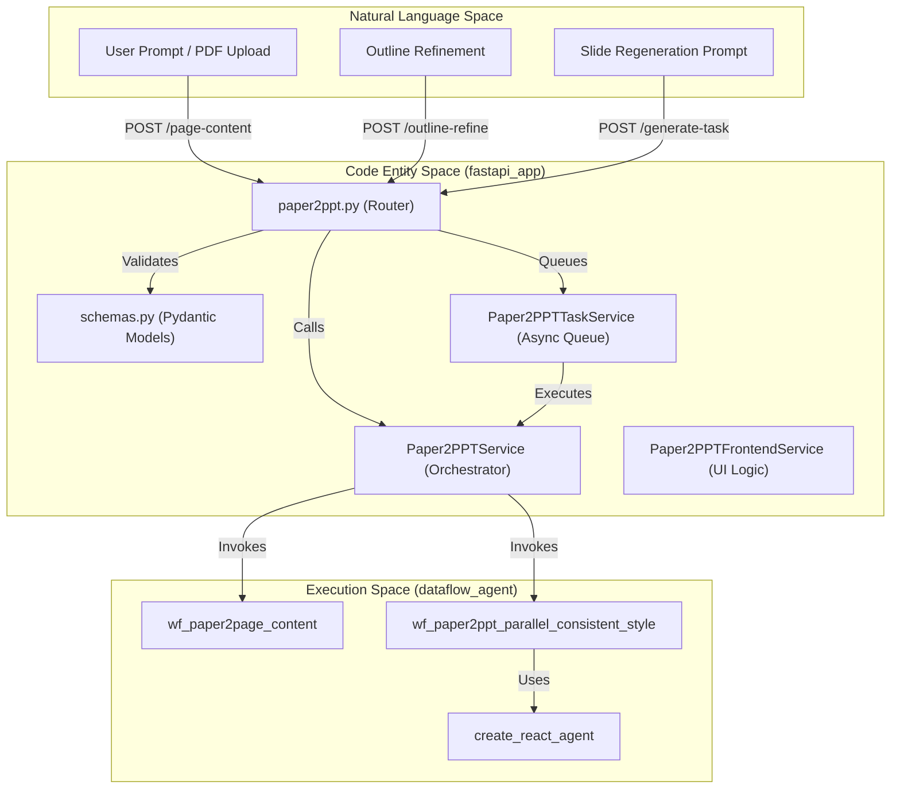
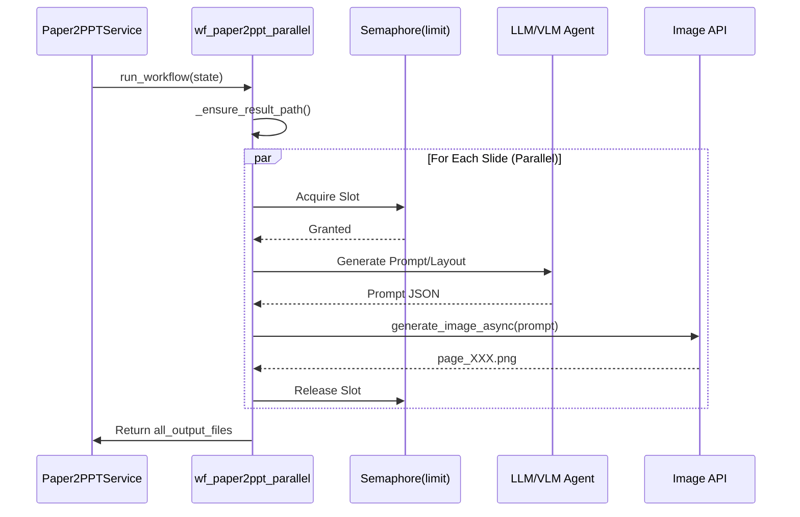

<!-- source: DeepWiki mcp.deepwiki.com · repo OpenDCAI/Paper2Any · page 13.2 Paper2PPT API · fetched 2026-11-02 -->

# Paper2PPT API

Relevant source files

The following files were used as context for generating this wiki page:

- [dataflow_agent/workflow/wf_paper2ppt_parallel_consistent_style.py](dataflow_agent/workflow/wf_paper2ppt_parallel_consistent_style.py)
- [fastapi_app/middleware/api_key.py](fastapi_app/middleware/api_key.py)
- [fastapi_app/routers/account.py](fastapi_app/routers/account.py)
- [fastapi_app/routers/paper2ppt.py](fastapi_app/routers/paper2ppt.py)
- [fastapi_app/schemas.py](fastapi_app/schemas.py)
- [fastapi_app/services/billing_service.py](fastapi_app/services/billing_service.py)
- [fastapi_app/services/paper2ppt_frontend_service.py](fastapi_app/services/paper2ppt_frontend_service.py)
- [fastapi_app/services/paper2ppt_service.py](fastapi_app/services/paper2ppt_service.py)
- [fastapi_app/services/paper2ppt_task_service.py](fastapi_app/services/paper2ppt_task_service.py)
- [fastapi_app/workflow_adapters/wa_paper2ppt.py](fastapi_app/workflow_adapters/wa_paper2ppt.py)
- [frontend-workflow/src/components/paper2ppt/GenerateStep.tsx](frontend-workflow/src/components/paper2ppt/GenerateStep.tsx)
- [frontend-workflow/src/components/paper2ppt/index.tsx](frontend-workflow/src/components/paper2ppt/index.tsx)
- [frontend-workflow/src/services/runtimeConfigService.ts](frontend-workflow/src/services/runtimeConfigService.ts)
- [script/heavy_workflow_worker.py](script/heavy_workflow_worker.py)

## Purpose and Scope

This document provides a technical reference for the Paper2PPT REST API endpoints in the Paper2Any system. These endpoints facilitate the transformation of academic papers, raw text, or research topics into structured PowerPoint presentations. The API supports a stateful, multi-stage workflow including content parsing, outline refinement, parallel slide generation, and frontend-driven "self-healing" loops.

**Sources:** [fastapi_app/routers/paper2ppt.py:1-27](), [fastapi_app/services/paper2ppt_service.py:1-95]()

---

## System Architecture

The Paper2PPT API is built on a service-oriented architecture that bridges the FastAPI routing layer with the DataFlow-Agent workflow engine. It utilizes a file-backed task system for long-running generations and a version manager for tracking slide iterations.

### Data Flow and Entity Mapping

The following diagram illustrates the relationship between Natural Language requests and the internal Code Entity space.

**Sources:** [fastapi_app/routers/paper2ppt.py:31-46](), [fastapi_app/services/paper2ppt_service.py:143-155](), [dataflow_agent/workflow/wf_paper2ppt_parallel_consistent_style.py:11-26]()

---

## Endpoint Reference

### 1. Content Parsing and Outline Generation
`POST /api/v1/paper2ppt/page-content`

Parses the input (PDF, Text, or Topic) and returns a structured JSON outline.

| Parameter | Type | Description |
|-----------|------|-------------|
| `input_type` | `Literal` | `text`, `pdf`, `pptx`, or `topic` |
| `file` | `UploadFile` | The source document (required for `pdf`/`pptx`) |
| `model` | `string` | LLM for outline generation (Default: `gpt-4o`) |
| `page_count` | `int` | Target number of slides (Default: 6) |
| `use_long_paper` | `bool` | Whether to use chunked parsing for large documents |

**Implementation:** This endpoint invokes `run_paper2page_content_wf_api` which uses MinerU for PDF extraction if necessary.

**Sources:** [fastapi_app/routers/paper2ppt.py:210-238](), [fastapi_app/services/paper2ppt_service.py:190-202](), [fastapi_app/workflow_adapters/wa_paper2ppt.py:181-221]()

### 2. Async Slide Generation
`POST /api/v1/paper2ppt/generate-task`

Submits a task for generating the actual slide images and assembling the PPTX file.

| Parameter | Type | Description |
|-----------|------|-------------|
| `pagecontent` | `string` | JSON string of the slide outline |
| `result_path` | `string` | The working directory for the task |
| `get_down` | `bool` | If true, regenerates a specific page |
| `page_id` | `int` | The index of the page to regenerate |
| `edit_prompt` | `string` | Instructions for slide modification |

**Task Lifecycle:**
1. **Queued:** Task metadata is written to `outputs/.tasks/paper2ppt/{task_id}.json`.
2. **Running:** `Paper2PPTTaskService` executes the workflow in a background `asyncio.Task`.
3. **Heartbeat:** The service updates the `updated_at` timestamp every 15 seconds to prevent stale timeouts.

**Sources:** [fastapi_app/routers/paper2ppt.py:265-290](), [fastapi_app/services/paper2ppt_task_service.py:88-134](), [fastapi_app/services/paper2ppt_task_service.py:194-209]()

### 3. Frontend-Driven Generation (Modern Mode)
`POST /api/v1/paper2ppt/frontend/generate`

A specialized endpoint for the "React-to-PPT" path where slides are rendered as HTML/CSS in the frontend first.

**Key Features:**
- **Theme Generation:** Creates a consistent `deck_theme.json` for the entire presentation.
- **Parallelism:** Uses `asyncio.Semaphore(4)` to limit concurrent slide generation.
- **Incremental Mode:** Supports `skip_slides` to reuse existing slide specifications.

**Sources:** [fastapi_app/routers/paper2ppt.py:334-353](), [fastapi_app/services/paper2ppt_frontend_service.py:50-106](), [fastapi_app/services/paper2ppt_frontend_service.py:142-172]()

---

## Parallel Execution Engine

The backend utilizes `wf_paper2ppt_parallel_consistent_style` to generate slide assets. It maintains visual consistency by using a "style anchor" (the first generated slide or a reference image).

### Parallel Generation Logic

**Concurrency Control:** The system reads `PAPER2PPT_PARALLEL_CONSISTENT_MAX_CONCURRENCY` from the environment to determine the number of simultaneous image generation calls.

**Sources:** [dataflow_agent/workflow/wf_paper2ppt_parallel_consistent_style.py:60-66](), [dataflow_agent/workflow/wf_paper2ppt_parallel_consistent_style.py:217-250]()

---

## Billing and Quota Enforcement

Every workflow request passes through the `APIKeyMiddleware` which enforces billing logic before expensive LLM or GPU operations occur.

### Quota Consumption Logic

1. **Submission Key:** A SHA-256 hash of the request payload is generated to prevent double-charging for identical retries within a 20-second window.
2. **Pre-consumption:** `BillingService.consume_workflow` is called before execution.
3. **Calculation:**
   - **Standard PPT:** Charged per page generated.
   - **Frontend PPT:** Charged 2 points per page if images are included, 1 point otherwise.

**Sources:** [fastapi_app/routers/paper2ppt.py:90-107](), [fastapi_app/routers/paper2ppt.py:172-207](), [fastapi_app/middleware/api_key.py:110-135]()

---

## Technical Details: Heavy Workflow Isolation

For stability, Paper2PPT can run in a separate subprocess using the `heavy_workflow_worker.py` script. This prevents memory fragmentation and allows for clean environment isolation for complex PDF parsing and PPT assembly tasks.

- **Trigger:** Controlled by `should_use_heavy_workflow_subprocess()`.
- **Communication:** Via temporary JSON files for input and output.
- **Worker Entry Point:** `script/heavy_workflow_worker.py --mode paper2ppt`.

**Sources:** [fastapi_app/workflow_adapters/wa_paper2ppt.py:31-34](), [script/heavy_workflow_worker.py:45-63]()

---

