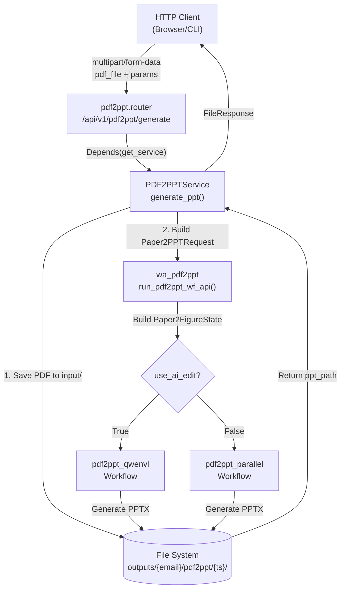
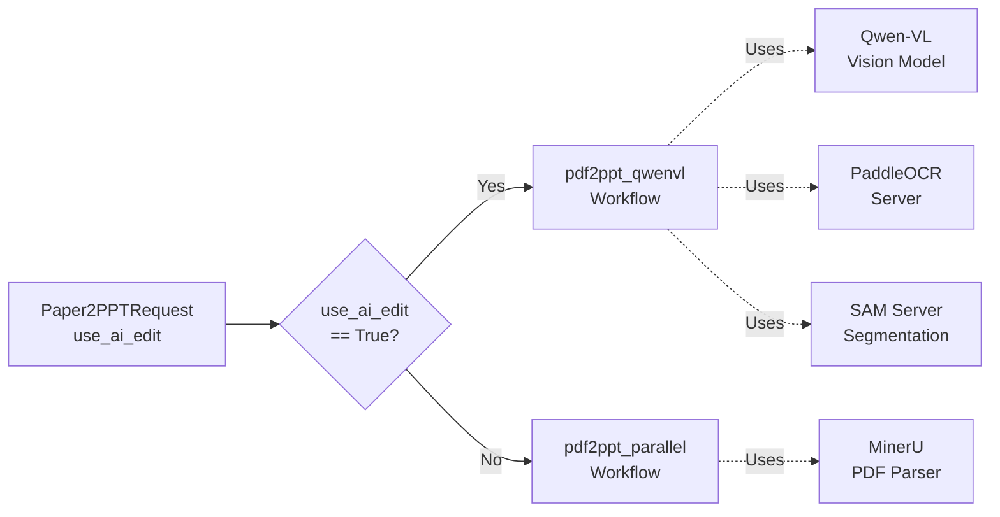
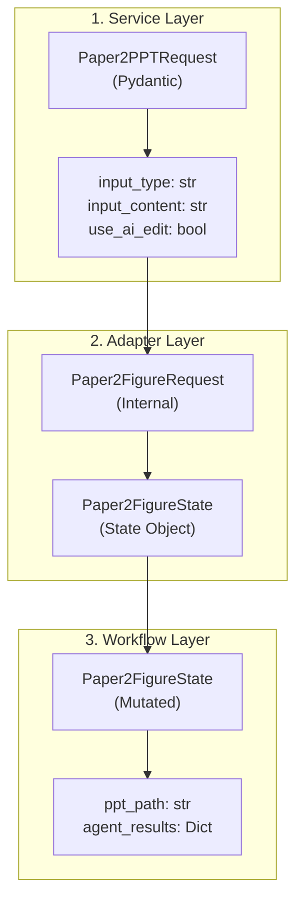

<!-- source: DeepWiki mcp.deepwiki.com · repo OpenDCAI/Paper2Any · page 13.3 PDF2PPT API · fetched 2026-11-02 -->

# PDF2PPT API

<details>
<summary>Relevant source files</summary>

The following files were used as context for generating this wiki page:

- [dataflow_agent/toolkits/postertool/src/agents/curator.py](dataflow_agent/toolkits/postertool/src/agents/curator.py)
- [dataflow_agent/toolkits/postertool/src/agents/parser.py](dataflow_agent/toolkits/postertool/src/agents/parser.py)
- [dataflow_agent/workflow/wf_paper2ppt_parallel_consistent_style.py](dataflow_agent/workflow/wf_paper2ppt_parallel_consistent_style.py)
- [fastapi_app/dependencies/auth.py](fastapi_app/dependencies/auth.py)
- [fastapi_app/middleware/api_key.py](fastapi_app/middleware/api_key.py)
- [fastapi_app/routers/files.py](fastapi_app/routers/files.py)
- [fastapi_app/routers/paper2ppt.py](fastapi_app/routers/paper2ppt.py)
- [fastapi_app/routers/pdf2ppt.py](fastapi_app/routers/pdf2ppt.py)
- [fastapi_app/schemas.py](fastapi_app/schemas.py)
- [fastapi_app/services/paper2poster_service.py](fastapi_app/services/paper2poster_service.py)
- [fastapi_app/services/paper2ppt_frontend_service.py](fastapi_app/services/paper2ppt_frontend_service.py)
- [fastapi_app/services/paper2ppt_service.py](fastapi_app/services/paper2ppt_service.py)
- [fastapi_app/workflow_adapters/wa_paper2ppt.py](fastapi_app/workflow_adapters/wa_paper2ppt.py)
- [frontend-workflow/src/components/paper2ppt/GenerateStep.tsx](frontend-workflow/src/components/paper2ppt/GenerateStep.tsx)
- [frontend-workflow/src/components/paper2ppt/index.tsx](frontend-workflow/src/components/paper2ppt/index.tsx)
- [frontend-workflow/src/services/fileService.ts](frontend-workflow/src/services/fileService.ts)
- [tests/test_paper2poster_parser.py](tests/test_paper2poster_parser.py)

</details>


## Purpose and Scope

The PDF2PPT API provides a single HTTP endpoint for converting PDF documents into PowerPoint presentations. This API wraps the PDF2PPT workflow and exposes it as a RESTful service with multipart file upload support.

This page documents the API interface layer. For details about the underlying workflow logic, see [PDF2PPT Workflow](#6.3). For file storage and URL generation patterns, see [File Storage & URLs](#4.4). For general error handling conventions, see [Error Handling](#13.5).

The API supports two modes:
- **Basic Mode**: Direct PDF-to-PPT conversion without AI enhancement (faster, no LLM API required).
- **AI Enhancement Mode**: Uses VLM (Vision Language Model) for improved layout recognition and content extraction via the `use_ai_edit` parameter.

---

## Endpoint Overview

| Method | Path | Purpose | Auth Required |
|--------|------|---------|---------------|
| `POST` | `/api/v1/pdf2ppt/generate` | Convert PDF to PPTX | API Key (via middleware) |

**Response Type**: Binary file download (`application/vnd.openxmlformats-officedocument.presentationml.presentation`)

Sources: [fastapi_app/routers/pdf2ppt.py:20-77](), [fastapi_app/middleware/api_key.py:76-76]()

---

## Request Flow Architecture

The following diagram illustrates the data flow from the client request through the service and adapter layers to the final workflow execution.



**Request Processing Layers**:
1. **Router Layer** ([fastapi_app/routers/pdf2ppt.py:20-77]()): FastAPI endpoint definition using `APIRouter`. It extracts parameters from `Form` data and handles the `UploadFile` object.
2. **Service Layer** ([fastapi_app/services/pdf2ppt_service.py:143-230]()): Orchestrates business logic, manages directory creation, and implements concurrency control via a module-level `task_semaphore`.
3. **Adapter Layer** ([fastapi_app/workflow_adapters/wa_pdf2ppt.py:11-138]()): Bridges the API request models to the internal `Paper2FigureState`. It handles path normalization and workflow selection logic.
4. **Workflow Layer**: Executes the actual PDF processing using the DataFlow-Agent framework.

Sources: [fastapi_app/routers/pdf2ppt.py:15-77](), [fastapi_app/services/pdf2ppt_service.py:143-230](), [fastapi_app/workflow_adapters/wa_pdf2ppt.py:11-138]()

---

## Request Parameters

### Required Parameters

| Parameter | Type | Location | Description |
|-----------|------|----------|-------------|
| `pdf_file` | `UploadFile` | File | PDF document to convert (binary file upload) |

### Optional Parameters

| Parameter | Type | Default | Description |
|-----------|------|---------|-------------|
| `use_ai_edit` | `bool` | `False` | Enable AI enhancement mode (requires `chat_api_url` and `api_key`) |
| `chat_api_url` | `str` | `None` | LLM API endpoint (required if `use_ai_edit=True`) |
| `api_key` | `str` | `None` | LLM API key (required if `use_ai_edit=True`) |
| `email` | `str` | `None` | User email for output directory organization |
| `model` | `str` | `settings.PDF2PPT_DEFAULT_MODEL` | LLM model name for text processing |
| `gen_fig_model` | `str` | `settings.PDF2PPT_DEFAULT_IMAGE_MODEL` | Image generation model name |
| `language` | `str` | `"zh"` | Output language (`"zh"` or `"en"`) |
| `style` | `str` | `"现代简约风格"` | Presentation style description |
| `page_count` | `int` | `8` | Target number of slides to generate |

### Parameter Validation Rules

**AI Enhancement Dependencies**:
If `use_ai_edit` is set to `True`, the service layer enforces that `chat_api_url` and `api_key` are provided.

**File Type Validation**: The `pdf_file` parameter must be a valid PDF document. While the router accepts any `UploadFile`, downstream workflow components like MinerU will fail if the file is not a valid PDF.

Sources: [fastapi_app/routers/pdf2ppt.py:20-36](), [fastapi_app/services/pdf2ppt_service.py:143-230]()

---

## Response Format

### Success Response

**HTTP Status**: `200 OK`

**Content-Type**: `application/vnd.openxmlformats-officedocument.presentationml.presentation`

**Headers**:
- `Content-Disposition: attachment; filename="{filename}.pptx"`
- `X-Paper2Any-Page-Count`: Actual number of pages generated.

**Body**: Binary PPTX file data.

### Error Responses

| Status Code | Condition | Response Body |
|-------------|-----------|---------------|
| `400` | Missing required file | `{"detail": "pdf_file is required"}` |
| `400` | AI mode without credentials | `{"detail": "When use_ai_edit is True, chat_api_url and api_key are required"}` |
| `403` | Rate limit exceeded | `{"error": "Rate limit exceeded", "code": "RATE_LIMIT_EXCEEDED"}` |
| `500` | Workflow execution failure | `{"detail": "[pdf2ppt] workflow did not set ppt_path on state"}` |

Sources: [fastapi_app/routers/pdf2ppt.py:69-77](), [fastapi_app/middleware/api_key.py:76-76](), [fastapi_app/services/pdf2ppt_service.py:143-230]()

---

## AI Enhancement Mode

### Workflow Selection Logic

The choice between the standard PDF processing path and the AI-enhanced path is determined by the `use_ai_edit` flag in the adapter layer.



**Mode Comparison**:

| Feature | Basic Mode (`use_ai_edit=False`) | AI Enhancement Mode (`use_ai_edit=True`) |
|---------|----------------------------------|------------------------------------------|
| Workflow | `pdf2ppt_parallel` | `pdf2ppt_qwenvl` |
| Speed | Faster (direct layout parsing) | Slower (VLM/SAM inference) |
| Dependencies | MinerU | MinerU + Qwen-VL + SAM + OCR |
| API Key Required | No | Yes |
| Layout Accuracy | Standard PDF extraction | Vision-based layout preservation |

### Implementation Detail

The workflow selection occurs in `wa_pdf2ppt.py`:

```python
# fastapi_app/workflow_adapters/wa_pdf2ppt.py:105-109
if req.use_ai_edit or req.input_type == "FIGURE":
    final_state: Paper2FigureState = await run_workflow("pdf2ppt_qwenvl", state)
else:
    final_state: Paper2FigureState = await run_workflow("pdf2ppt_parallel", state)
```

Sources: [fastapi_app/workflow_adapters/wa_pdf2ppt.py:105-109]()

---

## Directory Structure and File Management

### Output Directory Layout

Files are organized by user identifier and timestamp to prevent collisions.

```
outputs/
└── {email or 'default'}/
    └── pdf2ppt/
        └── {timestamp}/
            ├── input/
            │   └── input.pdf          # Original uploaded PDF
            ├── output/
            │   └── presentation_{ts}.pptx  # Generated presentation
            └── mineru_recursive/       # Intermediate parsing results
```

### Directory Creation Logic

The service layer generates a unique run directory for every request:

```python
# fastapi_app/services/pdf2ppt_service.py:190-200
def _create_run_dir(self, email: Optional[str], task_type: str) -> Path:
    ts = int(datetime.utcnow().timestamp())
    code = email or "default"
    run_dir = BASE_OUTPUT_DIR / code / task_type / str(ts)
    (run_dir / "input").mkdir(parents=True, exist_ok=True)
    return run_dir
```

Sources: [fastapi_app/services/pdf2ppt_service.py:190-200](), [fastapi_app/utils.py:1-28]()

---

## Concurrency Control

### Semaphore-Based Queuing

The PDF2PPT service implements a module-level `asyncio.Semaphore` to limit concurrent executions of the heavy PDF processing workflows.

```python
# fastapi_app/services/pdf2ppt_service.py:21
task_semaphore = asyncio.Semaphore(1)

# fastapi_app/services/pdf2ppt_service.py:100-101
async with task_semaphore:
    wf_resp = await run_pdf2ppt_wf_api(wf_req, result_path=run_dir)
```

**Purpose**: PDF conversion is resource-intensive (GPU and CPU). The semaphore ensures that only one conversion task runs at a time per backend instance, preventing system OOM (Out of Memory) errors.

Sources: [fastapi_app/services/pdf2ppt_service.py:21, 100-101]()

---

## State Flow Through Layers

This diagram maps the transformation of data from the initial Pydantic request model to the internal Agent State.



**State Transformation Pipeline**:

1. **Service Layer** ([fastapi_app/services/pdf2ppt_service.py:143-230]()):
   - Receives form data and file.
   - Saves the file and converts the `UploadFile` to a local path string.
   - Populates a `Paper2PPTRequest` schema.

2. **Adapter Layer** ([fastapi_app/workflow_adapters/wa_pdf2ppt.py:80-98]()):
   - Maps `Paper2PPTRequest` fields to `Paper2FigureRequest`.
   - Initializes `Paper2FigureState` with the request object and output paths.

3. **Workflow Layer** ([dataflow_agent/workflow/wf_paper2ppt_parallel_consistent_style.py]()):
   - The workflow engine (`run_workflow`) executes nodes that mutate the state.
   - The final `ppt_path` is written back to the state object.

Sources: [fastapi_app/services/pdf2ppt_service.py:143-230](), [fastapi_app/workflow_adapters/wa_pdf2ppt.py:80-98](), [fastapi_app/schemas.py:94-191]()

---

## Performance Considerations

### Rate Limiting
The API is protected by `APIKeyMiddleware`, which enforces a specific rate limit for this endpoint to prevent abuse and resource exhaustion.

- **Bucket**: `pdf2ppt`
- **Limit**: 8 requests per 300 seconds (5 minutes).

Sources: [fastapi_app/middleware/api_key.py:76-76]()

### Resource Usage
- **Basic Mode**: High CPU usage during MinerU parsing.
- **AI Mode**: High VRAM usage for VLM and SAM models. It is recommended to run these model servers on dedicated GPUs.

Sources: [fastapi_app/services/pdf2ppt_service.py:21-21](), [fastapi_app/routers/pdf2ppt.py:20-77]()

---

