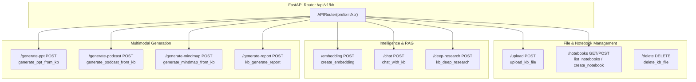
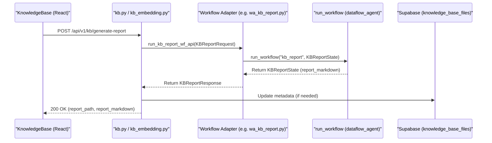

<!-- source: DeepWiki mcp.deepwiki.com · repo OpenDCAI/Paper2Any · page 13.4 Knowledge Base API · fetched 2026-11-02 -->

# Knowledge Base API

Relevant source files

The following files were used as context for generating this wiki page:

- [database/01_init_schema.sql](database/01_init_schema.sql)
- [dataflow_agent/workflow/wf_kb_podcast.py](dataflow_agent/workflow/wf_kb_podcast.py)
- [fastapi_app/routers/kb.py](fastapi_app/routers/kb.py)
- [fastapi_app/routers/kb_embedding.py](fastapi_app/routers/kb_embedding.py)
- [fastapi_app/workflow_adapters/wa_kb_deepresearch.py](fastapi_app/workflow_adapters/wa_kb_deepresearch.py)
- [fastapi_app/workflow_adapters/wa_kb_report.py](fastapi_app/workflow_adapters/wa_kb_report.py)
- [frontend-workflow/src/components/knowledge-base/LibraryView.tsx](frontend-workflow/src/components/knowledge-base/LibraryView.tsx)
- [frontend-workflow/src/components/knowledge-base/OutputView.tsx](frontend-workflow/src/components/knowledge-base/OutputView.tsx)
- [frontend-workflow/src/components/knowledge-base/UploadView.tsx](frontend-workflow/src/components/knowledge-base/UploadView.tsx)
- [frontend-workflow/src/components/knowledge-base/index.tsx](frontend-workflow/src/components/knowledge-base/index.tsx)
- [frontend-workflow/src/components/knowledge-base/tools/MindMapTool.tsx](frontend-workflow/src/components/knowledge-base/tools/MindMapTool.tsx)
- [frontend-workflow/src/components/knowledge-base/tools/PodcastTool.tsx](frontend-workflow/src/components/knowledge-base/tools/PodcastTool.tsx)
- [frontend-workflow/src/components/knowledge-base/tools/PptTool.tsx](frontend-workflow/src/components/knowledge-base/tools/PptTool.tsx)

## Purpose and Scope

The Knowledge Base API provides a comprehensive set of RESTful endpoints for managing user-uploaded files and generating AI-powered multimodal content. This system allows users to organize documents into categorized knowledge bases, perform semantic search via vector embeddings, and execute complex workflows including PPT generation, podcast synthesis, and automated reporting.

---

## API Endpoint Overview

The Knowledge Base API is exposed through the FastAPI router at `/api/v1/kb`. It interfaces with the `dataflow_agent` framework to orchestrate long-running tasks and utilizes Supabase for metadata persistence.

**Knowledge Base API Structure**

**Sources:** [fastapi_app/routers/kb.py:30-31](), [fastapi_app/routers/kb_embedding.py:10-11]()

---

## File Management and Notebooks

The system organizes files into "Notebooks" (logical collections). Files are physically stored in `outputs/kb_data/{email}/{notebook_dir}/sources/`.

### POST /kb/upload
Uploads a file and stores metadata. Supported extensions include `.pdf`, `.docx`, `.pptx`, `.png`, `.jpg`, `.mp4`.

**Implementation Details:**
- Files are saved using `shutil.copyfileobj` [fastapi_app/routers/kb.py:440-441]().
- Paths are resolved via `_notebook_sources_dir` which handles user-specific sandboxing [fastapi_app/routers/kb.py:197-199]().

### GET /kb/notebooks
Lists all notebooks for the authenticated user by reading a local JSON manifest at `outputs/kb_data/_notebooks/{user_id}.json` [fastapi_app/routers/kb.py:117-121]().

**Sources:** [fastapi_app/routers/kb.py:36-43](), [fastapi_app/routers/kb.py:397-445]()

---

## Vector Embedding & Search

Semantic search is powered by the `/kb/embedding` endpoint, which processes files into a FAISS vector store.

### POST /kb/embedding
Generates embeddings for specified files using `VectorStoreManager`.

**Data Flow:**
1. **Resolve Paths**: Validates that requested web paths belong to the user [fastapi_app/routers/kb_embedding.py:120-135]().
2. **Process**: Calls `process_knowledge_base_files` to chunk and embed content [fastapi_app/routers/kb_embedding.py:153-162]().
3. **Sync**: Updates the `knowledge_base_files` table in Supabase with the generated `kb_file_id` (UUID) for future RAG retrieval [fastapi_app/routers/kb_embedding.py:61-89]().

**Sources:** [fastapi_app/routers/kb_embedding.py:90-177](), [database/01_init_schema.sql:155-168]()

---

## Content Generation Workflows

### POST /kb/generate-podcast
Converts documents into an audio podcast. It supports `monologue` and `dialog` modes with variable lengths.

**Workflow: `kb_podcast`**
- **Node `parse_files_node`**: Uses `PyMuPDF` (fitz) for PDFs, `python-docx` for Word, and `python-pptx` for slides to extract raw text [dataflow_agent/workflow/wf_kb_podcast.py:80-165]().
- **Node `generate_script_node`**: An LLM agent generates a structured script based on the extracted content and requested `podcast_mode` [dataflow_agent/workflow/wf_kb_podcast.py:167-250]().
- **Node `generate_audio_node`**: Converts the script to speech using `generate_speech_bytes_async`. In dialog mode, it alternates between `voice_name` and `voice_name_b` [dataflow_agent/workflow/wf_kb_podcast.py:252-330]().

**Sources:** [dataflow_agent/workflow/wf_kb_podcast.py:36-37](), [fastapi_app/routers/kb.py:648-771]()

### POST /kb/generate-report
Generates a comprehensive Markdown report from knowledge base materials.

**Implementation:**
- Uses `wa_kb_report.py` as an adapter to trigger the `kb_report` workflow [fastapi_app/workflow_adapters/wa_kb_report.py:23-49]().
- The result is saved as `report.md` in the user's `kb_outputs` directory [fastapi_app/workflow_adapters/wa_kb_report.py:61-62]().

**Sources:** [fastapi_app/workflow_adapters/wa_kb_report.py:1-70](), [fastapi_app/schemas.py:22-22]()

### POST /kb/generate-mindmap
Generates Mermaid-format mindmap code from documents.

**Workflow: `kb_mindmap`**
- The LLM analyzes the hierarchy of the documents and outputs a `mindmap` block [fastapi_app/routers/kb.py:773-863]().
- Users can preview and edit this via the `MermaidPreview` and `MindMapFlowEditor` frontend components [frontend-workflow/src/components/knowledge-base/index.tsx:9-10]().

---

## Technical Architecture & Data Flow

The following diagram illustrates how a Knowledge Base request flows from the React frontend through the FastAPI routers to the DataFlow-Agent execution engine.

**System Entity Mapping**

**Sources:** [fastapi_app/routers/kb.py:885-915](), [fastapi_app/workflow_adapters/wa_kb_report.py:23-49](), [frontend-workflow/src/components/knowledge-base/index.tsx:14-16]()

---

## Database Schema

Knowledge base metadata is stored in two primary Supabase tables:

| Table | Purpose | Key Columns |
|-------|---------|-------------|
| `knowledge_bases` | Categorization of user notebooks | `id`, `user_id`, `name`, `description` |
| `knowledge_base_files` | Metadata for individual source files | `id`, `kb_id`, `storage_path`, `kb_file_id` (FAISS UUID), `is_embedded` |

**Sources:** [database/01_init_schema.sql:112-119](), [database/01_init_schema.sql:155-168]()

---

## Error Handling & Security

- **Path Validation**: The API uses `_ensure_path_within_roots` to prevent directory traversal attacks by verifying all file operations stay within the user's `kb_data` or `kb_outputs` directories [fastapi_app/routers/kb.py:101-109]().
- **Authentication**: Endpoints utilize `get_current_user` dependency, ensuring that `user_id` and `email` are validated against the authenticated session [fastapi_app/routers/kb.py:20-21]().
- **Dependency Checks**: Generation workflows check for optional system libraries like `python-docx` or `python-pptx` and return descriptive errors if they are missing [dataflow_agent/workflow/wf_kb_podcast.py:116-130]().

**Sources:** [fastapi_app/routers/kb.py:101-114](), [fastapi_app/routers/kb.py:87-88]()

---

