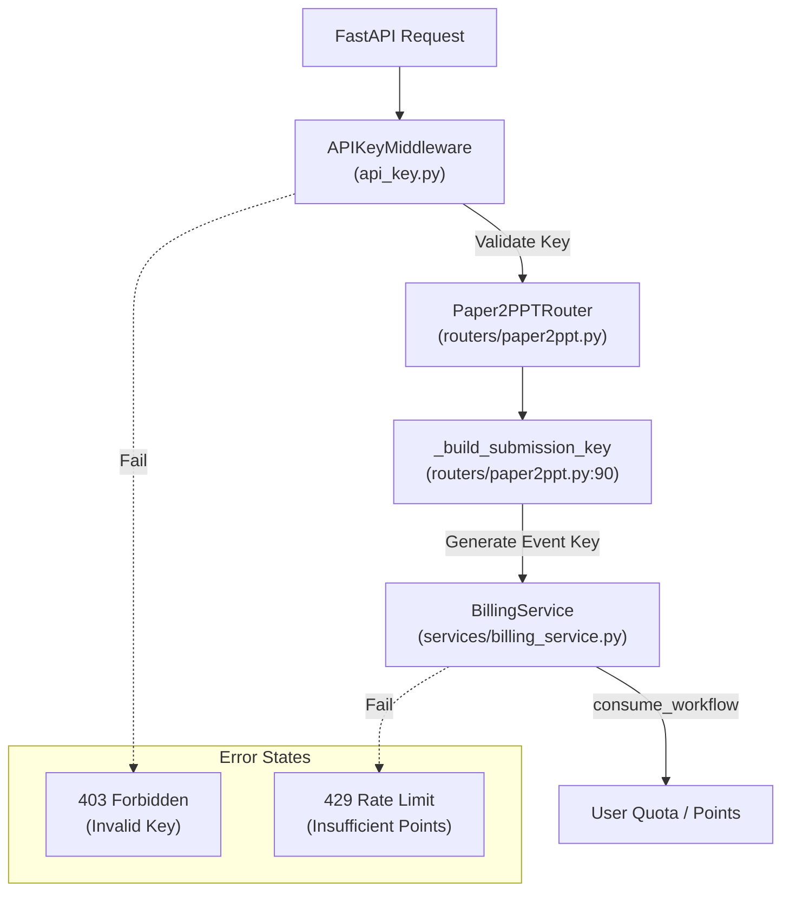
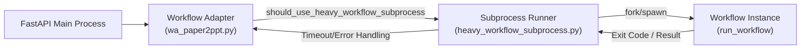

<!-- source: DeepWiki mcp.deepwiki.com · repo OpenDCAI/Paper2Any · page 13.5 Error Handling · fetched 2026-11-02 -->

# Error Handling

<details>
<summary>Relevant source files</summary>

The following files were used as context for generating this wiki page:

- [dataflow_agent/workflow/wf_paper2ppt_parallel_consistent_style.py](dataflow_agent/workflow/wf_paper2ppt_parallel_consistent_style.py)
- [fastapi_app/middleware/api_key.py](fastapi_app/middleware/api_key.py)
- [fastapi_app/routers/paper2ppt.py](fastapi_app/routers/paper2ppt.py)
- [fastapi_app/schemas.py](fastapi_app/schemas.py)
- [fastapi_app/services/paper2ppt_frontend_service.py](fastapi_app/services/paper2ppt_frontend_service.py)
- [fastapi_app/services/paper2ppt_service.py](fastapi_app/services/paper2ppt_service.py)
- [fastapi_app/workflow_adapters/wa_paper2ppt.py](fastapi_app/workflow_adapters/wa_paper2ppt.py)
- [frontend-workflow/src/components/Paper2GraphPage.tsx](frontend-workflow/src/components/Paper2GraphPage.tsx)
- [frontend-workflow/src/components/Paper2PptPage.tsx](frontend-workflow/src/components/Paper2PptPage.tsx)
- [frontend-workflow/src/components/Pdf2PptPage.tsx](frontend-workflow/src/components/Pdf2PptPage.tsx)
- [frontend-workflow/src/components/Ppt2PolishPage.tsx](frontend-workflow/src/components/Ppt2PolishPage.tsx)
- [frontend-workflow/src/components/paper2ppt/GenerateStep.tsx](frontend-workflow/src/components/paper2ppt/GenerateStep.tsx)
- [frontend-workflow/src/components/paper2ppt/index.tsx](frontend-workflow/src/components/paper2ppt/index.tsx)

</details>


This page documents the error handling mechanisms in the Paper2Any system, covering error response formats, common error codes, utility functions for error extraction, billing enforcement via `APIKeyMiddleware`, and troubleshooting guidance.

---

## Overview

Paper2Any implements a multi-layered error handling strategy that spans the React frontend, the FastAPI backend, and the DataFlow-Agent workflow engine. The system is designed to provide actionable feedback to users (e.g., "Insufficient Points") while maintaining detailed logs for developers.

**Key Components:**
- **Standardized Error Schemas**: Pydantic models for consistent API error responses [fastapi_app/schemas.py:11-21]().
- **Billing Enforcement**: Middleware that validates API keys and checks quotas before workflow execution [fastapi_app/middleware/api_key.py]().
- **Workflow Resilience**: Subprocess isolation and inter-process locking to prevent cascading failures during heavy tasks [fastapi_app/workflow_adapters/heavy_workflow_subprocess.py]().
- **Frontend Error Utilities**: Helper functions to parse backend errors and display user-friendly messages [frontend-workflow/src/utils/pointsMessaging.ts]().

---

## Error Response Formats

The backend utilizes standardized Pydantic models to ensure all error responses follow a predictable structure.

### API Error Models
Defined in `fastapi_app/schemas.py`, these models are used across all routers:

| Model | Field | Type | Description |
| :--- | :--- | :--- | :--- |
| `APIError` | `code` | `str` | Machine-readable error identifier. |
| | `message` | `str` | Human-readable error description. |
| `ErrorResponse`| `error` | `str` | The primary error message. |
| | `code` | `str` | Default is `INTERNAL_ERROR`. |
| | `details` | `Optional[Dict]`| Contextual metadata (e.g., validation failures). |

Sources: [fastapi_app/schemas.py:11-21]()

### Common Error Codes

| HTTP Status | Code | Meaning |
| :--- | :--- | :--- |
| **403** | `INVALID_CODE` | The provided API key or invite code is invalid or expired. |
| **429** | `RATE_LIMIT` | The user has exceeded the allowed request frequency or quota. |
| **400** | `VALIDATION_ERROR` | Input parameters (e.g., `input_type`) are malformed or missing [fastapi_app/services/paper2ppt_service.py:532-537](). |
| **500** | `WORKFLOW_ERROR` | A critical failure occurred within the agent graph execution. |

---

## Billing Enforcement & APIKeyMiddleware

The `APIKeyMiddleware` (and associated `BillingService`) acts as a gatekeeper for protected workflows. It enforces resource limits before expensive LLM or GPU operations are triggered.

### Billing Logic Flow
1. **Key Validation**: Checks the `Authorization` header or `api_key` field in the request body.
2. **Quota Check**: Consults `BillingService` to verify if the user (authenticated or guest) has enough "points" for the requested task.
3. **Event Locking**: Uses an `event_key` (based on a hash of the request payload) to prevent double-billing for identical retries within a short window (e.g., 20 seconds) [fastapi_app/routers/paper2ppt.py:95-107]().

### Code Entity Association

The following diagram illustrates how the billing enforcement logic bridges from the API request to the internal billing entities.

**Billing Enforcement Data Flow**

Sources: [fastapi_app/routers/paper2ppt.py:90-126](), [fastapi_app/middleware/api_key.py]()

---

## Error Handling Utilities

### Frontend: extractErrorMessage & Points Messaging
The frontend provides utilities to translate raw backend errors into localized, actionable UI components.

- **`isInsufficientPointsError`**: Detects if a backend error string relates to quota exhaustion [frontend-workflow/src/utils/pointsMessaging.ts:31]().
- **`buildInsufficientPointsMessage`**: Generates a rich message including the required points, current balance, and a purchase link [frontend-workflow/src/components/paper2ppt/index.tsx:160]().

### Backend: Path & URL Resolution
Errors often occur during file path resolution. The system uses `resolve_outputs_path` to safely handle directory traversal and missing files.

```python
# Example of path validation in service layer
base_dir = self._paper2ppt_service.resolve_result_path(req.result_path)
if not base_dir.exists():
    raise HTTPException(status_code=400, detail=f"result_path not exists: {base_dir}")
```
Sources: [fastapi_app/services/paper2ppt_frontend_service.py:75-77](), [fastapi_app/utils.py]()

---

## Workflow-Level Error Handling

### Parallel Execution & Retries
In `wf_paper2ppt_parallel_consistent_style.py`, image generation is wrapped in a retry utility to handle transient LLM/VLM API failures.

- **Function**: `_call_image_api_with_retry` [dataflow_agent/workflow/wf_paper2ppt_parallel_consistent_style.py:224-233]().
- **Behavior**: Executes a coroutine factory up to 3 times with a 1.0s delay.
- **Fallback**: If all retries fail, the specific slide is marked as `failed`, but the overall workflow continues to process other slides [dataflow_agent/workflow/wf_paper2ppt_parallel_consistent_style.py:336-345]().

### Heavy Workflow Subprocesses
To prevent memory leaks or process hangs from affecting the main FastAPI thread, heavy tasks (like MinerU PDF extraction) are run in isolated subprocesses.

**Subprocess Isolation Architecture**

Sources: [fastapi_app/workflow_adapters/wa_paper2ppt.py:31-34](), [fastapi_app/workflow_adapters/heavy_workflow_subprocess.py]()

---

## Troubleshooting Guidance

When encountering errors, follow this checklist to identify the source:

| Symptom | Check | Reference |
| :--- | :--- | :--- |
| **403 Invalid Code** | Verify `chat_api_key` or `invite_code` in the settings panel. | [frontend-workflow/src/components/paper2ppt/index.tsx:119-122]() |
| **429 Rate Limit** | Check user points balance in the Sidebar or Profile. | [frontend-workflow/src/services/quotaService.ts]() |
| **File Not Found** | Ensure the `result_path` provided in the request matches an existing directory in `outputs/`. | [fastapi_app/services/paper2ppt_service.py:121-122]() |
| **VLM/LLM Timeout** | Check `logs/model_servers.log` for local model status or external API provider status. | [dataflow_agent/workflow/wf_paper2ppt_parallel_consistent_style.py:224-233]() |
| **Subprocess Crash** | Check for `Zombie` processes or `OOM` (Out of Memory) errors in the system logs. | [fastapi_app/workflow_adapters/heavy_workflow_subprocess.py]() |

Sources: [frontend-workflow/src/components/paper2ppt/index.tsx:119-165](), [fastapi_app/services/paper2ppt_service.py:121-155]()

---

