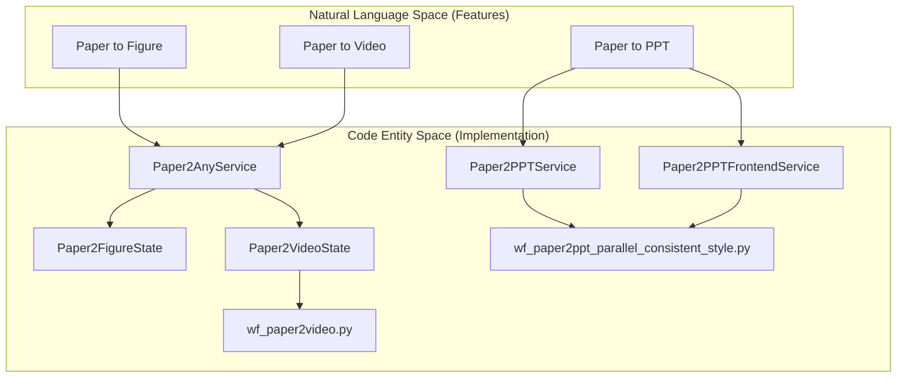
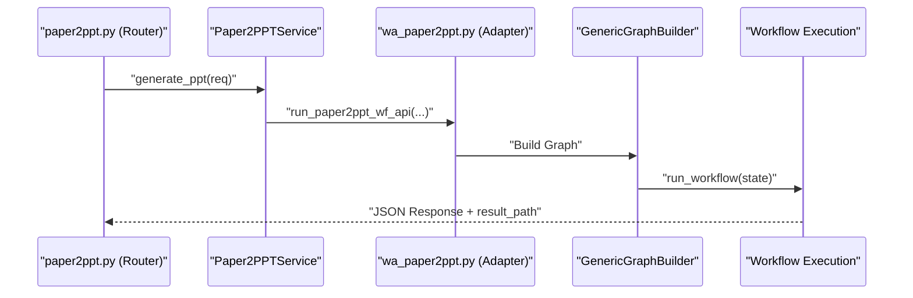

<!-- source: DeepWiki mcp.deepwiki.com · repo OpenDCAI/Paper2Any · page 14 Glossary · fetched 2026-11-02 -->

# Glossary

Relevant source files

The following files were used as context for generating this wiki page:

- [README.md](README.md)
- [README_CN.md](README_CN.md)
- [dataflow_agent/agentroles/cores/base_agent.py](dataflow_agent/agentroles/cores/base_agent.py)
- [dataflow_agent/graphbuilder/graph_builder.py](dataflow_agent/graphbuilder/graph_builder.py)
- [dataflow_agent/promptstemplates/prompts_repo.py](dataflow_agent/promptstemplates/prompts_repo.py)
- [dataflow_agent/resources/faiss_cache/all_ops.index.meta](dataflow_agent/resources/faiss_cache/all_ops.index.meta)
- [dataflow_agent/state.py](dataflow_agent/state.py)
- [dataflow_agent/toolkits/multimodaltool/providers.py](dataflow_agent/toolkits/multimodaltool/providers.py)
- [dataflow_agent/toolkits/multimodaltool/req_tts.py](dataflow_agent/toolkits/multimodaltool/req_tts.py)
- [dataflow_agent/toolkits/optool/op_tools.py](dataflow_agent/toolkits/optool/op_tools.py)
- [dataflow_agent/toolkits/p2vtool/p2v_tool.py](dataflow_agent/toolkits/p2vtool/p2v_tool.py)
- [dataflow_agent/toolkits/pipetool/pipe_tools.py](dataflow_agent/toolkits/pipetool/pipe_tools.py)
- [dataflow_agent/toolkits/resources/ops.json](dataflow_agent/toolkits/resources/ops.json)
- [dataflow_agent/workflow/wf_paper2ppt_parallel_consistent_style.py](dataflow_agent/workflow/wf_paper2ppt_parallel_consistent_style.py)
- [dataflow_agent/workflow/wf_paper2video.py](dataflow_agent/workflow/wf_paper2video.py)
- [fastapi_app/middleware/api_key.py](fastapi_app/middleware/api_key.py)
- [fastapi_app/routers/paper2ppt.py](fastapi_app/routers/paper2ppt.py)
- [fastapi_app/routers/paper2video.py](fastapi_app/routers/paper2video.py)
- [fastapi_app/schemas.py](fastapi_app/schemas.py)
- [fastapi_app/services/paper2ppt_frontend_service.py](fastapi_app/services/paper2ppt_frontend_service.py)
- [fastapi_app/services/paper2ppt_service.py](fastapi_app/services/paper2ppt_service.py)
- [fastapi_app/workflow_adapters/wa_paper2ppt.py](fastapi_app/workflow_adapters/wa_paper2ppt.py)
- [fastapi_app/workflow_adapters/wa_paper2video.py](fastapi_app/workflow_adapters/wa_paper2video.py)
- [frontend-workflow/src/components/Paper2GraphPage.tsx](frontend-workflow/src/components/Paper2GraphPage.tsx)
- [frontend-workflow/src/components/Paper2PptPage.tsx](frontend-workflow/src/components/Paper2PptPage.tsx)
- [frontend-workflow/src/components/Pdf2PptPage.tsx](frontend-workflow/src/components/Pdf2PptPage.tsx)
- [frontend-workflow/src/components/Ppt2PolishPage.tsx](frontend-workflow/src/components/Ppt2PolishPage.tsx)
- [frontend-workflow/src/components/paper2ppt/GenerateStep.tsx](frontend-workflow/src/components/paper2ppt/GenerateStep.tsx)
- [frontend-workflow/src/components/paper2ppt/index.tsx](frontend-workflow/src/components/paper2ppt/index.tsx)
- [static/new_readme/paper2citation/citation-explorer.png](static/new_readme/paper2citation/citation-explorer.png)
- [static/new_readme/paper2video/demo.gif](static/new_readme/paper2video/demo.gif)

This page provides definitions for codebase-specific terms, jargon, and domain concepts used throughout the **Paper2Any** system. It serves as a technical reference for onboarding engineers to understand how natural language concepts map to specific code entities.

## 1. Core Framework Concepts

### DataFlow-Agent Framework
The underlying agentic orchestration framework used to build all Paper2Any workflows. It provides the infrastructure for state management, tool execution, and graph-based routing.
*   **Code Pointer:** `dataflow_agent/` directory.

### GenericGraphBuilder
A utility class used to define the topology of a workflow. It allows developers to register nodes (functions or agents) and edges (transitions) to create a directed graph of execution.
*   **Code Pointer:** [dataflow_agent/graphbuilder/graph_builder.py:11-12]()

### MainState & MainRequest
The base dataclasses for all data flowing through a workflow. `MainRequest` holds configuration (API keys, models), while `MainState` holds the execution context (messages, intermediate results).
*   **Code Pointer:** [dataflow_agent/state.py:13-15](), [dataflow_agent/state.py:40-42]()

### Operator (Op)
A discrete, reusable unit of data processing logic. Operators are registered in a global registry and can be dynamically assembled into pipelines.
*   **Code Pointer:** [dataflow_agent/toolkits/optool/op_tools.py:1-10](), `dataflow_agent/toolkits/resources/ops.json`

---

## 2. Domain-Specific Jargon

| Term | Definition | Relevant Code Entities |
| :--- | :--- | :--- |
| **PageContent** | A structured JSON representation of a document's content, broken down by slide/page. It includes titles, layout descriptions, and asset references. | `PageContentRequest`, `SlideOutline` |
| **Asset Reference** | A pointer within a PageContent item to an external resource, such as a figure extracted from a PDF or a generated image path. | `asset_ref` in `SlideOutline` |
| **MinerU** | The primary PDF parsing engine used to extract layout information, formulas, and images from academic papers. | `mineru_root`, `run_paper2page_content_wf_api` |
| **SAM (Segment Anything)** | Used for image segmentation, specifically for extracting individual icons or components from a complex scientific figure. | `sam_server.py`, `sam3_tool.py` |
| **Technical Route** | A specific workflow (`paper2technical`) that generates stylized SVG-based roadmaps or methodology diagrams. | `tech_route_palette`, `svg_color_filename` |

---

## 3. Workflow Implementation Mapping

The following diagram bridges the **Natural Language Space** (user features) to the **Code Entity Space** (backend services and state models).

### System Feature to Code Mapping
"This diagram shows how high-level features map to specific FastAPI services and DataFlow-Agent states."

**Sources:** [fastapi_app/services/paper2ppt_service.py:143-145](), [dataflow_agent/state.py:133-135](), [dataflow_agent/workflow/wf_paper2ppt_parallel_consistent_style.py:1-16]()

---

## 4. Technical Architecture Definitions

### 4.1. The "Generate-Deconstruct-Reconstruct" Pattern
A core design pattern used in `Paper2Figure`.
1.  **Generate**: Create a high-level description or draft of a figure.
2.  **Deconstruct**: Break the figure into individual elements (icons, text, boxes) using SAM or VLM.
3.  **Reconstruct**: Re-assemble the elements into an editable format (PPTX or DrawIO).
*   **Code Pointer:** [fastapi_app/schemas.py:192-202]() (Response models showing multiple file outputs).

### 4.2. Workflow Execution Flow
"The following diagram illustrates the data flow from a FastAPI Router through the Service layer into the Agent Framework."

**Sources:** [fastapi_app/routers/paper2ppt.py:210-220](), [fastapi_app/services/paper2ppt_service.py:123-128](), [dataflow_agent/workflow/wf_paper2ppt_parallel_consistent_style.py:11-16]()

---

## 5. Abbreviation Registry

| Abbreviation | Full Term | Context |
| :--- | :--- | :--- |
| **VLM** | Vision Language Model | Used for describing images (e.g., Qwen-VL). |
| **TTS** | Text-to-Speech | Used in `Paper2Video` for narration. |
| **KB** | Knowledge Base | Refers to the RAG system for uploaded documents. |
| **SSE** | Server-Sent Events | Used for real-time progress updates in rebuttals. |
| **FDV** | Formal Description of Visualization | Internal schema for describing charts as text. |
| **RAG** | Retrieval-Augmented Generation | Used in `wf_intelligent_qa` and operator discovery. |

---

## 6. Key Directory Structure Jargon

*   **`outputs/`**: The central storage for all generated artifacts. Organized by `{email}/{workflow}/{timestamp}/`. [fastapi_app/services/paper2ppt_service.py:203-205]()
*   **`toolkits/`**: Contains the specialized "tools" (Python functions) that agents call to perform actions like generating images or parsing PDFs. [dataflow_agent/workflow/wf_paper2ppt_parallel_consistent_style.py:18-22]()
*   **`promptstemplates/`**: The repository of system and task prompts. [dataflow_agent/promptstemplates/prompts_repo.py:4-5]()
*   **`workflow_adapters/`**: The bridge between the FastAPI `schemas` and the `dataflow_agent` states. [fastapi_app/services/paper2ppt_service.py:123-128]()

**Sources:** [README.md:102-120](), [dataflow_agent/state.py:1-100](), [fastapi_app/schemas.py:1-200](), [fastapi_app/services/paper2ppt_service.py:1-150](), [dataflow_agent/promptstemplates/prompts_repo.py:1-120]()