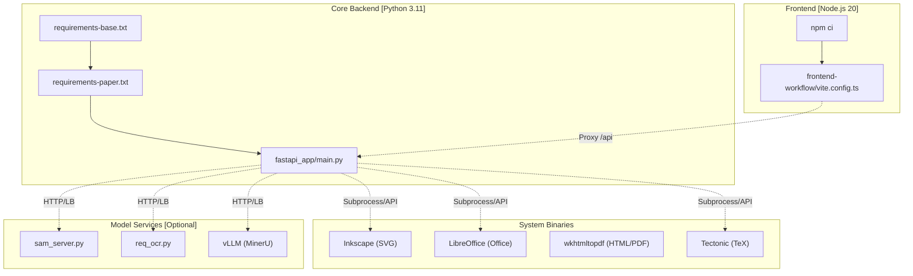
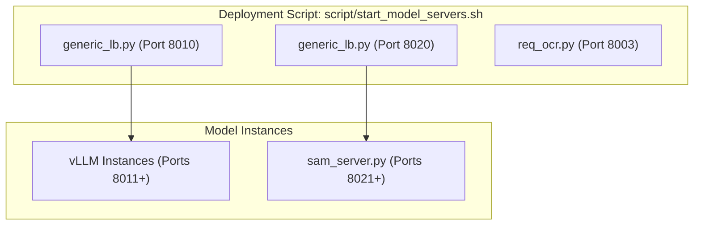

<!-- source: DeepWiki mcp.deepwiki.com · repo OpenDCAI/Paper2Any · page 2.1 Installation · fetched 2026-11-02 -->

# Installation

<details>
<summary>Relevant source files</summary>

The following files were used as context for generating this wiki page:

- [.dockerignore](.dockerignore)
- [Dockerfile](Dockerfile)
- [database/00_cleanup.sql](database/00_cleanup.sql)
- [docs/contributing.md](docs/contributing.md)
- [docs/guides/index.md](docs/guides/index.md)
- [docs/guides/open_source_deployment.md](docs/guides/open_source_deployment.md)
- [docs/index.md](docs/index.md)
- [docs/installation.md](docs/installation.md)
- [docs/quickstart.md](docs/quickstart.md)
- [mkdocs.yml](mkdocs.yml)
- [requirements-base.txt](requirements-base.txt)
- [requirements-paper.txt](requirements-paper.txt)
- [requirements-win-base.txt](requirements-win-base.txt)

</details>


This document provides comprehensive installation instructions for Paper2Any, covering system requirements, dependency installation, and setup procedures across different platforms. Paper2Any is a multimodal document processing system that requires a combination of Python, Node.js, and specific system-level binaries to handle document conversion and AI model serving.

---

## Overview

Paper2Any can be deployed in multiple configurations ranging from minimal (core workflows only) to complete (with local GPU model servers). The installation process consists of:

1.  **Python environment setup** - Core dependencies for the DataFlow-Agent framework and FastAPI backend.
2.  **System dependencies** - LaTeX engines, vector graphics tools (Inkscape), and document converters (LibreOffice).
3.  **Frontend installation** - React/Vite web interface.
4.  **Model servers** - Local GPU services for PDF parsing (MinerU), segmentation (SAM), and OCR (optional).

The system is designed with progressive enhancement: you can start with minimal dependencies and add components as needed.

---

## Installation Dependency Hierarchy

The following diagram illustrates the relationship between the various components and their underlying code entities.

**Code Entity Mapping: Installation Components**



**Sources**: [docs/installation.md:12-28](), [docs/guides/open_source_deployment.md:11-25](), [requirements-paper.txt:1-48]()

---

## System Requirements

### Minimum Requirements

| Component | Specification |
|-----------|--------------|
| **Operating System** | Linux (Ubuntu 22.04+ Recommended), Windows 10/11 |
| **Python** | 3.11 (Strictly recommended for backend) |
| **Node.js** | 20.x (LTS) |
| **RAM** | 8GB minimum (16GB+ for local models) |
| **Disk Space** | 10GB for dependencies + models |

### GPU Requirements (Optional)

For local model servers only:

| Model Server | GPU Memory | Role |
|--------------|------------|------|
| **MinerU (vLLM)** | 8GB+ | PDF Layout & Content Extraction |
| **SAM (Segment Anything)** | 4GB+ | Image/Diagram Segmentation |
| **OCR** | CPU/GPU | Text Recognition |

**Sources**: [docs/installation.md:29-38](), [docs/guides/open_source_deployment.md:143-165]()

---

## Installation Methods

### Method 1: Docker Deployment (Recommended)

Docker provides the fastest path to a working installation with all system dependencies pre-configured in a `python:3.11-slim` environment.

```bash
# 1. Clone repository
git clone https://github.com/OpenDCAI/Paper2Any.git
cd Paper2Any

# 2. Build and start services
docker compose up -d --build
```

The `Dockerfile` handles the installation of critical system packages:
- `build-essential`, `curl`, `git`, `wget`
- `inkscape`, `libreoffice`, `poppler-utils`
- `libgl1`, `libglib2.0-0` (for OpenCV)
- `wkhtmltopdf` (downloaded and installed via .deb)

**Sources**: [Dockerfile:1-41](), [docs/guides/open_source_deployment.md:130-141]()

---

### Method 2: Linux Native Installation

#### Step 1: Python Environment Setup

```bash
# Create conda environment
conda create -n paper2any python=3.11 -y
conda activate paper2any

# Install dependencies
pip install --upgrade pip
pip install -r requirements-paper.txt || pip install -r requirements-paper-backup.txt

# Optional: Install in editable mode for development
pip install -e .
```

**Sources**: [docs/installation.md:66-82](), [requirements-paper.txt:1-48]()

#### Step 2: System Dependencies

The backend relies on several external binaries for document conversion. On Ubuntu/Debian, install them via:

```bash
sudo apt-get update
sudo apt-get install -y \
  inkscape \
  libreoffice \
  poppler-utils \
  tectonic \
  libsndfile1 \
  libgl1
```

| Package | Purpose | Code Usage |
|---------|---------|------------|
| `inkscape` | SVG to PNG/PDF conversion | Vector graphics workflows |
| `libreoffice` | Office to PDF conversion | PPT generation/polishing |
| `tectonic` | Modern TeX engine | LaTeX/Beamer generation in Paper2Video |
| `wkhtmltopdf` | HTML to PDF conversion | Report generation |

**Sources**: [docs/installation.md:39-65](), [requirements-paper.txt:10-15]()

#### Step 3: Frontend Installation

The frontend is a React application built with Vite.

```bash
cd frontend-workflow
npm ci
```

The frontend communicates with the backend via a proxy defined in `vite.config.ts`. In development mode (`npm run dev`), requests to `/api` are routed to `http://localhost:8000`.

**Sources**: [docs/installation.md:84-90](), [docs/guides/open_source_deployment.md:64-77]()

---

### Method 3: Windows Native Installation

Windows installation requires specific versions of dependencies, primarily managed through `requirements-win-base.txt`.

```bash
# Create environment
conda create -n paper2any python=3.12 -y
conda activate paper2any

# Install Windows-specific requirements
pip install -r requirements-win-base.txt
```

**Note**: Windows users must manually install Inkscape and add the `bin` folder to the system PATH for the backend to find the executable.

**Sources**: [requirements-win-base.txt:1-92](), [docs/quickstart.md:19-29]()

---

## Model Server Installation (Optional)

For production or full-local environments, you must deploy the model servers. These are orchestrated by `script/start_model_servers.sh`.

### Deployment Topology



### Installation Steps:
1.  **Prepare Models**: Run `bash script/prepare_local_models.sh` to download necessary weights (e.g., RMBG-2.0).
2.  **Configure Profiles**: Edit `deploy/profiles/nv.env` to specify GPU IDs and ports.
3.  **Start Servers**: Run `bash script/start_model_servers.sh`.

The script will automatically generate `logs/model_servers.env` which the FastAPI backend reads to locate these services.

**Sources**: [docs/guides/open_source_deployment.md:31-46](), [docs/installation.md:92-104](), [docs/quickstart.md:101-110]()

---

## Summary of Installation Steps

| Step | Action | Command / File |
|------|--------|----------------|
| 1 | Clone Repo | `git clone ...` |
| 2 | Python Env | `conda create -n paper2any python=3.11` |
| 3 | Backend Deps | `pip install -r requirements-paper.txt` |
| 4 | System Deps | `sudo apt-get install inkscape libreoffice ...` |
| 5 | Frontend Deps | `cd frontend-workflow && npm ci` |
| 6 | Config | `cp fastapi_app/.env.example fastapi_app/.env` |
| 7 | Models (Opt) | `bash script/start_model_servers.sh` |

**Sources**: [docs/quickstart.md:10-84](), [docs/guides/open_source_deployment.md:202-234]()

---

