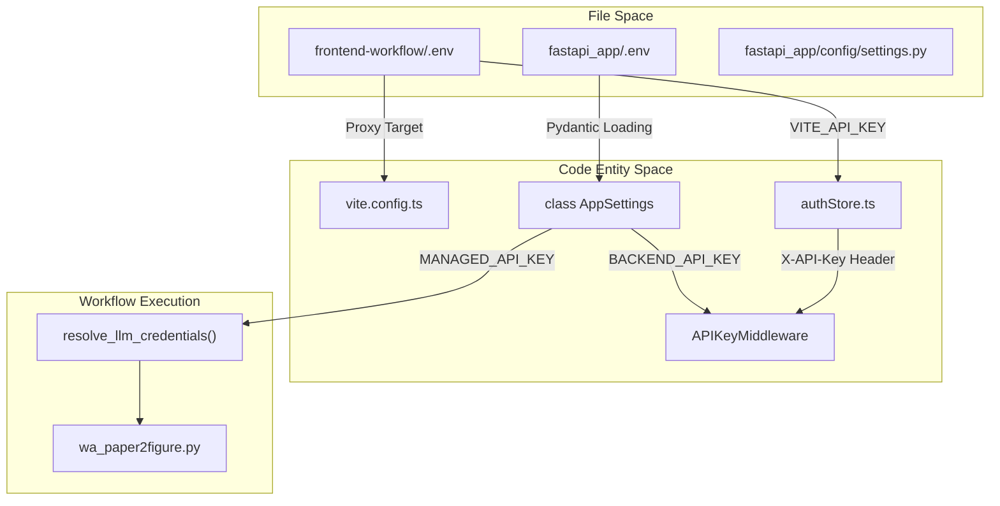
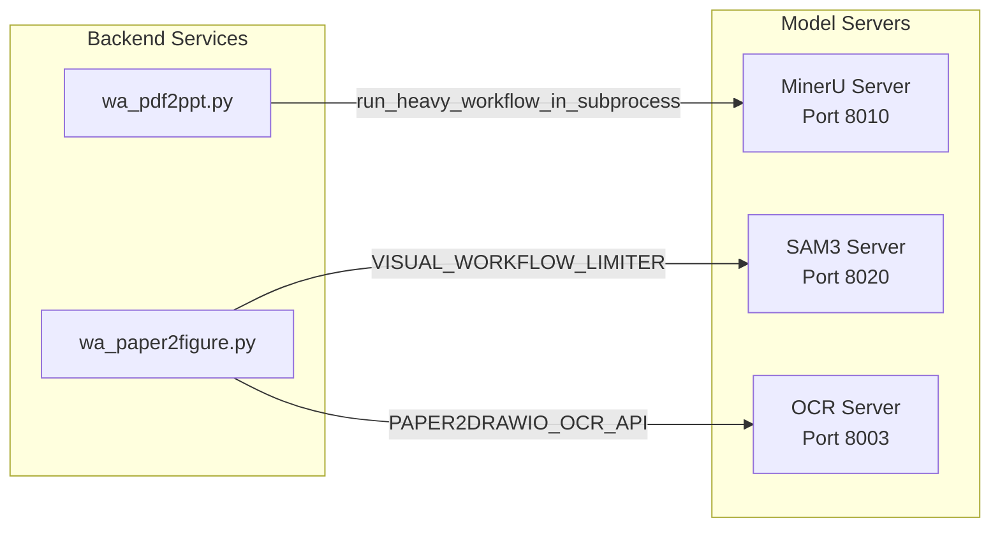

<!-- source: DeepWiki mcp.deepwiki.com · repo OpenDCAI/Paper2Any · page 2.2 Configuration · fetched 2026-11-02 -->

# Configuration

Relevant source files

The following files were used as context for generating this wiki page:

- [dataflow_agent/toolkits/multimodaltool/req_img.py](dataflow_agent/toolkits/multimodaltool/req_img.py)
- [dataflow_agent/toolkits/multimodaltool/utils.py](dataflow_agent/toolkits/multimodaltool/utils.py)
- [dataflow_agent/workflow/wf_paper2figure_image_only.py](dataflow_agent/workflow/wf_paper2figure_image_only.py)
- [dataflow_agent/workflow/wf_pdf2ppt_qwenvl.py](dataflow_agent/workflow/wf_pdf2ppt_qwenvl.py)
- [docs/contributing.md](docs/contributing.md)
- [docs/guides/index.md](docs/guides/index.md)
- [docs/guides/open_source_deployment.md](docs/guides/open_source_deployment.md)
- [docs/index.md](docs/index.md)
- [docs/installation.md](docs/installation.md)
- [docs/quickstart.md](docs/quickstart.md)
- [fastapi_app/.env.example](fastapi_app/.env.example)
- [fastapi_app/config/settings.py](fastapi_app/config/settings.py)
- [fastapi_app/services/image2ppt_service.py](fastapi_app/services/image2ppt_service.py)
- [fastapi_app/services/paper2any_service.py](fastapi_app/services/paper2any_service.py)
- [fastapi_app/workflow_adapters/wa_paper2figure.py](fastapi_app/workflow_adapters/wa_paper2figure.py)
- [fastapi_app/workflow_adapters/wa_pdf2ppt.py](fastapi_app/workflow_adapters/wa_pdf2ppt.py)
- [frontend-workflow/.env.example](frontend-workflow/.env.example)
- [mkdocs.yml](mkdocs.yml)

This page explains the configuration system for Paper2Any, which uses a multi-tier approach to manage internal API security, LLM provider settings, billing modes, and model service orchestration.

---

## Configuration Overview

Paper2Any's configuration is distributed across four primary file types to separate frontend presentation, backend business logic, deployment environment parameters, and model server allocations.

| File Path | Purpose | Key Variables |
|-----------|---------|---------------|
| `fastapi_app/.env` | Backend business logic & API keys | `BACKEND_API_KEY`, `APP_BILLING_MODE`, `DF_API_KEY` |
| `frontend-workflow/.env` | Frontend UI defaults & API routing | `VITE_API_KEY`, `VITE_DEFAULT_LLM_MODEL` |
| `deploy/profiles/*.env` | Machine-specific deployment params | `PORT`, `PYTHON_PATH`, `GPU_IDS` |
| `logs/model_servers.env` | Model service runtime state | Generated by `start_model_servers.sh` |

### Configuration Data Flow

The following diagram illustrates how configuration values are loaded and consumed by different system entities, bridging the gap between environment files and code execution.

**Sources:** [fastapi_app/config/settings.py:1-21](), [fastapi_app/.env.example:1-33](), [frontend-workflow/.env.example:1-15]()

---

## Backend Configuration (`fastapi_app/.env`)

The backend uses a three-tier model configuration system defined in `AppSettings` [fastapi_app/config/settings.py:21-28](). This allows for global fallbacks, workflow-specific defaults, and role-based overrides.

### API Key Setup
- **`BACKEND_API_KEY`**: Protects the FastAPI endpoints. The frontend `VITE_API_KEY` must match this exactly [fastapi_app/.env.example:25-28]().
- **`DF_API_KEY` / `DF_API_URL`**: Global fallback for LLM services if specific workflow keys are missing [fastapi_app/.env.example:43-47]().

### Billing & Managed Modes
The system supports two primary billing modes via `APP_BILLING_MODE` [fastapi_app/config/settings.py:94]():

1.  **`paid`**: Users must provide their own API keys in the frontend. The platform does not deduct internal points [fastapi_app/.env.example:31]().
2.  **`free`**: All API calls use the keys configured in the backend `.env`. Usage is restricted by the internal points system defined in `pricing.yaml` [fastapi_app/.env.example:32-33]().

### Managed API Credentials
In `free` mode, credentials are resolved using `resolve_llm_credentials()` and `resolve_image_generation_credentials()` [fastapi_app/services/managed_api_service.py:1-20](). You can configure unique keys for every workflow (e.g., `PAPER2PPT_MANAGED_API_KEY`) to prevent a single key failure from affecting all services [fastapi_app/.env.example:51-98]().

**Sources:** [fastapi_app/config/settings.py:30-94](), [fastapi_app/.env.example:1-98](), [fastapi_app/services/paper2any_service.py:17-20]()

---

## Frontend Configuration (`frontend-workflow/.env`)

The frontend configuration primarily handles UI defaults and the connection to the backend.

### Connection Settings
- **`VITE_API_BASE_URL`**: The URL of the FastAPI backend. If using the Vite proxy (default for development), this should be left empty [frontend-workflow/.env.example:12-15]().
- **`VITE_API_KEY`**: Internal communication key [frontend-workflow/.env.example:10]().

### Model Selection Defaults
These variables set the initial values in the UI dropdowns. Users can override these if the backend is in `paid` mode.

| Variable | Workflow | Default Value |
|----------|----------|---------------|
| `VITE_PAPER2PPT_MODEL` | Paper2PPT | `gpt-5.4,gpt-5.1` |
| `VITE_PAPER2FIGURE_MODEL_TECH_ROUTE` | Tech Route | `gpt-5.4,gpt-5.2` |
| `VITE_IMAGE2DRAWIO_VLM_MODEL` | Image2Drawio | `qwen-vl-ocr-2025-11-20` |

**Sources:** [frontend-workflow/.env.example:1-67]()

---

## Supabase & User Management

Supabase is optional but required for authentication, cloud history, and the points system.

### Configuration Variables
Both frontend and backend require Supabase credentials:
- `SUPABASE_URL`: Your project endpoint [fastapi_app/config/settings.py:110]().
- `SUPABASE_ANON_KEY`: Client-side key for public access [fastapi_app/config/settings.py:111]().
- `SUPABASE_SERVICE_ROLE_KEY`: (Backend only) High-privilege key for bypassing RLS [fastapi_app/config/settings.py:112]().

### Points System Integration
When `APP_BILLING_MODE=free`, the backend checks the user's points balance in Supabase (or a local SQLite fallback `guest_quota.sqlite3`) before executing workflows [fastapi_app/config/settings.py:94-96]().

**Sources:** [fastapi_app/config/settings.py:110-116](), [frontend-workflow/.env.example:69-75]()

---

## Model Service Orchestration

Complex workflows like `pdf2ppt_qwenvl` or `paper2fig_with_sam` require heavy lifting from local or remote model servers.

### Key Service Settings
- **MinerU**: Configured via `MINERU_API_KEY` (for remote) or `MINERU_PORT` (for local) [fastapi_app/config/settings.py:126-127](), [fastapi_app/.env.example:185-194]().
- **SAM3**: Uses `AsyncInterProcessSemaphore` named `sam3_visual_workflows` to prevent GPU OOM by limiting concurrent segmentation tasks to 1 [fastapi_app/services/paper2any_service.py:29-30](), [fastapi_app/services/image2ppt_service.py:20]().
- **OCR**: `PAPER2DRAWIO_OCR_API_URL` defaults to DashScope's compatible-mode endpoint [fastapi_app/config/settings.py:124]().

**Sources:** [fastapi_app/workflow_adapters/wa_paper2figure.py:30-33](), [fastapi_app/services/paper2any_service.py:29-30](), [dataflow_agent/workflow/wf_pdf2ppt_qwenvl.py:4-13]()

---

