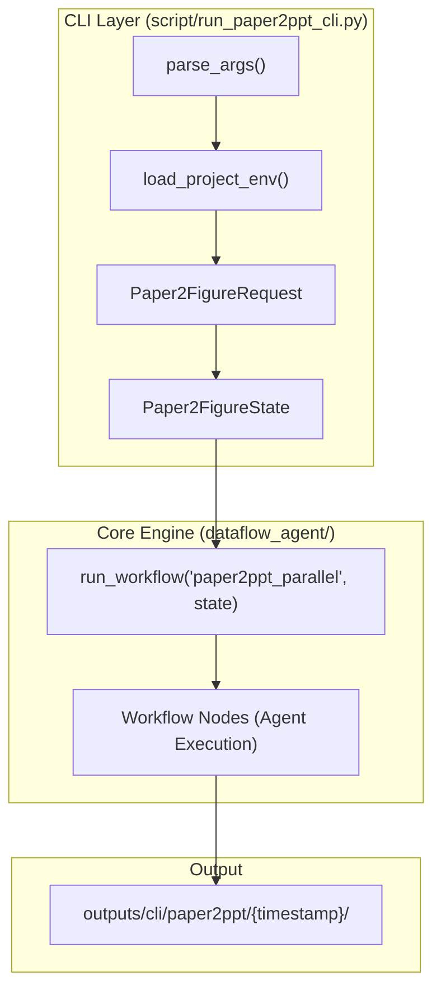
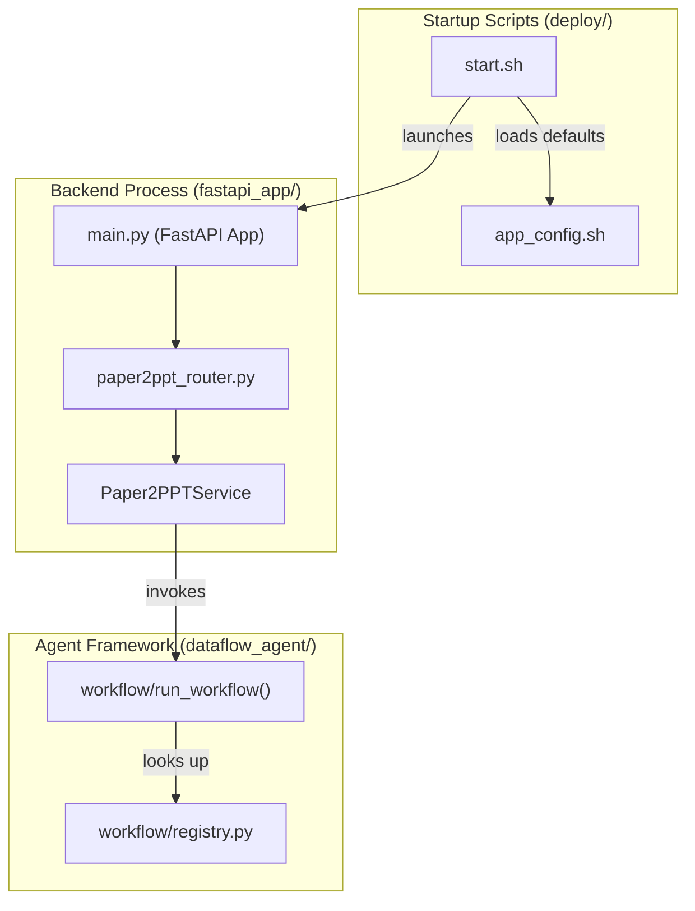

<!-- source: DeepWiki mcp.deepwiki.com · repo OpenDCAI/Paper2Any · page 2.3 Quick Start · fetched 2026-11-02 -->

# Quick Start

<details>
<summary>Relevant source files</summary>

The following files were used as context for generating this wiki page:

- [dataflow_agent/toolkits/p2vtool/1_merge.bash](dataflow_agent/toolkits/p2vtool/1_merge.bash)
- [deploy/app_config.sh](deploy/app_config.sh)
- [deploy/start.sh](deploy/start.sh)
- [deploy/stop.sh](deploy/stop.sh)
- [docs/contributing.md](docs/contributing.md)
- [docs/guides/index.md](docs/guides/index.md)
- [docs/guides/open_source_deployment.md](docs/guides/open_source_deployment.md)
- [docs/index.md](docs/index.md)
- [docs/installation.md](docs/installation.md)
- [docs/quickstart.md](docs/quickstart.md)
- [fastapi_app/__init__.py](fastapi_app/__init__.py)
- [fastapi_app/interprocess_lock.py](fastapi_app/interprocess_lock.py)
- [mkdocs.yml](mkdocs.yml)
- [script/run_image2ppt_cli.py](script/run_image2ppt_cli.py)
- [script/run_paper2figure_cli.py](script/run_paper2figure_cli.py)
- [script/run_paper2ppt_cli.py](script/run_paper2ppt_cli.py)
- [script/run_pdf2ppt_cli.py](script/run_pdf2ppt_cli.py)
- [script/run_ppt2polish_cli.py](script/run_ppt2polish_cli.py)
- [tests/test_paper2ppt_generate_route.py](tests/test_paper2ppt_generate_route.py)

</details>


This page walks through running the Paper2Any application locally using the provided deployment scripts, executing your first workflows via the web UI and CLI, and understanding the three primary deployment routes.

---

## 1. Deployment Routes

Paper2Any supports three deployment strategies depending on your hardware availability and use case.

| Route | Description | Target Audience | Key Components |
| :--- | :--- | :--- | :--- |
| **Minimal** | Uses cloud LLMs for all logic and image generation. No local GPUs required. | New users, rapid prototyping | FastAPI, React, OpenAI/Gemini/DeepSeek APIs |
| **Full Local** | Deploys local model servers (MinerU, SAM3, OCR) for high-performance parsing and segmentation. | Power users, privacy-focused | Local GPUs, `start_model_servers.sh` |
| **Docker** | Containerized environment for consistent deployment across systems. | Production, DevOps | Docker Compose, `Dockerfile` |

Sources: [docs/index.md:57-72](), [docs/quickstart.md:10-109]()

---

## 2. Local Setup & Service Startup

### 2.1 Backend Initialization
The backend is a FastAPI application that orchestrates the `DataFlow-Agent` framework.

1. **Environment**: Use Python 3.11.
2. **Configuration**: Copy `fastapi_app/.env.example` to `fastapi_app/.env` and provide your `DF_API_KEY`.
3. **Execution**: Run `bash deploy/start.sh`.

**Implementation Detail**: `deploy/start.sh` performs the following:
- **Environment Validation**: Calls `validate_python` to check for critical dependencies like `cv2`, `fastapi`, and `torch` [deploy/start.sh:24-38]().
- **Asset Resolution**: Locates local model weights (SAM3, RMBG) using `prepare_runtime_env` [deploy/start.sh:51-115]().
- **Process Management**: Starts `uvicorn` with `setsid` and `nohup` to detach the process from the shell, saving the PID to `logs/uvicorn.pid` [deploy/start.sh:209-252]().

### 2.2 Frontend Initialization
The frontend is a React application built with Vite.

1. **Environment**: Node.js 20+.
2. **Configuration**: Copy `frontend-workflow/.env.example` to `frontend-workflow/.env`.
3. **Execution**: Run `bash deploy/start_frontend.sh`.

**Service Interaction**:
- **Frontend**: `http://127.0.0.1:3000`
- **Backend API**: `http://127.0.0.1:8000`
- **Health Check**: `http://127.0.0.1:8000/health`

Sources: [docs/quickstart.md:19-88](), [deploy/start.sh:6-260]()

---

## 3. Executing First Workflows

### 3.1 Web UI Execution (Paper2PPT)
The most common entry point is the Paper2PPT workflow.

1. **Upload**: Provide a PDF or topic description.
2. **Outline**: The system generates a structured outline using the `Paper2PPTFrontendService` [fastapi_app/services/paper2ppt_frontend_service.py:15-15]().
3. **Generate**: Slides are generated in parallel. The UI tracks progress via the backend's status updates.

### 3.2 CLI Execution
For automation, Paper2Any provides dedicated CLI scripts in the `script/` directory. These scripts bypass the web UI and call `run_workflow` directly.

**Example: Paper2PPT CLI**
```bash
python script/run_paper2ppt_cli.py --input paper.pdf --page-count 15 --language zh
```

**Data Flow in CLI**:


Sources: [script/run_paper2ppt_cli.py:40-230](), [script/run_image2ppt_cli.py:154-209]()

---

## 4. System Runtime Architecture

The following diagram bridges the high-level startup commands to the internal code entities.



**Key Code Entities**:
- `app_config.sh`: Centralized shell configuration for ports, hosts, and environment variables [deploy/app_config.sh:1-32]().
- `fastapi_app.main:app`: The primary FastAPI instance entry point [fastapi_app/__init__.py:30-41]().
- `run_workflow`: The universal entry point for executing any registered graph [script/run_paper2ppt_cli.py:26-26]().

Sources: [deploy/app_config.sh:1-32](), [fastapi_app/__init__.py:30-41](), [deploy/start.sh:209-215]()

---

## 5. Deployment Cleanup

To stop all running services and release occupied ports:
```bash
bash deploy/stop.sh
```

**Implementation Detail**: `deploy/stop.sh` is aggressive. It first attempts to terminate processes using PIDs from `logs/uvicorn.pid`. If that fails, it uses `lsof`, `ss`, or `netstat` to find any process listening on `APP_PORT` and issues a `SIGTERM` followed by `SIGKILL` if necessary [deploy/stop.sh:61-147]().

Sources: [deploy/stop.sh:1-164]()

---

