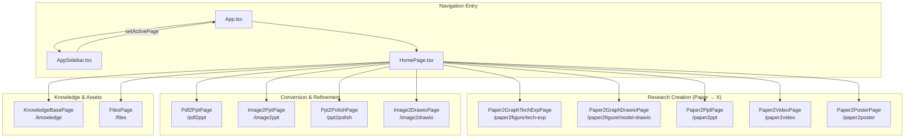
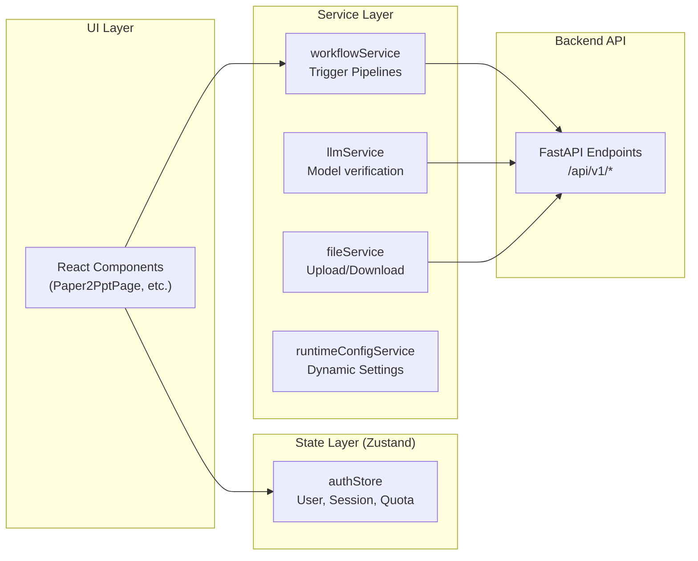

<!-- source: DeepWiki mcp.deepwiki.com · repo OpenDCAI/Paper2Any · page 3 Frontend Application · fetched 2026-11-02 -->

# Frontend Application

Relevant source files

The following files were used as context for generating this wiki page:

- [frontend-workflow/src/App.tsx](frontend-workflow/src/App.tsx)
- [frontend-workflow/src/components/AppSidebar.tsx](frontend-workflow/src/components/AppSidebar.tsx)
- [frontend-workflow/src/components/HomePage.tsx](frontend-workflow/src/components/HomePage.tsx)
- [frontend-workflow/src/config/homePageCatalog.ts](frontend-workflow/src/config/homePageCatalog.ts)
- [frontend-workflow/src/i18n.ts](frontend-workflow/src/i18n.ts)
- [frontend-workflow/src/locales/en/common.json](frontend-workflow/src/locales/en/common.json)
- [frontend-workflow/src/locales/zh/common.json](frontend-workflow/src/locales/zh/common.json)

## Purpose and Scope

This document describes the React-based web frontend for Paper2Any, which provides an interactive user interface for document conversion workflows. The frontend is a single-page application (SPA) built with React, TypeScript, and Vite, running on port 3000 by default. It serves as a visual orchestration layer for the [DataFlow-Agent Framework](#5), allowing users to upload papers and trigger complex multi-agent pipelines.

For backend API details, see [Backend API](#4). For specific workflow implementations, see [Paper2Any Workflows](#6). For authentication database schemas, see [Supabase Setup](#12.4).

---

## Technology Stack and Architecture

The frontend application uses the following core technologies:

| Technology | Purpose | Version |
|------------|---------|---------|
| **React** | UI framework | 18.x |
| **TypeScript** | Type-safe JavaScript | 5.x |
| **Vite** | Build tool and dev server | Latest |
| **Zustand** | State management | Latest |
| **i18next** | Internationalization | Latest |
| **Tailwind CSS** | Styling framework | 3.x |
| **Lucide React** | Icon library | Latest |

The application follows a component-based architecture with a glassmorphism design language, emphasizing a dark, modern research console aesthetic.

**Sources:** [frontend-workflow/src/App.tsx:177-182](), [frontend-workflow/src/i18n.ts:1-41]()

---

## Navigation and Routing

The application uses a custom routing mechanism based on `window.location.pathname` and `window.history.pushState` to manage navigation between various workflow pages without a full page reload.

### Application Routing Map

**Sources:** [frontend-workflow/src/App.tsx:29-75](), [frontend-workflow/src/App.tsx:159-174](), [frontend-workflow/src/config/homePageCatalog.ts:1-19]()

---

## Core Components

### Home Page Catalog
The `HomePage` serves as the central hub, categorized into three functional sections: **Creation** (generating from content), **Conversion** (processing existing assets), and **Research** (tracking and management). It uses `featuredHomeCards` and `homeFeatureSections` to render visual entry points with live previews (images, GIFs, or videos).

[frontend-workflow/src/config/homePageCatalog.ts:112-116]()
[frontend-workflow/src/components/HomePage.tsx:101-118]()

### App Sidebar
The `AppSidebar` provides persistent navigation with a hierarchical menu. It features sub-menus for complex categories like `paper2figure` (Tech Route, Model Diagram, AI Drawio) and `paper2ppt` (Image-style vs Editable).

[frontend-workflow/src/components/AppSidebar.tsx:41-88]()

### UI Component Details
For detailed documentation on the design language, upload cards, and specific page layouts, see **[User Interface Components](#3.1)**.

---

## Authentication and User Management

The frontend integrates with **Supabase** for user authentication, supporting:
*   **Email & Phone OTP**: Secure login via one-time passwords.
*   **Anonymous Mode**: Allows limited usage without an account, tracking quota via `localStorage`.
*   **AuthGate**: A higher-order component that protects specific routes and manages the login/registration state.

For implementation details, see **[Authentication & User Management](#3.2)**.

**Sources:** [frontend-workflow/src/App.tsx:131-133](), [frontend-workflow/src/locales/zh/common.json:177-185]()

---

## Quota and Points System

Paper2Any uses a points-based system to manage resource consumption. The frontend displays remaining quota in the header and enforces limits before triggering backend workflows.
*   **Daily Grants**: Automatic point resets for authenticated users.
*   **Usage Tracking**: Real-time updates after successful workflow execution.
*   **Pricing Modes**: Configurable via environment variables for free, paid, or managed billing.

For details on the points ledger and quota enforcement, see **[Quota & Points System](#3.3)**.

**Sources:** [frontend-workflow/src/App.tsx:21-22](), [frontend-workflow/src/locales/zh/common.json:10-10]()

---

## State Management and Services

The application manages global state using **Zustand** and abstracts backend interactions into a service layer.

### Frontend Service Architecture

For details on the `authStore` and API interaction patterns, see **[State Management](#3.4)**.

**Sources:** [frontend-workflow/src/App.tsx:1-27](), [frontend-workflow/src/i18n.ts:47-83]()

---

## Internationalization (i18n)

The frontend supports English (`en`) and Chinese (`zh`) through `i18next`. Translation files are modularized by feature (e.g., `paper2ppt.json`, `mindmap.json`).

[frontend-workflow/src/i18n.ts:5-31]()

**Sources:** [frontend-workflow/src/locales/en/common.json:1-12](), [frontend-workflow/src/locales/zh/common.json:1-12]()

---

